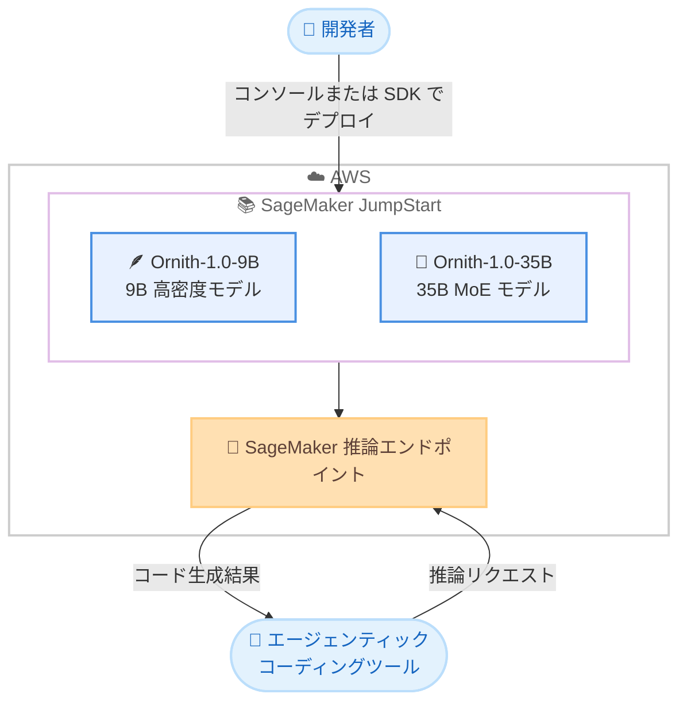

# Amazon SageMaker JumpStart - Ornith-1.0-9B および Ornith-1.0-35B モデルの提供開始

**リリース日**: 2026 年 11 月 11 日
**サービス**: Amazon SageMaker JumpStart
**機能**: DeepReinforce AI の Ornith-1.0-9B および Ornith-1.0-35B モデルの提供

📊 [このアップデートのインフォグラフィックを見る](https://takech9203.github.io/aws-news-summary/20261111-ornith-1-0-9b-ornith-1-0-35b-on-sagemaker-jumpstart.html)

## 概要

DeepReinforce AI の Ornith-1.0-9B および Ornith-1.0-35B モデルが Amazon SageMaker JumpStart で利用可能になりました。これにより、AWS のお客様が利用できる基盤モデルのポートフォリオがさらに拡大します。

これら 2 つのモデルは、MIT ライセンスで公開されたオープンソースの自己スキャフォールディング型エージェンティックコーディングモデル「Ornith 1.0」ファミリーの一部です。Terminal-Bench 2.1、SWE-Bench、NL2Repo、OpenClaw といったコーディングベンチマークにおいて、同規模のオープンソースモデルの中で最高水準の性能を達成しています。

SageMaker JumpStart を利用することで、お客様は数クリックでこれらのモデルをデプロイし、エージェンティックコーディングをはじめとする AI ユースケースに活用できます。

**アップデート前の課題**

- Ornith 1.0 ファミリーのモデルを AWS 上で利用するには、モデルの取得、推論環境の構築、サービングの設定を独自に行う必要があった
- エージェンティックコーディング向けに最適化されたオープンソースモデルを、マネージドな環境で簡単に試す手段が限られていた
- モデルごとに異なるデプロイ手順を調査・検証する運用負荷が発生していた

**アップデート後の改善**

- SageMaker JumpStart のモデルカタログから数クリックで Ornith-1.0-9B / 35B をデプロイできるようになった
- SageMaker Python SDK を使用したプログラムによるデプロイにも対応し、CI/CD やエージェントワークフローへの組み込みが容易になった
- 軽量な 9B 高密度モデルと、より高性能な 35B MoE モデルという 2 つの選択肢から、ワークロードに応じてモデルを選択できるようになった

## アーキテクチャ図



SageMaker JumpStart のモデルカタログから Ornith-1.0 ファミリーのモデルを選択し、SageMaker 推論エンドポイントとしてデプロイする流れを示しています。デプロイ後は、エージェンティックコーディングツールなどからエンドポイント経由で推論を実行できます。

## サービスアップデートの詳細

### 主要機能

1. **Ornith-1.0-9B: 軽量な 9B パラメータ高密度モデル**
   - Qwen 3.5 9B をベースにポストトレーニングされた高密度 (dense) モデル
   - 256K トークンのコンテキストウィンドウと 32 のデコーダーレイヤーを搭載
   - 単一 GPU での効率的なデプロイを想定した設計で、コンシューマー向けハードウェアを搭載したラップトップでも動作可能
   - 個人開発者や小規模チームが単一 GPU 上でエージェンティックコーディングワークフローを実行するユースケースに適合

2. **Ornith-1.0-35B: 35B パラメータ MoE モデル**
   - Qwen 3.5 をベースにポストトレーニングされた Mixture-of-Experts アーキテクチャのモデル
   - より強力なエージェンティックコーディング性能を提供しながら、24GB のコンシューマー向け GPU 1 基でデプロイ可能
   - トークンごとにパラメータの一部のみをアクティブ化する MoE アーキテクチャにより、品質と効率のバランスを実現
   - 本番環境のエージェンティックコーディングワークロードに適合

3. **自己改善型トレーニングフレームワーク**
   - 強化学習を用いて、スキャフォールド生成とソリューションロールアウトを同時に最適化
   - モデル自身がより優れた探索軌跡を発見し、高品質なコードソリューションを生成
   - 両モデルとも同一のアプローチを採用し、コーディングタスクを駆動するスキャフォールドと生成結果の双方を改善

4. **SageMaker JumpStart による簡単なデプロイ**
   - SageMaker コンソールのモデルカタログから数クリックでデプロイ可能
   - SageMaker Python SDK を使用したプログラムによるデプロイにも対応

## 技術仕様

### モデル比較

| 項目 | Ornith-1.0-9B | Ornith-1.0-35B |
|------|---------------|----------------|
| アーキテクチャ | 高密度 (dense) | Mixture-of-Experts |
| パラメータ数 | 9B | 35B |
| ベースモデル | Qwen 3.5 9B | Qwen 3.5 |
| コンテキストウィンドウ | 256K トークン | 公式発表に記載なし |
| デコーダーレイヤー | 32 | 公式発表に記載なし |
| 想定 GPU 要件 | 単一 GPU (ラップトップ含む) | 24GB コンシューマー GPU 1 基 |
| 主な用途 | 個人開発者・小規模チームのエージェンティックコーディング | 本番環境のエージェンティックコーディング |
| ライセンス | MIT | MIT |

### ベンチマーク

公式発表によると、両モデルは以下のコーディングベンチマークにおいて、同規模のオープンソースモデルの中で最高水準 (state-of-the-art) の性能を達成しています。

- Terminal-Bench 2.1
- SWE-Bench
- NL2Repo
- OpenClaw

## 設定方法

### 前提条件

1. AWS アカウントと SageMaker を利用できる IAM 権限
2. SageMaker Studio または SageMaker Python SDK の実行環境
3. デプロイ先リージョンにおける推論インスタンスのクォータ

### 手順

#### ステップ1: SageMaker JumpStart モデルカタログでモデルを検索

SageMaker コンソールから SageMaker Studio を開き、JumpStart のモデルカタログで「Ornith」を検索します。Ornith-1.0-9B または Ornith-1.0-35B を選択し、モデルの詳細を確認します。

#### ステップ2: モデルをデプロイ

コンソールの場合は、モデル詳細ページで [デプロイ] を選択し、エンドポイント名とインスタンスタイプを指定してデプロイします。

SageMaker Python SDK を使用する場合の例は以下のとおりです。

```python
from sagemaker.jumpstart.model import JumpStartModel

# JumpStart のモデル ID を指定してモデルを作成し、エンドポイントにデプロイする
model = JumpStartModel(model_id="<Ornith モデルの JumpStart モデル ID>")
predictor = model.deploy()
```

このコードは、JumpStart カタログ上のモデルを SageMaker 推論エンドポイントとしてデプロイします。実際のモデル ID はカタログ上の表記を確認してください。

#### ステップ3: 推論を実行

```python
# デプロイしたエンドポイントに対して推論リクエストを送信する
response = predictor.predict({
    "inputs": "Python で CSV ファイルを読み込み、列ごとの平均値を計算する関数を書いてください。"
})
print(response)
```

デプロイしたエンドポイントに対してプロンプトを送信し、コード生成結果を取得します。

## メリット

### ビジネス面

- **導入コストの低減**: MIT ライセンスのオープンソースモデルであり、マネージドな環境で迅速に評価・導入できる
- **開発生産性の向上**: エージェンティックコーディングに特化したモデルにより、コード生成や修正タスクの自動化を促進できる
- **スモールスタートが可能**: 軽量な 9B モデルから始めて、必要に応じて 35B モデルへ移行する段階的な導入ができる

### 技術面

- **デプロイの簡素化**: SageMaker JumpStart により、モデル取得やサービング環境構築の手間なく数クリックでデプロイできる
- **効率的な推論**: 35B モデルは MoE アーキテクチャによりトークンごとに一部のパラメータのみをアクティブ化し、品質と効率を両立する
- **長いコンテキストへの対応**: 9B モデルは 256K トークンのコンテキストウィンドウを備え、大規模なコードベースを扱うワークフローに対応できる

## デメリット・制約事項

### 制限事項

- 公式発表には利用可能リージョンの記載がなく、JumpStart カタログでの提供状況の確認が必要
- 公式発表には SageMaker 上での推奨インスタンスタイプの記載がない
- ベンチマーク性能は「同規模のオープンソースモデル」との比較であり、より大規模な商用モデルとの比較ではない

### 考慮すべき点

- エージェンティックコーディング用途に特化したモデルであり、汎用的な対話や他ドメインのタスクへの適性は別途評価が必要
- SageMaker 推論エンドポイントは起動中は課金が継続するため、利用しない時間帯の停止やオートスケーリングの設計が重要
- 生成されたコードの品質・セキュリティはレビュープロセスで担保する運用が推奨される

## ユースケース

### ユースケース1: 個人開発者・小規模チームのコーディングアシスタント

**シナリオ**: 小規模な開発チームが、コスト効率の高いエージェンティックコーディング環境を SageMaker 上に構築したい。

**実装例**:
```
1. SageMaker JumpStart から Ornith-1.0-9B をデプロイ
2. 開発ツールからエンドポイントを呼び出し、コード生成・修正タスクを実行
3. 256K トークンのコンテキストを活用し、リポジトリ全体の情報を含めて推論
```

**効果**: 軽量モデルによる低コスト運用と、長いコンテキストを活かしたリポジトリ規模のコーディング支援を両立できる。

### ユースケース2: 本番環境のエージェンティックコーディングワークロード

**シナリオ**: CI/CD パイプラインに組み込んだコード修正エージェントで、より高い精度のコード生成が必要。

**実装例**:
```
1. SageMaker JumpStart から Ornith-1.0-35B をデプロイ
2. CI/CD パイプラインの自動修正ステップからエンドポイントを呼び出し
3. SWE-Bench 系タスクに相当する Issue 修正やテスト失敗の自動修復を実行
```

**効果**: MoE アーキテクチャによる効率的な推論で、本番品質のエージェンティックコーディングを実現できる。

### ユースケース3: オープンソースモデルの比較評価

**シナリオ**: 社内のコーディングエージェント基盤に採用するモデルを選定するため、複数のオープンソースモデルを比較評価したい。

**実装例**:
```
1. JumpStart から Ornith-1.0-9B / 35B と他のコーディングモデルをそれぞれデプロイ
2. 自社のコードベースを用いた評価タスクで精度・レイテンシー・コストを計測
3. 評価完了後にエンドポイントを削除してコストを最小化
```

**効果**: 同一のマネージド環境で公平な比較評価を短期間で実施できる。

## 料金

モデル自体は MIT ライセンスのオープンソースモデルです。SageMaker JumpStart でのデプロイには、推論エンドポイントで使用する SageMaker インスタンスの料金が適用されます。料金はインスタンスタイプと稼働時間に依存するため、詳細は [Amazon SageMaker の料金ページ](https://aws.amazon.com/sagemaker/pricing/) を確認してください。

## 利用可能リージョン

公式発表には利用可能リージョンの明記がありません。SageMaker JumpStart のモデルカタログで、利用するリージョンでの提供状況を確認してください。

## 関連サービス・機能

- **Amazon SageMaker JumpStart**: 基盤モデルや事前学習済みモデルを数クリックでデプロイできるモデルハブ
- **Amazon SageMaker AI 推論エンドポイント**: デプロイしたモデルをホストし、リアルタイム推論を提供するマネージド基盤
- **Amazon Bedrock**: サーバーレスで基盤モデルを利用する選択肢。モデルの直接ホスティングが不要な場合の代替手段

## 参考リンク

- 📊 [インフォグラフィック](https://takech9203.github.io/aws-news-summary/20261111-ornith-1-0-9b-ornith-1-0-35b-on-sagemaker-jumpstart.html)
- [公式発表 (What's New)](https://aws.amazon.com/about-aws/whats-new/2026/01/ornith-1-0-9b-ornith-1-0-35b-on-sagemaker-jumpstart/)
- [Amazon SageMaker JumpStart ドキュメント](https://docs.aws.amazon.com/sagemaker/latest/dg/studio-jumpstart.html)
- [Amazon SageMaker 料金ページ](https://aws.amazon.com/sagemaker/pricing/)

## まとめ

エージェンティックコーディングに特化したオープンソースモデル Ornith-1.0-9B / 35B が SageMaker JumpStart に追加され、数クリックで評価・導入できるようになりました。コーディングエージェントの基盤モデルを検討しているチームは、まず軽量な 9B モデルで自社ワークロードとの適合性を評価し、必要に応じて MoE アーキテクチャの 35B モデルへの移行を検討することを推奨します。
