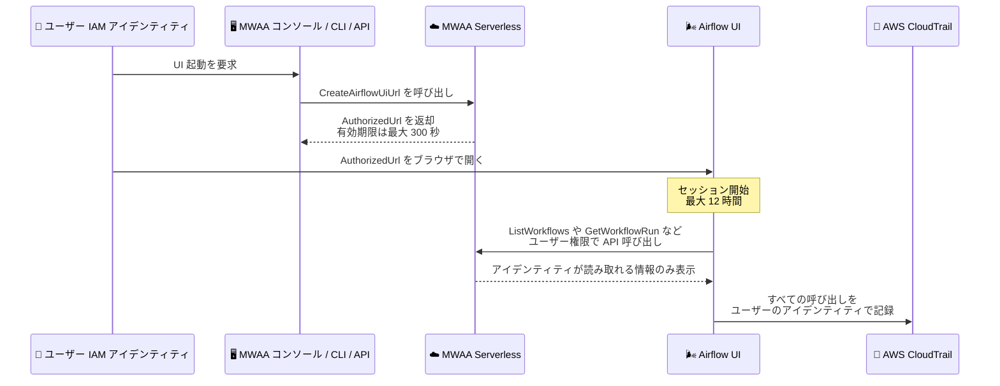

# Amazon MWAA Serverless - Apache Airflow UI の提供開始

**リリース日**: 2026 年 11 月 12 日
**サービス**: Amazon Managed Workflows for Apache Airflow (MWAA) Serverless
**機能**: Apache Airflow UI available in Amazon MWAA Serverless

📊 [このアップデートのインフォグラフィックを見る](https://takech9203.github.io/aws-news-summary/20261112-airflow-ui-for-mwaa-serverless.html)

## 概要

Amazon MWAA Serverless で、ネイティブの Apache Airflow UI が利用可能になりました。ワークフローの閲覧、ワークフロー実行とタスクインスタンスの確認、タスクログの閲覧、ワークフローのソースコードとバージョンの表示、ワークフロー実行の開始を、使い慣れた Airflow の画面から行えます。Web サーバーの実行や管理は不要で、MWAA Serverless が UI をホストし、新しいブラウザタブで開きます。

この UI の大きな特徴は、UI を開いた IAM アイデンティティの権限でそのまま動作する点です。そのアイデンティティが読み取れるワークフロー、実行、ログのみが表示され、実行開始の権限がなければ UI から実行を開始できません。UI にロールを渡す必要はなく、`StartWorkflowRun` 権限を付与しないことで読み取り専用アクセスも簡単に構成できます。また、UI がユーザーに代わって行う API 呼び出しはすべて AWS CloudTrail にそのユーザーのアイデンティティで記録されるため、監査証跡も確保されます。

Airflow UI は MWAA コンソール、AWS CLI、API のいずれからでも開けます。すでに Airflow に慣れているチームは、サーバーレス環境でも従来と同じインターフェイスでワークフローを運用できます。

**アップデート前の課題**

MWAA Serverless の登場以前やサーバーレス移行時には、以下の課題がありました。

- MWAA Serverless ではワークフローの状態確認やログ閲覧を AWS CLI や API、CloudWatch Logs 経由で行う必要があり、Airflow に慣れたユーザーにとって可視性が低かった
- タスクインスタンスの状態やワークフロー実行履歴を一覧で視覚的に確認する手段がなかった
- 従来の MWAA 環境の Airflow UI では Airflow 側のロールベース制御が必要で、IAM 権限との二重管理が発生しがちだった

**アップデート後の改善**

今回のアップデートにより、以下が可能になりました。

- MWAA Serverless でもネイティブの Apache Airflow UI でワークフロー、実行、タスクインスタンス、ログを視覚的に確認できるようになった
- UI は開いた IAM アイデンティティの権限で動作するため、IAM ポリシーだけでアクセス制御が完結し、読み取り専用アクセスも IAM で構成できるようになった
- UI の操作が CloudTrail にユーザーのアイデンティティで記録され、監査要件に対応しやすくなった
- Web サーバーの運用が不要なまま、コンソール、CLI、API から UI を起動できるようになった

## アーキテクチャ図



ユーザーが `CreateAirflowUiUrl` で取得した 1 回限りの起動 URL をブラウザで開くと UI セッションが開始され、UI はユーザーの IAM 権限の範囲内でのみ MWAA Serverless の API を呼び出します。すべての呼び出しは CloudTrail に記録されます。

## サービスアップデートの詳細

### 主要機能

1. **ネイティブ Apache Airflow UI のホスティング**
   - ワークフローの閲覧、ワークフロー実行とタスクインスタンスの確認、タスクログの閲覧が可能
   - ワークフローのソースコードとバージョンの表示、ワークフロー実行の開始に対応
   - Web サーバーの実行や管理は不要で、MWAA Serverless が UI をホストする

2. **IAM アイデンティティベースのアクセス制御**
   - UI は開いた IAM アイデンティティの権限で動作し、ロールを UI に渡す必要がない
   - アイデンティティが読み取れるワークフロー、実行、ログのみを表示
   - `airflow-serverless:StartWorkflowRun` を付与しなければ読み取り専用アクセスになる

3. **CloudTrail による監査証跡**
   - 起動 URL の作成は `CreateAirflowUiUrl` イベントとして記録される
   - UI がユーザーに代わって行う `ListWorkflowRuns` や `StartWorkflowRun` などの呼び出しも、そのユーザーのアイデンティティで記録される

4. **セキュアなセッション管理**
   - 起動 URL は 1 回限り有効で、最初に開いたブラウザでセッションが開始される
   - セッションは起動 URL を開いた IP アドレスに紐付けられる
   - セッション時間は最大 12 時間で、`--session-duration-in-seconds` で短縮可能

## 技術仕様

### UI 操作に必要な IAM アクション

| UI での操作 | 必要なアクション |
|------|------|
| ワークフローの一覧表示と閲覧 | `airflow-serverless:ListWorkflows`, `airflow-serverless:GetWorkflow` |
| ワークフローバージョンの表示 | `airflow-serverless:ListWorkflowVersions` |
| ワークフロー実行の表示 | `airflow-serverless:ListWorkflowRuns`, `airflow-serverless:GetWorkflowRun` |
| タスクインスタンスの表示 | `airflow-serverless:ListTaskInstances`, `airflow-serverless:GetTaskInstance` |
| ワークフロー実行の開始 | `airflow-serverless:StartWorkflowRun` |
| タスクログの閲覧 | ワークフローの CloudWatch Logs ロググループに対する `logs:FilterLogEvents` (カスタマーマネージド KMS キーで暗号化されている場合はキーポリシーの許可も必要) |

### CreateAirflowUiUrl API のパラメータ

| パラメータ | 詳細 |
|------|------|
| `ExpiresInSeconds` | 起動 URL の有効期間。5〜300 秒、デフォルトは 300 秒 |
| `SessionDurationInSeconds` | UI セッションの継続時間。1〜43,200 秒 (12 時間)、デフォルトは 43,200 秒 |

### API変更履歴

| 日付 | サービス | 変更内容 |
|------|----------|----------|
| 2026/11/12 | [airflow-serverless](https://awsapichanges.com/archive/changes/981bee-airflow-serverless.html) | 1 new api method - `CreateAirflowUiUrl` の追加 (Airflow UI サポート) |

### IAM ポリシー例

全ワークフローへの読み取りアクセスと実行開始を許可するポリシー例です。読み取り専用にする場合は `airflow-serverless:StartWorkflowRun` を除外します。

```json
{
  "Version": "2012-10-17",
  "Statement": [
    {
      "Effect": "Allow",
      "Action": [
        "airflow-serverless:CreateAirflowUiUrl",
        "airflow-serverless:ListWorkflows"
      ],
      "Resource": "*"
    },
    {
      "Effect": "Allow",
      "Action": [
        "airflow-serverless:GetWorkflow",
        "airflow-serverless:ListWorkflowVersions",
        "airflow-serverless:ListWorkflowRuns",
        "airflow-serverless:GetWorkflowRun",
        "airflow-serverless:ListTaskInstances",
        "airflow-serverless:GetTaskInstance",
        "airflow-serverless:StartWorkflowRun"
      ],
      "Resource": "arn:aws:airflow-serverless:us-east-1:111122223333:workflow/*"
    },
    {
      "Effect": "Allow",
      "Action": "logs:FilterLogEvents",
      "Resource": "arn:aws:logs:us-east-1:111122223333:log-group:my-workflow-log-group:*"
    }
  ]
}
```

## 設定方法

### 前提条件

1. MWAA Serverless のワークフローが作成済みであること (UI は現在のリージョンのワークフローを表示)
2. UI を開く IAM アイデンティティに `airflow-serverless:CreateAirflowUiUrl` が許可されていること
3. Cookie を受け入れるブラウザを使用すること (セッションは UI のドメインの Cookie に保持される)
4. UI 内で行う操作に応じた IAM 権限が付与されていること

### 手順

#### ステップ1: コンソールから UI を開く

1. Amazon MWAA コンソールを開く
2. ナビゲーションペインで [Serverless workflows] を選択
3. [Serverless workflows] ページで [Open Airflow UI] を選択

UI が新しいブラウザタブで開きます。

#### ステップ2: CLI から起動 URL を作成する

```bash
aws mwaa-serverless create-airflow-ui-url \
  --expires-in-seconds 60 \
  --session-duration-in-seconds 3600 \
  --region us-east-1
```

`create-airflow-ui-url` コマンドで 1 回限りの起動 URL を作成します。出力の `AuthorizedUrl` を `UrlExpiresAt` の期限内にブラウザで開くと、UI セッションが開始されます。この例では URL の有効期間を 60 秒、セッション時間を 1 時間に設定しています。

#### ステップ3: セッションを管理する

- 起動 URL は 1 回限り有効です。最初に開いた人がその権限でセッションを取得するため、パスワードと同様に扱い、共有しないでください
- セッションは起動 URL を開いた IP アドレスからのみ有効です
- セッションを早く終了するには、UI のユーザーメニューからサインアウトします
- 再度 UI を開くには、新しい起動 URL を作成します

## メリット

### ビジネス面

- **運用の可視性向上**: ワークフローの状態、実行履歴、ログを視覚的に確認でき、障害対応や日常運用のスピードが向上する
- **学習コストの削減**: Airflow に慣れたチームは、サーバーレス環境でも従来と同じインターフェイスをそのまま利用できる
- **ガバナンスの強化**: UI の全操作が CloudTrail にユーザー単位で記録され、監査やコンプライアンス要件に対応しやすい

### 技術面

- **IAM 一元管理**: アクセス制御が IAM ポリシーだけで完結し、Airflow 側のロール管理との二重管理が不要
- **インフラ管理不要**: Web サーバーのプロビジョニングや管理なしで UI を利用でき、MWAA Serverless の運用レスな特性を維持できる
- **セキュアなセッション設計**: 1 回限りの起動 URL、IP アドレスへのセッション紐付け、最大 12 時間のセッション上限により、安全なアクセスを実現

## デメリット・制約事項

### 制限事項

- UI からワークフローの一時停止・再開、実行やタスクインスタンスの停止・クリア・状態変更はできない (スケジュール変更は `UpdateWorkflow`、実行停止は `StopWorkflowRun` を使用)
- 接続 (Connections)、変数 (Variables)、プール、プロバイダー、設定、プラグイン、バックフィル、アセット、監査ログなどの管理機能は利用できない
- UI はパブリック HTTPS で提供され、VPC エンドポイント (AWS PrivateLink) 経由ではアクセスできないため、起動 URL を開くブラウザにはインターネットアクセスが必要 (`CreateAirflowUiUrl` の呼び出し自体はインターフェイス VPC エンドポイント経由で可能)

### 考慮すべき点

- 起動 URL は 1 回限り有効だが、期限内に第三者が先に開くとその人がユーザーの権限でセッションを取得するため、URL の取り扱いには注意が必要
- タスクログの閲覧には CloudWatch Logs への `logs:FilterLogEvents` 権限が別途必要で、ロググループが KMS カスタマーマネージドキーで暗号化されている場合はキーポリシーの許可も必要
- セッションは最大 12 時間で自動的に終了するため、長時間の運用では URL の再作成が必要

## ユースケース

### ユースケース1: 運用チームによる日常のワークフロー監視

**シナリオ**: データエンジニアリングチームが MWAA Serverless 上の ETL ワークフローの実行状況を毎日確認し、失敗したタスクのログを調査する。

**実装例**:
```bash
# コンソールの Serverless workflows ページから「Open Airflow UI」を選択
# または CLI で起動 URL を作成
aws mwaa-serverless create-airflow-ui-url --region ap-northeast-1
```

**効果**: CLI や CloudWatch Logs を個別に操作することなく、使い慣れた Airflow UI で実行履歴とタスクログを一元的に確認でき、障害調査の時間を短縮できる。

### ユースケース2: 監査担当者向けの読み取り専用アクセス

**シナリオ**: 監査やビジネス部門の担当者に、ワークフローの実行状況を閲覧のみ許可し、実行開始などの操作は禁止したい。

**実装例**:
```json
{
  "Effect": "Allow",
  "Action": [
    "airflow-serverless:CreateAirflowUiUrl",
    "airflow-serverless:ListWorkflows",
    "airflow-serverless:GetWorkflow",
    "airflow-serverless:ListWorkflowRuns",
    "airflow-serverless:GetWorkflowRun",
    "airflow-serverless:ListTaskInstances",
    "airflow-serverless:GetTaskInstance"
  ],
  "Resource": "*"
}
```

**効果**: `StartWorkflowRun` を付与しないだけで読み取り専用の UI アクセスを実現でき、Airflow 側のロール設定なしに最小権限の原則を適用できる。

### ユースケース3: オンデマンドのワークフロー手動実行

**シナリオ**: 開発者が新しいバージョンのワークフローをデプロイした後、スケジュールを待たずに UI から手動で実行して動作を確認する。

**実装例**:
```bash
# セッション時間を 1 時間に制限した起動 URL を作成
aws mwaa-serverless create-airflow-ui-url \
  --expires-in-seconds 60 \
  --session-duration-in-seconds 3600
# UI 上でワークフローを選択し、実行を開始してタスクの進行とログを確認
```

**効果**: デプロイしたワークフローのソースとバージョンを UI で確認した上で手動実行でき、開発サイクルのフィードバックが速くなる。操作はすべて CloudTrail に記録される。

## 料金

今回の発表では Airflow UI 自体の追加料金に関する記載はありません。MWAA Serverless の利用料金が適用されます。詳細は [Amazon MWAA 料金ページ](https://aws.amazon.com/mwaa/pricing/) を参照してください。

## 利用可能リージョン

Amazon MWAA Serverless が利用可能なすべての AWS リージョンで利用できます。最新のリージョン一覧は [AWS リージョン表](https://docs.aws.amazon.com/mwaa/latest/mwaa-serverless-userguide/what-is-mwaa-serverless.html#regions) を参照してください。

## 関連サービス・機能

- **AWS CloudTrail**: UI の起動 (`CreateAirflowUiUrl`) と UI が行う API 呼び出しをユーザーのアイデンティティで記録し、監査証跡を提供
- **Amazon CloudWatch Logs**: ワークフローのタスクログの保存先。UI からのログ閲覧には `logs:FilterLogEvents` 権限が必要
- **AWS IAM**: UI のアクセス制御の基盤。IAM ポリシーのみで表示範囲と操作可否を制御
- **AWS KMS**: ロググループをカスタマーマネージドキーで暗号化している場合、キーポリシーでの許可が必要

## 参考リンク

- 📊 [インフォグラフィック](https://takech9203.github.io/aws-news-summary/20261112-airflow-ui-for-mwaa-serverless.html)
- [公式発表 (What's New)](https://aws.amazon.com/about-aws/whats-new/2026/11/airflow-ui-for-mwaa-serverless/)
- [ドキュメント: Access the Airflow UI](https://docs.aws.amazon.com/mwaa/latest/mwaa-serverless-userguide/workflows-airflow-ui.html)
- [API リファレンス: CreateAirflowUiUrl](https://docs.aws.amazon.com/mwaa-serverless/latest/APIReference/API_CreateAirflowUiUrl.html)
- [料金ページ](https://aws.amazon.com/mwaa/pricing/)

## まとめ

MWAA Serverless にネイティブの Apache Airflow UI が追加され、サーバーレスのメリットを維持したまま、ワークフローの可視性と運用性が大きく向上しました。IAM 権限ベースのアクセス制御と CloudTrail による監査証跡により、エンタープライズのガバナンス要件にも対応しやすい設計です。MWAA Serverless を利用中のチームは、UI を開くユーザーに `airflow-serverless:CreateAirflowUiUrl` と必要な読み取り権限を付与し、運用フローへの組み込みを検討することをお勧めします。
