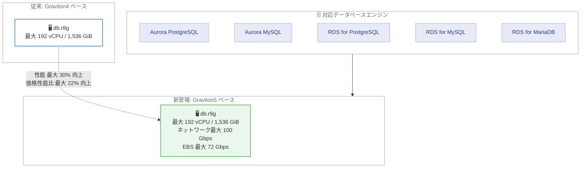

# Amazon Aurora / Amazon RDS - Graviton5 ベース R9g データベースインスタンスのサポート

**リリース日**: 2026 年 11 月 12 日
**サービス**: Amazon Aurora、Amazon RDS (PostgreSQL / MySQL / MariaDB)
**機能**: AWS Graviton5 ベース R9g データベースインスタンス (db.r9g)

📊 [このアップデートのインフォグラフィックを見る](https://takech9203.github.io/aws-news-summary/20261112-amazon-aurora-rds-postgresql-mysql-mariadb-r9g-instances.html)

## 概要

Amazon Aurora (PostgreSQL 互換エディションおよび MySQL 互換エディション) と Amazon RDS for PostgreSQL / MySQL / MariaDB が、AWS Graviton5 プロセッサを搭載した R9g データベースインスタンス (db.r9g) の一般提供を開始しました。Graviton5 は AWS が設計した最新世代のサーバープロセッサであり、AWS Nitro System 上に構築されています。

Aurora では、同等の Graviton4 ベースインスタンス (db.r8g) と比較して最大 30% のパフォーマンス向上、オンデマンド料金で最大 22% の価格性能比の向上が得られます (データベースエンジン、バージョン、ワークロードにより効果は異なります)。db.r9g は large から 48xlarge までの 9 サイズで提供され、最大 192 vCPU、vCPU あたり 8 GiB のメモリ比率、最大 100 Gbps のネットワーク帯域幅、最大 72 Gbps の Amazon EBS 帯域幅を備えます。

大規模なリレーショナルデータベースを運用し、より高いスループットやスケールアップの余地、コスト効率の改善を求めるユーザーに適したアップデートです。

**アップデート前の課題**

このアップデート以前には、以下の課題や制限がありました。

- Aurora / RDS で利用できる Graviton 系メモリ最適化インスタンスは Graviton4 ベースの db.r8g (最大 48xlarge、192 vCPU) が最新であり、それ以上の単一インスタンス性能向上にはエンジンやスキーマのチューニングが必要だった
- 書き込みがプライマリインスタンスに集中するワークロードでは、スケールアップの上限がそのまま性能上限となっていた
- 性能向上とコスト削減を両立する選択肢として、より新しい世代のインスタンスが待たれていた

**アップデート後の改善**

今回のアップデートにより、以下が可能になりました。

- 最新の Graviton5 ベース db.r9g インスタンスを選択し、Graviton4 比で最大 30% の性能向上を享受できる
- オンデマンド料金ベースで最大 22% の価格性能比向上により、同じ性能をより低いコストで実現できる
- インスタンスクラスの変更のみで移行でき、アプリケーションの変更は不要

## アーキテクチャ図



対応する 5 つのデータベースエンジンで Graviton5 ベースの db.r9g を選択でき、Graviton4 ベースの db.r8g と比較して性能と価格性能比が向上します (性能向上値は Aurora での比較)。

## サービスアップデートの詳細

### 主要機能

1. **Graviton5 プロセッサによる性能向上**
   - Aurora において、同等の Graviton4 ベースインスタンス比で最大 30% のパフォーマンス向上
   - オンデマンド料金ベースで最大 22% の価格性能比の向上
   - 効果はデータベースエンジン、バージョン、ワークロードによって異なる

2. **大規模構成に対応するスペック**
   - large から 48xlarge までの 9 サイズを提供
   - 最大 192 vCPU、vCPU あたり 8 GiB のメモリ比率 (最大 1,536 GiB)
   - 最大 100 Gbps のネットワーク帯域幅、最大 72 Gbps の Amazon EBS 帯域幅

3. **AWS Nitro System 上に構築**
   - コンピューティングとメモリリソースを最大限ワークロードに割り当てるアーキテクチャ
   - EC2 の R9g インスタンスと同様に、常時有効なメモリ暗号化などのセキュリティ機能を備えた Graviton5 を採用

## 技術仕様

### db.r9g インスタンスの主な仕様

| 項目 | 詳細 |
|------|------|
| プロセッサ | AWS Graviton5 (AWS 設計の最新世代サーバープロセッサ) |
| サイズ展開 | large ~ 48xlarge の 9 サイズ |
| 最大 vCPU | 192 vCPU (48xlarge) |
| メモリ比率 | vCPU あたり 8 GiB (48xlarge で 1,536 GiB) |
| ネットワーク帯域幅 | 最大 100 Gbps |
| EBS 帯域幅 | 最大 72 Gbps |
| 基盤 | AWS Nitro System |

### 対応エンジンバージョン (Aurora)

Aurora ユーザーガイドのサポート対象 DB インスタンスクラス一覧によると、db.r9g (large ~ 48xlarge) は以下のバージョンでサポートされます。

| エンジン | サポートバージョン |
|----------|--------------------|
| Aurora MySQL | 3.08.0 ~ 3.08.2、3.09.0、3.10.0 ~ 3.10.6、3.11.1、3.12.0、8.4.7、8.4.8、8.4.10 |
| Aurora PostgreSQL | 14.17 ~ 14.24 (14.21 を除く)、15.10、15.12 ~ 15.19 (15.11、15.16 を除く)、16.8 ~ 16.15 (16.12 を除く)、17.4 ~ 17.11 (17.8 を除く)、18.3、18.4、18.6 |

RDS for PostgreSQL / MySQL / MariaDB の対応バージョンは、RDS ユーザーガイドの DB インスタンスクラスのページで確認してください。

## 設定方法

### 前提条件

1. 利用可能リージョン (バージニア北部、オハイオ、オレゴン、フランクフルト) でクラスター / インスタンスを運用していること
2. db.r9g がサポートするエンジンバージョンを使用していること (必要に応じて事前にエンジンをアップグレード)
3. インスタンスクラス変更に伴う再起動の影響を考慮したメンテナンス計画があること

### 手順

#### ステップ 1: 現在のインスタンスクラスとエンジンバージョンの確認

```bash
aws rds describe-db-instances \
  --db-instance-identifier my-aurora-instance \
  --query "DBInstances[0].[DBInstanceClass,Engine,EngineVersion]"
```

対象インスタンスの現在のインスタンスクラス、エンジン、エンジンバージョンを表示し、db.r9g への移行可否を確認します。

#### ステップ 2: 利用可能なインスタンスクラスの確認

```bash
aws rds describe-orderable-db-instance-options \
  --engine aurora-postgresql \
  --engine-version 17.7 \
  --query "OrderableDBInstanceOptions[?starts_with(DBInstanceClass, 'db.r9g')].DBInstanceClass" \
  --region us-east-1
```

指定したエンジンバージョンとリージョンで注文可能な db.r9g インスタンスクラスの一覧を取得し、利用可能なサイズを確認します。

#### ステップ 3: インスタンスクラスの変更

```bash
aws rds modify-db-instance \
  --db-instance-identifier my-aurora-instance \
  --db-instance-class db.r9g.4xlarge \
  --apply-immediately
```

対象インスタンスのインスタンスクラスを db.r9g.4xlarge に変更します。`--apply-immediately` を指定すると即時適用され、再起動が発生します。メンテナンスウィンドウで適用する場合はこのオプションを省略します。Aurora クラスターの場合は、リーダーインスタンスから順に変更してフェイルオーバーさせることでダウンタイムを最小化できます。

## メリット

### ビジネス面

- **コスト効率の改善**: オンデマンド料金ベースで最大 22% の価格性能比向上により、同等の性能をより低コストで実現、またはコストを維持したまま性能を向上できる
- **アプリケーション変更が不要**: インスタンスクラスの変更のみで移行でき、移行コストが小さい
- **サステナビリティ**: Graviton 系プロセッサの採用はエネルギー効率の観点でも有利とされており、環境目標への貢献が期待できる

### 技術面

- **性能向上**: Aurora で Graviton4 比最大 30% のパフォーマンス向上により、書き込みがプライマリに集中するワークロードのスケールアップ余地が拡大する
- **広い帯域幅**: 最大 100 Gbps のネットワーク帯域幅と最大 72 Gbps の EBS 帯域幅により、高スループットなワークロードに対応できる
- **一貫したメモリ比率**: 全サイズで vCPU あたり 8 GiB のメモリ比率を維持しており、サイズ変更時の設計見積もりが容易

## デメリット・制約事項

### 制限事項

- 利用可能リージョンは現時点で 4 リージョン (バージニア北部、オハイオ、オレゴン、フランクフルト) に限定され、東京リージョンでは未提供
- サポートされるエンジンバージョンが限定されており、古いバージョンを使用している場合は事前のエンジンアップグレードが必要
- 性能向上の数値 (最大 30% / 22%) は Aurora での比較であり、エンジン、バージョン、ワークロードによって効果は異なる

### 考慮すべき点

- インスタンスクラス変更時には再起動が発生するため、メンテナンスウィンドウやフェイルオーバーを活用した計画的な移行が必要
- リザーブドインスタンスを利用中の場合、db.r9g への移行に伴う購入計画の見直しが必要
- 移行前に本番相当のワークロードで性能検証を行い、実際の改善幅を確認することが推奨される

## ユースケース

### ユースケース 1: 書き込み負荷の高い基幹データベースのスケールアップ

**シナリオ**: Aurora PostgreSQL のプライマリインスタンスの CPU 使用率が恒常的に高く、書き込みスループットが頭打ちになっている。

**実装例**:
```bash
aws rds modify-db-instance \
  --db-instance-identifier my-primary-instance \
  --db-instance-class db.r9g.16xlarge \
  --no-apply-immediately
```

**効果**: 同一サイズのまま db.r8g から db.r9g へ移行するだけで最大 30% の性能向上が見込め、シャーディングなどの大規模な構成変更を先送りできます。

### ユースケース 2: コスト最適化を目的とした世代更新

**シナリオ**: db.r8g.8xlarge で安定稼働しているが、価格性能比を改善してデータベースコストを削減したい。

**実装例**:
```bash
# リーダーインスタンスから順に db.r9g へ変更し、フェイルオーバーで切り替え
aws rds modify-db-instance \
  --db-instance-identifier my-reader-instance \
  --db-instance-class db.r9g.8xlarge \
  --apply-immediately
```

**効果**: オンデマンド料金ベースで最大 22% の価格性能比向上により、性能要件を満たしながらサイズダウンによるコスト削減を検討できます。

### ユースケース 3: 分析系クエリが混在するワークロードの帯域幅強化

**シナリオ**: RDS for MySQL で大量データの読み書きと分析系クエリが混在し、ストレージ I/O とネットワークがボトルネックになっている。

**実装例**:
```bash
aws rds modify-db-instance \
  --db-instance-identifier my-mysql-instance \
  --db-instance-class db.r9g.12xlarge \
  --no-apply-immediately
```

**効果**: 最大 72 Gbps の EBS 帯域幅と最大 100 Gbps のネットワーク帯域幅により、I/O 集約的なワークロードのボトルネックを緩和できます。

## 料金

db.r9g インスタンスは、既存のデータベースインスタンスと同様にオンデマンドおよびリザーブドインスタンスの料金体系で利用できます。Aurora では Graviton4 ベースインスタンスとの比較で、オンデマンド料金ベースで最大 22% の価格性能比向上がうたわれています。

リージョン、エンジン、サイズごとの具体的な料金は以下を参照してください。

- [Amazon Aurora の料金](https://aws.amazon.com/jp/rds/aurora/pricing/)
- [Amazon RDS の料金](https://aws.amazon.com/jp/rds/pricing/)

## 利用可能リージョン

発表時点で以下の 4 リージョンで利用可能です。

- 米国東部 (バージニア北部)
- 米国東部 (オハイオ)
- 米国西部 (オレゴン)
- 欧州 (フランクフルト)

## 関連サービス・機能

- **Amazon EC2 R9g インスタンス**: 同じ Graviton5 を搭載した EC2 のメモリ最適化インスタンス。セルフマネージドなデータベースやインメモリキャッシュにも同世代の性能向上を適用できる
- **AWS Graviton プロセッサ**: AWS が設計する Arm ベースのサーバープロセッサファミリー。Graviton5 は最新世代で、常時有効なメモリ暗号化などのセキュリティ機能を備える
- **AWS Nitro System**: 仮想化機能を専用ハードウェアにオフロードし、ホストのリソースをワークロードに最大限割り当てる基盤技術

## 参考リンク

- 📊 [インフォグラフィック](https://takech9203.github.io/aws-news-summary/20261112-amazon-aurora-rds-postgresql-mysql-mariadb-r9g-instances.html)
- [公式発表 (What's New)](https://aws.amazon.com/about-aws/whats-new/2026/11/amazon-aurora-rds-postgresql-mysql-mariadb-r9g-instances/)
- [Aurora DB インスタンスクラス (ドキュメント)](https://docs.aws.amazon.com/AmazonRDS/latest/AuroraUserGuide/Concepts.DBInstanceClass.html)
- [Aurora のサポート対象 DB インスタンスクラス (ドキュメント)](https://docs.aws.amazon.com/AmazonRDS/latest/AuroraUserGuide/Concepts.DBInstanceClass.SupportAurora.html)
- [RDS DB インスタンスクラス (ドキュメント)](https://docs.aws.amazon.com/AmazonRDS/latest/UserGuide/Concepts.DBInstanceClass.html)
- [Amazon EC2 R9g インスタンス](https://aws.amazon.com/ec2/instance-types/r9g/)
- [Amazon Aurora の料金](https://aws.amazon.com/rds/aurora/pricing/)
- [Amazon RDS の料金](https://aws.amazon.com/rds/pricing/)

## まとめ

Graviton5 ベースの db.r9g は、Aurora / RDS の主要オープンソースエンジンに対して性能と価格性能比の両面で世代更新のメリットをもたらすアップデートです。対象リージョンで db.r8g などを利用中の場合は、サポート対象エンジンバージョンを確認のうえ、検証環境で性能を測定し、計画的な移行を検討することを推奨します。東京リージョンなど他リージョンへの展開は今後の発表に注目してください。
