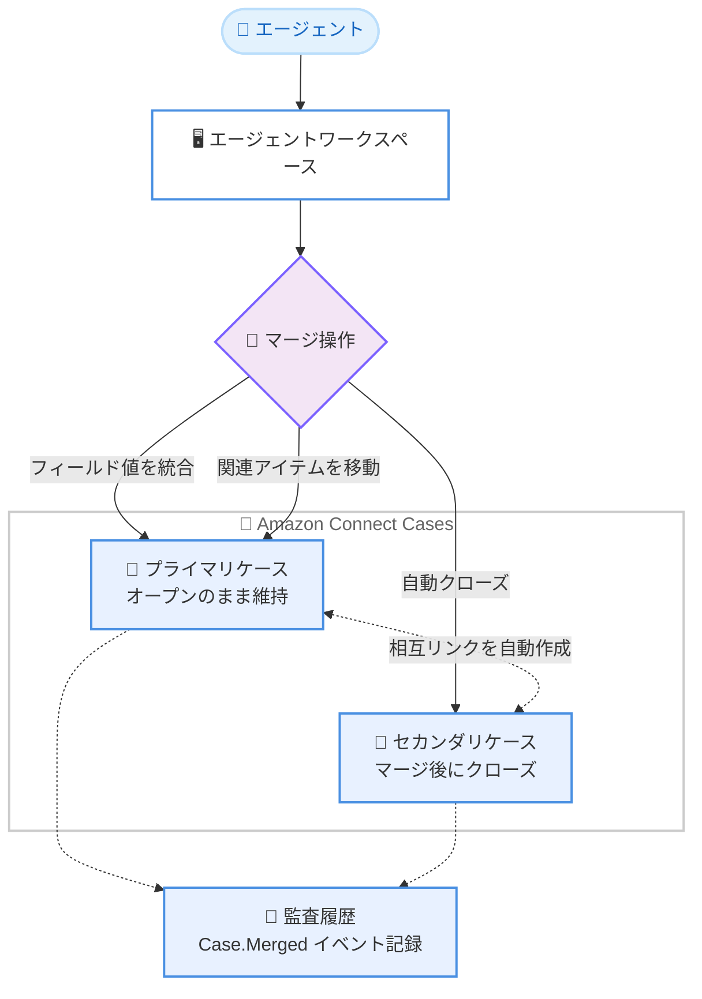

# Amazon Connect - ケースのマージと関連ケースのリンク

**リリース日**: 2026 年 11 月 12 日
**サービス**: Amazon Connect (Cases)
**機能**: エージェントワークスペースでの関連ケースのマージおよびリンク

📊 [このアップデートのインフォグラフィックを見る](https://takech9203.github.io/aws-news-summary/20261112-amazon-connect-cases-merge-link.html)

## 概要

Amazon Connect Cases が、エージェントワークスペースでの関連ケースの「マージ (統合)」と「リンク (関連付け)」をサポートしました。顧客が同じ問題について複数回、または複数のチャネル (チャット、メールなど) で問い合わせを行うと、ケース履歴が分断されてしまうことがあります。今回のアップデートにより、エージェントはこれらのケースを 1 つのケースに統合し、一貫した履歴として管理できるようになりました。

マージでは、プライマリケースとセカンダリケースを選択し、セカンダリケースのフィールド値やコメント・コンタクトなどの関連アイテムをプライマリケースに引き継いだうえで、セカンダリケースを自動的にクローズします。リンクでは、例えば同一の障害の影響を受けた複数の顧客のケースを相互に関連付けることで、影響を受けたすべての顧客に対して一貫した対応を行えます。

コンタクトセンターでケース管理を行う組織にとって、問題解決の迅速化と対応品質の均一化を実現する重要なアップデートです。API (StartMergeCases、GetMergeCasesStatus) も追加されており、プログラムからのマージ操作にも対応しています。

**アップデート前の課題**

- 同じ顧客が複数チャネルから問い合わせた場合、チャネルごとに別々のケースが作成され、履歴が分断されていた
- 重複ケースを手動で整理するには、コメントのコピーやケースのクローズなどの作業を個別に行う必要があった
- 同一の問題に起因する複数顧客のケースを関連付ける標準的な仕組みがなく、対応内容がエージェントごとにばらつく可能性があった

**アップデート後の改善**

- 重複したケースをマージし、フィールド値・コメント・コンタクトを 1 つのケースに統合できるようになった
- マージ時にセカンダリケースが自動的にクローズされ、両ケースの監査履歴にマージ操作が記録されるようになった
- 関連ケースを [Linked Cases] タブで相互にリンクし、同一問題の影響を受けた複数顧客への一貫した対応が可能になった

## アーキテクチャ図



エージェントがワークスペースからマージを実行すると、セカンダリケースのフィールド値と関連アイテムがプライマリケースに統合され、セカンダリケースは自動的にクローズされます。両ケースは相互にリンクされ、監査履歴にマージイベントが記録されます。

## サービスアップデートの詳細

### 主要機能

1. **ケースのマージ**
   - プライマリケース (オープンのまま維持) とセカンダリケース (マージ後にクローズ) を選択してマージを実行
   - **Quick merge** (デフォルト): プライマリケースのフィールド値を維持し、空のフィールドのみセカンダリケースの値で補完
   - **Manual merge**: 値が異なるフィールドごとに、プライマリ・セカンダリどちらの値を採用するかを個別に選択
   - 関連アイテムの扱いも選択可能 (すべて移動する、またはプライマリケースの関連アイテムのみ維持)
   - マージはバックグラウンドで非同期に実行される

2. **関連ケースのリンク**
   - ケースの [Linked Cases] タブで、参照番号・タイトル・ステータス・担当ユーザー・最終更新日とともにリンク済みケースを一覧表示
   - [Add linked case] でケースを追加リンク、[Unlink] でリンク解除が可能
   - マージを実行すると、プライマリケースとセカンダリケースは自動的に相互リンクされる

3. **監査履歴への記録**
   - マージによるフィールド更新やステータス変更は両ケースの監査履歴に記録される
   - GetCaseAuditEvents API では `Case.Merged` タイプのサマリーイベントとして取得可能
   - 監査イベントには `mergeEventId`、`primaryCaseId`、`secondaryCaseId` を含む `mergeMetadata` が付与され、同一マージのイベントをグルーピングできる

4. **マージ用 API の追加**
   - StartMergeCases: セカンダリケースをプライマリケースへマージする非同期処理を開始
   - GetMergeCasesStatus: マージ処理のステータス (IN_PROGRESS / COMPLETED) を取得

## 技術仕様

### マージ可能なケースの条件

| 条件 | 詳細 |
|------|------|
| ステータス | どちらのケースも Closed でないこと |
| 顧客 | 両ケースが同一顧客であるか、少なくとも一方のケースに顧客が設定されていないこと |
| 進行中のマージ | どちらのケースも進行中のマージに含まれていないこと |
| 過去のマージ | セカンダリケースとしてマージされたことがあるケースは再マージ不可 (過去にプライマリケースだったケースは再マージ可) |
| フィールド数 | マージ後のプライマリケースのフィールド値が 500 を超えないこと |
| 関連アイテム数 | マージ後の関連アイテム数がサービスクォータを超えないこと |
| テンプレート | 異なるケーステンプレート間でもマージ可能 (プライマリケースのテンプレートを維持) |

### マージ対象の挙動

| 対象 | マージ時の挙動 |
|------|----------------|
| カスタムフィールド、割り当てキュー、割り当てユーザー、サマリー、ケース理由 | プライマリケースの値を維持 (空の場合はセカンダリケースの値で補完、Manual merge では個別選択可) |
| ステータス、タイトル、顧客、参照番号 | プライマリケースの値を維持 |
| コメント、コンタクト、カスタム関連アイテム、リンク済みケース | セカンダリケースからプライマリケースへ移動 (`aws:` で始まるタグを除きタグも維持) |
| ファイル、SLA などその他の関連アイテム | 移動されず、セカンダリケースに残る |

### API 変更履歴

| 日付 | サービス | 変更内容 |
|------|----------|----------|
| 2026/11/11 | [Amazon Connect Cases](https://awsapichanges.com/archive/changes/082701-cases.html) | 2 new 1 updated api methods - ケースをマージして履歴を統合する API (StartMergeCases) と、進行中のマージ操作のステータスを取得する API (GetMergeCasesStatus) を追加 |

### 必要な権限

マージとリンクの操作には、セキュリティプロファイルで以下の権限が必要です。

| 操作 | 必要な権限 |
|------|-----------|
| ケースのマージ | **Cases - Merge** (有効化すると View 権限が自動付与。Edit 権限は不要) |
| リンクの追加 | **Cases - Edit** |
| リンクの解除 | **Linked cases - Delete** |

タグベースのアクセス制御を使用している場合、エージェントはプライマリケースとセカンダリケースの両方へのアクセス権を持っている必要があります。

## 設定方法

### 前提条件

1. Amazon Connect インスタンスで Cases が有効化されていること
2. エージェントのセキュリティプロファイルに **Cases - Merge** 権限が付与されていること (マージの場合)
3. リンク操作には **Cases - Edit** 権限 (追加) または **Linked cases - Delete** 権限 (解除) が付与されていること

### 手順

#### ステップ 1: エージェントワークスペースでケースを開く

エージェントワークスペースで、マージ対象のケースのいずれかを開きます。ケース詳細ページで [Merge] を選択します (表示されない場合は [More] から [Merge] を選択)。開始したケースがプライマリケースになります。

#### ステップ 2: セカンダリケースを選択する

[Merge cases] ページで [Choose a case] を選択し、マージするケースを検索して選択します。一覧には、クローズされておらず、同一顧客または顧客未設定のケースのみが表示されます。スワップアイコンでプライマリとセカンダリを入れ替えることもできます。

#### ステップ 3: マージ方法と関連アイテムの扱いを選択して実行する

[Merge method] で Quick merge または Manual merge を選択し、[Merge related items] で関連アイテムの扱いを選択します。警告を確認して [Merge cases] を選択すると、マージがバックグラウンドで実行されます。

#### ステップ 4 (任意): API からマージを実行する

```bash
# マージを開始 (セカンダリケースをプライマリケースへ統合)
aws connectcases start-merge-cases \
  --domain-id <ドメイン ID> \
  --primary-case-id <プライマリケース ID> \
  --secondary-case-id <セカンダリケース ID>

# マージのステータスを確認
aws connectcases get-merge-cases-status \
  --domain-id <ドメイン ID> \
  --case-id <ケース ID>
```

StartMergeCases はマージ処理を非同期で開始します。いずれかのケースが進行中のマージに含まれている場合や、過去に別のケースへマージされている場合は ConflictException が返されます。GetMergeCasesStatus は、マージ実行中は両ケースに対して IN_PROGRESS を、完了後はセカンダリケースに対して COMPLETED を返します。

## メリット

### ビジネス面

- **問題解決の迅速化**: 分断されていたケース履歴が 1 つに統合され、エージェントが全体の文脈を即座に把握できる
- **対応品質の均一化**: 同一問題の影響を受けた複数顧客のケースをリンクすることで、すべての顧客に一貫した対応を提供できる
- **重複対応の削減**: 同じ問題に対する重複ケースを統合し、複数エージェントによる二重対応を防止できる

### 技術面

- **監査証跡の維持**: マージ操作は両ケースの監査履歴に記録され、`mergeEventId` で同一マージのイベントをグルーピングできる
- **API による自動化**: StartMergeCases / GetMergeCasesStatus API により、外部システムからのマージ自動化が可能
- **柔軟なマージ制御**: Quick merge と Manual merge の使い分け、関連アイテムの移動有無の選択など、細かな制御が可能

## デメリット・制約事項

### 制限事項

- マージは取り消しできない。セカンダリケースとしてマージされたケースは、再度マージできない
- 一度にマージできるのは、1 件のセカンダリケースから 1 件のプライマリケースへのみ
- ファイル、SLA などの関連アイテムタイプは移動されず、セカンダリケースに残る
- マージ後のプライマリケースのフィールド値は 500 以下、関連アイテム数はサービスクォータの範囲内である必要がある
- 両ケースが同一顧客であるか、少なくとも一方に顧客が未設定でなければマージできない

### 考慮すべき点

- マージはバックグラウンドで実行され、関連アイテムが多い場合は完了までに時間がかかることがある
- マージ実行中、セカンダリケースは編集・削除などの操作ができない
- タグベースのアクセス制御を使用している場合、エージェントは両方のケースへのアクセス権が必要
- リンクの解除 ([Unlink]) も取り消しできないため、操作権限の付与範囲は慎重に設計する必要がある

## ユースケース

### ユースケース 1: マルチチャネル問い合わせの統合

**シナリオ**: 顧客が配送遅延についてチャットで問い合わせた後、同じ件でメールも送信し、2 つのケースが作成された。

**実装例**:
```text
1. エージェントがチャット起点のケースを開き [Merge] を選択
2. セカンダリケースとしてメール起点のケースを選択
3. Quick merge + Keep all related items でマージを実行
```

**効果**: コメントとコンタクトが 1 つのケースに集約され、エージェントが全チャネルのやり取りを一元的に参照しながら対応できる。

### ユースケース 2: 大規模障害時の関連ケースのリンク

**シナリオ**: サービス障害により、多数の顧客から同一事象に関するケースが作成された。顧客が異なるためマージはできないが、一貫した対応が必要。

**実装例**:
```text
1. 障害の親ケースを作成
2. 各顧客のケースの [Linked Cases] タブで [Add linked case] を選択し、親ケースにリンク
3. 親ケースの対応方針に沿って各ケースへ回答
```

**効果**: 影響を受けたすべての顧客のケースを親ケース経由で追跡でき、回答内容のばらつきを防止できる。

### ユースケース 3: 外部システム連携によるマージの自動化

**シナリオ**: CRM 側の重複検出ロジックで同一顧客の重複ケースを検出し、自動的にマージしたい。

**実装例**:
```text
1. CRM の重複検出処理が同一顧客のオープンケースのペアを特定
2. StartMergeCases API でマージを開始
3. GetMergeCasesStatus API で COMPLETED を確認後、CRM 側のレコードを更新
```

**効果**: 手動でのケース整理が不要になり、エージェントは常に統合済みのケースで対応を開始できる。

## 料金

今回の発表に追加料金の記載はありません。Amazon Connect Cases の標準料金 (作成されたケース数に基づく従量課金) が適用されます。詳細は [Amazon Connect の料金ページ](https://aws.amazon.com/connect/pricing/) を参照してください。

## 利用可能リージョン

以下の 10 リージョンで利用可能です。

- 米国東部 (バージニア北部)
- 米国西部 (オレゴン)
- カナダ (中部)
- 欧州 (フランクフルト)
- 欧州 (ロンドン)
- アジアパシフィック (ソウル)
- アジアパシフィック (シンガポール)
- アジアパシフィック (シドニー)
- アジアパシフィック (東京)
- アフリカ (ケープタウン)

## 関連サービス・機能

- **Amazon Connect Cases**: 顧客の問題をケースとして追跡・管理する機能。本アップデートの対象機能
- **Amazon Connect エージェントワークスペース**: エージェントがコンタクト対応とケース管理を一元的に行う UI。マージ・リンク操作の実行場所
- **Amazon Connect Customer Profiles**: 顧客情報の統合管理機能。マージ可否の判定に顧客の同一性が使用される
- **タグベースのアクセス制御**: ケースへのアクセスをタグで制御する機能。マージには両ケースへのアクセス権が必要

## 参考リンク

- 📊 [インフォグラフィック](https://takech9203.github.io/aws-news-summary/20261112-amazon-connect-cases-merge-link.html)
- [公式発表 (What's New)](https://aws.amazon.com/about-aws/whats-new/2026/11/amazon-connect-cases-merge-link/)
- [ドキュメント: Merge cases in Cases](https://docs.aws.amazon.com/connect/latest/adminguide/case-merge.html)
- [ドキュメント: Link related cases](https://docs.aws.amazon.com/connect/latest/adminguide/cm-linked-cases.html)
- [ドキュメント: Amazon Connect Cases](https://docs.aws.amazon.com/connect/latest/adminguide/cases.html)
- [製品ページ: Amazon Connect Cases](https://aws.amazon.com/products/connect/customer/cases/)
- [料金ページ](https://aws.amazon.com/connect/pricing/)

## まとめ

Amazon Connect Cases のマージ・リンク機能により、マルチチャネルで分断されがちなケース履歴の統合と、同一問題に関する複数ケースの関連付けが標準機能として利用できるようになりました。重複ケースの手動整理に課題を抱えているコンタクトセンターでは、セキュリティプロファイルへの Merge 権限の付与とエージェントへの運用ルールの周知から導入を始めることを推奨します。マージは取り消しできないため、Manual merge の使い分けを含めた操作ガイドラインの整備も合わせて検討してください。
