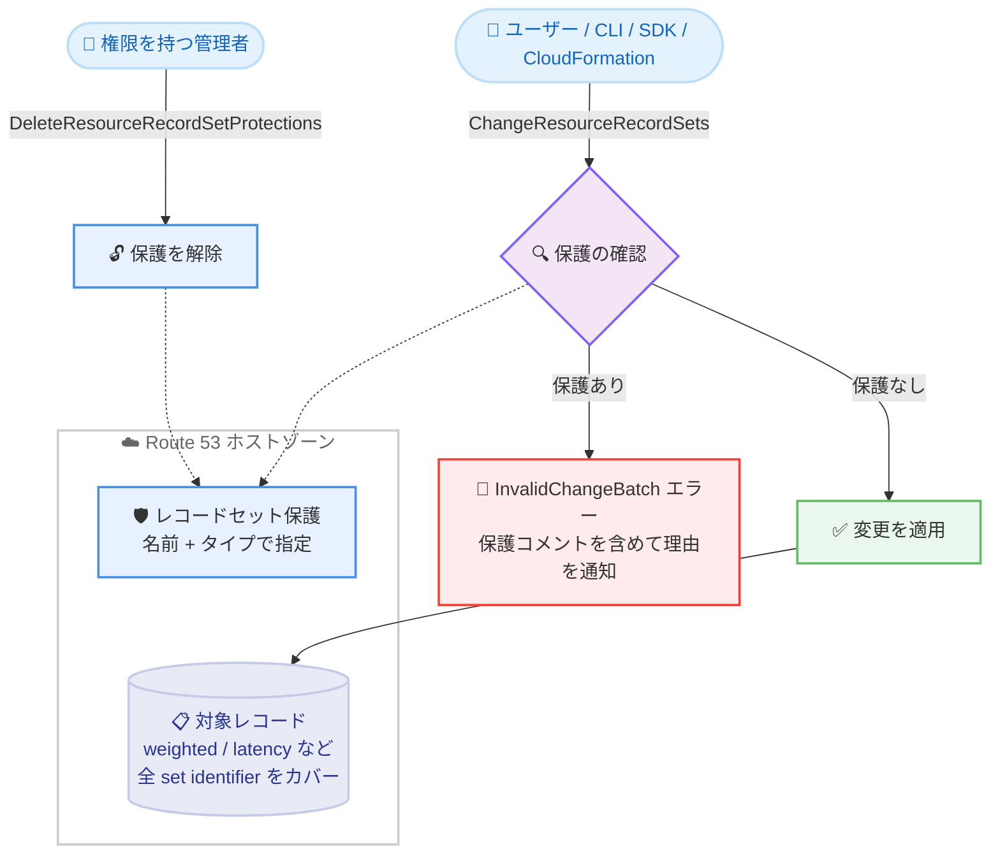

# Amazon Route 53 - レコードセット保護のサポート

**リリース日**: 2026 年 11 月 12 日
**サービス**: Amazon Route 53
**機能**: レコードセット保護 (Record Set Protection)

📊 [このアップデートのインフォグラフィックを見る](https://takech9203.github.io/aws-news-summary/20261112-amazon-route-53-record-set-protection.html)

## 概要

Amazon Route 53 がレコードセット保護 (Record Set Protection) に対応しました。DNS 管理者は、ホストゾーン内の重要な DNS レコード (ゾーン apex、MX レコード、本番エンドポイントへのルーティングレコードなど) に対して保護を設定し、誤った変更や削除を防止できます。保護されたレコードへの変更リクエストは、権限を持つユーザーが保護を解除するまですべてブロックされます。

保護はレコードの名前とタイプの組み合わせで指定し、1 つの保護が同じ名前・タイプを持つすべてのレコードをカバーします。異なる set identifier を持つ weighted や latency などのルーティングポリシーレコードもまとめて保護されます。また、レコードが存在しない段階で予防的に保護を作成し、その名前・タイプでのレコード作成自体を防止することも可能です。各保護には最大 256 文字のコメントを付与でき、変更がブロックされた際のエラーメッセージに含まれるため、呼び出し元は保護の理由や連絡先を把握できます。

本機能は、本番ドメインの DNS レコードを運用するすべての組織、特に複数のチームや IaC ツールが同一ホストゾーンを変更する環境において、DNS 起因の障害リスクを低減する重要なガードレールとなります。

**アップデート前の課題**

このアップデート以前は、重要な DNS レコードを誤変更から守る手段が IAM ポリシーに限られていました。

- ホストゾーンを変更できるすべてのユーザー・ロールの IAM ポリシーに、レコードレベルの条件を個別に記述する必要があった
- 変更がブロックされた場合でも、呼び出し元には保護の有無やブロックの理由が伝わらなかった
- 新しいユーザーやロールを追加するたびにポリシーの整合性を維持する運用負荷が発生していた

**アップデート後の改善**

今回のアップデートにより、レコード単位の保護を Route 53 側で直接管理できるようになりました。

- 名前とタイプを指定するだけでレコードを保護でき、IAM ポリシーへのレコードレベル条件の記述が不要になった
- 保護は `route53:*` を持つプリンシパルを含むすべてのユーザー・ロールに適用され、`ChangeResourceRecordSets` のポリシー条件では上書きできない
- ブロック時のエラーメッセージに保護コメントが含まれ、呼び出し元が理由と対処方法を把握できるようになった
- レコード作成前の予防的な保護により、特定の名前・タイプの新規レコード作成を防止できるようになった

## アーキテクチャ図



保護されたレコードへの `ChangeResourceRecordSets` リクエストは、IAM 権限にかかわらず `InvalidChangeBatch` エラーでブロックされ、`DeleteResourceRecordSetProtections` 権限を持つ管理者が保護を解除した場合のみ変更が可能になります。

## サービスアップデートの詳細

### 主要機能

1. **名前とタイプによるレコード保護**
   - 保護はホストゾーン内のレコード名とレコードタイプの組み合わせで指定する (例: `www.example.com` と `A`)
   - 1 つの保護が同じ名前・タイプのすべてのレコードをカバーし、異なる set identifier を持つ weighted、latency などのルーティングポリシーレコードも一括で保護される (一部のレコードのみを保護することはできない)
   - `ChangeResourceRecordSets` が受け付けるすべてのレコードタイプを保護でき、ゾーン apex の NS・SOA レコードも対象

2. **すべてのプリンシパルに適用される強制力**
   - 保護は `route53:*` のフル権限を持つユーザーを含む、すべてのユーザー・ロールに適用される
   - `route53:ChangeResourceRecordSets` に対する IAM ポリシー条件では保護を上書きできない
   - CloudFormation、AWS CLI、SDK からの変更も同様に `InvalidChangeBatch` エラーでブロックされる

3. **予防的な保護 (レコードの事前予約)**
   - レコードが存在しない名前・タイプに対しても保護を作成できる
   - 保護を削除するまで、その名前・タイプでのレコード作成が防止される
   - 予約された名前は保護の一覧には表示されるが、レコードの一覧には表示されない

4. **コメントによる理由の伝達**
   - 各保護に最大 256 文字のコメントを付与できる
   - 変更がブロックされた際のエラーメッセージにコメントが含まれ、呼び出し元が保護の理由や連絡先を把握できる
   - コメントの更新はできないため、変更する場合は保護を削除して再作成する

5. **全件一括処理のリクエスト**
   - 保護の作成・削除リクエストは all-or-nothing で、リクエスト内のすべての保護が追加・削除されるか、まったく処理されないかのいずれか
   - `ChangeResourceRecordSets` も、リクエスト内のいずれかの変更が保護に抵触した場合はリクエスト全体が拒否される

## 技術仕様

### 動作仕様

| 項目 | 詳細 |
|------|------|
| 保護の識別単位 | ホストゾーン内のレコード名 + レコードタイプ |
| 対象レコードタイプ | `ChangeResourceRecordSets` が受け付けるすべてのタイプ (apex の NS・SOA を含む) |
| ブロック対象の操作 | `CREATE`、`DELETE`、`UPSERT` (既存と同一内容の `UPSERT` は拒否されない) |
| ブロック時のエラー | `InvalidChangeBatch` (HTTP 400)、保護コメントを含むメッセージ |
| コメント | 保護ごとに最大 256 文字 (任意、更新不可) |
| 1 リクエストあたりの保護数 | 作成・削除とも最大 100 件 |
| 一覧取得のページサイズ | 最大 300 件 (`NextToken` でページング) |
| 対応ホストゾーン | パブリック・プライベートの両方 |
| ホストゾーンの削除 | 保護が 1 つでも残っていると削除不可 (先に保護の削除が必要) |
| DNS クエリへの影響 | なし (保護はレコードの変更のみを制御) |
| 監査ログ | 保護の作成・削除・一覧取得は CloudTrail に記録される |

### API 変更履歴

| 日付 | サービス | 変更内容 |
|------|----------|----------|
| 2026/11/12 | [route53](https://awsapichanges.com/archive/changes/981bee-route53.html) | 3 new api methods - `CreateResourceRecordSetProtections`、`DeleteResourceRecordSetProtections`、`ListResourceRecordSetProtections` を追加 |

### 権限と保護解除の統制

保護の強度は `route53:DeleteResourceRecordSetProtections` 権限の統制に依存します。以下は、保護の解除を明示的に拒否するポリシーの例です。

```json
{
  "Version": "2012-10-17",
  "Statement": [
    {
      "Effect": "Deny",
      "Action": "route53:DeleteResourceRecordSetProtections",
      "Resource": "arn:aws:route53:::hostedzone/*"
    }
  ]
}
```

保護関連の 3 つのアクションはホストゾーンリソース (`arn:aws:route53:::hostedzone/{Id}`) のみをサポートし、サービス固有の条件キーはサポートしません。解除権限は少数の管理者に限定し、必要に応じてサービスコントロールポリシー (SCP) での拒否も検討してください。

## 設定方法

### 前提条件

1. Route 53 のパブリックまたはプライベートホストゾーンが存在すること
2. `route53:CreateResourceRecordSetProtections` などの保護関連アクションの権限を持つこと
3. AWS CLI を使用する場合は、本機能に対応したバージョンへ更新済みであること

### 手順

#### ステップ 1: 保護の作成

```bash
aws route53 create-resource-record-set-protections \
    --hosted-zone-id Z1D633PJN98FT9 \
    --protections '[{"RecordName":"example.com","RecordType":"A","Comment":"Production apex. Contact the DNS team before changing."},{"RecordName":"example.com","RecordType":"MX"}]'
```

`example.com` ホストゾーンのゾーン apex に 2 つの保護を作成します。A レコードにはコメント付きの保護、MX レコードにはコメントなしの保護を設定しています。成功すると空のレスポンスが返ります。1 リクエストで最大 100 件まで指定できます。

#### ステップ 2: 保護の一覧確認

```bash
aws route53 list-resource-record-set-protections \
    --hosted-zone-id Z1D633PJN98FT9
```

ホストゾーン内の保護を一覧表示します。結果はレコード名、レコードタイプの順にソートされ、`RecordName` は `ListResourceRecordSets` と同様に末尾にドットが付いた完全修飾形式で返されます。コンソールの場合は、ホストゾーン詳細ページの [Protections] タブで確認できます。

#### ステップ 3: 保護されたレコードを変更する場合

```bash
aws route53 delete-resource-record-set-protections \
    --hosted-zone-id Z1D633PJN98FT9 \
    --protections '[{"RecordName":"example.com","RecordType":"A"}]'
```

保護を削除してからレコードを変更し、必要であれば保護を再作成します。保護が残っている状態でレコードを変更しようとすると、以下のような `InvalidChangeBatch` エラーが返ります。

```text
RRSet with DNS name www.example.com., type A is protected and cannot be changed.
Protection comment: "Production apex. Contact the DNS team before changing.".
Call DeleteResourceRecordSetProtections for this record set before changing it.
```

## メリット

### ビジネス面

- **障害リスクの低減**: ゾーン apex や MX レコードなど、誤変更が即座に障害につながるレコードへのガードレールを設けることで、DNS 起因のサービス停止やメール不達のリスクを低減できる
- **運用負荷の削減**: ユーザー・ロールごとの IAM ポリシーにレコードレベル条件を記述・維持する必要がなくなり、ポリシー管理の運用負荷が削減される
- **円滑なコミュニケーション**: 保護コメントにより、ブロックされた担当者が理由と連絡先をその場で把握でき、チーム間の調整がスムーズになる

### 技術面

- **IAM 権限より強い強制力**: `route53:*` を持つプリンシパルにも保護が適用されるため、権限設定の漏れによる誤変更を防止できる
- **ルーティングポリシーレコードの一括保護**: 異なる set identifier を持つ weighted や latency レコードも 1 つの保護でまとめてカバーされる
- **予防的な名前の予約**: レコード作成前に保護を作成することで、意図しない名前・タイプでのレコード作成を防止できる
- **監査性**: 保護の作成・削除・一覧取得は CloudTrail に記録され、変更の追跡が可能

## デメリット・制約事項

### 制限事項

- 保護は名前とタイプ単位で適用され、同じ名前・タイプのうち特定の set identifier のレコードだけを保護することはできない
- 保護のコメントは更新できず、変更するには保護を削除して再作成する必要がある
- 保護の作成・削除は 1 リクエストあたり最大 100 件、一覧取得は 1 ページあたり最大 300 件
- 保護が残っているホストゾーンは削除できない (先にすべての保護の削除が必要)
- ホストゾーンあたりの保護数にはクォータがあり、超過すると `LimitsExceeded` エラーになる

### 考慮すべき点

- 保護の強度は `route53:DeleteResourceRecordSetProtections` 権限の統制に依存するため、解除権限を少数の管理者に限定し、SCP での拒否も検討する必要がある
- apex の NS・SOA レコードへの保護はユーザーの変更をブロックするが、Route 53 自身によるホストゾーン管理のための更新は妨げない
- CloudFormation などの IaC ツールで保護対象レコードを管理している場合、スタック更新が `InvalidChangeBatch` エラーで失敗するため、変更時の運用フロー (保護の解除と再作成) を整備しておく必要がある
- 加速リカバリ (accelerated recovery) の有効化・無効化中は、保護の作成・削除が `Throttling` エラーになる場合があり、リトライが必要

## ユースケース

### ユースケース 1: 本番ドメインのゾーン apex と MX レコードの保護

**シナリオ**: 複数のチームが同一ホストゾーンを管理しており、本番ドメインの apex レコードやメール配送に使う MX レコードの誤変更によるサービス停止・メール不達を防ぎたい。

**実装例**:
```bash
aws route53 create-resource-record-set-protections \
    --hosted-zone-id Z1D633PJN98FT9 \
    --protections '[
      {"RecordName":"example.com","RecordType":"A","Comment":"本番 apex。変更前に DNS チームへ連絡してください。"},
      {"RecordName":"example.com","RecordType":"MX","Comment":"メール配送用。変更前に DNS チームへ連絡してください。"}
    ]'
```

**効果**: フル権限を持つユーザーを含め、apex と MX レコードへの変更がすべてブロックされ、エラーメッセージのコメントで連絡先が伝わるため、意図しない変更による障害を防止できる。

### ユースケース 2: ルーティングポリシーレコード群の一括保護

**シナリオ**: 本番エンドポイント `www.example.com` に weighted ルーティングの A レコードが複数存在し、トラフィック配分を誤って変更されるリスクを排除したい。

**実装例**:
```bash
aws route53 create-resource-record-set-protections \
    --hosted-zone-id Z1D633PJN98FT9 \
    --protections '[{"RecordName":"www.example.com","RecordType":"A","Comment":"本番トラフィック配分。変更は CAB 承認後に実施。"}]'
```

**効果**: 1 つの保護で、異なる set identifier を持つすべての weighted A レコードがまとめて保護され、トラフィック配分の意図しない変更を防止できる。

### ユースケース 3: 予防的な保護による名前の予約

**シナリオ**: 将来の利用のために予約しておきたいサブドメイン名があり、他のチームがその名前・タイプでレコードを作成してしまうことを防ぎたい。

**実装例**:
```bash
aws route53 create-resource-record-set-protections \
    --hosted-zone-id Z1D633PJN98FT9 \
    --protections '[{"RecordName":"api.example.com","RecordType":"CNAME","Comment":"新 API 基盤用に予約済み。プラットフォームチーム管理。"}]'
```

**効果**: レコードが存在しない段階でも名前とタイプを予約でき、保護を削除するまで `api.example.com` の CNAME レコードの作成が防止される。

## 料金

公式発表に本機能の追加料金に関する記載はありません。Route 53 の料金詳細は料金ページを参照してください。

## 利用可能リージョン

パブリックおよびプライベートホストゾーンが提供されている、すべての AWS 商用リージョンで利用可能です。

## 関連サービス・機能

- **AWS IAM / サービスコントロールポリシー**: `route53:DeleteResourceRecordSetProtections` 権限の統制が保護の実効性を左右する。SCP による解除権限の拒否と組み合わせることで統制を強化できる
- **AWS CloudTrail**: 保護の作成・削除・一覧取得の API 呼び出しが記録され、監査証跡として利用できる
- **AWS CloudFormation**: 保護対象レコードへのスタック経由の変更も同様にブロックされるため、IaC 運用では変更フローへの組み込みが必要
- **Route 53 加速リカバリ**: 保護は加速リカバリの有効・無効やフェイルオーバー中も維持され、フェイルオーバー中も保護の作成・削除・一覧取得が可能

## 参考リンク

- 📊 [インフォグラフィック](https://takech9203.github.io/aws-news-summary/20261112-amazon-route-53-record-set-protection.html)
- [公式発表 (What's New)](https://aws.amazon.com/about-aws/whats-new/2026/11/amazon-route-53-record-set-protection/)
- [ドキュメント: Protecting records from changes](https://docs.aws.amazon.com/Route53/latest/DeveloperGuide/rrset-protection.html)
- [API リファレンス: CreateResourceRecordSetProtections](https://docs.aws.amazon.com/Route53/latest/APIReference/API_CreateResourceRecordSetProtections.html)
- [API 変更履歴 (awsapichanges.com)](https://awsapichanges.com/archive/changes/981bee-route53.html)
- [料金ページ](https://aws.amazon.com/route53/pricing/)

## まとめ

Amazon Route 53 のレコードセット保護により、IAM ポリシーの複雑な条件記述なしに、重要な DNS レコードを誤変更から直接保護できるようになりました。保護はフル権限を持つユーザーにも適用される強力なガードレールであり、ブロック時にはコメント付きのエラーで理由が伝わるため、運用上の混乱も最小限に抑えられます。本番ドメインの apex、MX、重要エンドポイントのレコードから保護の適用を始め、あわせて `DeleteResourceRecordSetProtections` 権限の統制 (IAM・SCP) を整備することを推奨します。
