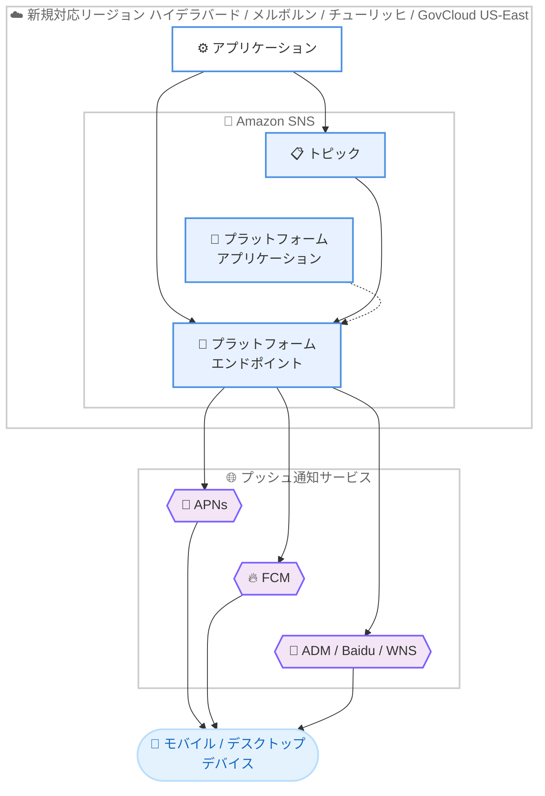

# Amazon SNS - モバイルプッシュ通知が追加の 4 リージョンで利用可能に

**リリース日**: 2026 年 11 月 12 日
**サービス**: Amazon Simple Notification Service (Amazon SNS)
**機能**: モバイルプッシュ通知のリージョン拡大

📊 [このアップデートのインフォグラフィックを見る](https://takech9203.github.io/aws-news-summary/20261112-amazon-sns-push-four-regions.html)

## 概要

Amazon SNS のモバイルプッシュ通知機能が、新たに 4 つの AWS リージョンで利用可能になりました。今回追加されたのは、アジアパシフィック (ハイデラバード)、アジアパシフィック (メルボルン)、欧州 (チューリッヒ)、AWS GovCloud (US-East) の各リージョンです。

Amazon SNS はフルマネージドの pub/sub サービスであり、AWS Lambda、Amazon SQS、Amazon Data Firehose、HTTP エンドポイント、SMS (AWS End User Messaging 経由)、プッシュ通知、E メールなど、複数のエンドポイントへのメッセージ配信を提供します。モバイルプッシュ通知機能を使用すると、Amazon Device Messaging (ADM)、Apple Push Notification Service (APNs)、Baidu Cloud Push (Baidu)、Firebase Cloud Messaging (FCM)、Windows Push Notification Services (WNS) の 5 つのプッシュ通知サービスを通じて、モバイルデバイスやデスクトップ上のアプリに直接メッセージを配信できます。

今回のリージョン拡大により、インド、オーストラリア、スイスにワークロードを持つお客様や、米国政府関連のコンプライアンス要件を持つお客様が、アプリケーションと同一リージョン内でプッシュ通知基盤を構築できるようになります。

**アップデート前の課題**

このアップデート以前には、以下の課題や制限がありました。

- ハイデラバード、メルボルン、チューリッヒの各リージョンにワークロードを配置しているお客様は、モバイルプッシュ通知のために他リージョンの Amazon SNS を利用する必要があった
- クロスリージョン構成により、アーキテクチャが複雑化し、リージョン間のレイテンシーやデータ所在地 (データレジデンシー) の考慮が必要だった
- AWS GovCloud (US-East) を利用する政府機関や規制業種のお客様は、GovCloud 環境内でモバイルプッシュ通知を完結できなかった

**アップデート後の改善**

今回のアップデートにより、以下が可能になりました。

- 追加された 4 リージョン内でプラットフォームアプリケーションとエンドポイントを作成し、プッシュ通知を直接送信できるようになった
- アプリケーション本体と同一リージョンで通知基盤を構築でき、アーキテクチャがシンプルになり、データレジデンシー要件への対応が容易になった
- AWS GovCloud (US-East) において、コンプライアンス要件を満たしながらモバイルプッシュ通知を利用できるようになった

## アーキテクチャ図



新規対応リージョン内でアプリケーションから Amazon SNS のトピックまたはプラットフォームエンドポイントに発行されたメッセージが、APNs や FCM などのプッシュ通知サービスを経由して各デバイスに配信される流れを示しています。

## サービスアップデートの詳細

### 主要機能

1. **新規対応リージョンの追加**
   - アジアパシフィック (ハイデラバード) : ap-south-2
   - アジアパシフィック (メルボルン) : ap-southeast-4
   - 欧州 (チューリッヒ) : eu-central-2
   - AWS GovCloud (US-East) : us-gov-east-1

2. **対応プッシュ通知サービス**
   - Amazon Device Messaging (ADM)
   - Apple Push Notification Service (APNs) : iOS および macOS に対応
   - Baidu Cloud Push (Baidu)
   - Firebase Cloud Messaging (FCM)
   - Windows Push Notification Services (WNS)

3. **既存機能との互換性**
   - プラットフォームアプリケーションの作成、プラットフォームエンドポイントの管理、トピック経由の配信など、既存リージョンと同様のモバイルプッシュ機能を利用可能
   - トピックへのサブスクリプションによるファンアウト配信と、エンドポイントへの直接配信の両方に対応

## 技術仕様

### モバイルプッシュ通知の仕組み

| 項目 | 詳細 |
|------|------|
| プラットフォームアプリケーション | プッシュ通知サービスの認証情報を登録して作成するリソース (PlatformApplicationArn) |
| プラットフォームエンドポイント | デバイストークンから作成する配信先リソース (EndpointArn) |
| 配信方式 | エンドポイントへの直接配信、またはトピック経由のファンアウト配信 |
| 通知の形式 | メッセージアラート、バッジ更新、サウンドアラート |
| 対応プッシュサービス | ADM、APNs、Baidu、FCM、WNS |

### セットアップの流れ

1. 対応するモバイルプラットフォームの認証情報とデバイストークンを取得する
2. 認証情報を使用して Amazon SNS でプラットフォームアプリケーション (PlatformApplicationArn) を作成する
3. プッシュ通知サービスからアプリとデバイスを表すデバイストークンを取得する
4. デバイストークンと PlatformApplicationArn からプラットフォームエンドポイント (EndpointArn) を作成する
5. EndpointArn を使用してメッセージを発行する

## 設定方法

### 前提条件

1. 新規対応リージョンのいずれかで AWS アカウントを利用できること
2. 対象プラットフォームのプッシュ通知サービスの認証情報 (APNs 証明書やトークン、FCM の認証情報など) を取得済みであること
3. モバイルアプリ側でデバイストークンを取得できる実装が完了していること

### 手順

#### ステップ 1: プラットフォームアプリケーションの作成

```bash
aws sns create-platform-application \
  --name MyMobileApp \
  --platform GCM \
  --attributes PlatformCredential="YOUR_FCM_API_KEY" \
  --region ap-south-2
```

新規対応リージョン (この例ではハイデラバードリージョン) に、FCM 用のプラットフォームアプリケーションを作成します。`--platform` には ADM、APNS、APNS_SANDBOX、BAIDU、GCM (FCM)、WNS などを指定できます。

#### ステップ 2: プラットフォームエンドポイントの作成

```bash
aws sns create-platform-endpoint \
  --platform-application-arn arn:aws:sns:ap-south-2:123456789012:app/GCM/MyMobileApp \
  --token "DEVICE_TOKEN" \
  --region ap-south-2
```

モバイルアプリから取得したデバイストークンを使用して、配信先となるプラットフォームエンドポイントを作成します。返却される EndpointArn が個々のデバイス上のアプリを表します。

#### ステップ 3: プッシュ通知の送信

```bash
aws sns publish \
  --target-arn arn:aws:sns:ap-south-2:123456789012:endpoint/GCM/MyMobileApp/abcd1234-5678-90ab-cdef-example \
  --message "こんにちは、ハイデラバードリージョンからのプッシュ通知です" \
  --region ap-south-2
```

作成したエンドポイントに対してメッセージを発行し、プッシュ通知サービス経由でデバイスに配信します。トピックにエンドポイントをサブスクライブさせて、ファンアウト配信することも可能です。

## メリット

### ビジネス面

- **データレジデンシー対応**: インド、オーストラリア、スイスなど、データ所在地に関する要件が厳しい地域で、国内またはリージョン内にプッシュ通知基盤を配置できる
- **政府・規制業種への対応**: AWS GovCloud (US-East) での利用が可能になり、米国政府関連のコンプライアンス要件を持つワークロードでもモバイルプッシュ通知を利用できる
- **ユーザー体験の向上**: アプリケーションと通知基盤を同一リージョンに配置することで、通知配信までの処理が効率化される

### 技術面

- **アーキテクチャの簡素化**: クロスリージョン構成が不要になり、構成管理や監視がシンプルになる
- **レイテンシーの削減**: アプリケーションバックエンドと同一リージョン内で SNS API を呼び出せるため、リージョン間通信のオーバーヘッドがなくなる
- **既存機能との一貫性**: 既存リージョンと同じ API、同じ 5 つのプッシュ通知サービスに対応しており、既存の実装をそのまま展開できる

## デメリット・制約事項

### 制限事項

- モバイルプッシュ通知 (プラットフォームアプリケーションの作成) に対応するリージョンは限定されており、全リージョンで利用できるわけではない。最新の対応状況は公式ドキュメントの対応リージョン一覧を確認する必要がある
- プラットフォームアプリケーションとエンドポイントはリージョナルリソースであり、リージョン間で自動的に共有されない

### 考慮すべき点

- 既存リージョンから新規リージョンへ移行する場合、プラットフォームアプリケーションの再作成とデバイストークンの再登録 (エンドポイントの再作成) が必要になる
- プッシュ通知サービス (APNs、FCM など) 側の認証情報の管理とローテーションは引き続き利用者側の責任となる

## ユースケース

### ユースケース 1: インド国内向けモバイルアプリの通知基盤

**シナリオ**: インド国内のユーザー向けにモバイルアプリを提供しており、データ所在地の要件からハイデラバードリージョンにバックエンドを構築している。

**実装例**:
```
ap-south-2 リージョンに FCM / APNs 用のプラットフォームアプリケーションを作成し、
アプリ起動時に取得したデバイストークンからエンドポイントを登録。
バックエンドの Lambda から SNS Publish API で通知を送信。
```

**効果**: バックエンドと通知基盤を同一リージョンに統合でき、データレジデンシー要件を満たしながら低レイテンシーで通知を配信できる。

### ユースケース 2: 米国政府関連ワークロードでの通知配信

**シナリオ**: AWS GovCloud (US-East) で稼働する政府機関向けシステムから、職員のモバイルデバイスに緊急連絡や業務通知を配信したい。

**実装例**:
```
us-gov-east-1 リージョンにプラットフォームアプリケーションを作成し、
システムのイベント (アラート発生など) をトリガーに SNS トピックへ発行。
トピックにサブスクライブされたモバイルエンドポイントへファンアウト配信。
```

**効果**: GovCloud 環境内で通知処理を完結でき、コンプライアンス要件を維持したままモバイル通知を実現できる。

### ユースケース 3: 欧州マルチリージョン構成での通知のローカライズ

**シナリオ**: スイスの金融機関が、チューリッヒリージョンで稼働する顧客向けアプリから取引通知やセキュリティアラートを配信したい。

**実装例**:
```
eu-central-2 リージョンにプラットフォームアプリケーションを作成し、
取引処理パイプラインから SNS 経由で APNs / FCM にプッシュ通知を配信。
配信ステータスは SNS の配信ステータスログで CloudWatch に記録。
```

**効果**: スイス国内のデータ処理要件に対応しながら、リアルタイムに近い取引通知を顧客に届けられる。

## 料金

Amazon SNS のモバイルプッシュ通知は、発行されたメッセージ数に基づく従量課金制です。今回のリージョン拡大による追加料金はなく、各リージョンの標準的な Amazon SNS 料金が適用されます。リージョンごとの具体的な料金は、Amazon SNS の料金ページで確認してください。

## 利用可能リージョン

今回新たに追加されたリージョンは以下の 4 つです。

- アジアパシフィック (ハイデラバード)
- アジアパシフィック (メルボルン)
- 欧州 (チューリッヒ)
- AWS GovCloud (US-East)

これにより、モバイルプッシュ通知は東京、大阪を含む 29 リージョンで利用可能になりました。対応リージョンの完全な一覧は、Amazon SNS デベロッパーガイドの対応リージョンページを参照してください。

## 関連サービス・機能

- **AWS End User Messaging**: SMS やその他のチャネルによるエンドユーザー向けメッセージングを提供し、SNS のプッシュ通知と組み合わせてマルチチャネル通知を構成できる
- **Amazon SQS / AWS Lambda**: SNS トピックのサブスクライバーとして、プッシュ通知と並行してバックエンド処理を実行するファンアウト構成を実現できる
- **Amazon CloudWatch**: SNS の配信ステータスログと連携し、プッシュ通知の成功率や失敗理由をモニタリングできる

## 参考リンク

- 📊 [インフォグラフィック](https://takech9203.github.io/aws-news-summary/20261112-amazon-sns-push-four-regions.html)
- [公式発表 (What's New)](https://aws.amazon.com/about-aws/whats-new/2026/11/amazon-sns-push-four-regions/)
- [ドキュメント: Amazon SNS モバイルプッシュ通知](https://docs.aws.amazon.com/sns/latest/dg/sns-mobile-application-as-subscriber.html)
- [ドキュメント: モバイルプッシュ通知の対応リージョン](https://docs.aws.amazon.com/sns/latest/dg/sns-mobile-push-supported-regions.html)
- [Amazon SNS 製品ページ](https://aws.amazon.com/sns/)
- [料金ページ](https://aws.amazon.com/sns/pricing/)

## まとめ

Amazon SNS のモバイルプッシュ通知がハイデラバード、メルボルン、チューリッヒ、AWS GovCloud (US-East) の 4 リージョンに拡大し、データレジデンシーやコンプライアンス要件を持つワークロードでも同一リージョン内で通知基盤を構築できるようになりました。該当リージョンでクロスリージョン構成によりプッシュ通知を運用しているお客様は、通知基盤のリージョン内への移行を検討することを推奨します。
