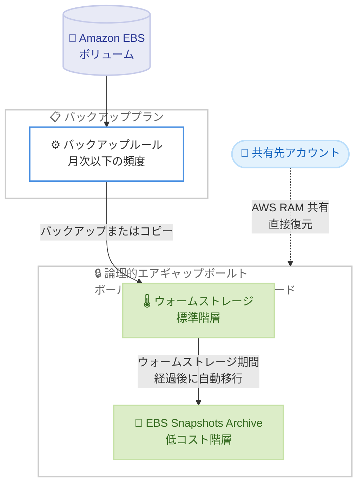

# AWS Backup - 論理的エアギャップボールトの Amazon EBS Snapshots Archive サポート

**リリース日**: 2026 年 11 月 12 日
**サービス**: AWS Backup
**機能**: 論理的エアギャップボールトにおける Amazon EBS Snapshots Archive サポート

📊 [このアップデートのインフォグラフィックを見る](https://takech9203.github.io/aws-news-summary/20261112-aws-backup-lag-vault-ebs-archive.html)

## 概要

AWS Backup の論理的エアギャップボールト (logically air-gapped vault) が、Amazon EBS Snapshots Archive をサポートしました。論理的エアギャップボールトに保存した Amazon EBS バックアップを、アクセス頻度の低いスナップショット向けの低コストストレージ階層である EBS Snapshots Archive へ移行できるようになります。

論理的エアギャップボールトは、コンプライアンスモードのボールトロックが常に有効化され、デフォルトでロックされた不変 (イミュータブル) のバックアップを保持する特殊なボールトです。AWS 所有キーまたはカスタマーマネージドキーによる暗号化で分離され、AWS RAM を通じたアカウント間・AWS Organizations 間での安全な共有と、共有先アカウントからの直接復元による迅速なリカバリをサポートします。今回のアップデートにより、ランサムウェア対策などで論理的エアギャップボールトを利用する組織が、長期保持やコンプライアンス要件を満たしながらストレージコストを削減できるようになりました。

**アップデート前の課題**

- 論理的エアギャップボールト内の Amazon EBS バックアップは、EBS Snapshots Archive 階層へ移行できず、ウォームストレージ (標準階層) の料金で保持し続ける必要があった
- 長期保持やコンプライアンス目的でバックアップを数年単位で保管する場合、アクセス頻度が低いにもかかわらずストレージコストが高止まりしていた
- コスト最適化のためにアーカイブ階層を使いたい場合、エアギャップによる保護を諦めて標準バックアップボールトを選択するといったトレードオフが発生していた

**アップデート後の改善**

- 論理的エアギャップボールト内の Amazon EBS バックアップを EBS Snapshots Archive へ移行し、エアギャップ保護と低コストの長期保持を両立できるようになった
- バックアッププランのライフサイクル設定でウォームストレージ期間を指定するだけで、アーカイブ階層への移行が自動化される
- コピー先としてだけでなく、論理的エアギャップボールトをプライマリバックアップターゲットとして使用する場合にもアーカイブ設定が可能になった

## アーキテクチャ図



月次以下の頻度で実行されるバックアップルールにより、Amazon EBS バックアップが論理的エアギャップボールトに保存され、指定したウォームストレージ期間の経過後に EBS Snapshots Archive 階層へ自動的に移行されます。

## サービスアップデートの詳細

### 主要機能

1. **論理的エアギャップボールト内での EBS スナップショットアーカイブ**
   - 論理的エアギャップボールトに保存した Amazon EBS バックアップを、低コストの EBS Snapshots Archive 階層へ移行可能
   - バックアップはボールトへのコピー完了後、設定したウォームストレージ期間の経過を経てアーカイブ階層に移行
   - アーカイブ後もコンプライアンスモードのボールトロックによる不変性と、暗号化による分離は維持される

2. **ライフサイクル設定による自動移行**
   - 月次以下の頻度で実行されるバックアップルールにおいて、コピーアクションの宛先に論理的エアギャップボールトを指定し、コピーライフサイクルで「Archive Amazon EBS snapshots」を選択
   - ウォームストレージに保持する期間と、合計保持期間を設定する
   - 論理的エアギャップボールトをプライマリバックアップターゲットとして使用する場合は、バックアップルールのライフサイクルでアーカイブを設定

3. **コンソール・CLI・SDK からの利用**
   - AWS Backup コンソール、AWS CLI、AWS SDK のいずれからも設定可能
   - 既存のバックアッププランの更新 (`update-backup-plan`) または新規作成 (`create-backup-plan`) で対応

## 技術仕様

### ライフサイクル要件

| 項目 | 詳細 |
|------|------|
| 対象リソース | Amazon EBS バックアップ (スナップショット) |
| バックアップルールの頻度 | 月次以下 (月 1 回またはそれより低頻度) |
| 合計保持期間 | ウォームストレージ期間より 90 日以上長く設定する必要がある |
| 保持期間の範囲 | ボールトの最小保持期間と最大保持期間の範囲内であること |
| ボールトの最小保持期間 | 7 日以上で設定 (論理的エアギャップボールト共通の仕様) |
| 暗号化 | AWS 所有キー (デフォルト) またはカスタマーマネージドキー |
| 課金区分 | 論理的エアギャップボールト内のストレージ・データ転送はすべて「AWS Backup」として課金 |

### API 変更履歴

今回のアップデートに関連する直近の AWS Backup API 変更は、awsapichanges.com では確認されていません (2026 年 11 月 13 日時点)。既存のバックアッププラン API のライフサイクル設定で対応します。

### カスタマーマネージドキー使用時のキーポリシー

ボールトをカスタマーマネージドキー (CMK) で暗号化している場合、このアーカイブオプションを有効化する前にキーポリシーの更新が必要です。詳細は[公式ドキュメントのキーポリシー設定](https://docs.aws.amazon.com/aws-backup/latest/devguide/logicallyairgappedvault.html)を参照してください。

## 設定方法

### 前提条件

1. 論理的エアギャップボールトが利用可能なリージョンであること (中国リージョンおよび AWS GovCloud (US) では利用不可)
2. EBS Snapshots Archive が利用可能なリージョンであること
3. CMK 暗号化のボールトを使用する場合は、事前にキーポリシーを更新していること

### 手順

#### ステップ 1: 論理的エアギャップボールトの作成 (未作成の場合)

```bash
aws backup create-logically-air-gapped-backup-vault \
  --backup-vault-name MyLAGVault \
  --min-retention-days 30 \
  --max-retention-days 3650
```

最小保持期間 30 日、最大保持期間 3,650 日の論理的エアギャップボールトを作成します。ボールトロックはコンプライアンスモードで自動的に有効化されます。

#### ステップ 2: バックアッププランでアーカイブ付きコピーを設定

```bash
aws backup update-backup-plan \
  --backup-plan-id <plan-id> \
  --backup-plan '{
    "BackupPlanName": "MonthlyEBSPlan",
    "Rules": [{
      "RuleName": "MonthlyToLAGVault",
      "TargetBackupVaultName": "Default",
      "ScheduleExpression": "cron(0 5 1 * ? *)",
      "Lifecycle": {"DeleteAfterDays": 455},
      "CopyActions": [{
        "DestinationBackupVaultArn": "arn:aws:backup:ap-northeast-1:123456789012:backup-vault:MyLAGVault",
        "Lifecycle": {
          "OptInToArchiveForSupportedResources": true,
          "MoveToColdStorageAfterDays": 90,
          "DeleteAfterDays": 455
        }
      }]
    }]
  }'
```

毎月 1 日に実行されるバックアップルールに、論理的エアギャップボールトへのコピーアクションを追加します。コピーライフサイクルでアーカイブを有効化し、ウォームストレージに 90 日間保持した後にアーカイブ階層へ移行、合計 455 日間保持する設定です (合計保持期間はウォームストレージ期間 + 90 日以上が必要)。

#### ステップ 3: 移行状況の確認

```bash
aws backup list-recovery-points-by-backup-vault \
  --backup-vault-name MyLAGVault
```

ボールト内のリカバリポイントの一覧と、各リカバリポイントのライフサイクル状態を確認します。論理的エアギャップボールト内のリカバリポイント ARN は `arn:aws:backup:{region}:{account-id}:recovery-point:*` 形式になる点に注意してください。

## メリット

### ビジネス面

- **ストレージコストの削減**: アクセス頻度の低い長期保持バックアップを低コストのアーカイブ階層に移行することで、保管コストを削減できる
- **コンプライアンス対応**: 不変バックアップによる長期保持要件 (監査・規制対応) を、コストを抑えながら満たすことができる
- **セキュリティとコストの両立**: ランサムウェア対策としてのエアギャップ保護を、コスト最適化を理由に諦める必要がなくなる

### 技術面

- **ライフサイクルの自動化**: ウォームストレージ期間を設定するだけで、アーカイブ階層への移行が自動的に実行される
- **一貫した管理**: バックアッププランの一元管理の中でアーカイブ設定が完結し、個別のスナップショット操作が不要
- **迅速なリカバリ体制の維持**: AWS RAM による共有と直接復元の仕組みはそのまま利用でき、インシデント時の RTO 短縮に貢献する

## デメリット・制約事項

### 制限事項

- アーカイブ階層へ移行した EBS バックアップは、別のボールトや別リージョンへコピーできない (Multi-party approval による復元アクセスバックアップボールトからのコピーも不可)。別アカウント・別リージョンにコピーを保持したい場合は、ウォームストレージにある間にコピーする必要がある
- アーカイブ対象は月次以下の頻度で実行されるバックアップルールに限定される (EBS Snapshots Archive 共通の要件)
- 合計保持期間はウォームストレージ期間より 90 日以上長く設定する必要がある

### 考慮すべき点

- アーカイブ階層からの復元はウォームストレージからの復元より時間がかかるため、RTO 要件と照らして移行タイミングを設計する必要がある
- CMK 暗号化のボールトでは、アーカイブ有効化前にキーポリシーの更新が必要
- 論理的エアギャップボールトはボールトロックがコンプライアンスモードで固定されるため、保持期間の設計は慎重に行う必要がある

## ユースケース

### ユースケース 1: ランサムウェア対策と長期保持の両立

**シナリオ**: 金融機関が規制要件により EBS ボリュームのバックアップを 7 年間保持する必要があり、同時にランサムウェア攻撃からバックアップを保護したい。

**実装例**:
```
月次バックアップルール
  → 論理的エアギャップボールトへコピー
  → ウォームストレージ 90 日 → アーカイブ階層へ自動移行
  → 合計保持期間 7 年
```

**効果**: 不変かつ分離されたバックアップを低コストで 7 年間保持でき、規制要件とセキュリティ要件を同時に満たせる。

### ユースケース 2: 組織全体のバックアップコスト最適化

**シナリオ**: AWS Organizations 配下の多数のアカウントで論理的エアギャップボールトを運用しており、長期保持バックアップのストレージコストが増大している。

**実装例**:
```
AWS Organizations のバックアップポリシーで
月次ルールのコピーライフサイクルにアーカイブ設定を一括適用
```

**効果**: 組織全体で一貫したアーカイブポリシーを適用し、セキュリティ水準を維持したままストレージコストを削減できる。

### ユースケース 3: 共有ボールトによる迅速な復旧体制

**シナリオ**: 本番アカウントが侵害された場合に備え、別の復旧用アカウントからバックアップを直接復元できる体制を構築したい。直近のバックアップは迅速に復元し、古いバックアップは低コストで保持したい。

**実装例**:
```
論理的エアギャップボールトを AWS RAM で復旧用アカウントに共有
直近 90 日分: ウォームストレージ (迅速な復元)
90 日以降: アーカイブ階層 (低コスト保持)
```

**効果**: インシデント時は直近のウォームストレージ上のバックアップから迅速に復旧しつつ、長期保持分のコストを最適化できる。

## 料金

論理的エアギャップボールト内のストレージおよびデータ転送の料金は、すべて「AWS Backup」の課金として発生します。EBS Snapshots Archive はウォームストレージ (標準階層) よりも低コストのストレージ階層であり、アクセス頻度の低い長期保持バックアップのコストを削減できます。アーカイブ階層からの復元には取り出しに関する料金と時間が発生するため、詳細は [AWS Backup 料金ページ](https://aws.amazon.com/backup/pricing/)を参照してください。

## 利用可能リージョン

論理的エアギャップボールトと Amazon EBS Snapshots Archive の両方が利用可能なすべての AWS リージョンで利用できます。なお、論理的エアギャップボールトは中国 (北京)、中国 (寧夏)、AWS GovCloud (US-East)、AWS GovCloud (US-West) では現在利用できません。最新の対応状況は[リージョン別機能可用性](https://docs.aws.amazon.com/aws-backup/latest/devguide/backup-feature-availability.html#features-by-region)を確認してください。

## 関連サービス・機能

- **Amazon EBS Snapshots Archive**: アクセス頻度の低いスナップショット向けの低コストストレージ階層。今回のアップデートで論理的エアギャップボールトからの移行先として利用可能になった
- **AWS Backup Vault Lock**: バックアップの不変性を保証する機能。論理的エアギャップボールトではコンプライアンスモードが常に有効
- **AWS RAM**: 論理的エアギャップボールトをアカウント間で共有し、共有先アカウントからの直接復元を可能にするリソース共有サービス
- **AWS Backup Audit Manager**: 特定リソースのバックアップが論理的エアギャップボールトに保存されていることを監査するコントロールを提供

## 参考リンク

- 📊 [インフォグラフィック](https://takech9203.github.io/aws-news-summary/20261112-aws-backup-lag-vault-ebs-archive.html)
- [公式発表 (What's New)](https://aws.amazon.com/about-aws/whats-new/2026/11/aws-backup-lag-vault-ebs-archive/)
- [ドキュメント: Logically air-gapped vault](https://docs.aws.amazon.com/aws-backup/latest/devguide/logicallyairgappedvault.html)
- [ドキュメント: リージョン別機能可用性](https://docs.aws.amazon.com/aws-backup/latest/devguide/backup-feature-availability.html#features-by-region)
- [料金ページ](https://aws.amazon.com/backup/pricing/)

## まとめ

論理的エアギャップボールトが EBS Snapshots Archive をサポートしたことで、ランサムウェア対策としてのエアギャップ保護と、長期保持バックアップのコスト最適化を両立できるようになりました。論理的エアギャップボールトで EBS バックアップを長期保持している場合は、月次以下のバックアップルールのライフサイクル設定を見直し、アーカイブ階層の活用によるコスト削減を検討することを推奨します。アーカイブ後は別ボールト・別リージョンへのコピーができなくなるため、コピー戦略はウォームストレージ期間中に完了するよう設計してください。
