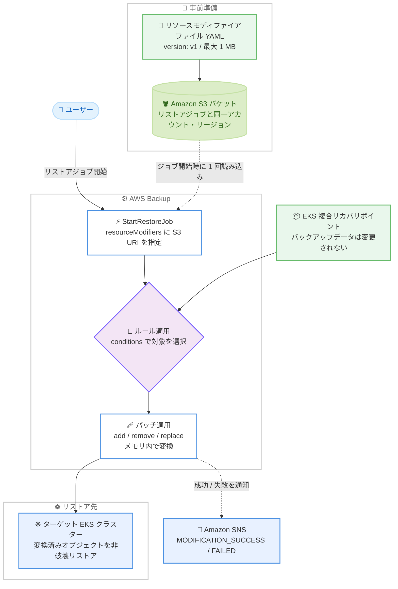

# AWS Backup - Amazon EKS リストア時のリソースモディファイアサポート

**リリース日**: 2026 年 11 月 12 日
**サービス**: AWS Backup
**機能**: Amazon EKS リストアにおけるリソースモディファイア (Resource Modifiers)

📊 [このアップデートのインフォグラフィックを見る](https://takech9203.github.io/aws-news-summary/20261112-aws-backup-resource-modifiers-eks.html)

## 概要

AWS Backup が、Amazon EKS バックアップのリストア時にリソースモディファイア (Resource Modifiers) をサポートしました。リソースモディファイアは、リストア中に Kubernetes オブジェクトを変換するルールセットです。YAML ファイルで変換ルールを一度定義しておけば、AWS Backup がリストアプロセス中に自動的にルールを適用します。変換はリストア中にメモリ内で適用されるため、元のバックアップデータは変更されません。

この機能は、クロスアカウントやクロスリージョンにコピーされたバックアップのリストアで特に有効です。別のアカウントやリージョンから EKS バックアップをリストアすると、IAM ロール、データベースエンドポイント、Amazon ECR レジストリ URI など、ソース環境への参照がクラスターに残ることがあります。リソースモディファイアを使用することで、これらの参照をリストア時に自動で書き換えられるようになり、クロスアカウント・クロスリージョンのディザスタリカバリ (DR) ワークフローの信頼性が向上します。

DR 戦略として EKS クラスターのバックアップを別アカウント・別リージョンに保管している組織や、ネームスペースの付け替えなどリストア時のカスタマイズを必要とする Kubernetes 運用チームが主な対象ユーザーです。

**アップデート前の課題**

このアップデート以前は、別環境へのリストア後に手作業での修正が必要でした。

- クロスアカウント・クロスリージョンリストア後、ソース環境を指す ECR イメージ URI、データベースエンドポイント、ストレージクラス名などを手動で特定して修正する必要があった
- 手作業での修正は時間がかかり、ミスが発生しやすく、DR の復旧時間 (RTO) を悪化させる要因になっていた
- リストアのたびに同じ修正作業を繰り返す必要があり、DR 手順の自動化が困難だった

**アップデート後の改善**

今回のアップデートにより、リストア時の変換が自動化されました。

- 変換ルールを YAML ファイルで一度定義すれば、AWS Backup がリストア中に自動適用するようになった
- JSON Patch 形式の `add`、`remove`、`replace` 操作により、イメージ URI やエンドポイントなど任意のフィールドを書き換えられるようになった
- リストア後の手動修正が不要になり、クロスアカウント・クロスリージョン DR の信頼性と再現性が向上した

## アーキテクチャ図



S3 に配置した YAML ファイルの変換ルールを、AWS Backup がリストアジョブ開始時に 1 回読み込み、リカバリポイント内の Kubernetes オブジェクトにメモリ内でパッチを適用してからターゲットクラスターへリストアする流れを示しています。

## サービスアップデートの詳細

### 主要機能

1. **YAML による変換ルールの宣言的定義**
   - `version: v1` と `resourceModifierRules` から成る YAML ファイルで変換ルールを定義する
   - ファイルを Amazon S3 バケットにアップロードし、リストアジョブ開始時に `resourceModifiers` メタデータキーで S3 URI を渡す
   - AWS Backup はジョブ開始時にファイルを 1 回だけ読み込み、そのコピーをリストア全体で使用する (開始後のファイル変更や削除はジョブに影響しない)

2. **conditions による対象オブジェクトの柔軟な選択**
   - `groupResource`: `apps/v1/deployments` のような group/version/resource 形式で対象リソース種別を指定
   - `resourceNameRegex`: RE2 構文の正規表現でオブジェクト名を完全一致で選択
   - `namespaces`: バックアップ時点のネームスペース名のリストで絞り込み
   - `labelSelector`: ラベルのキーと値の完全一致で絞り込み
   - 各ルールは少なくとも 1 つの条件が必須で、複数指定時はすべての条件に一致するオブジェクトのみが対象になる

3. **JSON Patch 形式のパッチ操作**
   - `add`、`remove`、`replace` の 3 種類の操作をサポートし、`path` は JSON Pointer 構文 (配列インデックス含む) で指定する
   - 配列末尾への追加は `-` インデックス (例: `/spec/template/spec/containers/-`) を使用できる
   - パッチとルールは記載順に適用され、同じ `path` を対象とする場合は最後のものが有効になる (最も具体的なルールを最後に記載する)

4. **SNS 通知による変更結果の可視化**
   - `EKS_RESTORE_MODIFICATION_SUCCESS`: ルールに一致したオブジェクトにすべてのパッチが正常適用された
   - `EKS_RESTORE_MODIFICATION_FAILED`: ルールに一致したがパッチの適用に失敗した (オブジェクトは成功した変更のみ適用された状態でリストアが試行される)
   - 変更失敗があってもジョブステータスは変わらず、ステータスメッセージに追記される

## 技術仕様

### リソースモディファイアファイルの要件

| 項目 | 詳細 |
|------|------|
| ファイル形式 | UTF-8 の有効な YAML、`version: v1` が必須 |
| 最大サイズ | 1 MB |
| 禁止事項 | YAML アンカー・エイリアスの使用、重複キー |
| 配置場所 | リストアジョブと同一アカウント・同一リージョンの S3 バケット |
| 必要な権限 | `StartRestoreJob` を呼び出すプリンシパルに対象ファイルへの `s3:GetObject` 権限 (`iam-role-arn` で渡すロールではない点に注意) |
| 検証タイミング | ジョブ送信時に検証され、ファイルが欠落・アクセス不可・無効な場合はジョブ開始前に拒否される |
| 指定方法 | リストアメタデータの `resourceModifiers` キーに S3 URI を指定 (省略可能) |

### リソースモディファイアファイルのスキーマ

```yaml
version: v1
resourceModifierRules:
  - conditions:
      groupResource: apps/v1/deployments   # group/version/resource 形式
      resourceNameRegex: "my-app.*"        # RE2 構文、名前全体に一致
      namespaces:
        - production
      labelSelector:
        matchLabels:
          app: payment
    patches:
      - operation: replace
        path: "/spec/storageClassName"
        value: "new-sc"
      - operation: remove
        path: "/metadata/uid"
```

### パッチ操作の仕様

| 操作 | 説明 | value |
|------|------|-------|
| `add` | パスの最終フィールドを追加。配列はインデックス位置に挿入、`-` で末尾に追加 | 必須 (null 不可) |
| `replace` | 既存フィールドの値を置換 | 必須 (null 不可) |
| `remove` | 既存フィールドを削除 | 指定不可 |

**注意点**: パッチの親パスはオブジェクト上に既に存在している必要があります。たとえば `labels` マップを持たないオブジェクトに `/metadata/labels/team` を `add` すると失敗します。また、パスにワイルドカードは使用できないため、複数の配列要素を変更する場合はインデックスごとにパッチを記述します。スタンドアロンの JSON Patch とは異なり、1 つの操作が失敗しても AWS Backup は残りの操作を続行します。

## 設定方法

### 前提条件

1. AWS Backup で Amazon EKS の複合リカバリポイント (EKS クラスター状態 + 永続ボリューム) を取得済みであること
2. リストアジョブと同一アカウント・同一リージョンに S3 バケットがあること
3. `StartRestoreJob` を呼び出すプリンシパルがリソースモディファイアファイルへの `s3:GetObject` 権限を持つこと
4. リストア用 IAM ロール (例: `AWSBackupServiceRolePolicyForRestores` がアタッチされたロール) が用意されていること

### 手順

#### ステップ 1: リソースモディファイアファイルを作成

```yaml
# modifiers.yaml: クロスアカウント・クロスリージョンリストア用の例
# アカウント 111122223333 / us-east-1 からアカウント 444455556666 / us-west-2 へのリストア
version: v1
resourceModifierRules:
  - conditions:
      groupResource: apps/v1/deployments
      namespaces:
        - production
      labelSelector:
        matchLabels:
          app: payment
    patches:
      - operation: replace
        path: "/spec/template/spec/containers/0/image"
        value: "444455556666.dkr.ecr.us-west-2.amazonaws.com/payment-service:v2.1.0"
      - operation: replace
        path: "/spec/template/spec/containers/0/env/0/value"
        value: "payment-db.cluster-dst789.us-west-2.rds.amazonaws.com"
      - operation: add
        path: "/metadata/annotations/backup.aws.com~1restored-from"
        value: "arn:aws:backup:us-east-1:111122223333:recovery-point:rp-abc123"
```

`production` ネームスペースの `app: payment` ラベルを持つ Deployment を対象に、コンテナイメージをリストア先アカウントの ECR URI へ、データベースエンドポイントをリストア先リージョンの RDS エンドポイントへ置換し、リストア元のリカバリポイントを示す注釈を追加するルールです。JSON Pointer では `~1` がキー名中のスラッシュ `/` のエスケープシーケンスとなるため、`backup.aws.com~1restored-from` は注釈キー `backup.aws.com/restored-from` を指します。

#### ステップ 2: ファイルを S3 にアップロード

```bash
aws s3 cp modifiers.yaml s3://my-backup-bucket/restore-configs/account-modifiers.yaml
```

作成した YAML ファイルを、リストアジョブを実行するアカウント・リージョンと同じ S3 バケットにアップロードしています。バケットポリシーが呼び出し元プリンシパルを拒否しないことを確認してください (AWS Backup はユーザーのネットワークからではなくユーザーに代わってファイルを読み取るため、特定の VPC エンドポイントや IP 範囲にアクセスを制限するポリシーは、IAM 権限が正しくても読み取りをブロックします)。

#### ステップ 3: resourceModifiers を指定してリストアジョブを開始

```bash
aws backup start-restore-job \
    --recovery-point-arn "arn:aws:backup:us-west-2:444455556666:recovery-point:composite:eks/my-cluster-20261110" \
    --iam-role-arn "arn:aws:iam::444455556666:role/AWSBackupDefaultServiceRole" \
    --metadata '{"clusterName":"dr-cluster","newCluster":"false","resourceModifiers":"s3://my-backup-bucket/restore-configs/account-modifiers.yaml"}' \
    --resource-type "EKS"
```

`StartRestoreJob` のメタデータに `resourceModifiers` キーで S3 URI を渡してリストアジョブを開始しています。AWS Backup はジョブ送信時にファイルを検証し、問題があればジョブ開始前に拒否します。

#### ステップ 4: リストア結果と変更結果を確認

```bash
# リストアジョブの進捗を確認
aws backup describe-restore-job --restore-job-id <restore-job-id>
```

ジョブの進捗とステータスメッセージを確認しています。変更の成否をオブジェクト単位で把握するには、SNS イベント通知 (`EKS_RESTORE_MODIFICATION_SUCCESS` / `EKS_RESTORE_MODIFICATION_FAILED`) を購読します。

## メリット

### ビジネス面

- **RTO の短縮**: リストア後の手動修正作業が不要になり、クロスアカウント・クロスリージョン DR の復旧時間を短縮できる
- **DR 手順の自動化と標準化**: 変換ルールをコード (YAML) として管理できるため、DR 手順の属人化を排除し、リストアテストの再現性を確保できる
- **ヒューマンエラーの削減**: 手作業での参照修正に伴う修正漏れや誤修正のリスクを低減できる

### 技術面

- **非破壊的な変換**: 変換はメモリ内で適用され、元のバックアップデータ (リカバリポイント) は一切変更されない
- **柔軟な対象選択**: リソース種別、名前の正規表現、ネームスペース、ラベルセレクタの組み合わせで変換対象を精密に制御できる
- **可観測性**: SNS イベント通知によりオブジェクト単位で変更の成功・失敗を追跡でき、ジョブステータスメッセージでも変更失敗の有無を確認できる

## デメリット・制約事項

### 制限事項

- ファイルは最大 1 MB で、YAML アンカー・エイリアスや重複キーは使用できない
- パッチのパスにワイルドカードは使用できず、複数の配列要素を変更するにはインデックスごとにパッチを記述する必要がある
- `resourceNameRegex` は RE2 構文のため、先読み・後読み (lookaround) や後方参照は使用できない
- S3 バケットはリストアジョブと同一アカウント・同一リージョンに配置する必要がある
- 実行時にパッチが失敗しても後続の操作は継続されるため、オブジェクトが部分的に変更された状態でリストアされる可能性がある

### 考慮すべき点

- AWS Backup は変更後のオブジェクトが Kubernetes 的に有効かどうかを検証しない。必須フィールドの削除や型の不一致があるとクラスター側でオブジェクトが拒否され、そのオブジェクトのリストアが失敗する。本番で利用する前に非本番環境のリストアでルールをテストすることが推奨されている
- ルールは記載順に適用され、最も具体的な一致が優先されるわけではないため、具体的なルールほど後に記載する必要がある
- `s3:GetObject` 権限が必要なのは `StartRestoreJob` を呼び出すプリンシパル (API 呼び出し元) であり、`iam-role-arn` で渡すロールではない点に注意が必要
- IRSA (IAM Roles for Service Accounts) の OIDC プロバイダー参照はリソースモディファイアだけでは解決できない場合があり、クロスクラスターの可搬性が必要なワークロードには EKS Pod Identity の利用が推奨されている

## ユースケース

### ユースケース 1: クロスリージョン DR でのエンドポイント・イメージ URI の書き換え

**シナリオ**: us-east-1 の本番 EKS クラスターのバックアップを us-west-2 にコピーしており、DR 発動時に us-west-2 でリストアする。コンテナイメージの ECR URI と RDS エンドポイントが us-east-1 を指したままではアプリケーションが起動しない。

**実装例**:
```yaml
version: v1
resourceModifierRules:
  - conditions:
      groupResource: apps/v1/deployments
    patches:
      - operation: replace
        path: "/spec/template/spec/containers/0/image"
        value: "444455556666.dkr.ecr.us-west-2.amazonaws.com/payment-service:v2.1.0"
      - operation: replace
        path: "/spec/template/spec/containers/0/env/0/value"
        value: "payment-db.cluster-dst789.us-west-2.rds.amazonaws.com"
```

**効果**: DR リストアと同時にリージョン固有の参照が書き換わり、リストア後の手動修正なしでアプリケーションを起動できる。RTO が短縮され、DR テストの自動化も容易になる。

### ユースケース 2: 同一クラスター内でのネームスペース付け替えリストア

**シナリオ**: 本番ネームスペースのバックアップを、同じクラスター内の検証用ネームスペースとしてリストアし、本番に影響を与えずにデータ検証やトラブルシューティングを行いたい。EKS リストアは非破壊的で既存オブジェクトを上書きしないため、同名ネームスペースへのそのままのリストアでは既存オブジェクトがスキップされてしまう。

**実装例**:
```yaml
# AWS Storage Blog で紹介されている、リストア先ネームスペースを
# 付け替えるアプローチ (metadata.namespace 等を書き換えるルールを定義)
version: v1
resourceModifierRules:
  - conditions:
      groupResource: v1/namespaces
      resourceNameRegex: "production"
    patches:
      - operation: replace
        path: "/metadata/name"
        value: "production-restore-test"
```

**効果**: 稼働中のワークロードに影響を与えずに、同一クラスター内でバックアップデータの検証やリストアテストを実施できる。詳細な手順は AWS Storage Blog の記事を参照。

### ユースケース 3: ストレージクラス名の変換

**シナリオ**: リストア先クラスターではソースクラスターと異なる CSI ドライバー・ストレージクラス構成を採用しており、PVC が参照するストレージクラス名をリストア時に変換したい。

**実装例**:
```yaml
version: v1
resourceModifierRules:
  - conditions:
      groupResource: v1/persistentvolumeclaims
    patches:
      - operation: replace
        path: "/spec/storageClassName"
        value: "gp3-encrypted"
```

**効果**: リストア先クラスターのストレージ構成に合わせて PVC を自動変換でき、ストレージクラス不一致によるボリュームプロビジョニング失敗を防止できる。

## 料金

リソースモディファイア機能自体に追加料金はありません (What's New での言及なし)。AWS Backup の通常のバックアップストレージ料金とリストア料金が適用されます。また、リソースモディファイアファイルを格納する Amazon S3 の標準料金 (ストレージ・リクエスト) が別途発生します。

詳細は [AWS Backup の料金ページ](https://aws.amazon.com/backup/pricing/) を参照してください。

## 利用可能リージョン

AWS Backup が Amazon EKS バックアップをサポートするすべての商用 AWS リージョンおよび AWS GovCloud (US) リージョンで利用可能です。

## 関連サービス・機能

- **Amazon EKS**: リストア対象の Kubernetes マネージドサービス。EKS バックアップはクラスター状態と永続ボリュームを含む複合リカバリポイントとして管理される
- **Amazon S3**: リソースモディファイアファイルの配置場所。リストアジョブと同一アカウント・リージョンのバケットが必要
- **Amazon SNS**: 変更の成功・失敗をオブジェクト単位で通知する `EKS_RESTORE_MODIFICATION_SUCCESS` / `EKS_RESTORE_MODIFICATION_FAILED` イベントを配信
- **EKS Pod Identity**: クロスクラスターリストアの可搬性を高める IAM 連携方式。OIDC プロバイダーに依存する IRSA の代替として推奨
- **AWS Backup 論理的エアギャップボールト**: EKS バックアップのクロスアカウント共有・リストアと組み合わせることで、ランサムウェア対策を含む DR 戦略を強化できる

## 参考リンク

- 📊 [インフォグラフィック](https://takech9203.github.io/aws-news-summary/20261112-aws-backup-resource-modifiers-eks.html)
- [公式発表 (What's New)](https://aws.amazon.com/about-aws/whats-new/2026/11/aws-backup-resource-modifiers-eks/)
- [AWS Blog: Remap Amazon EKS namespaces on restore with AWS Backup resource modifiers](https://aws.amazon.com/blogs/storage/remap-amazon-eks-namespaces-on-restore-with-aws-backup-resource-modifiers/)
- [ドキュメント: Restore an Amazon EKS cluster (Restore customizations)](https://docs.aws.amazon.com/aws-backup/latest/devguide/restoring-eks.html)
- [料金ページ](https://aws.amazon.com/backup/pricing/)

## まとめ

リソースモディファイアにより、これまで手作業で行っていたクロスアカウント・クロスリージョンリストア後の参照修正 (ECR URI、データベースエンドポイント、ストレージクラス名など) を YAML ベースのルールで自動化できるようになりました。EKS の DR 戦略を運用している場合は、既存のリストア手順にリソースモディファイアを組み込み、非本番環境でのリストアテストでルールの動作を検証することを推奨します。
