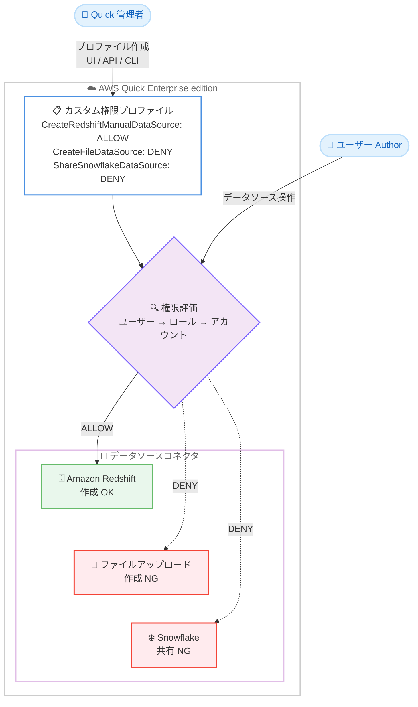

# AWS Quick - 構造化データソースの制限によるきめ細かなガバナンス強化

**リリース日**: 2026 年 11 月 12 日
**サービス**: AWS Quick
**機能**: カスタム権限による構造化データソースコネクタの制限 (Structured Data Source Restrictions)

📊 [このアップデートのインフォグラフィックを見る](https://takech9203.github.io/aws-news-summary/20261112-aws-quick-structured-data-source-restrictions.html)

## 概要

AWS Quick は、カスタム権限 (Custom Permissions) プロファイルを通じて、構造化データソースコネクタ単位でのきめ細かな制限機能の一般提供を開始しました。管理者は、ユーザーがどの種類のデータソースを作成・更新・共有できるかを、コネクタごとに個別に制御できるようになります。

この機能は AWS Quick Enterprise edition の管理者向けに提供され、Quick の管理コンソール UI、API、AWS CLI のいずれからも設定できます。例えば、Amazon Redshift データソースの作成は許可しつつ、ファイルアップロードによるデータソース作成はブロックする、特定コネクタのデータソース共有のみを禁止する、といった柔軟な制御が可能です。組織はセルフサービス分析を推進しながら、データガバナンス要件を強制できます。

**アップデート前の課題**

- 以前はデータソースに対する制限が「すべてのデータソースの作成・更新の禁止」「すべてのデータソースの共有の禁止」といった一括制御に限られ、コネクタの種類ごとに制御を分けることができなかった
- 承認済みのデータウェアハウス (例: Amazon Redshift) への接続は許可しつつ、統制外のデータ持ち込み (例: ファイルアップロード) のみを禁止する、といった要件を Quick の権限機能だけでは実現しにくかった
- ガバナンス要件を満たすために、データソース作成を全面的に禁止すると、セルフサービス分析の利便性が大きく損なわれていた

**アップデート後の改善**

- コネクタ単位 (例: `Snowflake`、`RedshiftManual`、`GoogleBigQuery` など) で、作成 (Create)・更新 (Update)・共有 (Share) の 3 つの権限を個別に制限できるようになった
- 特定のコネクタについてデータソースの共有のみをブロックするなど、一括制限よりも精緻なガバナンスポリシーを定義できるようになった
- Quick の UI に加えて API・AWS CLI でもプロファイルを管理できるため、ガバナンス設定の自動化・コード化 (Infrastructure as Code) が容易になった

## アーキテクチャ図



管理者が定義したカスタム権限プロファイルに基づき、ユーザーのデータソース操作がコネクタ単位で評価され、許可または拒否されます。権限はユーザー、ロール、アカウントの順で評価され、より具体的なレベルの設定が優先されます。

## サービスアップデートの詳細

### 主要機能

1. **コネクタ単位のデータソース権限制御**
   - 各データソースコネクタに対して、作成 (Create)・更新 (Update)・共有 (Share) の 3 つの権限を個別に制限可能
   - 例: Amazon Redshift データソースの作成は許可し、Snowflake データソースの作成は禁止する
   - コネクタ全体 (作成・更新・共有のすべて) をまとめて制限することも可能

2. **UI・API・AWS CLI による設定**
   - Quick 管理コンソールの [Capabilities & features] セクションにある [Connectors] グループの [Data sources] 配下で、コネクタごとに設定可能
   - `create-custom-permissions` などの API / CLI 操作で、`Create{{Connector}}DataSource` のようなケイパビリティ名を指定してプロファイルを定義可能
   - 管理コンソールの Check permissions 機能で、どのプロファイルがどのレベル (ユーザー、ロール、アカウント) で適用されているかを確認可能

3. **複数レベルでの適用と優先順位**
   - カスタム権限プロファイルはアカウント、ロール (Admin、Author、Reader)、ユーザーの各レベルで割り当て可能
   - ユーザーレベル → ロールレベル → アカウントレベルの順に評価され、最も具体的なレベルの設定が優先される
   - カスタム権限はスコープダウンポリシーであり、ロールが持つデフォルトの権限を超える権限の付与はできない

## 技術仕様

### データソースコネクタのケイパビリティ名

API / CLI でコネクタ単位の権限を設定する際は、以下のケイパビリティ名を使用します。`{{Connector}}` には `Snowflake`、`RedshiftManual`、`GoogleBigQuery` などのコネクタ名が入ります。

| 権限 | ケイパビリティ名 |
|------|------------------|
| コネクタのすべての権限 | `{{Connector}}DataSource` |
| 作成 | `Create{{Connector}}DataSource` |
| 更新 | `Update{{Connector}}DataSource` |
| 共有 | `Share{{Connector}}DataSource` |

### 全コネクタ共通の制限との関係

| 設定項目 | 動作 |
|----------|------|
| Creating or updating all data sources | すべてのコネクタのデータソース作成・更新を一括で禁止 |
| Sharing data sources | すべてのコネクタのデータソース共有を一括で禁止 |
| コネクタ単位の権限 | 上記の一括制限を設定した場合、該当する操作はすべてのコネクタで制限される。制限していないコネクタ権限は許可されたまま |

親ケイパビリティを `DENY` にすると、その配下の子機能も拒否されます。親が `DENY` の状態で子機能を `ALLOW` にしても子機能は制限されたままとなるため、特定の子機能のみを許可したい場合は、親を許可したまま制限したい子機能のみを `DENY` にします。

### 必要な IAM 権限

カスタム権限プロファイルの管理には、Quick 管理者であることに加えて `quicksight:CreateCustomPermissions`、`quicksight:UpdateCustomPermissions`、`quicksight:ListCustomPermissionAssignments` などの IAM 権限が必要です。

## 設定方法

### 前提条件

1. AWS Quick Enterprise edition を利用していること
2. Quick 管理者権限を持つユーザーであること
3. カスタム権限関連の IAM 権限 (`quicksight:CreateCustomPermissions` など) が付与されていること

### 手順

#### ステップ 1: カスタム権限プロファイルの作成

```bash
aws quicksight create-custom-permissions \
  --aws-account-id 123456789012 \
  --custom-permissions-name RestrictSnowflake \
  --capabilities '{"CreateSnowflakeDataSource": "DENY", "ShareSnowflakeDataSource": "DENY"}'
```

Snowflake データソースの作成と共有を禁止するカスタム権限プロファイル `RestrictSnowflake` を作成します。`--capabilities` にコネクタ単位のケイパビリティ名と `DENY` を指定することで、対象操作を制限します。

#### ステップ 2: プロファイルのユーザーまたはロールへの割り当て

```bash
aws quicksight update-user-custom-permission \
  --aws-account-id 123456789012 \
  --namespace default \
  --user-name analyst-user \
  --custom-permissions-name RestrictSnowflake
```

作成したプロファイルを特定のユーザーに割り当てます。ロール単位 (Admin、Author、Reader) やアカウント単位での割り当ても可能で、ユーザーレベルの設定が最も優先されます。

#### ステップ 3: 適用状況の確認

Quick 管理コンソールの Check permissions 機能を使用して、対象ユーザーにどのプロファイルがどのレベル (ユーザー、ロール、アカウント) で適用されているかを確認します。設定後は、実際に対象ユーザーでデータソース作成画面を開き、制限が意図どおりに反映されていることを検証します。

## メリット

### ビジネス面

- **ガバナンスとセルフサービスの両立**: 承認済みデータソースへの接続は許可しつつ、統制外のデータ持ち込みのみを禁止することで、データガバナンス要件を満たしながらセルフサービス分析を推進できる
- **コンプライアンス対応の強化**: 機密データを扱うコネクタの共有を禁止するなど、組織のデータ取り扱いポリシーを Quick 上で直接強制できる
- **段階的な統制の導入**: 全面禁止ではなくコネクタ単位での制限が可能なため、業務影響を最小限に抑えながらガバナンスを強化できる

### 技術面

- **きめ細かな権限設計**: 作成・更新・共有の 3 つの権限を独立して設定でき、一括制限よりも精緻なポリシーを実装できる
- **自動化への対応**: API / AWS CLI でプロファイルを管理できるため、ガバナンス設定のコード化や CI/CD パイプラインへの組み込みが可能
- **柔軟な適用範囲**: アカウント、ロール、ユーザーの各レベルで割り当てられ、優先順位に基づいて最適な粒度で統制を適用できる

## デメリット・制約事項

### 制限事項

- Enterprise edition でのみ利用可能
- カスタム権限はスコープダウンポリシーであり、ユーザーのデフォルトロールを超える権限を付与することはできない (例: Reader に編集権限を与えることは不可)
- 親ケイパビリティを `DENY` にした状態で子機能を `ALLOW` に設定してもエラーにならず、子機能は制限されたままとなるため、適用後にコンソールで結果を確認する必要がある

### 考慮すべき点

- 権限はユーザー → ロール → アカウントの順で評価され、最初に一致したレベルが優先される。ユーザーレベルで許可プロファイルを割り当てると、アカウントレベルの Deny by Default プロファイルが適用されないため、割り当てレベルの設計に注意が必要
- 共有を禁止しても、すでに共有済みのデータソースには引き続きアクセス可能なケースがあるため、既存の共有状態の棚卸しも併せて実施することが望ましい

## ユースケース

### ユースケース 1: 承認済みデータウェアハウスへの接続のみを許可

**シナリオ**: 全社のデータ分析基盤として Amazon Redshift を標準化しており、ユーザーが個人のファイルを直接アップロードして分析することを禁止したい。

**実装例**:
```json
{
  "CreateFileDataSource": "DENY",
  "UpdateFileDataSource": "DENY",
  "ShareFileDataSource": "DENY"
}
```

**効果**: ユーザーは承認済みの Redshift データソースを自由に作成して分析できる一方、統制外のファイルアップロードによるデータ持ち込みを防止できる。

### ユースケース 2: 特定コネクタのデータソース共有を禁止

**シナリオ**: Snowflake 上に機密性の高いデータが存在し、データソースの作成は特定チームに許可するが、他ユーザーへの共有による意図しないアクセス拡大を防ぎたい。

**実装例**:
```bash
aws quicksight create-custom-permissions \
  --aws-account-id 123456789012 \
  --custom-permissions-name NoSnowflakeShare \
  --capabilities '{"ShareSnowflakeDataSource": "DENY"}'
```

**効果**: 分析チームは Snowflake データソースを作成・更新できるが、共有操作のみがブロックされ、アクセス範囲の無秩序な拡大を防止できる。

### ユースケース 3: ロール単位での段階的なガバナンス適用

**シナリオ**: Author ロール全体には厳格な制限を適用しつつ、データエンジニアリングチームの特定ユーザーにはより広い権限を許可したい。

**実装例**:
```
1. Author ロールに制限プロファイル (複数コネクタの作成を DENY) を割り当て
2. データエンジニアの個別ユーザーに許可プロファイルを割り当て
3. ユーザーレベル → ロールレベルの優先順位により、個別ユーザーには広い権限が適用される
```

**効果**: 権限評価の優先順位を活用して、組織全体の統制と特定チームの柔軟性を両立できる。

## 料金

カスタム権限によるデータソースコネクタ制限は AWS Quick Enterprise edition の機能として提供されます。本機能自体に対する追加料金は発表されていません。詳細は料金ページを参照してください。

## 利用可能リージョン

AWS Quick がサポートされているすべての AWS リージョンで利用可能です。最新のリージョン一覧は [Supported Regions](https://docs.aws.amazon.com/quick/latest/userguide/regions.html) を参照してください。

## 関連サービス・機能

- **Amazon QuickSight API**: カスタム権限プロファイルの管理には `quicksight` 名前空間の API (`CreateCustomPermissions` など) を使用する
- **Amazon Redshift / Snowflake / Google BigQuery などのデータソース**: コネクタ単位の制限対象となる構造化データソース
- **AWS IAM**: カスタム権限の管理操作自体は IAM 権限 (`quicksight:CreateCustomPermissions` など) で制御される
- **AWS Quick ナレッジベースコネクタ / アクションコネクタ**: データソースと同様に、ナレッジベースやアクションについてもコネクタ単位の制限が可能

## 参考リンク

- 📊 [インフォグラフィック](https://takech9203.github.io/aws-news-summary/20261112-aws-quick-structured-data-source-restrictions.html)
- [公式発表 (What's New)](https://aws.amazon.com/about-aws/whats-new/2026/11/aws-quick-structured-data-source-restrictions/)
- [AWS Blog: Establishing enterprise governance in AWS Quick using custom permissions](https://aws.amazon.com/blogs/business-intelligence/establishing-enterprise-governance-in-amazon-quick-using-custom-permissions/)
- [ドキュメント: Custom permissions](https://docs.aws.amazon.com/quick/latest/userguide/custom-permissions.html)
- [API リファレンス: Capabilities](https://docs.aws.amazon.com/quicksight/latest/APIReference/API_Capabilities.html)

## まとめ

AWS Quick のカスタム権限がコネクタ単位の構造化データソース制限に対応したことで、組織はセルフサービス分析の利便性を維持しながら、データガバナンス要件をより精緻に強制できるようになりました。Enterprise edition を利用している組織は、現在のデータソース利用状況を棚卸しし、承認済みコネクタのみを許可するプロファイル設計から導入を検討することを推奨します。
