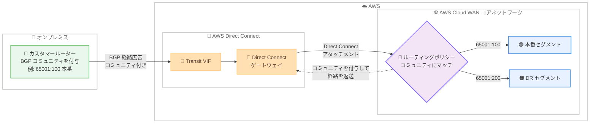

# AWS Cloud WAN - Direct Connect アタッチメントでの BGP コミュニティサポート

**リリース日**: 2026 年 11 月 12 日
**サービス**: AWS Cloud WAN
**機能**: Direct Connect アタッチメントにおけるルーティングポリシー用 BGP コミュニティサポート

📊 [このアップデートのインフォグラフィックを見る](https://takech9203.github.io/aws-news-summary/20261112-cloud-wan-bgp-community-directconnect.html)

## 概要

AWS Cloud WAN が、Direct Connect アタッチメントでの BGP コミュニティのサポートを開始しました。これにより、Cloud WAN のルーティングポリシー (Advanced Routing Policy) で、Direct Connect 経由でオンプレミスから受信したルートの BGP コミュニティタグを評価し、ルートフィルタリングやパス優先度の制御を行えるようになりました。また、Cloud WAN からオンプレミスルーターへの経路広告時に BGP コミュニティを伝搬させることも可能です。

これまで Cloud WAN ルーティングポリシーで BGP コミュニティを評価できるのは、Site-to-Site VPN アタッチメントと Connect アタッチメントのみでした。今回のアップデートにより、エンタープライズのハイブリッドネットワークで主流である Direct Connect 接続でも、オンプレミス側からコミュニティタグを使ってルーティングの意図 (routing intent) を動的に通知し、Cloud WAN 側でポリシーとして適用できるようになります。

本番環境と災害復旧 (DR) 環境のトラフィック分離、優先パスの指定、リージョン単位での経路伝搬制限といったユースケースを、VPN オーバーレイによる回避策や手動でのポリシー複製なしに実現でき、運用の複雑さと設定ミスのリスクを削減します。

**アップデート前の課題**

- Cloud WAN ルーティングポリシーで BGP コミュニティを評価できるのは Site-to-Site VPN アタッチメントと Connect アタッチメントのみで、Direct Connect アタッチメントでは利用できなかった
- Direct Connect 接続でコミュニティベースのルーティング制御を行うには、Direct Connect 上に VPN オーバーレイを構築するなどの回避策が必要だった
- オンプレミス側のルーティング意図を Cloud WAN 側に動的に伝える手段がなく、各アタッチメントへのポリシーの手動複製が必要で、設定ミスのリスクがあった

**アップデート後の改善**

- オンプレミス環境から Direct Connect 経由で広告するルートに BGP コミュニティタグを付与し、Cloud WAN 内でフィルタリングやパス優先ルールを適用できるようになった
- Cloud WAN からオンプレミスルーターへのアウトバウンド経路広告時に、BGP コミュニティを付与・削除・伝搬できるようになった
- VPN オーバーレイなどの回避策や手動でのポリシー複製が不要になり、ハイブリッドネットワークのオーケストレーションがシンプルになった

## アーキテクチャ図



オンプレミスルーターが BGP コミュニティを付与して経路を広告すると、Direct Connect アタッチメントを経由して Cloud WAN のルーティングポリシーがコミュニティを評価し、フィルタリングやパス優先度の設定などのアクションを適用します。アウトバウンド方向ではコミュニティを付与してオンプレミスに伝搬できます。

## サービスアップデートの詳細

### 主要機能

1. **インバウンド経路での BGP コミュニティマッチ**
   - オンプレミスから Direct Connect 経由で受信した経路の標準 BGP コミュニティタグ (例: `65001:100`) にマッチするルールを定義可能
   - マッチした経路に対して、フィルタリング (allow / drop)、ローカルプリファレンス・AS パス・MED などのパス優先度属性の設定、コミュニティの追加・削除といったアクションを実行可能
   - Transit VIF 経由で広告された標準 BGP コミュニティタグは、Direct Connect ゲートウェイを越えて Cloud WAN コアネットワークまで保持される

2. **アウトバウンド経路での BGP コミュニティ伝搬**
   - Cloud WAN からオンプレミスルーターへのアウトバウンド経路広告時に、BGP コミュニティを透過的に伝搬可能
   - アウトバウンド経路更新でコミュニティの追加・削除を行い、オンプレミス側のルーティングポリシーに意図を通知できる

3. **ルーティング意図の動的なシグナリング**
   - オンプレミス側でコミュニティタグを付け替えるだけで、Cloud WAN 側の事前定義済みポリシーが自動的に適用される
   - アタッチメントごとの手動ポリシー複製が不要になり、ハイブリッドネットワーク全体のオーケストレーションを簡素化

## 技術仕様

### アタッチメントタイプ別のルーティングポリシーサポート

| アタッチメントタイプ | ルートフィルタリング | ルート集約 | BGP 属性変更 | BGP コミュニティ |
|---------------------|---------------------|-----------|-------------|-----------------|
| Site-to-Site VPN | 対応 | 対応 (アウトバウンドのみ) | 対応 | 対応 |
| Direct Connect | 対応 | 対応 (アウトバウンドのみ) | 対応 | **対応 (制約あり、今回追加)** |
| Connect | 対応 | 対応 (アウトバウンドのみ) | 対応 | 対応 |
| Transit Gateway ルートテーブル | 対応 | 対応 (アウトバウンドのみ) | 対応 | 非対応 |
| VPC | インバウンドのみ | 非対応 | 非対応 | 非対応 |

### Direct Connect アタッチメントでの BGP コミュニティの制約

| 項目 | 詳細 |
|------|------|
| サポート対象 | 標準 BGP コミュニティ (ASN:value 形式、例: `65001:200`) |
| Large BGP コミュニティ (RFC 8092) | 非サポート。コアネットワーク到達前に削除される |
| 拡張コミュニティ (ルートターゲット等) | 非サポート。コアネットワーク到達前に削除される |
| AWS 予約 ASN | 先頭の値が `7224`、`10124`、`17493`、`9059`、`4001` のコミュニティは削除される。先頭には自組織の ASN を使用する |
| ベストパス選択 | Direct Connect はプレフィックスごとに単一のベストパスを選択してからコアネットワークに広告する。同一プレフィックスを複数ロケーションから異なるコミュニティで広告した場合、ベストパスのコミュニティのみ保持される |

## 設定方法

### 前提条件

1. AWS Cloud WAN コアネットワークが作成済みであること
2. Direct Connect ゲートウェイが作成済みで、Cloud WAN コアネットワークに Direct Connect アタッチメントとして関連付けられていること (Transit VIF を使用)
3. Direct Connect ゲートウェイの ASN がコアネットワークの ASN 範囲外であること

### 手順

#### ステップ 1: オンプレミスルーターで BGP コミュニティを付与

```text
! Cisco IOS の設定例
route-map TAG-PROD permit 10
 match ip address prefix-list PROD-PREFIXES
 set community 65001:100

router bgp 65001
 neighbor <DX peer IP> route-map TAG-PROD out
 neighbor <DX peer IP> send-community
```

オンプレミスルーターで、Direct Connect の BGP ピアに広告する経路に標準コミュニティ (例: `65001:100`) を付与します。`send-community` でコミュニティ属性の送信を有効化します。

#### ステップ 2: Cloud WAN ルーティングポリシーでコミュニティにマッチするルールを定義

```json
{
  "rules": [
    {
      "rule-number": 10,
      "conditions": [
        {
          "type": "community",
          "value": "65001:100"
        }
      ],
      "action": {
        "type": "set-local-preference",
        "value": 200
      }
    },
    {
      "rule-number": 20,
      "conditions": [
        {
          "type": "community",
          "value": "65001:900"
        }
      ],
      "action": {
        "type": "drop"
      }
    }
  ]
}
```

Cloud WAN のルーティングポリシーで、受信経路のコミュニティ `65001:100` にローカルプリファレンス 200 を設定して優先パスとし、`65001:900` が付与された経路をドロップするルールを定義します (実際のポリシードキュメント構文は公式ドキュメントを参照してください)。

#### ステップ 3: ポリシーを Direct Connect アタッチメントに関連付けて動作確認

Network Manager コンソールまたは API でルーティングポリシーを Direct Connect アタッチメントのインバウンド / アウトバウンド方向に関連付けます。適用後、コアネットワークのルーティング情報を確認し、コミュニティに基づくフィルタリングやパス選択が意図どおり動作していることを検証します。なお、`list-core-network-routing-information` API はルーティングポリシー適用前の情報を表示する点に注意してください。

## メリット

### ビジネス面

- **運用コストの削減**: VPN オーバーレイによる回避策やポリシーの手動複製が不要になり、ハイブリッドネットワークの運用負荷を削減
- **設定ミスリスクの低減**: コミュニティタグによる動的なポリシー適用により、アタッチメントごとの個別設定に起因する設定ミスを防止
- **サードパーティ製品が不要**: AWS ネイティブの高度なルーティング制御により、高価で管理が複雑な外部ルーティングソリューションへの投資を回避

### 技術面

- **本番 / DR トラフィックの分離**: コミュニティタグのマッチングにより、本番トラフィックと災害復旧トラフィックを明確に分離可能
- **マルチパス環境でのパス制御**: コミュニティにマッチした経路へのローカルプリファレンス、AS パス、MED の設定により、複数の接続パスから優先パスを柔軟に指定可能
- **経路伝搬のスコープ制御**: リージョン単位での経路伝搬制限など、コミュニティベースできめ細かな到達性制御を実現

## デメリット・制約事項

### 制限事項

- Large BGP コミュニティ (RFC 8092) と拡張コミュニティ (ルートターゲット等) はサポートされず、コアネットワーク到達前に削除される
- 先頭の値が AWS 予約 ASN (`7224`、`10124`、`17493`、`9059`、`4001`) のコミュニティは削除される
- ルーティングポリシーで指定する ASN (コミュニティタグ等) は、コアネットワーク設定の ASN 範囲と重複できない
- Transit Gateway ルートテーブルアタッチメントと VPC アタッチメントでは BGP コミュニティは引き続き利用不可

### 考慮すべき点

- Direct Connect はプレフィックスごとに単一のベストパスを選択してから広告するため、複数ロケーションから同一プレフィックスを異なるコミュニティで広告した場合、ベストパスのコミュニティのみが保持される
- ルート集約を併用する場合、集約ルートは属性がリセットされ (コミュニティは空)、マッチしたプレフィックスのコミュニティは引き継がれない
- Cloud WAN の Direct Connect アタッチメントは許可プレフィックスリストをサポートしないため、経路制御はルーティングポリシーで行う必要がある

## ユースケース

### ユースケース 1: 本番と DR のトラフィック分離

**シナリオ**: オンプレミスのデータセンターから本番用と DR 用の経路を同じ Direct Connect 接続で広告しており、Cloud WAN 側でそれぞれ異なるセグメントや優先度で扱いたい。

**実装例**:
```text
オンプレミス側:
  本番プレフィックス → コミュニティ 65001:100 を付与
  DR プレフィックス  → コミュニティ 65001:200 を付与

Cloud WAN 側:
  65001:100 にマッチ → ローカルプリファレンスを高く設定し優先
  65001:200 にマッチ → バックアップ用の属性を設定
```

**効果**: 単一の Direct Connect 接続上で本番と DR の経路を論理的に分離し、個別のプレフィックスリスト管理なしでポリシーを自動適用できる。

### ユースケース 2: マルチパス環境での優先パス指定

**シナリオ**: 複数の Direct Connect ロケーションと Site-to-Site VPN で冗長接続を構成しており、通常時は特定の Direct Connect パスを優先し、オンプレミス側の判断で優先パスを動的に切り替えたい。

**実装例**:
```text
オンプレミス側:
  優先パスで広告する経路 → コミュニティ 65001:300 を付与

Cloud WAN 側:
  65001:300 にマッチ → set-local-preference 300
  マッチしない経路   → デフォルトの優先度
```

**効果**: Cloud WAN 側のポリシーを変更せず、オンプレミス側のコミュニティ付与だけで優先パスを動的に制御でき、メンテナンス時の切り替え作業が簡素化される。

### ユースケース 3: リージョン単位の経路伝搬制限

**シナリオ**: グローバル展開している Cloud WAN コアネットワークで、特定のオンプレミス経路を特定リージョンのセグメントにのみ伝搬させ、他リージョンへの不要な経路伝搬を防ぎたい。

**実装例**:
```text
オンプレミス側:
  国内限定の経路 → コミュニティ 65001:810 を付与

Cloud WAN 側:
  リージョン間 CNE-to-CNE のアウトバウンドポリシーで
  65001:810 にマッチする経路を drop
```

**効果**: 経路の到達範囲 (ブラストラディウス) を最小化し、ルートテーブルの肥大化や意図しないリージョン間通信を防止できる。

## 料金

BGP コミュニティサポート自体に追加料金はありません。AWS Cloud WAN のコアネットワークエッジ料金、アタッチメント料金、データ処理料金、および AWS Direct Connect のポート料金・データ転送料金が通常どおり適用されます。詳細は各サービスの料金ページを参照してください。

## 利用可能リージョン

AWS Direct Connect と AWS Cloud WAN の両方が利用可能なすべての AWS リージョンで利用できます。サポートされるリージョンの一覧は [Cloud WAN Routing Policies のドキュメント](https://docs.aws.amazon.com/network-manager/latest/cloudwan/cloudwan-routing-policies.html)を参照してください。

## 関連サービス・機能

- **AWS Direct Connect**: オンプレミスと AWS 間の専用ネットワーク接続。Transit VIF と Direct Connect ゲートウェイ経由で Cloud WAN に接続し、今回のアップデートでコミュニティタグが保持されるようになった
- **AWS Site-to-Site VPN / Connect アタッチメント**: 従来から BGP コミュニティをサポートしているアタッチメントタイプ。Direct Connect と組み合わせた冗長構成で一貫したコミュニティベースのポリシーを適用可能
- **AWS Network Manager**: Cloud WAN のコアネットワークとルーティングポリシーを管理するサービス。Direct Connect ゲートウェイとコアネットワークの関連付けも Network Manager の Cloud WAN コンソールから行う

## 参考リンク

- 📊 [インフォグラフィック](https://takech9203.github.io/aws-news-summary/20261112-cloud-wan-bgp-community-directconnect.html)
- [公式発表 (What's New)](https://aws.amazon.com/about-aws/whats-new/2026/11/cloud-wan-bgp-community-directconnect/)
- [ドキュメント: AWS Cloud WAN Routing policies](https://docs.aws.amazon.com/network-manager/latest/cloudwan/cloudwan-routing-policies.html)
- [ドキュメント: Direct Connect gateway and AWS Cloud WAN core network associations](https://docs.aws.amazon.com/directconnect/latest/UserGuide/direct-connect-cloud-wan.html)
- [料金ページ: AWS Cloud WAN](https://aws.amazon.com/cloud-wan/pricing/)

## まとめ

Direct Connect アタッチメントでの BGP コミュニティサポートにより、エンタープライズのハイブリッドネットワークで一般的な Direct Connect 接続でも、コミュニティタグによる動的なルーティングポリシー制御が可能になりました。これまで VPN オーバーレイや手動ポリシー複製で対応していた環境では、構成の簡素化を検討する価値があります。導入時は標準コミュニティのみ対応である点と AWS 予約 ASN の制約を確認し、ルーティングポリシーの設計を見直すことを推奨します。
