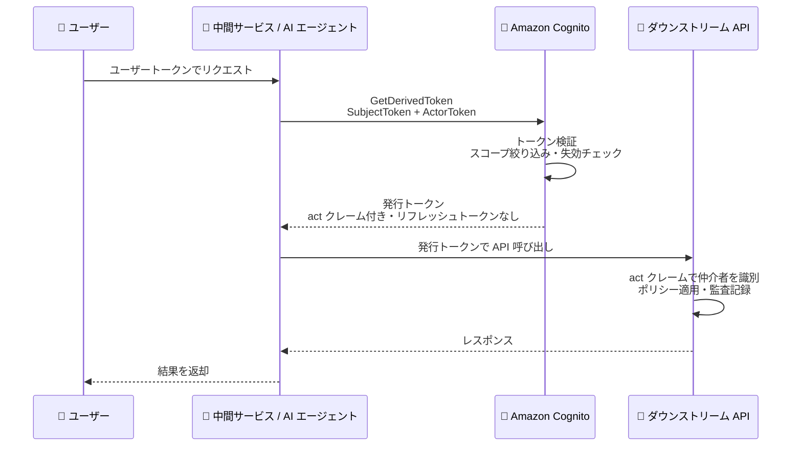

# Amazon Cognito - OAuth 2.0 トークン交換のサポート

**リリース日**: 2026 年 11 月 12 日
**サービス**: Amazon Cognito
**機能**: OAuth 2.0 Token Exchange (RFC 8693) / GetDerivedToken API

📊 [このアップデートのインフォグラフィックを見る](https://takech9203.github.io/aws-news-summary/20261112-cognito-token-exchange.html)

## 概要

Amazon Cognito が、RFC 8693 で定義される OAuth 2.0 トークン交換 (Token Exchange) をサポートしました。これにより、ユーザーに代わって動作するサービスや AI エージェントが、ユーザーの既存トークンを、特定のダウンストリームサービス向けにスコープを絞り込んだ新しいトークンに交換できるようになります。トークン交換は、新しい GetDerivedToken API、または既存のトークンエンドポイントのトークン交換グラント経由で実行できます。

交換で発行されるトークンは、元のトークンより狭いスコープを持ち、単一のオーディエンスにバインドされ、リフレッシュトークンを伴いません。さらに、アクタートークンを含めて交換を行うと、発行されるトークンに RFC 8693 の `act` クレームが付与され、ダウンストリームサービスは「ユーザーが直接行ったリクエスト」と「エージェントがユーザーに代わって行ったリクエスト」を区別できます。

マイクロサービス間の委任や、MCP サーバー・AI エージェントがユーザーに代わってバックエンド API を呼び出すエージェント型アーキテクチャを構築する開発者にとって、独自のトークン発行基盤を作り込むことなく、標準仕様に準拠した安全なトークン委任を実現できる重要なアップデートです。

**アップデート前の課題**

このアップデート以前は、中間サービスがユーザーに代わってダウンストリームサービスを呼び出す際に、以下の課題がありました。

- ユーザーの元のトークンをそのまま転送する必要があり、ダウンストリームサービスに必要以上に広いスコープや異なるオーディエンス向けのトークンが渡っていた
- 独自のカスタムトークン発行システムを構築・維持する必要があった
- ダウンストリームサービス側で、ユーザー本人のリクエストと仲介者によるリクエストを区別する標準的な手段がなかった

**アップデート後の改善**

今回のアップデートにより、以下が可能になりました。

- ユーザーのトークンを、特定のダウンストリームサービス向けにスコープを絞り込み、単一オーディエンスにバインドした短命トークンに交換できるようになった
- `act` クレームにより、仲介者 (エージェントやサービス) を識別でき、監査ログや仲介者固有のポリシー適用が可能になった
- RFC 8693 準拠の標準的な方法でトークン委任を実現でき、カスタムトークン発行基盤が不要になった

## アーキテクチャ図



中間サービスがユーザーのトークン (SubjectToken) と自身のトークン (ActorToken) を Cognito に提示し、ダウンストリーム API 専用にスコープを絞った新しいトークンを取得する委任 (Delegation) フローを示しています。

## サービスアップデートの詳細

### 主要機能

1. **GetDerivedToken API によるトークン交換**
   - 既存のトークン (SubjectToken) を提示し、特定のダウンストリームサービス向けの新しいトークンを取得する
   - AWS SDK から直接呼び出すか、トークンエンドポイント (`/oauth2/token`) のトークン交換グラント (`urn:ietf:params:oauth:grant-type:token-exchange`) 経由で実行できる
   - トークンエンドポイント経由の場合はユーザープールドメインが必要。SDK 経由の場合はドメイン不要

2. **2 つのセマンティクス: Impersonation と Delegation**
   - **Impersonation (なりすまし)**: ActorToken を含めない場合、ユーザーが直接操作したかのようなトークンが発行される (`act` クレームなし)
   - **Delegation (委任)**: ActorToken を含めると、発行トークンに `act` クレームが付与され、仲介者を識別できる
   - アプリクライアントの認証フロー設定 `ALLOW_TOKEN_EXCHANGE_IMPERSONATION` / `ALLOW_TOKEN_EXCHANGE_DELEGATION` で、どちらのセマンティクスを許可するか制御する

3. **ダウンスコープのみのセキュリティモデル**
   - 発行トークンのスコープは「リクエストしたスコープ」「SubjectToken のスコープ」「アプリクライアントが発行を許可されたスコープ」の積集合となり、元のトークンにないスコープは絶対に追加されない
   - リフレッシュトークンは発行されず、交換されたトークンは短命で自動的に失効する
   - SubjectToken の署名・有効期限・失効 (グローバルサインアウト等) が検証され、対象ユーザーは有効かつ確認済みである必要がある
   - Audience / Resource はユーザープールに登録済みのリソースサーバーに対して検証される

4. **外部 IdP トークンのサポート**
   - SubjectToken / ActorToken には、Cognito 発行のトークンだけでなく、ユーザープールに登録済みの外部 IdP (OIDC または SAML 2.0) のトークンも使用できる
   - 外部 IdP トークンを使用する場合は、プロバイダー名 (`SubjectTokenProviderName` / `ActorTokenProviderName`) を併せて指定する
   - 外部 IdP 経由のユーザーは、事前にユーザープール内のリンク済みユーザーとして存在している必要がある (トークン交換で新規ユーザーは作成されない)

5. **Pre Token Generation Lambda トリガーとの統合**
   - トークン交換時に Pre Token Generation Lambda トリガーが `TokenGeneration_TokenExchange` という `triggerSource` で起動する
   - 発行トークンのクレームやスコープの追加・抑制・上書き、交換の拒否が可能

## 技術仕様

### GetDerivedToken API の主要パラメータ

| パラメータ | 必須 | 説明 |
|------|------|------|
| `ClientId` | 必須 | トークン交換をリクエストするアプリクライアントの ID |
| `ClientSecret` | 条件付き | シークレットを持つアプリクライアントの場合に必須 |
| `SubjectToken` | 必須 | 交換対象のユーザートークン |
| `SubjectTokenType` | 必須 | `ACCESS_TOKEN` / `ID_TOKEN` / `SAML2` |
| `ActorToken` | 任意 | 仲介者を示すトークン。指定すると `act` クレームが付与される |
| `ActorTokenType` | 条件付き | ActorToken 指定時に必須。`ACCESS_TOKEN` / `ID_TOKEN` / `SAML2` |
| `Audiences` | 任意 | 発行トークンの対象サービスの論理名 (最大 1 件、`Resources` と同時指定不可) |
| `Resources` | 任意 | ユーザープール内のリソースサーバー識別子 (最大 1 件、`Audiences` と同時指定不可) |
| `Scopes` | 任意 | 発行トークンにリクエストするスコープ。未指定の場合は SubjectToken と同じスコープ |
| `RequestedTokenType` | 任意 | `ACCESS_TOKEN` または `ID_TOKEN` (SAML アサーションは発行不可) |

### レスポンス要素

| 項目 | 詳細 |
|------|------|
| `IssuedToken` | 発行された新しいトークン |
| `IssuedTokenType` | `ACCESS_TOKEN` または `ID_TOKEN` |
| `Scopes` | 実際に付与されたスコープ |
| `TokenType` | `Bearer` など |
| `ExpiresIn` | 有効期限までの秒数 |

### API 変更履歴

本アップデートで Amazon Cognito Identity Provider (cognito-idp) に GetDerivedToken API が追加されています。なお、レポート作成時点 (2026 年 11 月 13 日) では awsapichanges.com のフィードに該当エントリは未掲載です。詳細は [GetDerivedToken API リファレンス](https://docs.aws.amazon.com/cognito-user-identity-pools/latest/APIReference/API_GetDerivedToken.html) を参照してください。

### 委任交換で発行されるアクセストークンのペイロード例

```json
{
    "sub": "a1b2c3d4-5678-90ab-cdef-EXAMPLE11111",
    "token_use": "access",
    "scope": "solar-system-data/asteroids.add",
    "aud": "solar-system-data",
    "act": {
        "sub": "service-a-client-id"
    },
    "exp": 1735689600,
    "iat": 1735686000
}
```

`act` クレームの `sub` に仲介サービスのクライアント ID が記録され、ダウンストリームサービスは仲介者を識別できます。

## 設定方法

### 前提条件

1. ユーザープールが Essentials または Plus 機能プランであること
2. アプリクライアントの `ExplicitAuthFlows` に、利用するセマンティクスに応じた認証フロー (`ALLOW_TOKEN_EXCHANGE_IMPERSONATION` / `ALLOW_TOKEN_EXCHANGE_DELEGATION`) が設定されていること
3. `Audiences` / `Resources` に指定する値がユーザープールに登録済みのリソースサーバーに対応していること
4. トークンエンドポイント経由で交換する場合は、ユーザープールにドメインが設定されていること
5. アカウントでトークン交換が有効であること (無効の場合は `OperationNotEnabledException` が返る)

### 手順

#### ステップ 1: アプリクライアントでトークン交換フローを有効化

```bash
aws cognito-idp update-user-pool-client \
  --user-pool-id us-east-1_EXAMPLE \
  --client-id 1example23456789 \
  --explicit-auth-flows ALLOW_TOKEN_EXCHANGE_DELEGATION ALLOW_REFRESH_TOKEN_AUTH
```

アプリクライアントの明示的な認証フローに `ALLOW_TOKEN_EXCHANGE_DELEGATION` を追加し、委任セマンティクスでのトークン交換を許可します。Impersonation を利用する場合は `ALLOW_TOKEN_EXCHANGE_IMPERSONATION` を指定します。

#### ステップ 2: GetDerivedToken API でトークンを交換

```bash
aws cognito-idp get-derived-token \
  --client-id 1example23456789 \
  --client-secret exampleClientSecret123EXAMPLE \
  --subject-token eyJra456defEXAMPLE \
  --subject-token-type ACCESS_TOKEN \
  --actor-token eyJra789ghiEXAMPLE \
  --actor-token-type ACCESS_TOKEN \
  --audiences solar-system-data \
  --scopes solar-system-data/asteroids.add
```

ユーザーのアクセストークン (SubjectToken) と仲介サービスのトークン (ActorToken) を提示し、リソースサーバー `solar-system-data` 向けにスコープを絞った新しいトークンを取得します。

#### ステップ 3: トークンエンドポイント経由での交換 (代替手段)

```bash
curl -X POST https://example-domain.auth.us-west-2.amazoncognito.com/oauth2/token \
  -H "Content-Type: application/x-www-form-urlencoded" \
  -H "Authorization: Basic $(echo -n 'client_id:client_secret' | base64)" \
  -d "grant_type=urn:ietf:params:oauth:grant-type:token-exchange" \
  -d "subject_token=eyJra456defEXAMPLE" \
  -d "subject_token_type=urn:ietf:params:oauth:token-type:access_token" \
  -d "audience=solar-system-data" \
  -d "scope=solar-system-data/asteroids.add"
```

RFC 8693 標準のトークン交換グラントを使用して、トークンエンドポイントに HTTP POST リクエストを送信します。委任の場合は `actor_token` と `actor_token_type` パラメータを追加します。

## メリット

### ビジネス面

- **エージェント型アーキテクチャへの対応**: AI エージェントや MCP サーバーがユーザーに代わって行動する際の標準的な認可基盤を、マネージドサービスとして利用できる
- **開発・運用コストの削減**: カスタムトークン発行システムの構築・維持が不要になり、認可基盤の開発工数を削減できる
- **監査・コンプライアンスの強化**: `act` クレームにより「誰が誰に代わって操作したか」を監査ログに記録でき、説明責任を果たしやすくなる

### 技術面

- **最小権限の原則の徹底**: ダウンスコープのみ許可される設計により、交換後のトークンが元のトークンより広い権限を持つことがない
- **トークン漏えいリスクの低減**: 発行トークンは単一オーディエンスにバインドされ、リフレッシュトークンを伴わない短命トークンのため、漏えい時の影響範囲が限定される
- **標準準拠**: RFC 8693 準拠のため、OAuth 2.0 エコシステムの他のコンポーネントとの相互運用性が高い
- **柔軟なカスタマイズ**: Pre Token Generation Lambda トリガー (`TokenGeneration_TokenExchange`) で交換時のクレームやスコープを制御できる

## デメリット・制約事項

### 制限事項

- Essentials または Plus 機能プランのユーザープールでのみ利用可能 (Lite プランは対象外)
- 発行できるトークンは Cognito のアクセストークンまたは ID トークンのみで、SAML アサーションは発行できない
- `Audiences` と `Resources` は同時に指定できず、それぞれ最大 1 件まで
- RFC 8693 の `may_act` クレーム (事前にどのアクターが代理可能かを宣言するクレーム) は現時点で発行・評価されない
- 外部 IdP のトークンを使用する場合、対象ユーザーが事前にユーザープールのリンク済みユーザーとして存在している必要がある

### 考慮すべき点

- リフレッシュトークンが発行されないため、交換されたトークンの有効期限切れを考慮したトークンキャッシュ戦略の設計が必要
- Lite プランを利用中の場合、この機能のために Essentials 以上へのプラン変更が必要となり、MAU 課金が発生する
- アプリクライアントごとに Impersonation / Delegation のどちらを許可するか、セキュリティ要件に基づいた設計が必要 (Impersonation では仲介者を識別できない点に注意)

## ユースケース

### ユースケース 1: MCP サーバーによるバックエンド API 呼び出し

**シナリオ**: AI エージェントの MCP サーバーが、ユーザーのトークンを受け取り、ユーザーに代わってバックエンド API を呼び出す。バックエンド側では、エージェント経由のリクエストであることを識別して専用のポリシーを適用したい。

**実装例**:
```json
{
    "ClientId": "mcp-server-client-id",
    "SubjectToken": "<ユーザーのアクセストークン>",
    "SubjectTokenType": "ACCESS_TOKEN",
    "ActorToken": "<MCP サーバーのトークン>",
    "ActorTokenType": "ACCESS_TOKEN",
    "Audiences": [ "backend-api" ],
    "Scopes": [ "backend-api/data.read" ]
}
```

**効果**: バックエンド API は `act` クレームで MCP サーバーを識別でき、エージェント経由のアクセスに対して読み取り専用ポリシーの適用や監査記録が可能になる。

### ユースケース 2: マイクロサービス間のサービス間委任

**シナリオ**: フロントエンドからリクエストを受けた注文サービスが、決済サービスを呼び出す。決済サービスには決済に必要な最小限のスコープだけを持つトークンを渡したい。

**実装例**:
```bash
aws cognito-idp get-derived-token \
  --client-id order-service-client \
  --subject-token "<ユーザーのアクセストークン>" \
  --subject-token-type ACCESS_TOKEN \
  --resources payment-api \
  --scopes payment-api/charge.create
```

**効果**: 決済サービスには決済専用にスコープを絞ったトークンのみが渡り、ユーザーの元トークンが持つ他の権限 (注文履歴の閲覧など) が不要に伝播しない。

### ユースケース 3: 外部 IdP ユーザーのトークンのダウンスコープ

**シナリオ**: 企業の SAML IdP で認証したユーザーのアサーションを、社内 API 呼び出し用の Cognito アクセストークンに交換する。

**実装例**:
```json
{
    "ClientId": "internal-app-client-id",
    "SubjectToken": "<SAML 2.0 アサーション>",
    "SubjectTokenType": "SAML2",
    "SubjectTokenProviderName": "CorporateSAML",
    "Audiences": [ "internal-api" ]
}
```

**効果**: 登録済み外部 IdP のトークンを Cognito の標準トークンに変換でき、ダウンストリームサービスは Cognito トークンの検証ロジックだけで統一的に認可できる。

## 料金

トークン交換機能自体への追加料金はなく、Essentials または Plus 機能プランの月間アクティブユーザー (MAU) 課金に含まれます。

### 料金例

| プラン | MAU あたりの料金 (概算) |
|--------|------------------|
| Essentials | $0.015/MAU (月間 10,000 MAU までの無料利用枠あり) |
| Plus | $0.020/MAU (無料利用枠なし) |

最新の料金は [Amazon Cognito 料金ページ](https://aws.amazon.com/cognito/pricing/) を参照してください。

## 利用可能リージョン

Amazon Cognito が利用可能なすべての AWS リージョンで利用できます。

## 関連サービス・機能

- **Amazon Cognito ユーザープール機能プラン**: トークン交換は Essentials / Plus プランの機能。プランごとの機能差は機能プランのドキュメントを参照
- **Cognito リソースサーバーとカスタムスコープ**: `Audiences` / `Resources` の検証対象となるリソースサーバーの定義が前提
- **Pre Token Generation Lambda トリガー**: `TokenGeneration_TokenExchange` トリガーソースで交換時のトークンをカスタマイズ可能
- **M2M 認可 (クライアントクレデンシャルグラント / GetClientToken)**: ユーザーではなくアプリケーションを認可する仕組み。トークン交換はユーザートークンの派生であり、用途が異なる

## 参考リンク

- 📊 [インフォグラフィック](https://takech9203.github.io/aws-news-summary/20261112-cognito-token-exchange.html)
- [公式発表 (What's New)](https://aws.amazon.com/about-aws/whats-new/2026/11/cognito-token-exchange/)
- [ドキュメント: Exchanging tokens for downstream services](https://docs.aws.amazon.com/cognito/latest/developerguide/cognito-user-pools-token-exchange.html)
- [API リファレンス: GetDerivedToken](https://docs.aws.amazon.com/cognito-user-identity-pools/latest/APIReference/API_GetDerivedToken.html)
- [RFC 8693 - OAuth 2.0 Token Exchange](https://www.rfc-editor.org/rfc/rfc8693.html)
- [料金ページ](https://aws.amazon.com/cognito/pricing/)

## まとめ

Amazon Cognito の OAuth 2.0 トークン交換サポートにより、AI エージェントやマイクロサービスがユーザーに代わってダウンストリームサービスを呼び出す際の認可を、RFC 8693 準拠の標準的な方法で実現できるようになりました。エージェント型アーキテクチャやサービス間委任を設計している場合は、Essentials / Plus プランのユーザープールでアプリクライアントのトークン交換フローを有効化し、GetDerivedToken API の検証から始めることを推奨します。
