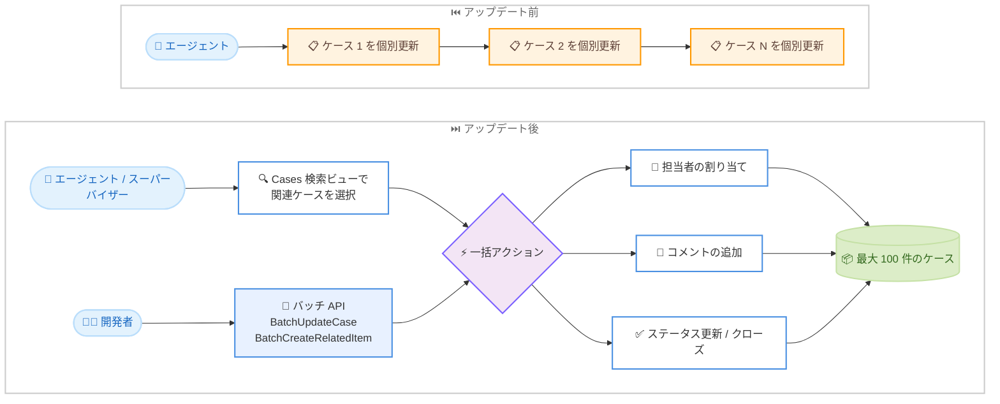

# Amazon Connect Customer - Cases の一括アクション (最大 100 件)

**リリース日**: 2026 年 11 月 12 日
**サービス**: Amazon Connect Customer
**機能**: Cases のバッチアクション (Bulk Case Actions)

📊 [このアップデートのインフォグラフィックを見る](https://takech9203.github.io/aws-news-summary/20261112-connect-batch-actions-100-cases.html)

## 概要

Amazon Connect Customer の Cases で、エージェントとスーパーバイザーが最大 100 件のケースに対して一括 (バッチ) アクションを実行できるようになりました。担当者の割り当て、コメントの追加、ステータスの更新 (クローズを含む) を、ケースを 1 件ずつ開くことなく単一の操作で実行できます。

この機能は、配送遅延やサービス障害のように 1 つの問題が多数の顧客に影響するシナリオで特に有効です。適切な権限を持つエージェントとスーパーバイザーは、Cases の検索ビューで関連するケースを選択し、担当者変更、コメント追加、クローズなどをまとめて実行できます。また、開発者向けにはバッチ API が提供されており、同様の更新をプログラムから実行することも可能です。

**アップデート前の課題**

- 以前は、多数の顧客に影響する問題が発生した場合でも、ケースを 1 件ずつ開いて個別に更新する必要があった
- 大量のケースの担当者変更やクローズに時間がかかり、エージェントの作業負荷が増大していた
- 関連するケース群へ一括でコメントを追加する手段がなく、情報共有に手間がかかっていた

**アップデート後の改善**

- 最大 100 件のケースを選択し、担当者の割り当て、コメント追加、ステータス更新を単一アクションで実行できるようになった
- 大規模障害や配送遅延などの際に、関連ケースの一括クローズや一括更新により対応時間を大幅に短縮できるようになった
- バッチ API (BatchUpdateCase、BatchCreateRelatedItem) により、プログラムからの自動化も可能になった

## アーキテクチャ図



ケースを 1 件ずつ更新していた従来のフローと、検索ビューまたはバッチ API から最大 100 件のケースへ一括アクションを実行する新しいフローの比較です。

## サービスアップデートの詳細

### 主要機能

1. **担当者の一括割り当て**
   - Cases 検索ビューの [Actions] ドロップダウンから [Assign cases] を選択
   - 選択した複数のケースをユーザーまたはキューへ一括で割り当て可能
   - 大規模インシデント時の担当チームへの振り分けを効率化

2. **コメントの一括追加**
   - [Actions] ドロップダウンから [Add comment] を選択し、選択したすべてのケースに同一コメントを追加
   - 障害の進捗状況や対応方針を関連ケース全体へ一度に共有可能

3. **ステータスの一括更新**
   - [Actions] ドロップダウンから [Update status] を選択し、選択したケースのステータスを一括変更
   - 問題解決後の関連ケースの一括クローズに活用可能

4. **バッチ API によるプログラム実行**
   - `BatchUpdateCase`: 最大 100 件のケースのフィールド (タイトル、ステータス、顧客 ID、カスタムフィールド) を一括更新
   - `BatchCreateRelatedItem`: 最大 100 件のケースへコメントタイプの関連アイテムを一括追加
   - いずれも同一ドメイン内のケースが対象で、ケースごとの成功 / 失敗結果が返却される

## 技術仕様

### 一括アクションの仕様

| 項目 | 詳細 |
|------|------|
| 対象サービス | Amazon Connect Customer の Cases |
| 一度に操作可能なケース数 | 最大 100 件 |
| コンソール操作 | Cases 検索ビューの [Actions] ドロップダウン |
| 対応アクション | 担当者の割り当て、ステータス更新、コメント追加、CSV エクスポート |
| 必要な権限 | セキュリティプロファイルの Cases - Cases bulk action 権限 |
| API | BatchUpdateCase、BatchCreateRelatedItem |
| API の結果返却 | ケースごとの成功 / 失敗結果を返却 |

### API 変更履歴

| 日付 | サービス | 変更内容 |
|------|----------|----------|
| 2026/11/06 | [Amazon Connect Cases](https://awsapichanges.com/archive/changes/76ccee-cases.html) | 2 new api methods - Bulk Case Actions 用の BatchCreateRelatedItem と BatchUpdateCase を追加 |

### 必要な権限設定

一括アクションを使用するには、セキュリティプロファイルに **Cases - Cases bulk action** 権限が必要です。この権限がない場合、Cases 検索ビューに [Actions] ドロップダウンは表示されません。

## 設定方法

### 前提条件

1. Amazon Connect インスタンスで Cases が有効化されていること
2. セキュリティプロファイルに Cases bulk action 権限が付与されていること
3. 対象リージョンでインスタンスが稼働していること

### 手順

#### ステップ 1: セキュリティプロファイルの権限設定

Amazon Connect 管理コンソールでセキュリティプロファイルを開き、**Cases** セクションの **Cases bulk action** 権限を有効化します。この権限により、エージェントワークスペースの Cases 検索ビューに [Actions] ドロップダウンが表示されるようになります。

#### ステップ 2: エージェントワークスペースで一括アクションを実行

1. Cases 検索ビューで対象のケースを検索し、一括操作したいケースを選択します
2. [Actions] ドロップダウンから [Assign cases]、[Update status]、[Add comment] のいずれかを選択します
3. ダイアログで割り当て先、ステータス、コメント内容を指定して実行します

#### ステップ 3: バッチ API によるプログラム実行 (オプション)

```bash
# 最大 100 件のケースのステータスを一括更新する例
aws connectcases batch-update-case \
  --domain-id "your-domain-id" \
  --cases '[{"caseId": "case-id-1", "fields": [{"id": "status", "value": {"stringValue": "closed"}}]}]'
```

`batch-update-case` は指定したドメイン内の複数ケースのフィールド (ステータスなど) を一括更新します。レスポンスにはケースごとの成功 / 失敗結果が含まれるため、部分的な失敗をハンドリングできます。

## メリット

### ビジネス面

- **対応時間の短縮**: 大規模障害や配送遅延の際、数十〜100 件のケースを単一アクションで処理でき、顧客対応のリードタイムを大幅に短縮
- **エージェント生産性の向上**: 繰り返しの個別更新作業が不要になり、エージェントは顧客対応そのものに集中可能
- **一貫した顧客コミュニケーション**: 関連ケースへ同一コメントを一括追加することで、対応内容のばらつきを防止

### 技術面

- **API による自動化**: BatchUpdateCase と BatchCreateRelatedItem により、外部システムやワークフローからの一括更新を自動化可能
- **ケースごとの結果返却**: バッチ API はケース単位の成功 / 失敗を返却するため、エラーハンドリングやリトライ処理を実装しやすい
- **権限による統制**: セキュリティプロファイルの専用権限 (Cases bulk action) により、一括操作を実行できるユーザーを制御可能

## デメリット・制約事項

### 制限事項

- 一度に操作できるケース数は最大 100 件まで
- バッチ API の対象は同一ドメイン内のケースに限定される
- 一括アクションの利用にはセキュリティプロファイルの Cases bulk action 権限が必要

### 考慮すべき点

- 一括更新は影響範囲が大きいため、誤操作時の影響も大きくなる。権限付与の対象者は慎重に選定することが推奨される
- バッチ API 利用時は、ケースごとの失敗結果を確認し、必要に応じて再実行する仕組みを用意することが望ましい

## ユースケース

### ユースケース 1: 配送遅延に伴う関連ケースの一括更新

**シナリオ**: 物流障害により特定地域の配送が遅延し、同一の問い合わせケースが大量に発生した。

**実装例**:
```
1. Cases 検索ビューで該当地域・該当期間のケースを検索
2. 関連ケースを選択し [Add comment] で遅延状況と解消見込みを一括追加
3. 配送再開後、[Update status] で該当ケースを一括クローズ
```

**効果**: 数十件のケースへの対応を数分で完了でき、顧客への情報提供の遅れを防止できる。

### ユースケース 2: サービス障害発生時の専任チームへの一括割り当て

**シナリオ**: サービス障害の発生により関連ケースが急増し、障害対応の専任チームに集約したい。

**実装例**:
```
1. 障害に関連するケースを検索ビューで抽出
2. [Assign cases] で障害対応キューまたは専任ユーザーへ一括割り当て
3. 対応方針をコメントとして一括追加し、チーム内で共有
```

**効果**: ケースの振り分け作業が単一アクションで完了し、障害対応の初動を迅速化できる。

### ユースケース 3: 外部システムと連携した一括クローズの自動化

**シナリオ**: 社内の障害管理システムでインシデントがクローズされた際、関連する Connect のケースを自動でクローズしたい。

**実装例**:
```
1. 障害管理システムのクローズイベントをトリガーに Lambda 関数を起動
2. 関連ケース ID の一覧を取得し、BatchUpdateCase でステータスを一括更新
3. BatchCreateRelatedItem で解決内容のコメントを一括追加
4. レスポンスの失敗ケースのみ再実行またはアラート通知
```

**効果**: 手動運用を排除し、システム間でケース状態の整合性を自動的に維持できる。

## 料金

今回の発表では、一括アクション機能に関する追加料金の情報は含まれていません。Cases の利用料金については、Amazon Connect の料金ページを参照してください。

## 利用可能リージョン

以下の 10 リージョンで利用可能です。

- 米国東部 (バージニア北部)
- 米国西部 (オレゴン)
- カナダ (中部)
- 欧州 (フランクフルト)
- 欧州 (ロンドン)
- アジアパシフィック (ソウル)
- アジアパシフィック (シンガポール)
- アジアパシフィック (シドニー)
- アジアパシフィック (東京)
- アフリカ (ケープタウン)

## 関連サービス・機能

- **Amazon Connect Cases**: 本アップデートの対象機能。顧客の問い合わせをケースとして追跡・管理するケース管理機能
- **Amazon Connect エージェントワークスペース**: 一括アクションを実行する UI を提供するエージェント向け統合ワークスペース
- **AWS Lambda**: バッチ API と組み合わせることで、外部イベントをトリガーとしたケースの一括更新を自動化可能

## 参考リンク

- 📊 [インフォグラフィック](https://takech9203.github.io/aws-news-summary/20261112-connect-batch-actions-100-cases.html)
- [公式発表 (What's New)](https://aws.amazon.com/about-aws/whats-new/2026/11/connect-batch-actions-100-cases/)
- [ドキュメント: Batch actions on Cases](https://docs.aws.amazon.com/connect/latest/adminguide/batch-actions-cases.html)
- [Amazon Connect Customer の Cases 製品ページ](https://aws.amazon.com/products/connect/customer/cases/)
- [料金ページ](https://aws.amazon.com/connect/pricing/)

## まとめ

Cases の一括アクションにより、大規模障害や配送遅延など多数の顧客に影響する問題への対応が大幅に効率化されます。コンソールからの操作に加えてバッチ API も提供されるため、外部システムと連携した自動化も可能です。Cases を利用中の場合は、セキュリティプロファイルへの Cases bulk action 権限の付与と、運用フローへの組み込みを検討することを推奨します。
