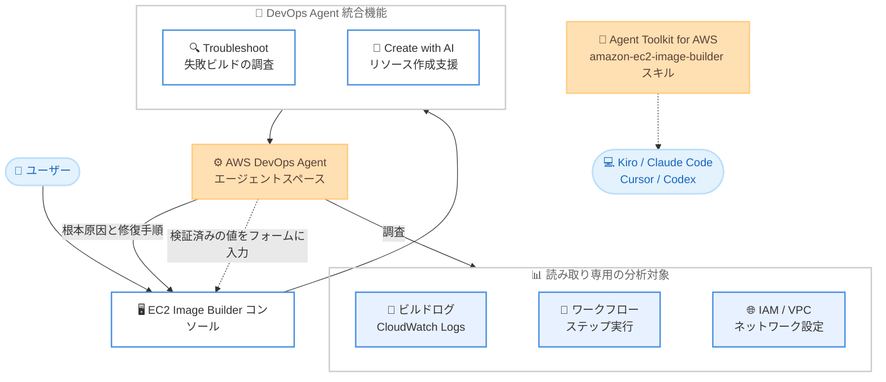

# EC2 Image Builder - DevOps Agent 統合によるトラブルシューティングとリソース作成支援

**リリース日**: 2026 年 11 月 12 日
**サービス**: EC2 Image Builder / AWS DevOps Agent
**機能**: EC2 Image Builder コンソールと AWS DevOps Agent の統合 (Troubleshoot / Create with AI)

📊 [このアップデートのインフォグラフィックを見る](https://takech9203.github.io/aws-news-summary/20261112-ec2-image-builder-devops-agent-integration.html)

## 概要

EC2 Image Builder のコンソールが AWS DevOps Agent と統合され、イメージパイプラインのトラブルシューティングとリソース作成を AI が支援するようになりました。ビルドが失敗した際には、エージェントがビルドログ、ワークフローステップ、コンポーネント、ネットワーク設定を読み取り、根本原因と修復手順を提示します。最大 50 件の失敗したパイプラインを一括で診断し、同じ会話の中でフォローアップ質問を続けることもできます。

リソース作成では、作成したいリソースを自然言語で記述すると、エージェントがサービス側で検証済みの値をコンソールのフォームに自動入力します。ユーザーは提案された値を確認・編集したうえで、自分でリソースを作成します。さらに、Agent Toolkit for AWS に `amazon-ec2-image-builder` スキルが追加され、Kiro、Claude Code、Cursor、Codex などの AI コーディングエージェントからも同等のイメージ作成・診断機能を利用できます。

ゴールデンイメージの運用を担うプラットフォームチームや、多数のイメージパイプラインを管理する組織にとって、ビルド失敗の調査時間を大幅に短縮し、複雑な設定作業の負荷を軽減するアップデートです。

**アップデート前の課題**

- ビルド失敗時は、ビルドログ、CloudWatch Logs、ワークフローステップ、IAM やネットワーク設定を手動で確認して原因を特定する必要があり、調査に時間がかかっていた
- 複数のパイプラインが失敗した場合、共通の根本原因を見つけるには 1 件ずつ個別に調査する必要があった
- コンポーネント、レシピ、パイプラインなどのリソース作成では多数の設定項目を手動で入力する必要があり、設定ミスはビルド実行後まで発覚しないことがあった

**アップデート後の改善**

- コンソールからワンクリックで AI による調査を開始でき、根本原因分析と修復手順 (コマンドや設定変更の例を含む) を数分で受け取れるようになった
- 最大 50 件の失敗パイプラインを一括分析し、根本原因ごとにグループ化された結果と影響を受けるパイプラインの一覧を取得できるようになった
- 自然言語の記述から、ドライラン検証済みの設定値がコンソールのフォームに自動入力されるようになり、依存リソースの提案も受けられるようになった
- Agent Toolkit のスキルにより、ターミナルや IDE 上の自前の AI エージェントからも同じ機能を利用できるようになった

## アーキテクチャ図



ユーザーはコンソールの Troubleshoot / Create with AI から DevOps Agent のエージェントスペースを利用します。エージェントはログやネットワーク設定を読み取り専用で分析して結果を返し、リソース作成時は検証済みの値をフォームに入力します。

## サービスアップデートの詳細

### 主要機能

1. **Troubleshoot (AI によるビルド失敗調査)**
   - パイプライン一覧、出力イメージ一覧、またはコンソールヘッダーのトラブルシューティングアイコンから調査を開始できる
   - ビルドログ、CloudWatch Logs、ワークフローステップ実行、IAM インスタンスプロファイル、セキュリティグループ、サブネットルーティング、NAT ゲートウェイ、VPC エンドポイント、Systems Manager Agent の到達性などを分析する
   - 根本原因分析、修復手順、修正のためのコマンドや設定変更例を数分で提示する
   - 分析は読み取り専用で、リソースは変更されない

2. **複数パイプラインの一括診断**
   - 最大 50 件の失敗パイプラインを選択して「Troubleshoot selected」、または「Troubleshoot all」で一括分析できる
   - 結果は根本原因ごとにグループ化され、共有される根本原因の説明、影響を受けるパイプライン、グループ単位の修復手順が提示される
   - ドリルダウンプロンプトで特定のパイプラインをさらに詳細に調査できる

3. **フォローアップ質問**
   - 調査完了後、同じ会話の中で質問を継続でき、エージェントは調査のコンテキストを保持する
   - 1 回の質問は最大 4,000 文字まで入力できる
   - 「どのステップがなぜ失敗したのか」「修復手順の適用方法」などを質問できる

4. **Create with AI (AI によるリソース作成・更新支援)**
   - コンポーネント、イメージレシピ、コンテナレシピ、イメージパイプライン、イメージワークフロー、インフラストラクチャ設定、ディストリビューション設定の作成に対応する
   - 既存のイメージ、コンポーネント、レシピを検索して提案に活用し、提案値はドライランで検証してから表示する
   - レシピやパイプラインに必要な依存リソース (レシピ、コンポーネント、インフラストラクチャ設定など) も提案する
   - Update with AI では 1 つの記述から複数フィールドをまとめて変更でき、クリアされるフィールドは「Will be cleared」と表示される

5. **Agent Toolkit for AWS の Image Builder スキル**
   - `amazon-ec2-image-builder` スキルをロードすると、Kiro、Claude Code、Cursor、Codex などの AI コーディングエージェントからイメージ作成と失敗ビルドの診断を実行できる
   - スキルはユーザー自身の AWS 認証情報で動作し、AWS DevOps Agent は使用しない

## 技術仕様

### 機能比較

| 項目 | コンソール統合 (Troubleshoot / Create with AI) | Agent Toolkit スキル |
|------|------|------|
| 実行場所 | EC2 Image Builder コンソール | ターミナルや IDE 上の AI コーディングエージェント |
| 基盤 | AWS DevOps Agent のエージェントスペース | ユーザー自身の AI エージェントと AWS 認証情報 |
| 課金 | DevOps Agent のエージェント秒単位で課金 | DevOps Agent の課金なし |
| 一括診断 | 最大 50 パイプライン | エージェントの実装に依存 |

### 必要な IAM 権限

Troubleshoot と Create with AI は同じ権限とエージェントスペースを使用します。

| 権限 | 用途 |
|------|------|
| `aidevops:ListAgentSpaces` | 利用可能なエージェントスペースの検出 |
| `aidevops:CreateChat` | セッション (チャット) の開始 |
| `aidevops:SendChatMessage` | メッセージの送信 |
| `aidevops:CreateAgentSpace` | Image Builder にエージェントスペースを作成させる場合のみ必要 |

このほか、Create with AI で提案値を適用してリソースを作成・更新する際には、通常の Image Builder 権限が必要です。

### IAM ポリシー例

```json
{
  "Version": "2012-10-17",
  "Statement": [
    {
      "Effect": "Allow",
      "Action": [
        "aidevops:ListAgentSpaces",
        "aidevops:CreateChat",
        "aidevops:SendChatMessage",
        "aidevops:CreateAgentSpace"
      ],
      "Resource": "*"
    }
  ]
}
```

## 設定方法

### 前提条件

1. 上記の `aidevops` 系 IAM 権限を持つ IAM ユーザーまたはロール
2. AWS DevOps Agent のエージェントスペース (既存のものを利用するか、Image Builder に作成させる)
3. Create with AI はコマーシャルリージョンでのみ利用可能。現在のリージョンで DevOps Agent が利用できない場合は、チャット用にサポート対象リージョンを選択する (作成されるリソースは現在のリージョンに残る)

### 手順

#### ステップ 1: エージェントスペースのセットアップ

EC2 Image Builder コンソールで初めて AI 機能を開くと、ドロワーにセットアップ画面が表示されます。「Set up for me」を選択すると Image Builder がエージェントスペースを作成・設定し、「Use a different agent space」を選択すると既存のエージェントスペースを利用できます。エージェントスペースの作成自体は無料です。

#### ステップ 2: 失敗ビルドのトラブルシューティング

「Image pipelines」一覧で失敗ステータスの横にあるトラブルシューティングアイコンを選択するか、複数の失敗パイプラインを選択して「Troubleshoot selected」を選択します。調査はドロワーでリアルタイムに進捗を確認でき、完了すると根本原因分析と修復手順が表示されます。その後、同じ会話でフォローアップ質問を送信できます。

#### ステップ 3: Create with AI によるリソース作成

リソースの作成ページのヘッダーで「Create with AI」を選択し、ドロワーに作成したいリソースを自然言語で記述して送信します。

```text
Install and configure nginx on Amazon Linux 2023
Create an Ubuntu 22 web server image with the CloudWatch agent
Distribute my AMI to us-east-1, us-west-2 and eu-west-1 with a build-dated name
```

「Suggested values」カードで提案値を確認して「Apply to form」を選択し、フォームの各フィールドを確認・編集したうえで、通常どおりリソースを作成します。

## メリット

### ビジネス面

- **調査時間の短縮**: ログやネットワーク設定の手動調査が不要になり、ビルド失敗からの復旧が数分単位に短縮される
- **運用負荷の軽減**: 最大 50 件のパイプラインを一括診断できるため、大規模環境での障害対応の工数を削減できる
- **オンボーディングの容易化**: 自然言語でリソースを作成できるため、Image Builder の設定項目に不慣れなメンバーでも適切な構成を作成しやすい

### 技術面

- **網羅的な分析**: ビルドログだけでなく、IAM、セキュリティグループ、サブネットルーティング、VPC エンドポイント、Systems Manager Agent の到達性まで横断的に調査する
- **検証済みの提案値**: Create with AI はドライランで値を検証してから提示するため、ビルド実行後に設定ミスが発覚するリスクを減らせる
- **安全な設計**: Troubleshoot は読み取り専用の分析であり、リソースの作成・更新は常にユーザー自身が最終確認して実行する

## デメリット・制約事項

### 制限事項

- 一括診断の対象は最大 50 件の失敗パイプライン
- フォローアップ質問は 1 回あたり最大 4,000 文字
- Create with AI はライフサイクルポリシーをサポートしない
- トラブルシューティングの対象は Image Builder のビルド失敗と、IAM、VPC、Systems Manager Agent などの関連インフラストラクチャに限定される

### 考慮すべき点

- DevOps Agent の利用は Image Builder とは別にエージェント秒単位で課金される (Cost Explorer では「AWS DevOps Agent」として表示)
- 調査中にエージェントが CloudWatch Logs などの他サービスへクエリを実行した場合、各サービスの標準料金が発生する
- 回答は AI によって生成されるため、リソースを変更する前に分析結果と推奨事項を必ず検証する必要がある
- 提案される依存リソースはアカウント内に実際に作成されるリソースであり、ビルドで使用するとコストが発生し得る
- DevOps Agent はエージェントスペースのあるリージョンでリクエストを処理するため、データの処理リージョンを考慮する必要がある

## ユースケース

### ユースケース 1: 夜間ビルドの失敗を翌朝すばやく復旧

**シナリオ**: 夜間スケジュールで実行しているゴールデンイメージのパイプラインが失敗し、翌朝までに新しい AMI を配布する必要がある。

**実装例**:
```text
1. Image pipelines 一覧で失敗パイプラインのトラブルシューティングアイコンを選択
2. 根本原因分析 (例: コンポーネント内のパッケージ URL 切れ) と修復手順を確認
3. フォローアップ質問「この修復をコンポーネントのどのステップに適用すればよいか」で詳細を確認
4. 修正後に Troubleshoot again で再検証
```

**効果**: ログの手動調査なしで数分以内に原因を特定し、復旧までのリードタイムを大幅に短縮できる。

### ユースケース 2: 大規模環境での共通障害パターンの特定

**シナリオ**: VPC エンドポイントの設定変更後、数十本のイメージパイプラインが一斉に失敗した。

**実装例**:
```text
1. Image pipelines 一覧で失敗パイプラインを複数選択し Troubleshoot selected を実行
2. 根本原因ごとにグループ化された結果 (例: S3 向け VPC エンドポイントへの経路不足) を確認
3. グループ単位の修復手順を適用し、ドリルダウンプロンプトで個別パイプラインを追加調査
```

**効果**: 1 件ずつ調査することなく、共通の根本原因と影響範囲を一度の分析で把握できる。

### ユースケース 3: 自然言語による Web サーバーイメージの迅速な構築

**シナリオ**: 新規プロジェクト向けに、CloudWatch エージェント入りの Ubuntu ベース Web サーバーイメージを短時間で用意したい。

**実装例**:
```text
Create with AI への入力:
"Create an Ubuntu 22 web server image with the CloudWatch agent"

→ 提案されたレシピと依存リソース (コンポーネント、インフラストラクチャ設定など) を確認
→ Apply to form で反映し、内容を確認してレシピを作成
```

**効果**: 多数の設定項目を手動で入力することなく、検証済みの構成でイメージレシピを作成できる。

## 料金

EC2 Image Builder 自体の追加料金はありません。コンソールの Troubleshoot と Create with AI は AWS DevOps Agent を使用し、エージェントが調査やリクエスト処理に費やした時間に基づいてエージェント秒単位で課金されます。エージェントスペースの作成は無料です。料金は AWS の請求書と Cost Explorer に「AWS DevOps Agent」として表示されます。

また、調査中にエージェントが CloudWatch Logs などの他の AWS サービスへクエリを実行した場合、各サービスの標準料金が別途発生します。Agent Toolkit のスキルはユーザー自身の AI コーディングエージェントで動作するため、DevOps Agent の課金は発生しません。

最新の料金は [AWS DevOps Agent の料金ページ](https://aws.amazon.com/devops-agent/pricing/) を参照してください。

## 利用可能リージョン

すべてのコマーシャルリージョンで利用可能です。現在のリージョンで AWS DevOps Agent が利用できない場合は、チャット用にサポート対象リージョンを選択できます (作成されるリソースは現在のリージョンに残ります)。

## 関連サービス・機能

- **AWS DevOps Agent**: コンソールの Troubleshoot と Create with AI の基盤となる AI エージェント。エージェントスペースと課金はこのサービスに基づく
- **Agent Toolkit for AWS**: `amazon-ec2-image-builder` スキルを提供し、Kiro や Claude Code などの AI コーディングエージェントから Image Builder を操作できるようにする
- **Amazon CloudWatch Logs**: ビルドログの格納先であり、Troubleshoot が調査時に分析する主要なデータソース
- **AWS Systems Manager**: ビルドインスタンスの管理に使用され、Troubleshoot は Systems Manager Agent の到達性も調査対象とする

## 参考リンク

- 📊 [インフォグラフィック](https://takech9203.github.io/aws-news-summary/20261112-ec2-image-builder-devops-agent-integration.html)
- [公式発表 (What's New)](https://aws.amazon.com/about-aws/whats-new/2026/11/ec2-image-builder-devops-agent-integration)
- [ドキュメント: Use AI to create resources and troubleshoot builds in Image Builder](https://docs.aws.amazon.com/imagebuilder/latest/userguide/ai-image-builder.html)
- [ドキュメント: Troubleshoot failed builds with AI](https://docs.aws.amazon.com/imagebuilder/latest/userguide/devops-agent-troubleshooting.html)
- [ドキュメント: Create and update resources with AI](https://docs.aws.amazon.com/imagebuilder/latest/userguide/ai-assisted-resource-creation.html)
- [AWS DevOps Agent ユーザーガイド](https://docs.aws.amazon.com/devopsagent/latest/userguide/)
- [料金ページ: AWS DevOps Agent](https://aws.amazon.com/devops-agent/pricing/)

## まとめ

EC2 Image Builder コンソールと AWS DevOps Agent の統合により、ビルド失敗の根本原因分析とリソース作成という 2 つの主要な運用タスクが AI で支援されるようになりました。多数のイメージパイプラインを運用しているチームは、まず失敗ビルドの Troubleshoot から試し、必要な `aidevops` 系 IAM 権限とエージェント秒単位の課金を確認したうえで導入を検討することを推奨します。AI コーディングエージェントを利用している場合は、Agent Toolkit の `amazon-ec2-image-builder` スキルの活用も有効です。
