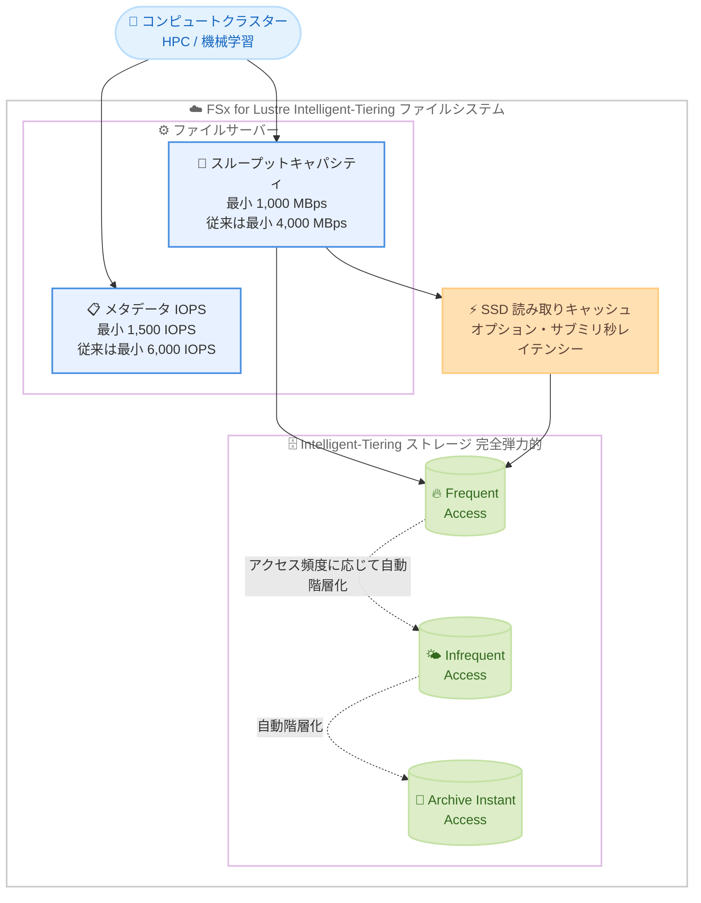

# Amazon FSx for Lustre - Intelligent-Tiering ファイルシステムのエントリーコストを 75% 引き下げ

**リリース日**: 2026 年 11 月 12 日
**サービス**: Amazon FSx for Lustre
**機能**: Intelligent-Tiering ファイルシステムの最小プロビジョンドスループットキャパシティおよびメタデータ IOPS の引き下げ

📊 [このアップデートのインフォグラフィックを見る](https://takech9203.github.io/aws-news-summary/20261112-fsx-lustre-intelligent-tiering-lower-throughput.html)

## 概要

Amazon FSx for Lustre は、Intelligent-Tiering ストレージクラスを使用するファイルシステムの最小プロビジョンドスループットキャパシティと最小メタデータ IOPS を 75% 引き下げました。スループットキャパシティの最小値は従来の 4,000 MBps から 1,000 MBps に、メタデータパフォーマンスの最小値は 6,000 IOPS から 1,500 IOPS に引き下げられ、Intelligent-Tiering ファイルシステムのエントリーコストが 75% 低減されます。

FSx for Lustre の Intelligent-Tiering ストレージクラスは、アクセス頻度に応じてデータを自動的に階層化する、完全弾力的 (フルエラスティック) な Lustre ファイルストレージです。事前のストレージ容量のプロビジョニングが不要で、ホットデータとコールドデータが混在し、常時 SSD レベルのパフォーマンスを必要としないワークロードに最適化されています。スループットキャパシティはファイルサーバーの読み書き速度を、メタデータ IOPS は 1 秒あたりに作成・読み取り・削除できるファイルおよびディレクトリの数を決定します。

今回の引き下げにより、小規模なデータセットから始めて時間とともに成長していく HPC (ハイパフォーマンスコンピューティング) や機械学習のワークロードでも、低コストで Intelligent-Tiering ファイルシステムを導入しやすくなりました。

**アップデート前の課題**

このアップデート以前には、以下の課題や制限がありました。

- Intelligent-Tiering ファイルシステムの最小スループットキャパシティが 4,000 MBps であり、小規模なワークロードには過剰なスループットをプロビジョニングする必要があった
- 最小メタデータ IOPS が 6,000 IOPS であり、ファイル操作の少ないワークロードでも高いメタデータ性能に対するコストが発生していた
- スループットキャパシティとメタデータ IOPS は時間課金のため、エントリーコストが高く、小規模から始めるプロジェクトや PoC では導入のハードルが高かった

**アップデート後の改善**

今回のアップデートにより、以下が可能になりました。

- 最小スループットキャパシティが 1,000 MBps に引き下げられ、スループットキャパシティは 1,000 MBps、2,000 MBps、および 4,000 MBps の倍数 (最大 2,000,000 MBps) から選択できるようになった
- 最小メタデータ IOPS が 1,500 IOPS に引き下げられ、ファイル操作の規模に見合った小さい構成を選択できるようになった
- 最小構成の月額コストが従来比 75% 低減され、小規模なデータセットから始めてワークロードの成長に合わせてスケールする利用形態が容易になった

## アーキテクチャ図



Intelligent-Tiering ファイルシステムの構成を示しています。今回のアップデートで、ファイルサーバーのスループットキャパシティとメタデータ IOPS の最小値がそれぞれ 75% 引き下げられ、小規模構成から開始できるようになりました。ストレージ層は完全弾力的で、アクセス頻度に応じて 3 つの階層間を自動的に移動します。

## サービスアップデートの詳細

### 主要機能

1. **最小スループットキャパシティの引き下げ**
   - 従来の最小値 4,000 MBps から 1,000 MBps へ 75% 引き下げ
   - 選択可能な値は 1,000 MBps、2,000 MBps、および 4,000 MBps の倍数 (最大 2,000,000 MBps)
   - スループットキャパシティはストレージ容量から独立しており、プロビジョニングした量に対して課金される

2. **最小メタデータ IOPS の引き下げ**
   - 従来の最小値 6,000 IOPS から 1,500 IOPS へ 75% 引き下げ
   - メタデータ IOPS は 1 秒あたりに作成・読み取り・削除できるファイルおよびディレクトリ数を決定する
   - ファイル数の少ないワークロードでは小さい値を選択してコストを削減できる

3. **エントリーコストの 75% 低減**
   - スループットキャパシティとメタデータ IOPS の両方を最小構成にした場合、月額の固定コストが従来比 75% 低減される
   - 小規模なデータセットから始めて成長していく HPC・機械学習ワークロードに適した価格帯となった

## 技術仕様

### 新しい最小構成と従来の比較

| 項目 | 従来の最小値 | 新しい最小値 | 削減率 |
|------|--------------|--------------|--------|
| プロビジョンドスループットキャパシティ | 4,000 MBps | 1,000 MBps | 75% |
| メタデータ IOPS | 6,000 IOPS | 1,500 IOPS | 75% |

### 低スループット構成のパフォーマンス特性

公式ドキュメントに記載されている、Intelligent-Tiering ファイルシステムの設計上のパフォーマンスは以下のとおりです。

| プロビジョンドスループット (MBps) | ベースラインネットワークスループット (MBps) | インメモリキャッシュ (GB) | SSD キャッシュ最大ディスクスループット (MBps) | SSD キャッシュ最大ディスク IOPS |
|------|------|------|------|------|
| 1,000 | 3,125 | 19.2 | 1,000 | 40,000 |
| 2,000 | 6,250 | 38.4 | 2,000 | 80,000 |
| 4,000 ごと | 12,500 | 76.8 | 4,000 | 160,000 |

ネットワーク IOPS はいずれの構成でも数十万 IOPS 規模に対応します。

### 関連する API パラメータ

`CreateFileSystem` API の `LustreConfiguration` で Intelligent-Tiering ファイルシステムの性能を指定します。

| パラメータ | 説明 |
|------|------|
| `ThroughputCapacity` | Intelligent-Tiering 使用時のスループット (MBps)。有効値は 1,000、2,000、および 4,000 の倍数 (最大 2,000,000) |
| `MetadataConfiguration` | メタデータ性能の設定。`Mode` に `AUTOMATIC` または `USER_PROVISIONED` を指定し、`USER_PROVISIONED` の場合は `Iops` を指定 |
| `DataReadCacheConfiguration` | SSD 読み取りキャッシュの設定。`StorageType` が `INTELLIGENT_TIERING` の場合に必須 |
| `EfaEnabled` | EFA および GPUDirect Storage の有効化。Intelligent-Tiering では `ThroughputCapacity` が 4,000 MBps またはその倍数の場合のみ有効化可能 |

## 設定方法

### 前提条件

1. Intelligent-Tiering ストレージクラスが利用可能なリージョンであること (PERSISTENT_2 デプロイメントタイプ対応リージョン)
2. ファイルシステムを配置する VPC、サブネット、セキュリティグループが準備済みであること
3. AWS CLI が最新バージョンに更新されていること

### 手順

#### ステップ 1: 最小構成で Intelligent-Tiering ファイルシステムを作成

```bash
aws fsx create-file-system \
  --file-system-type LUSTRE \
  --storage-type INTELLIGENT_TIERING \
  --subnet-ids subnet-0123456789abcdef0 \
  --security-group-ids sg-0123456789abcdef0 \
  --lustre-configuration '{
    "DeploymentType": "PERSISTENT_2",
    "ThroughputCapacity": 1000,
    "MetadataConfiguration": {
      "Mode": "USER_PROVISIONED",
      "Iops": 1500
    },
    "DataReadCacheConfiguration": {
      "SizingMode": "PROPORTIONAL_TO_THROUGHPUT_CAPACITY"
    }
  }'
```

新しい最小値であるスループットキャパシティ 1,000 MBps、メタデータ 1,500 IOPS を指定して、Intelligent-Tiering ファイルシステムを作成します。SSD 読み取りキャッシュはスループットキャパシティに比例したサイズで自動プロビジョニングされます。

#### ステップ 2: ファイルシステムの状態を確認

```bash
aws fsx describe-file-systems \
  --query "FileSystems[?StorageType=='INTELLIGENT_TIERING'].[FileSystemId,Lifecycle,LustreConfiguration.ThroughputCapacity]" \
  --output table
```

作成した Intelligent-Tiering ファイルシステムの ID、ライフサイクル状態、プロビジョニングされたスループットキャパシティを一覧表示し、`AVAILABLE` になっていることを確認します。

#### ステップ 3: ワークロードの成長に合わせたスケール

ワークロードが成長した場合は、`update-file-system` によるスループットキャパシティの変更や、SSD 読み取りキャッシュのサイズ変更が可能です。ストレージ容量自体は完全弾力的であり、データ量に応じて自動的に拡大・縮小されるため、容量のスケール操作は不要です。

## メリット

### ビジネス面

- **エントリーコストの大幅な低減**: 最小構成の固定コストが 75% 低減され、Intelligent-Tiering の導入ハードルが大きく下がる
- **スモールスタートの実現**: 小規模なデータセットから始まる HPC・機械学習プロジェクトでも、初期段階から過剰な投資をせずに本番と同じストレージ基盤を利用できる
- **コスト最適化の選択肢拡大**: HDD ベースのファイルシステムや SSD ストレージクラスと比較して、より低コストな構成を幅広いワークロードで選択できる

### 技術面

- **性能とストレージの独立したスケール**: スループットキャパシティはストレージ容量から独立しており、必要な性能だけを選択できる
- **完全弾力的なストレージ**: ストレージ容量のプロビジョニングが不要で、データ量に応じて自動的に拡大・縮小する
- **十分なベースライン性能**: 最小の 1,000 MBps 構成でも、ベースラインネットワークスループット 3,125 MBps、SSD キャッシュで最大 40,000 ディスク IOPS を利用できる

## デメリット・制約事項

### 制限事項

- 新しい最小値は**新規に作成する** Intelligent-Tiering ファイルシステムに適用される
- EFA および GPUDirect Storage を有効化するには、スループットキャパシティが 4,000 MBps またはその倍数である必要があり、1,000 MBps / 2,000 MBps 構成では利用できない
- Intelligent-Tiering ストレージクラスは PERSISTENT_2 デプロイメントタイプが利用可能なリージョンに限定される

### 考慮すべき点

- Intelligent-Tiering ストレージへの直接アクセスは数十ミリ秒程度のファーストバイトレイテンシーとリクエスト課金が発生するため、低レイテンシーが必要な場合は SSD 読み取りキャッシュのサイズ設計が重要になる
- 常時高い性能と一貫した低レイテンシーが必要なワークロードには、引き続き SSD ストレージクラスが適している
- スループットキャパシティとメタデータ IOPS は時間課金のため、ワークロードに対して過剰にプロビジョニングするとコストメリットが薄れる

## ユースケース

### ユースケース 1: 小規模から始める機械学習トレーニング基盤

**シナリオ**: 機械学習チームが数 TB 規模のデータセットでモデル開発を開始し、将来的にデータセットとクラスター規模の拡大を見込んでいる。

**実装例**:
```
スループットキャパシティ 1,000 MBps、メタデータ 1,500 IOPS の最小構成で
Intelligent-Tiering ファイルシステムを作成。
データセットの成長に合わせてスループットキャパシティを段階的に引き上げる。
```

**効果**: 従来比 75% 低いエントリーコストで開発を開始でき、ストレージは自動で拡大するため、成長に合わせた段階的なスケールが可能になる。

### ユースケース 2: ホットデータとコールドデータが混在する HPC ワークロード

**シナリオ**: 解析ジョブで直近の結果データには頻繁にアクセスするが、過去の結果データはほとんど参照されない。従来は HDD ベースのファイルシステムでコストを抑えていた。

**実装例**:
```
Intelligent-Tiering ファイルシステムに SSD 読み取りキャッシュを構成。
頻繁にアクセスするデータはキャッシュからサブミリ秒レイテンシーで提供し、
コールドデータは Infrequent Access / Archive Instant Access 階層へ自動移行。
```

**効果**: アクセス頻度に応じた自動階層化により、ストレージコストを抑えながら、ホットデータには SSD 水準の性能を提供できる。

### ユースケース 3: PoC・検証環境のコスト削減

**シナリオ**: 本番導入前に FSx for Lustre Intelligent-Tiering の性能特性やアプリケーション互換性を検証したいが、検証のためだけに大きな固定コストはかけたくない。

**実装例**:
```
検証環境では 1,000 MBps / 1,500 IOPS の最小構成でファイルシステムを作成し、
本番と同じ API・運用手順で検証を実施。
本番移行時にスループットキャパシティを必要なレベルに設定する。
```

**効果**: 従来の 4 分の 1 のエントリーコストで検証環境を構築でき、本番と同一のストレージクラスで互換性を確認できる。

## 料金

Intelligent-Tiering ファイルシステムの料金は、ストレージ使用量 (階層ごとの GB あたり月額)、リクエスト数、プロビジョンドスループットキャパシティ、メタデータ IOPS、SSD 読み取りキャッシュの各ディメンションで構成されます。今回のアップデートで引き下げられたのは、時間課金が発生するスループットキャパシティとメタデータ IOPS の最小値です。

### 料金例 (米国東部バージニア北部リージョンの公開料金に基づく概算)

| 構成 | 月額料金 (概算) |
|--------|------------------|
| 従来の最小構成: 4,000 MBps + 6,000 IOPS | 約 2,410 USD (4,000 × 0.52 USD + 6,000 × 0.055 USD) |
| 新しい最小構成: 1,000 MBps + 1,500 IOPS | 約 602.50 USD (1,000 × 0.52 USD + 1,500 × 0.055 USD) |

上記はスループットキャパシティとメタデータ IOPS のみの概算であり、ストレージ使用量、リクエスト、SSD 読み取りキャッシュの料金が別途発生します。最新の料金は料金ページを確認してください。

## 利用可能リージョン

新しい低スループットキャパシティレベルは、Intelligent-Tiering ストレージクラスが利用可能なすべての AWS リージョンにおいて、新規に作成する Intelligent-Tiering ファイルシステムで利用できます。対応リージョンの最新情報は AWS リージョン別サービス一覧を参照してください。

## 関連サービス・機能

- **Amazon FSx for Lustre (SSD ストレージクラス)**: 一貫した低レイテンシーと高い性能が必要なワークロード向けの選択肢であり、Intelligent-Tiering とワークロード特性に応じて使い分けられる
- **Amazon S3**: データリポジトリ関連付けにより、S3 バケットと FSx for Lustre を連携したデータパイプラインを構築できる
- **Amazon EC2 / AWS Batch / Amazon SageMaker AI**: HPC や機械学習のコンピュート基盤として、FSx for Lustre を高性能な共有ファイルシステムとして利用できる

## 参考リンク

- 📊 [インフォグラフィック](https://takech9203.github.io/aws-news-summary/20261112-fsx-lustre-intelligent-tiering-lower-throughput.html)
- [公式発表 (What's New)](https://aws.amazon.com/about-aws/whats-new/2026/11/fsx-lustre-intelligent-tiering-lower-throughput/)
- [ドキュメント: Intelligent-Tiering ストレージクラスのパフォーマンス特性](https://docs.aws.amazon.com/fsx/latest/LustreGuide/intelligent-tiering-file-systems.html)
- [Amazon FSx for Lustre 製品ページ](https://aws.amazon.com/fsx/lustre/)
- [料金ページ](https://aws.amazon.com/fsx/lustre/pricing/)
- [AWS リージョン別サービス一覧](https://aws.amazon.com/about-aws/global-infrastructure/regional-product-services/)

## まとめ

Amazon FSx for Lustre の Intelligent-Tiering ファイルシステムは、最小スループットキャパシティが 1,000 MBps、最小メタデータ IOPS が 1,500 IOPS に引き下げられ、エントリーコストが 75% 低減されました。小規模なデータセットから始まる HPC・機械学習ワークロードや検証環境において、低コストで完全弾力的な Lustre ストレージを導入しやすくなっています。新規ファイルシステムの作成時には、ワークロードの規模に見合った小さい構成から始めることを検討してください。
