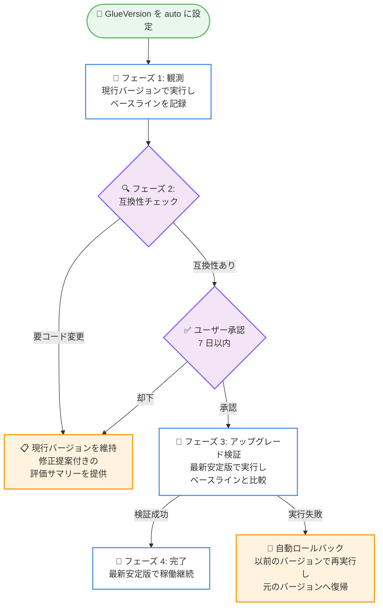

# AWS Glue - Apache Spark ジョブの自動バージョンアップグレード

**リリース日**: 2026 年 11 月 12 日
**サービス**: AWS Glue
**機能**: Automatic version upgrades for Apache Spark jobs (自動バージョンアップグレード)

📊 [このアップデートのインフォグラフィックを見る](https://takech9203.github.io/aws-news-summary/20261112-glue-spark-auto-upgrades.html)

## 概要

AWS Glue が、Apache Spark ジョブの自動バージョンアップグレード (auto upgrade) を発表しました。ジョブの `GlueVersion` パラメータを `auto` に設定するだけで、手動での移行プロジェクトを実施することなく、Spark ジョブを最新の安定版 AWS Glue ランタイムに保つことができます。これにより、セキュリティパッチ、パフォーマンス改善、Apache Iceberg などの新しいテーブルフォーマットのサポートを継続的に利用できます。

自動アップグレードには複数の検証ガードレールが組み込まれています。AWS Glue はジョブのスクリプト、設定、依存関係を分析して新しいランタイムとの互換性を評価し、アップグレードの実行前にユーザーの承認を必須とします。承認後のアップグレード実行では、スキーマ、データ量、レイテンシー、フォーマットといったジョブの出力プロファイルをベースラインと比較して検証し、問題があれば自動的に以前のバージョンへ戻します。

コード変更が必要なジョブは現在のバージョンのまま安全に維持され、AWS Glue が修正提案を含むアップグレード分析を提供します。修正は手動または Apache Spark upgrade agent で適用できます。多数のジョブを一括で評価・更新するための Glue ジョブ管理スキル (AI エージェント用) も GitHub の aws-samples リポジトリで公開されています。

**アップデート前の課題**

- Glue バージョンのアップグレードは、ジョブごとに手動での互換性評価、テスト、切り替え作業が必要な移行プロジェクトだった
- 古いランタイムに留まるジョブは、セキュリティパッチや性能改善、新しいテーブルフォーマット対応の恩恵を受けられなかった
- 多数のジョブを抱える環境では、バージョンアップの作業負荷が大きく、アップグレードが後回しになりがちだった

**アップデート後の改善**

- `GlueVersion` を `auto` に設定するだけで、互換性評価からアップグレード検証までを AWS Glue が自動で実施するようになった
- アップグレード後の実行が失敗した場合は、以前のバージョンで自動的に再実行し、ジョブを元のバージョンへ戻すセーフティネットが提供されるようになった
- コード変更が必要なジョブには修正提案付きの分析結果が提供され、計画的な対応が可能になった

## アーキテクチャ図



既存ジョブの自動アップグレードは 4 つのフェーズで進行し、互換性チェック、ユーザー承認、出力ベースラインとの比較検証、失敗時の自動ロールバックという多層のガードレールで安全性を確保します。

## サービスアップデートの詳細

### 主要機能

1. **`GlueVersion` パラメータの `auto` 設定**
   - AWS Glue Studio、CLI、API、SDK からジョブの作成・更新時に設定可能
   - 既存ジョブは 4 フェーズの評価プロセスを経て最新安定版へ移行
   - 新規作成したジョブは評価フェーズをスキップし、最初から最新安定版で実行

2. **互換性評価とユーザー承認**
   - AWS Glue がジョブスクリプト、設定、依存関係を分析し、既知の破壊的変更の有無をチェック
   - 問題がない場合は適格性サマリー (eligibility summary) が送付され、7 日以内に承認または却下を選択
   - 承認が最新安定版へ移行する唯一のステップであり、ユーザーの同意なしにアップグレードされることはない

3. **出力プロファイルによる検証と自動ロールバック**
   - アップグレード後の実行を、スキーマ、データ量、レイテンシー、フォーマットのベースラインと比較
   - アップグレード後の実行が失敗した場合、以前のバージョンでリトライし、ジョブを元のバージョンへ自動復帰
   - AWS Glue はユーザーのスクリプトやジョブ設定を変更しない

4. **コード変更が必要なジョブへの対応**
   - 互換性のないジョブはアップグレードされず、現行バージョンのまま安全に稼働を継続
   - 評価サマリーに必要な変更点と修正提案が記載され、手動または Apache Spark upgrade agent で適用可能

5. **AI エージェントによる一括管理**
   - GitHub の aws-samples/aws-glue-samples リポジトリで公開されている managing-glue-jobs スキルを利用
   - 自然言語プロンプトで複数ジョブの評価、auto upgrade の有効化、メール通知設定、承認操作が可能

## 技術仕様

### 自動アップグレードの 4 フェーズ

| フェーズ | AWS Glue の動作 | ユーザーの操作 |
|------|------|------|
| 1. 観測 | 現行バージョンでジョブを実行し、ベースラインを記録 | 不要 |
| 2. 互換性チェックと承認 | 既知の破壊的変更をチェックし、問題なければ適格性サマリーを送付 | サマリーを確認し、7 日以内に承認または却下 |
| 3. アップグレード検証 | 次回以降の実行を最新安定版で行い、各実行をベースラインと比較 | アップグレード後の実行をモニタリング |
| 4. 完了 | 最新安定版で稼働継続。実行失敗時は以前のバージョンへ復帰 | 評価サマリーを確認 |

### 対象ジョブの要件

| 項目 | 詳細 |
|------|------|
| ジョブタイプ | Spark ETL ジョブ (`glueetl`)。Streaming、Python shell、Ray ジョブは非対応 |
| Glue バージョン | AWS Glue 2.0 以降のジョブが対象 |
| `MaxRetries` | 1 以上に設定 (失敗時に以前のバージョンでリトライするために使用) |
| ジョブ実行キューイング | 無効化が必要 |
| リトライ安全性 | 途中失敗からのリトライで出力の重複や破損が発生しない設計であること (例: リトライ時に出力を上書きする) |

### 設定例

```json
{
  "Name": "my-etl-job",
  "GlueVersion": "auto",
  "MaxRetries": 1,
  "Command": {
    "Name": "glueetl",
    "ScriptLocation": "s3://my-bucket/scripts/my-etl-job.py"
  }
}
```

## 設定方法

### 前提条件

1. 対象ジョブが AWS Glue 2.0 以降の Spark ETL ジョブ (`glueetl`) であること
2. `MaxRetries` が 1 以上に設定され、ジョブ実行キューイングが無効であること
3. ジョブがリトライ安全であること (リトライによる出力の重複・破損が発生しない、または部分出力をクリーンアップできる)
4. auto upgrade に必要な IAM 権限が付与されていること

### 手順

#### ステップ 1: ジョブのリトライ安全性を確認する

ジョブが途中で失敗した場合に、リトライで出力が重複・破損しないことを確認します。たとえば、リトライ時に出力を上書きする設計であれば安全です。

#### ステップ 2: `GlueVersion` を `auto` に設定する

```bash
aws glue update-job \
  --job-name my-etl-job \
  --job-update '{"GlueVersion": "auto", "MaxRetries": 1, "Role": "arn:aws:iam::123456789012:role/GlueJobRole", "Command": {"Name": "glueetl", "ScriptLocation": "s3://my-bucket/scripts/my-etl-job.py"}}'
```

既存ジョブの `GlueVersion` パラメータを `auto` に更新し、`MaxRetries` を 1 に設定します。AWS Glue Studio のコンソールからも同様に設定できます。設定後は通常どおりジョブを実行し続けます。

#### ステップ 3: 適格性サマリーを確認して承認する

AWS Glue が観測と互換性チェックを完了すると、適格性サマリーが届きます。内容を確認し、7 日以内に承認します。承認後の実行から最新安定版が使用されます。

#### ステップ 4: アップグレード後の実行をモニタリングする

アップグレード検証フェーズの実行結果をモニタリングし、評価完了後に auto upgrade 評価サマリーを確認します。実行が失敗した場合は、AWS Glue が自動的に以前のバージョンへ戻します。

#### ステップ 5 (オプション): AI エージェントで複数ジョブを一括管理する

GitHub の aws-samples/aws-glue-samples リポジトリから managing-glue-jobs スキルをインストールし、以下のようなプロンプトで複数ジョブを評価・設定できます。

```text
Assess my Glue jobs in us-west-2 for auto upgrade. Use AWS profile my-profile.
Proceed with the eligible jobs, and set up auto upgrade email notifications to data-team@example.com.
```

1 つ目のプロンプトは読み取り専用の評価を実行し、2 つ目のプロンプトは適格なジョブの `GlueVersion` を `auto` に設定してメール通知リソースを作成します。エージェントは変更前に必ず確認を求めます。

## メリット

### ビジネス面

- **運用負荷の削減**: バージョンアップの移行プロジェクトが不要になり、エンジニアリングリソースをビジネス価値の高い開発に集中できる
- **セキュリティ体制の強化**: 最新ランタイムのセキュリティパッチを継続的に適用でき、古いバージョンに起因するリスクを低減できる
- **追加コストなし**: auto upgrade 自体に追加料金はなく、ジョブ実行は通常のレートで課金される

### 技術面

- **多層のガードレール**: 互換性チェック、ユーザー承認、出力ベースライン比較、失敗時の自動ロールバックにより、安全にアップグレードできる
- **スクリプト非変更**: AWS Glue はユーザーのスクリプトやジョブ設定を変更しないため、意図しない動作変更のリスクがない
- **最新機能の活用**: 新しい Glue ランタイムのパフォーマンス改善や Apache Iceberg などの新テーブルフォーマット対応を自動的に利用できる

## デメリット・制約事項

### 制限事項

- Spark ETL ジョブ (`glueetl`) のみ対応。Streaming、Python shell、Ray ジョブは非対応
- AWS Glue 2.0 以降のジョブが対象
- `MaxRetries` を 1 以上に設定し、ジョブ実行キューイングを無効にする必要がある
- 1 つのジョブで同時に実行できる評価は 1 つのみ。Upgrade with AI を実行中のジョブは auto upgrade を利用できない
- 商用リージョンで利用可能 (GovCloud、中国リージョンは記載なし)

### 考慮すべき点

- ジョブがリトライ安全であることが前提となるため、冪等性のない出力処理を持つジョブは事前に設計の見直しが必要
- 実行頻度の低いジョブは、評価にジョブ自身の実行を使用するため、アップグレード完了までに時間がかかる
- 評価期間中にジョブのスクリプトや出力を変更すると、ベースラインが古くなり評価が失敗する可能性がある
- 適格性サマリーへの承認期限は 7 日間であり、期限内の確認・承認フローを運用に組み込む必要がある

## ユースケース

### ユースケース 1: 多数の ETL ジョブを抱えるデータ基盤のランタイム統一

**シナリオ**: 数百の Glue 2.0 / 3.0 / 4.0 ジョブが混在するデータ基盤で、セキュリティパッチ適用と性能改善のために最新バージョンへの統一を進めたいが、手動での移行工数を確保できない。

**実装例**:
```text
managing-glue-jobs スキル (AI エージェント) を使用:
1. "Assess my Glue jobs in us-west-2 for auto upgrade." で全ジョブを一括評価
2. 適格なジョブの GlueVersion を auto に一括設定し、メール通知を構成
3. 適格性サマリーを確認して順次承認
```

**効果**: 移行プロジェクトを立ち上げることなく、多数のジョブを段階的かつ安全に最新ランタイムへ統一できる。

### ユースケース 2: 夜間バッチ ETL ジョブの安全な自動アップグレード

**シナリオ**: S3 上のデータを変換して出力を上書きする夜間バッチジョブを運用している。リトライ安全な設計のため、自動アップグレードの対象に適している。

**実装例**:
```bash
aws glue update-job \
  --job-name nightly-batch-etl \
  --job-update '{"GlueVersion": "auto", "MaxRetries": 1, ...}'
```

**効果**: 夜間バッチは通常どおり実行を継続しながら、裏側で互換性評価が進み、承認後に最新安定版へ移行。失敗時は自動的に元のバージョンへ戻るため、業務影響を最小化できる。

### ユースケース 3: 新規ジョブを常に最新ランタイムで運用

**シナリオ**: 新しいデータパイプラインを構築するにあたり、将来のバージョンアップ対応を最初から不要にしたい。

**実装例**:
```bash
aws glue create-job \
  --name new-pipeline-job \
  --glue-version auto \
  --max-retries 1 \
  --role arn:aws:iam::123456789012:role/GlueJobRole \
  --command '{"Name": "glueetl", "ScriptLocation": "s3://my-bucket/scripts/new-pipeline.py"}'
```

**効果**: 新規作成時に `auto` を指定したジョブは評価フェーズをスキップし、最初から最新安定版で実行される。以降のバージョンアップも自動で追従する。

## 料金

auto upgrade 自体に追加料金はありません。評価のための追加のジョブ実行も発生せず、各ジョブ実行は通常の AWS Glue の料金 (DPU 時間ベース) で課金されます。

## 利用可能リージョン

すべての AWS 商用リージョンで利用可能です。ドキュメントには以下を含む 33 リージョンが記載されています。

- アジアパシフィック (東京)、アジアパシフィック (大阪)、アジアパシフィック (ソウル)、アジアパシフィック (シンガポール) など
- 米国東部 (バージニア北部)、米国東部 (オハイオ)、米国西部 (北カリフォルニア)、米国西部 (オレゴン)
- 欧州 (フランクフルト)、欧州 (アイルランド)、欧州 (ロンドン)、欧州 (パリ) など

東京リージョンと大阪リージョンの両方で利用可能です。

## 関連サービス・機能

- **AWS Glue Studio**: コンソールからジョブの `GlueVersion` を `auto` に設定し、適格性サマリーの確認や承認操作が可能
- **Apache Spark upgrade agent / Upgrade with AI**: コード変更が必要なジョブに対して、修正提案の適用を支援する既存のアップグレード機能。auto upgrade と同時には利用不可
- **Apache Iceberg**: 最新ランタイムへの追従により、新しいテーブルフォーマットのサポートを継続的に利用可能
- **aws-samples/aws-glue-samples (managing-glue-jobs スキル)**: AI エージェントで複数ジョブの評価・設定・承認を一括管理するための GitHub 公開スキル

## 参考リンク

- 📊 [インフォグラフィック](https://takech9203.github.io/aws-news-summary/20261112-glue-spark-auto-upgrades.html)
- [公式発表 (What's New)](https://aws.amazon.com/about-aws/whats-new/2026/11/glue-spark-auto-upgrades/)
- [ドキュメント: Automatic version upgrades for AWS Glue jobs](https://docs.aws.amazon.com/glue/latest/dg/auto-version-upgrades.html)
- [GitHub: managing-glue-jobs スキル (aws-samples/aws-glue-samples)](https://github.com/aws-samples/aws-glue-samples/blob/8d52b2c004d48b4d15c20cb1b0bd161da0c98a0d/utilities/skills/managing-glue-jobs/README.md)
- [料金ページ: AWS Glue](https://aws.amazon.com/glue/pricing/)

## まとめ

AWS Glue の自動バージョンアップグレードにより、Spark ジョブを追加料金なしで常に最新の安定版ランタイムに保てるようになり、バージョンアップの移行プロジェクトが不要になります。互換性チェック、ユーザー承認、出力ベースライン検証、自動ロールバックという多層のガードレールが安全性を担保します。まずはリトライ安全な Spark ETL ジョブを対象に `GlueVersion` を `auto` に設定し、適格性サマリーを確認するところから始めることを推奨します。
