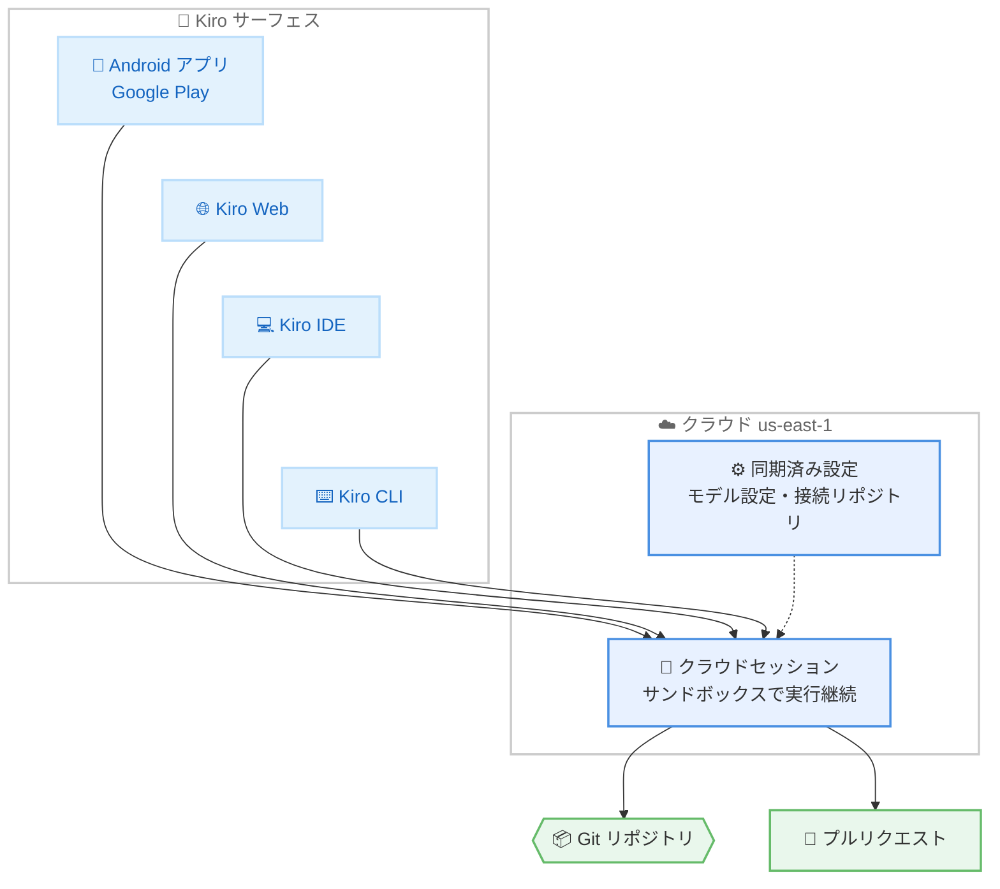

# Kiro - Kiro for Android の提供開始

**リリース日**: 2026 年 11 月 12 日
**サービス**: Kiro
**機能**: Kiro for Android (Kiro Mobile)

📊 [このアップデートのインフォグラフィックを見る](https://takech9203.github.io/aws-news-summary/20261112-kiro-android.html)

## 概要

Kiro for Android が Google Play で利用可能になりました。Android スマートフォンから Kiro のクラウドセッションにアクセスし、新しい作業の開始、進行中の作業の確認とステア (方向付け)、変更内容のレビューまでを行えます。ラップトップの前に戻らなくても、移動中や外出先からエンジニアリング作業を前進させられることが今回のアップデートの最大の価値です。

クラウドセッションにより、同じ作業が Kiro CLI、Web、IDE、Android の間で共有されます。Android で会話履歴とセッション履歴を引き継いだままクラウドセッションを開いたり、Android で開始した作業を後から別のサーフェスで再開したりできます。Kiro の設定を同期済みであれば、その設定もクラウドセッションで利用されます。セッションはユーザーがサーフェスを切り替えたりスマートフォンを置いたりしてもクラウドサンドボックス内で実行され続け、Android 上では実行中・完了・要対応のセッションを一覧で確認できます。

Kiro for Android は有料の Kiro プラン (Pro、Pro+、Pro Max、Power など) で利用できます。なお、Kiro for iOS は引き続きプレビュー段階であり、早期アクセスのリクエストを受け付けています。

**アップデート前の課題**

このアップデート以前に存在していた課題や制限は以下のとおりです。

- 以前は Kiro のクラウドセッションを操作するために Kiro CLI、Web、IDE といったデスクトップ環境が必要だった
- 移動中や外出先でアイデアを思いついたり本番バグを発見したりしても、デスクに戻るまで作業を開始できなかった
- セッションがユーザーの判断 (ブランチの選択や実装方針の確認など) を待つ状態になった場合、ラップトップの前に戻るまで作業がブロックされた
- 完成した変更のレビューや PR 作成の指示もデスクトップ環境からしか行えなかった

**アップデート後の改善**

今回のアップデートにより可能になったことは以下のとおりです。

- Android スマートフォンから新しいクラウドセッションを開始し、リポジトリを接続して構築・修正・調査を指示できるようになった
- スクリーンショットを添付して意図を素早く伝えられるようになった
- セッションが判断を必要とした際に、スマートフォンから質問に回答したりコンテキストを追加したりして作業のブロックを解除できるようになった
- ファイル編集がモバイルフレンドリーなカードとして表示され、スマートフォン上でファイル単位の diff レビューが可能になった
- レビュー後に Kiro へ修正を差し戻したり、PR の作成を指示して PR ステータスをセッションと合わせて確認したりできるようになった

## アーキテクチャ図



クラウドセッションはクラウド上のサンドボックスで実行され続け、Android を含むすべての Kiro サーフェスから同じセッションにアクセスできます。セッションはリポジトリのコードを操作し、最終的に PR を作成します。

## サービスアップデートの詳細

### 主要機能

1. **サーフェスをまたぐ作業の継続 (クラウドセッション連携)**
   - Kiro CLI、Web、IDE、Android の間で同じ作業 (会話履歴・セッション履歴) を共有
   - Android でクラウドセッションを開くと会話とセッション履歴がそのまま引き継がれる
   - Android で開始した作業を後から別のサーフェスで再開可能
   - 同期済みの Kiro 設定 (モデル設定など) はクラウドセッションでも利用される
   - セッションはサーフェスの切り替えやスマートフォンを置いた後もクラウドサンドボックスで実行を継続
   - Android 上で「実行中」「完了」「要対応」のセッション状態を一覧で確認可能

2. **スマートフォンからの新規セッション開始**
   - Android から新しいセッションを開始し、必要なリポジトリを接続して構築・修正・調査の内容を指示
   - スクリーンショットを添付して意図を伝えることが可能
   - Kiro はコードの調査、ツールの使用、変更の実施、テストの実行をクラウド上で継続

3. **作業のブロック解除 (ステア)**
   - セッションがブランチの選択、実装詳細の確認、方針転換などの判断を必要とした場合に通知
   - Android からセッションを開き、質問への回答やコンテキストの追加を行うことで作業を継続させられる

4. **スマートフォンからのレビューと出荷**
   - 変更が完成したら diff をスマートフォン上で直接確認
   - ファイル編集はモバイルフレンドリーなカードとして表示され、ファイル単位でレビュー可能
   - 修正が必要な場合は Kiro に差し戻して再作業を指示
   - 変更に問題がなければ Kiro が PR を作成し、PR ステータスはセッションと合わせて表示される

## 技術仕様

### 利用要件

| 項目 | 詳細 |
|------|------|
| 対象プラットフォーム | Android (Google Play で配信) |
| 必要プラン | 有料 Kiro プラン (Pro、Pro+、Pro Max、Power など) |
| サインイン | Kiro CLI、Web、IDE と同一のアイデンティティを使用 |
| 引き継がれる情報 | クラウドセッション、接続済みリポジトリ、モデル設定、同期済み設定 |
| エンタープライズ要件 | IAM Identity Center 利用組織では、管理者がクラウドセッションを有効化する必要あり |
| クラウドセッションのリージョン | us-east-1 (バージニア北部) |
| iOS 版 | プレビュー継続中 (早期アクセスをリクエスト可能) |

## 設定方法

### 前提条件

1. 有料の Kiro プラン (Pro、Pro+、Pro Max、Power など) を契約していること
2. Kiro CLI、Web、IDE で使用しているサインイン用アイデンティティを保有していること
3. IAM Identity Center を利用するエンタープライズ組織の場合、管理者によってクラウドセッションが有効化されていること

### 手順

#### ステップ 1: アプリのインストール

Google Play から「Kiro」アプリ (`dev.kiro.mobile`) をダウンロードしてインストールします。

- Google Play: https://play.google.com/store/apps/details?id=dev.kiro.mobile

#### ステップ 2: サインイン

Kiro CLI、Web、IDE で使用しているものと同じアイデンティティでサインインします。クラウドセッション、接続済みリポジトリ、モデル設定、同期済み設定が自動的に引き継がれます。

#### ステップ 3: セッションの開始または再開

新しいセッションを開始する場合は、リポジトリを接続し、構築・修正・調査したい内容をプロンプトで指示します。必要に応じてスクリーンショットを添付できます。既存のクラウドセッションがある場合は、一覧から開いて会話を継続します。

## メリット

### ビジネス面

- **リードタイムの短縮**: アイデアの発生から作業開始までの時間を短縮し、デスクに戻る前に調査や修正を進められる
- **作業のブロック解消**: セッションが判断待ちで停止する時間を最小化し、エンジニアリング作業全体のスループットを向上できる
- **場所にとらわれない開発体制**: 通勤中や外出先でもレビューと PR 作成まで完結でき、チームの対応速度が向上する

### 技術面

- **マルチサーフェス対応**: CLI、Web、IDE、Android で同一のクラウドセッションと設定を共有し、一貫した作業体験を実現
- **クラウドサンドボックスでの継続実行**: スマートフォンを閉じてもセッションはクラウド上で実行を継続し、テスト実行まで自動で進行
- **モバイル最適化されたレビュー体験**: diff がモバイルフレンドリーなカードとして表示され、小さな画面でもファイル単位のレビューが可能

## デメリット・制約事項

### 制限事項

- 有料プランが必要であり、無料プランでは Kiro for Android を利用できない
- クラウドセッションは現時点で us-east-1 (バージニア北部) でのみ提供される
- IAM Identity Center を利用するエンタープライズ組織では、管理者がクラウドセッションを有効化するまでユーザーは Kiro for Android にアクセスできない
- iOS 版はプレビュー段階であり、一般提供はされていない

### 考慮すべき点

- クラウドセッションはクラウド上のサンドボックスでコードを扱うため、組織のセキュリティポリシーやデータ所在地の要件を事前に確認する必要がある
- スマートフォンでのレビューは手軽である一方、大規模な変更の精査にはデスクトップ環境との併用が現実的である

## ユースケース

### ユースケース 1: 外出先でのアイデアの即時着手

**シナリオ**: 移動中に新機能のアイデアを思いついた開発者が、デスクに戻る前に実装を開始したい。

**実装例**:
```text
1. Android の Kiro アプリで新規セッションを開始
2. 対象リポジトリを接続
3. 「リクエスト ID の検証・生成ロジックを /myapp/common に移動し、
   ゲートウェイを共有実装に更新して」と指示
4. Kiro がクラウド上でコード調査、変更、テスト実行を継続
```

**効果**: デスクに戻った時点で変更とテストが完了しており、レビューから着手できる。

### ユースケース 2: 判断待ちセッションのブロック解除

**シナリオ**: クラウドセッションが実装方針の確認を必要として停止しているが、担当者は外出中である。

**実装例**:
```text
1. Android アプリで「要対応」状態のセッションを確認
2. セッションを開き、Kiro からの質問 (ブランチ選択や実装詳細) に回答
3. 必要に応じて追加のコンテキストを提供
4. Kiro が回答を受けて作業を再開
```

**効果**: ラップトップに戻るまで作業が停止することがなくなり、セッションの待ち時間を最小化できる。

### ユースケース 3: スマートフォンからのレビューと PR 作成

**シナリオ**: 通勤中に、完了したセッションの変更内容をレビューして PR を作成したい。

**実装例**:
```text
1. Android アプリで完了済みセッションを開く
2. モバイルフレンドリーなカード表示でファイルごとの diff をレビュー
3. 修正が必要なら Kiro に差し戻して再作業を指示
4. 問題なければ Kiro に PR の作成を指示し、PR ステータスをセッション上で確認
```

**効果**: レビューから PR 作成までをスマートフォンで完結でき、変更の出荷サイクルが加速する。

## 料金

Kiro for Android 自体に追加料金はなく、有料の Kiro プランに含まれる形で提供されます。クラウドセッションでの作業は各プランのクレジットを消費します。

### 対象プラン

| プラン | 月額料金 | 含まれるクレジット |
|--------|----------|--------------------|
| Pro | 20 USD | 1,000 クレジット |
| Pro+ | 40 USD | 2,000 クレジット |
| Pro Max | 100 USD | 5,000 クレジット |
| Power | 200 USD | 10,000 クレジット |

追加クレジットは 1 クレジットあたり 0.04 USD で購入できます。最新の料金は [Kiro の料金ページ](https://kiro.dev/pricing/) を参照してください。

## 利用可能リージョン

Kiro はグローバルに提供されるサービスです。ただし、クラウドセッションは現時点で us-east-1 (バージニア北部) で提供されています。

## 関連サービス・機能

- **Kiro クラウドセッション**: Android を含む全サーフェスから共有されるクラウド上の作業セッション。本アップデートの基盤機能
- **Kiro Web / IDE / CLI**: Android と同一アイデンティティ・同一セッションで連携するデスクトップ向けサーフェス
- **AWS IAM Identity Center**: エンタープライズ組織でのサインインに利用。管理者によるクラウドセッションの有効化が必要

## 参考リンク

- 📊 [インフォグラフィック](https://takech9203.github.io/aws-news-summary/20261112-kiro-android.html)
- [公式発表 (Kiro Blog): Introducing Kiro for Android](https://kiro.dev/blog/android/)
- [Kiro Changelog](https://kiro.dev/changelog/)
- [Google Play: Kiro](https://play.google.com/store/apps/details?id=dev.kiro.mobile)
- [ドキュメント: Cloud sessions](https://kiro.dev/docs/cloud-sessions/)
- [ドキュメント: クラウド設定の同期](https://kiro.dev/docs/web/cloud-configuration/)
- [料金ページ](https://kiro.dev/pricing/)

## まとめ

Kiro for Android の提供開始により、クラウドセッションを使ったエンジニアリング作業を Android スマートフォンから開始・ステア・レビューできるようになり、デスクを離れている時間が作業のブロック要因ではなくなりました。有料プランを利用中のユーザーは Google Play からアプリをインストールし、既存のアイデンティティでサインインするだけで利用を開始できます。IAM Identity Center を利用する組織では、管理者によるクラウドセッションの有効化を事前に確認することを推奨します。
