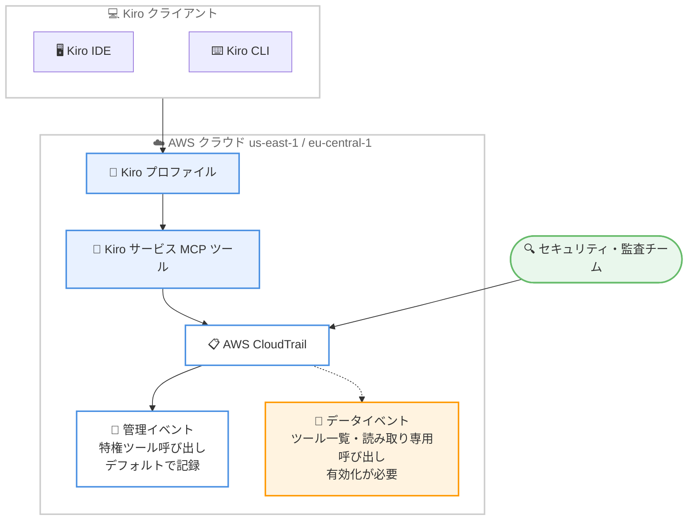

# Kiro - Changelog 2026-11-12 (CLI 3.3.0 / CloudTrail 監査ログ対応)

**リリース日**: 2026 年 11 月 12 日
**サービス**: Kiro
**機能**: /copy コマンド拡張・コンパクション開始タイミング設定 (CLI 3.3.0)、Kiro ツール呼び出しの AWS CloudTrail 監査対応

📊 [このアップデートのインフォグラフィックを見る](https://takech9203.github.io/aws-news-summary/20261112-kiro-changelog-2026-11-12.html)

## 概要

2026 年 11 月 12 日付の Kiro Changelog では、2 つの主要なアップデートが発表されました。1 つ目は Kiro CLI 3.3.0 のリリースで、過去の応答をコピーする `/copy N` および `/copy last N` コマンドの追加と、自動コンパクション (会話履歴の要約) を開始するコンテキスト使用率をユーザー自身が選択できる機能が含まれます。長時間のセッションで過去の回答を再利用したい開発者や、コンテキスト管理を細かく制御したいユーザーに有用なアップデートです。

2 つ目は「Audit Kiro Tool Calls with AWS CloudTrail」で、Kiro サービス MCP ツールの呼び出しが AWS CloudTrail に記録されるようになりました。対象は米国東部 (バージニア北部) `us-east-1` および欧州 (フランクフルト) `eu-central-1` の Kiro プロファイルです。セキュリティチームや監査チームは、誰がリクエストしたか、どのツールが呼び出されたか、いつ実行されたか、完了したかどうかを CloudTrail 上で確認できます。

なお、同日付の「Kiro Mobile for Android」(Google Play での提供開始) は別レポート ([2026-11-12-kiro-android.md](./2026-11-12-kiro-android.md)) でカバーしているため、本レポートでは割愛します。

**アップデート前の課題**

- `/copy` コマンドは最新の応答しかコピーできず、過去の応答を再利用するには手動での選択・コピーが必要だった
- 自動コンパクションが開始されるコンテキスト使用率は固定で、ユーザーが調整できなかった
- Kiro サービスツールの呼び出し履歴を組織として一元的に監査する手段がなく、セキュリティ・コンプライアンス要件への対応が難しかった

**アップデート後の改善**

- `/copy N` で N 番目に新しい応答を、`/copy last N` で直近 N 件のメッセージをまとめてコピーできるようになった
- `/settings` の Compaction 画面から自動コンパクション開始のしきい値 (コンテキスト使用率) をグローバルデフォルトとして設定でき、自動コンパクションのオン / オフも切り替え可能になった
- Kiro サービス MCP ツールの呼び出しが AWS CloudTrail に記録され、既存の AWS 監査基盤 (CloudTrail Lake、Athena、SIEM 連携など) で分析できるようになった

## アーキテクチャ図



Kiro クライアントから Kiro サービス MCP ツールへの呼び出しが AWS CloudTrail に記録される流れを示しています。特権ツール呼び出しは管理イベントとしてデフォルトで記録され、ツール一覧や読み取り専用呼び出しはデータイベントの有効化により記録できます。

## サービスアップデートの詳細

### 主要機能

1. **過去の応答のコピー (`/copy N` / `/copy last N`)**
   - `/copy` は従来どおり最新の応答をコピーする
   - `/copy N` は N 番目に新しい応答をコピーする (例: `/copy 2` は最新の 1 つ前の応答)
   - `/copy last N` は直近 N 件のメッセージを古い順にまとめてコピーする。自分のプロンプトと Kiro の返答の両方が対象で、プロンプトには `**You:**`、返答には `**Kiro:**` のラベルが付く
   - ツール呼び出しをまたいで分割された返答は 1 件のメッセージとして数えられる
   - 会話全体が必要な場合は `/transcript` を使用する

2. **自動コンパクション開始タイミングの選択**
   - V3 セッションで `/settings` を実行し、Compaction 画面を開くと、現在のセッションで使用されているしきい値を確認し、グローバルデフォルトを設定できる
   - しきい値は、Kiro が古い履歴を要約し始めるコンテキスト使用率 (%) を意味する
   - エディタには許容範囲とデフォルト値が表示され、設定した値は次に開始または読み込むセッションから適用される
   - 同じ画面で自動コンパクションのオン / オフも切り替え可能
   - 設定値は `compaction.autoCompactionThreshold` として保存され、ワークスペースの `cli.json` で上書きできる

3. **CLI 3.3.0 のその他の改善・修正**
   - エージェントモニターに各サブエージェントのタスクを表示
   - `/model` の検索・ソート・編集操作を Up キーに移動
   - V2 エージェントを V3 にアップグレードした際に allow ルールが広がらないよう修正
   - エージェント再起動後に停止したワークフローセッションを再読み込み
   - ヘッドレス実行、resume、`/memories`、`/goal`、音声、クリップボード、セッション、検索表示に関する問題を修正

4. **Kiro ツール呼び出しの AWS CloudTrail 監査 (General)**
   - Kiro サービス MCP ツールへの呼び出しを AWS CloudTrail に記録
   - 対象は米国東部 (バージニア北部) `us-east-1` および欧州 (フランクフルト) `eu-central-1` の Kiro プロファイル
   - 誰がリクエストしたか、どのツールが呼び出されたか、いつ実行されたか、完了したかどうかを確認できる
   - 特権ツール呼び出しは管理イベントとしてデフォルトで記録される
   - ツール一覧の取得や読み取り専用ツール呼び出しは、データイベントを有効化することで記録できる
   - イベントではツールの引数は編集 (redact) され、結果は含まれない
   - 対象は Kiro サービスツールのみで、ユーザーが Kiro に追加した MCP サーバーは対象外

## 技術仕様

### CLI 3.3.0 コピー・コンパクション機能

| 項目 | 詳細 |
|------|------|
| `/copy` | 最新の応答をコピー (従来どおり) |
| `/copy N` | N 番目に新しい応答をコピー |
| `/copy last N` | 直近 N 件のメッセージを古い順にコピー (You / Kiro ラベル付き) |
| コンパクション設定 | `/settings` → Compaction 画面 |
| 設定キー | `compaction.autoCompactionThreshold` |
| 上書き | ワークスペースの `cli.json` で上書き可能 |
| 適用タイミング | 次に開始または読み込むセッションから |

### CloudTrail 監査ログ

| 項目 | 詳細 |
|------|------|
| 対象 | Kiro サービス MCP ツールの呼び出し |
| 対象プロファイル | us-east-1 および eu-central-1 の Kiro プロファイル |
| 管理イベント | 特権ツール呼び出し (デフォルトで記録) |
| データイベント | ツール一覧・読み取り専用ツール呼び出し (有効化が必要) |
| 記録内容 | リクエスト元、呼び出されたツール、実行時刻、完了状態 |
| 除外内容 | ツール引数は編集され、結果は含まれない |
| 対象外 | ユーザーが Kiro に追加した MCP サーバーの呼び出し |

## 設定方法

### 前提条件

1. Kiro CLI 3.3.0 以降 (コピー・コンパクション機能)
2. us-east-1 または eu-central-1 に作成された Kiro プロファイル (CloudTrail 監査)
3. CloudTrail のイベントを参照できる IAM 権限 (監査チーム向け)

### 手順

#### ステップ 1: Kiro CLI を最新版に更新

```bash
kiro --version
```

現在の CLI バージョンを確認します。3.3.0 未満の場合は、Kiro の更新手順に従って最新版に更新します。

#### ステップ 2: 過去の応答をコピー

```bash
# チャット内で実行
/copy 2        # 最新の 1 つ前の応答をコピー
/copy last 4   # 直近 4 件のメッセージを古い順にコピー
```

`/copy 2` は最新の 1 つ前の応答をクリップボードにコピーします。`/copy last 4` は直近 4 件のメッセージ (プロンプトと返答の両方) を You / Kiro のラベル付きでコピーします。

#### ステップ 3: コンパクションしきい値を設定

```bash
# V3 セッション内で実行
/settings
# Compaction 画面を開き、しきい値 (コンテキスト使用率 %) を設定
```

`/settings` から Compaction 画面を開き、自動コンパクションを開始するコンテキスト使用率を設定します。設定値は `compaction.autoCompactionThreshold` として保存され、次のセッションから適用されます。チーム共通の値を使いたい場合は、ワークスペースの `cli.json` で上書きします。

#### ステップ 4: CloudTrail で Kiro ツール呼び出しを確認 (監査チーム)

対象リージョンの CloudTrail コンソールでイベント履歴を確認します。特権ツール呼び出しは管理イベントとしてデフォルトで記録されています。ツール一覧や読み取り専用ツール呼び出しも記録したい場合は、証跡 (Trail) のデータイベントを有効化します。

## メリット

### ビジネス面

- **監査・コンプライアンス対応**: Kiro の利用状況が CloudTrail に記録されるため、組織のセキュリティポリシーや監査要件に沿った AI コーディングツールの運用が可能になる
- **既存監査基盤の活用**: CloudTrail という AWS 標準の仕組みを使うため、既存の SIEM 連携やログ分析パイプラインをそのまま活用できる
- **開発者の生産性向上**: 過去の応答の再利用が容易になり、長時間セッションでの作業効率が向上する

### 技術面

- **柔軟なコンテキスト管理**: コンパクション開始しきい値を調整することで、履歴保持とコンテキスト節約のバランスをプロジェクト特性に合わせて最適化できる
- **設定の階層化**: グローバルデフォルトとワークスペース `cli.json` による上書きで、個人設定とチーム設定を両立できる
- **プライバシーに配慮したログ**: CloudTrail イベントではツール引数が編集され結果も含まれないため、機密情報の漏えいリスクを抑えつつ監査証跡を確保できる

## デメリット・制約事項

### 制限事項

- CloudTrail 監査の対象は us-east-1 および eu-central-1 の Kiro プロファイルに限られる
- ログの対象は Kiro サービスツールのみで、ユーザーが追加した MCP サーバーの呼び出しは記録されない
- イベントにはツールの引数の詳細や実行結果は含まれないため、操作内容の完全な再現はできない
- コンパクションしきい値の設定は V3 セッションが対象で、適用は次のセッションから

### 考慮すべき点

- 読み取り専用ツール呼び出しまで記録する場合はデータイベントの有効化が必要で、CloudTrail のデータイベント料金が発生する可能性がある
- ワークスペースの `cli.json` がしきい値を上書きするため、個人設定が反映されない場合は `cli.json` の内容を確認する

## ユースケース

### ユースケース 1: 長時間セッションでの過去回答の再利用

**シナリオ**: 設計検討のセッションで、数ターン前に Kiro が提示した設計案をドキュメントに転記したい。

**実装例**:
```
/copy 3
```

**効果**: スクロールして手動選択することなく、3 番目に新しい応答をそのままクリップボードに取得でき、ドキュメント作成の手間が削減される。

### ユースケース 2: 大規模リポジトリでのコンテキスト管理の最適化

**シナリオ**: 大規模なコードベースを扱うため、コンパクションを早めに開始してコンテキスト逼迫によるパフォーマンス低下を避けたい。

**実装例**:
```
/settings → Compaction → しきい値を低めの値に設定
```

**効果**: コンテキスト使用率が設定値に達した時点で古い履歴が要約され、安定したセッション運用ができる。チームで統一する場合はワークスペースの `cli.json` に設定を記載する。

### ユースケース 3: エンタープライズでの Kiro 利用の監査

**シナリオ**: 企業のセキュリティチームが、開発者の Kiro サービスツール利用状況を定期的にレビューし、不審な操作がないか確認したい。

**実装例**:
```
CloudTrail イベント履歴で Kiro 関連イベントをフィルタリングし、
必要に応じて CloudTrail Lake や Athena で分析
```

**効果**: 誰が・いつ・どのツールを呼び出したかを AWS 標準の監査基盤で追跡でき、コンプライアンスレポートの作成や異常検知に活用できる。

## 利用可能リージョン

Kiro はグローバルに利用可能です。ただし、CloudTrail への監査ログ記録は、米国東部 (バージニア北部) `us-east-1` および欧州 (フランクフルト) `eu-central-1` に作成された Kiro プロファイルが対象です。

## 関連サービス・機能

- **AWS CloudTrail**: Kiro サービスツール呼び出しの記録先。管理イベント・データイベントの仕組みをそのまま利用できる
- **Kiro CLI**: 本アップデートの `/copy` 拡張とコンパクション設定は CLI 3.3.0 で提供
- **Kiro Mobile for Android**: 同日発表のモバイルアプリ。詳細は別レポート ([2026-11-12-kiro-android.md](./2026-11-12-kiro-android.md)) を参照
- **MCP (Model Context Protocol)**: Kiro サービスツールは MCP ツールとして提供される。ユーザー追加の MCP サーバーは今回の監査対象外

## 参考リンク

- 📊 [インフォグラフィック](https://takech9203.github.io/aws-news-summary/20261112-kiro-changelog-2026-11-12.html)
- [Kiro Changelog](https://kiro.dev/changelog/)
- [Kiro ドキュメント](https://kiro.dev/docs/)

## まとめ

Kiro CLI 3.3.0 では `/copy N` / `/copy last N` による過去応答の柔軟なコピーと、自動コンパクション開始しきい値のユーザー設定が可能になり、長時間セッションでの使い勝手が大きく向上しました。あわせて、Kiro サービス MCP ツールの呼び出しが AWS CloudTrail に記録されるようになり、エンタープライズでのガバナンス要件に対応しやすくなっています。us-east-1 または eu-central-1 に Kiro プロファイルを持つ組織は、CloudTrail での監査体制の整備を検討することを推奨します。
