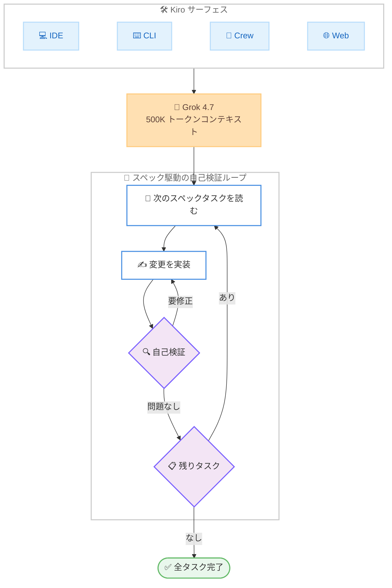

# Kiro - Grok 4.7 モデルの提供開始

**リリース日**: 2026 年 11 月 12 日
**サービス**: Kiro
**機能**: Grok 4.7 モデルのサポート (IDE / CLI / Crew / Web)

📊 [このアップデートのインフォグラフィックを見る](https://takech9203.github.io/aws-news-summary/20261112-kiro-grok-4-7.html)

## 概要

AWS が提供する AI エージェント開発環境 Kiro で、SpaceXSI の最新モデル Grok 4.7 が利用可能になりました。Kiro IDE、CLI、Crew、Web のすべてのサーフェスで本日から利用でき、Anthropic、OpenAI、SpaceXSI、主要なオープンウェイトプロバイダーのモデルを 1 つの環境で選択できるようになります。タスクごとに能力、速度、コストの観点から最適なモデルを選べることが Kiro のモデル選択の中核的な価値です。

Grok 4.7 は SpaceXSI が「コーディングとナレッジワークにおいて最も有能なモデル」と位置づけるモデルで、数時間に及ぶ長時間タスクへの持続力 (スタミナ) と、次のステップに進む前に自身の成果物を検証する自己チェック能力を重視して構築されています。より大規模な新しいベースモデルの上に、長時間タスクに重みを置いた長期の強化学習を実施しており、長いコーディング作業やターミナル作業で特に性能向上が見られます。

**アップデート前の課題**

- Grok 4.6 では長時間のエージェント作業において、序盤のミスが後続のステップに波及しやすく、Terminal-Bench 4.0 で 20.3% など長時間タスク系ベンチマークのスコアに課題があった
- ハルシネーション率が Artificial Analysis の AA-Omniscience テストで 34% と高めだった
- フロンティア級のコーディング性能とコストのバランスで選択肢が限られていた

**アップデート後の改善**

- Grok 4.7 により Terminal-Bench 4.0 が 37.6%、DeepSWE v1.1 が 71.0% へ向上し、長時間のエージェント作業での信頼性が大幅に改善された
- 各ステップで自己検証を行う動作が、Kiro のスペック駆動開発 (長いタスクリストの逐次実行) と適合するようになった
- 500K トークンのコンテキストウィンドウにより、スペック、設計ドキュメント、コードベースの大部分を 1 つのセッションに収められるようになった

## アーキテクチャ図



Kiro の各サーフェスから Grok 4.7 を選択でき、スペックの長いタスクリストに対して「実装 → 自己検証 → 次のタスク」のループを繰り返す動作を示しています。

## サービスアップデートの詳細

### 主要機能

1. **全サーフェスでの Grok 4.7 サポート**
   - Kiro IDE、CLI、Crew、Web のすべてで本日から利用可能
   - Kiro Pro、Pro+、Pro Max、Power、Enterprise プランで実験的 (experimental) サポートとして提供
   - モデルピッカーから「New」ラベル付きの Grok 4.7 を選択するだけで利用開始できる

2. **長時間エージェント作業向けの設計**
   - 新しい大規模ベースモデルと、数時間かかるタスクに重みを置いた長期の強化学習により訓練
   - 自身の出力の検証能力と、長いタスクでのフルコンテキスト活用能力が向上
   - 序盤のミスが全ステップに波及しやすい長時間実行で特に効果を発揮し、Kiro のスペック駆動開発と相性が良い

3. **4 段階の推論努力レベル**
   - low、medium、high (デフォルト)、xhigh の 4 レベルから選択可能
   - low は簡単な調査や小さな編集、medium は日常的なコーディング、high は複数ステップの計画、xhigh は長時間のエージェント実行や複数ファイルにまたがるバグ修正に適する
   - 高いレベルほど長いタスク全体で自己チェックに使える余地が増える

4. **大規模コンテキストとマルチモーダル入力**
   - 500K トークンのコンテキストウィンドウを備え、スペック全体、設計ドキュメント、コードベースの大部分を 1 セッションに収容可能
   - テキストと画像の入力に対応

5. **強化されたセーフガード**
   - SpaceXSI によると、まったく新しいセーフガードスタックを搭載し、拒否応答とジェイルブレイク耐性で同社がテストした中で最も強力なモデル
   - HackerBench v0.3 では、リスクのあるデュアルユースのサイバープロンプトの通過率がわずか 3.3% で、正当なセキュリティ作業をブロックすることはまれ

## 技術仕様

### ベンチマーク結果 (SpaceXSI 公表値、Grok 4.6 との比較)

| ベンチマーク | Grok 4.6 | Grok 4.7 |
|------|------|------|
| Terminal-Bench 4.0 | 20.3% | 37.6% |
| CursorBench 4.0 | 40.4% | 46.3% |
| DeepSWE v1.1 | 65.2% | 71.0% |
| AA Briefcase v1.1 (数時間のオフィスワーク) | 1,546 Elo | 1,657 Elo |

出典: SpaceXSI。Grok 4.7 は xhigh 努力レベル、DeepSWE は high 努力レベルでの測定値。

### 独立評価機関 Artificial Analysis による測定

| 指標 | Grok 4.6 | Grok 4.7 |
|------|------|------|
| Intelligence Index | 44 | 46 |
| Coding Agent Index | 47 | 56 |
| GDPval-AA (プロフェッショナルワーク) | 1,605 Elo | 1,695 Elo |
| AA-Omniscience Index | 30 | 32 |
| AA-Omniscience ハルシネーション率 | 34% | 29% |

### 推論努力レベル

| レベル | 推奨用途 |
|------|------|
| low | 簡単な調査、小さな編集 |
| medium | 日常的なコーディング |
| high (デフォルト) | 複数ステップの計画 |
| xhigh | 長時間のエージェント実行、複数ファイルにまたがるバグ修正 |

### モデル仕様

| 項目 | 詳細 |
|------|------|
| コンテキストウィンドウ | 500K トークン |
| 入力モダリティ | テキスト、画像 |
| API 料金 (SpaceXSI 公表の比較値) | 入力 $2 / 出力 $6 (100 万トークンあたり) |
| ホストリージョン | us-east-1 (バージニア北部) |

## 設定方法

### 前提条件

1. Kiro Pro、Pro+、Pro Max、Power、Enterprise のいずれかのプランに加入していること
2. Kiro IDE、CLI、Crew、Web のいずれかのサーフェスを利用できること

### 手順

#### ステップ 1: モデルピッカーで Grok 4.7 を選択

Kiro IDE のチャットパネル、または Kiro Crew / Web / CLI のモデルピッカーを開き、「New」ラベルが付いた Grok 4.7 を選択します。

#### ステップ 2: 推論努力レベルを設定

タスクの性質に合わせて low / medium / high / xhigh から努力レベルを選択します。デフォルトは high です。クイックな調査には low、長時間のエージェント実行には xhigh を選びます。

#### ステップ 3: スペックを渡して実行

スペック駆動開発では、tasks.md の実装プランを Grok 4.7 に渡すと、各タスクについて「読み取り → 実装 → 自己検証 → 次のタスクへ」のループを繰り返して作業を進めます。

## メリット

### ビジネス面

- **コスト効率**: DeepSWE v1.1 で 71.0% と GPT-5.6 Sol (72.7%) や Fable 5.1 (70.0%) と同等レンジの性能を、より低い価格帯で利用できる
- **長時間作業の自動化**: Kiro Crew と組み合わせることで、ログオフ後も数時間に及ぶ作業を任せられる
- **モデル選択の自由度**: Anthropic、OpenAI、SpaceXSI、オープンウェイトの各モデルを 1 つの環境で使い分けられ、フロンティアの進化に合わせてワークフローを維持できる

### 技術面

- **自己検証による品質向上**: 各ステップで自身の成果物を確認してから次に進むため、長いタスクリストで序盤のミスが波及するリスクを低減できる
- **大規模コンテキスト**: 500K トークンのウィンドウにより、スペック、設計ドキュメント、コードベースの大部分を 1 セッションで扱える
- **ハードウェア・電気工学分野の強み**: EEBench で 64.0% と、Fable 5.1 (56.4%) や GPT-5.6 Sol (39.4%) を上回るトップスコア

## デメリット・制約事項

### 制限事項

- 実験的 (experimental) サポートとしての提供であり、対象は Pro、Pro+、Pro Max、Power、Enterprise プランの顧客に限られる
- モデルのホストは us-east-1 (バージニア北部) のみ
- クレジット倍率が 2.7 倍と高めに設定されており、200K トークンを超える長コンテキストリクエストでは 5.4 倍に倍増する

### 考慮すべき点

- Artificial Analysis の測定では、Intelligence Index タスクあたりの出力トークン数が約 38K から約 81K へ増加しており、タスクあたりのトークン消費が増える傾向がある
- 高い努力レベル (high / xhigh) ほど自己チェックに時間とトークンを使うため、簡単なタスクでは low / medium を選ぶ方が効率的

## ユースケース

### ユースケース 1: スペック駆動での長時間コーディング

**シナリオ**: 大規模な機能追加をスペックに分解し、長いタスクリストを順に実装したい。

**実装例**:
```
Kiro IDE でスペックの tasks.md を開き、チャットパネルで Grok 4.7 (high または xhigh) を
選択して実装プランの実行を指示する。
```

**効果**: 各タスクの完了前に自己検証が行われるため、後続タスクへのミスの波及を抑えながら、複数時間に及ぶ実装を進められる。

### ユースケース 2: 複数リポジトリへの修正の一括依頼

**シナリオ**: セキュリティ修正を複数のリポジトリへ適用し、それぞれプルリクエストとして受け取りたい。

**実装例**:
```
Kiro Web で Grok 4.7 を選択し、対象リポジトリ群へのセキュリティ変更を依頼する。
セッション完了後、リポジトリごとのプルリクエストを確認する。
```

**効果**: 修正作業をハンドオフして PR として受け取れるため、横断的な修正の運用負荷を削減できる。

### ユースケース 3: ターミナル作業と自動化

**シナリオ**: 壊れた PyTorch モデルの復旧など、ターミナル中心の調査・修復作業を自動化したい。

**実装例**:
```
Kiro CLI でモデルを Grok 4.7 に設定し、復旧手順の調査と実行を指示する。
```

**効果**: Terminal-Bench 4.0 のスコアが 20.3% から 37.6% へ大きく向上しており、ターミナル作業での成功率改善が期待できる。

## 料金

Kiro のプランに含まれるクレジットを消費して利用します。Grok 4.7 のクレジット倍率は 2.7 倍で、200K トークンを超える長コンテキストリクエストでは倍率が 5.4 倍になります。

| 条件 | クレジット倍率 |
|--------|------------------|
| 通常リクエスト | 2.7 倍 |
| 200K トークン超の長コンテキストリクエスト | 5.4 倍 |

## 利用可能リージョン

Kiro はグローバルに利用可能です。Grok 4.7 モデルは us-east-1 (バージニア北部) でホストされます。

## 関連サービス・機能

- **Kiro IDE**: スペック駆動開発でタスクを逐次実行する開発環境。Grok 4.7 の自己検証ループと組み合わせて長時間の実装作業に対応
- **Kiro Crew**: ログオフ後も継続する数時間規模のエージェント実行環境。Grok 4.7 の長時間タスク耐性を活かせる
- **Kiro Web / CLI**: 修正のハンドオフと PR 作成、ターミナル作業と自動化にそれぞれ対応

## 参考リンク

- 📊 [インフォグラフィック](https://takech9203.github.io/aws-news-summary/20261112-kiro-grok-4-7.html)
- [公式発表 (Kiro Blog)](https://kiro.dev/blog/grok-4-7/)
- [Kiro Changelog](https://kiro.dev/changelog/)
- [Kiro 公式サイト](https://kiro.dev/)

## まとめ

Grok 4.7 の追加により、Kiro では長時間のエージェント作業に強く、自己検証能力を備えたモデルを低コストで選択できるようになりました。スペック駆動の長いタスクリストや、複数リポジトリへの修正の一括依頼など、長時間・大規模コンテキストの作業で特に効果が期待できます。まずは high (デフォルト) で試し、長時間実行には xhigh、クレジット消費を抑えたい場面では 200K トークン以下のコンテキストに収める運用を推奨します。
