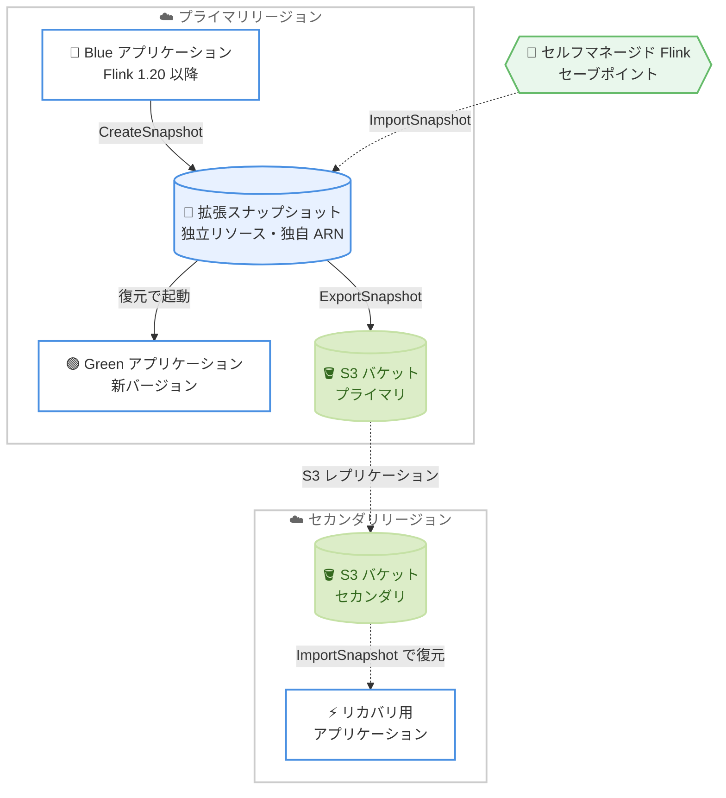

# Amazon Managed Service for Apache Flink - 拡張スナップショット (Enhanced Snapshots)

**リリース日**: 2026 年 11 月 12 日
**サービス**: Amazon Managed Service for Apache Flink
**機能**: Enhanced Snapshots (拡張スナップショット)

📊 [このアップデートのインフォグラフィックを見る](https://takech9203.github.io/aws-news-summary/20261112-managed-flink-enhanced-snapshots.html)

## 概要

Amazon Managed Service for Apache Flink が、アプリケーション状態を独立した AWS リソースとして管理できる「拡張スナップショット (Enhanced Snapshots)」を発表しました。拡張スナップショットは Apache Flink のセーブポイントを独立したリソースとして保存するもので、それぞれが独自の ARN、ライフサイクル、タグ、IAM アクセス許可を持ちます。スナップショットの所有者はアプリケーションではなくアカウントとなり、作成元アプリケーションを停止・更新・削除してもスナップショットは残り続けます。

この機能により、アプリケーション間およびリージョン間でのアプリケーション状態のキャプチャ、エクスポート、復元が可能になります。Blue/Green デプロイメント、セルフマネージド Flink からの状態を保持した移行、Amazon S3 へのエクスポートを利用したクロスリージョンの災害対策など、これまで実現が難しかった運用パターンをサポートします。ステートフルなストリーム処理を本番運用する Solutions Architect やデータエンジニアにとって重要なアップデートです。

**アップデート前の課題**

従来のアプリケーションスナップショット (レガシー) には以下の制約がありました。

- スナップショットは特定のアプリケーションに紐づいており、別のアプリケーションへ状態を復元できなかったため、Blue/Green デプロイメントで状態を引き継げなかった
- セルフマネージドの Apache Flink で取得したセーブポイントをマネージドサービスへ取り込む手段がなく、状態を保持した移行が困難だった
- スナップショットを S3 へエクスポートできず、セカンダリリージョンへの状態の複製によるクロスリージョンリカバリを構成できなかった

**アップデート後の改善**

- 拡張スナップショットを使用して別のアプリケーションを起動できるようになり、処理の一時停止を伴わない Blue/Green デプロイメントや A/B テストが可能になった
- `ImportSnapshot` API により既存の Apache Flink セーブポイントを拡張スナップショットとして取り込めるようになり、セルフマネージド環境から状態を失わずに移行できるようになった
- `ExportSnapshot` API により拡張スナップショットを S3 バケットへエクスポートし、セカンダリリージョンのバケットへ複製することでクロスリージョンリカバリを実現できるようになった

## アーキテクチャ図



拡張スナップショットはアプリケーションから独立したリソースとして保存され、別アプリケーションへの復元 (Blue/Green)、S3 へのエクスポートによるクロスリージョン複製、セルフマネージド Flink のセーブポイントのインポートに利用できます。

## サービスアップデートの詳細

### 主要機能

1. **独立リソースとしてのスナップショット管理**
   - 拡張スナップショットは `arn:aws:kinesisanalytics:{region}:{account-id}:snapshot/{snapshot-name}` 形式の独自 ARN を持つ
   - 独自のライフサイクル、タグ、IAM アクセス許可を持ち、アプリケーションを停止・更新・削除してもスナップショットは保持される
   - 名前はアカウント・リージョン内で一意 (1〜100 文字、英数字・アンダースコア・ピリオド・ハイフン)
   - 同一アカウント・同一リージョン内の別アプリケーションへ復元可能

2. **スナップショットモードの選択**
   - アプリケーション単位で `SnapshotMode` を設定: `APPLICATION_SNAPSHOTS_LEGACY` (デフォルト) または `ENHANCED_SNAPSHOTS`
   - `CreateApplication` または `UpdateApplication` でモードを設定し、`DescribeApplication` で確認可能
   - 既存アプリケーションは自動では移行されず、明示的な設定が必要

3. **インポートとエクスポート**
   - `ImportSnapshot`: S3 上の Apache Flink セーブポイントを拡張スナップショットとして取り込み。セルフマネージド Flink からの移行に利用可能
   - `ExportSnapshot`: 拡張スナップショットを S3 バケットへエクスポート。S3 レプリケーションと組み合わせてセカンダリリージョンへ状態を複製可能
   - 作成・削除・インポート・エクスポートはすべて非同期操作で、`SnapshotOperationId` により進捗を追跡

4. **システムスナップショット**
   - 拡張スナップショットモードで `SnapshotsEnabled` が `true` の場合、アプリケーションの停止・更新・VPC 設定や CloudWatch ログオプションの追加/削除時に自動作成される
   - 名前は `SYSTEMSNAPSHOT-{OPERATION}-{application-name}-{timestamp-ms}` 形式
   - 呼び出し元プリンシパルには `kinesisanalytics:CreateSystemSnapshot` 権限が必要

## 技術仕様

### スナップショットのステータス

| ステータス | 意味 |
|------|------|
| `CREATING` | 作成またはインポート中。復元・エクスポートは不可 |
| `READY` | 完了。復元・エクスポート・削除が可能 |
| `DELETING` | 削除処理中 |
| `FAILED` | 作成またはインポートが失敗。削除するまで名前は予約されたまま |

### 同時実行数の制限

| 操作 | 制限 | 超過時の例外 |
|------|------|------|
| `CreateSnapshot` | アプリケーションごとに `CREATING` 状態のスナップショットは 1 つ | `ResourceInUseException` |
| `ExportSnapshot` | スナップショットごとに同時エクスポートは 1 つ (全宛先合計) | `LimitExceededException` |
| `ImportSnapshot` / `ExportSnapshot` | アカウント・リージョンごとにインポートとエクスポート合計 10 件まで | `LimitExceededException` |

### API変更履歴

| 日付 | サービス | 変更内容 |
|------|----------|----------|
| 2026/11/11 | [kinesisanalytics](https://awsapichanges.com/archive/changes/082701-kinesisanalytics.html) | 8 new 6 updated api methods - 拡張スナップショットのサポート追加。`CreateSnapshot`、`DeleteSnapshot`、`DescribeSnapshot`、`ListSnapshots`、`ImportSnapshot`、`ExportSnapshot`、`DescribeSnapshotOperation`、`ListSnapshotOperations` などの API を追加 |

### スナップショットモードの確認例

```json
{
    "ApplicationDetail": {
        "ApplicationConfigurationDescription": {
            "ApplicationSnapshotConfigurationDescription": {
                "SnapshotsEnabled": true,
                "SnapshotMode": "ENHANCED_SNAPSHOTS"
            }
        }
    }
}
```

`DescribeApplication` のレスポンスで現在のスナップショットモードを確認できます。

## 設定方法

### 前提条件

1. Apache Flink 1.20 以降で実行されるアプリケーションであること
2. アプリケーションの `SnapshotMode` を `ENHANCED_SNAPSHOTS` に設定すること
3. 呼び出し元プリンシパルに `kinesisanalytics:CreateSystemSnapshot` を含む必要な IAM アクセス許可を付与すること
4. インポート/エクスポートを行う場合は、対象の S3 バケットとそのアクセス許可を準備すること

### 手順

#### ステップ1: アプリケーションを拡張スナップショットモードへ更新

```bash
aws kinesisanalyticsv2 update-application \
  --application-name MyApplication \
  --current-application-version-id 1 \
  --application-configuration-update '{
    "ApplicationSnapshotConfigurationUpdate": {
      "SnapshotModeUpdate": "ENHANCED_SNAPSHOTS"
    }
  }'
```

既存アプリケーションのスナップショットモードを `ENHANCED_SNAPSHOTS` に変更します。新規作成時は `CreateApplication` の `ApplicationSnapshotConfiguration.SnapshotMode` で指定します。

#### ステップ2: 拡張スナップショットを作成

```bash
aws kinesisanalyticsv2 create-snapshot \
  --application-name MyApplication \
  --snapshot-name MyApplication-snapshot-1
```

実行中のアプリケーションから拡張スナップショットを作成します。レスポンスに `SnapshotArn`、`SnapshotStatus`、`SnapshotOperationId` が返され、処理は非同期で進行します。

#### ステップ3: 操作の進捗を確認

```bash
aws kinesisanalyticsv2 describe-snapshot-operation \
  --snapshot-name MyApplication-snapshot-1 \
  --snapshot-operation-id a1B2c3D4e5F6
```

非同期操作の状態を確認します。スナップショットが `READY` になると、別アプリケーションへの復元やエクスポートが可能になります。

## メリット

### ビジネス面

- **ダウンタイムの削減**: Blue/Green デプロイメントにより、アプリケーション更新時の処理の一時停止を回避し、ストリーム処理の継続性を向上できる
- **移行の加速**: セルフマネージド Flink の状態を保持したままマネージドサービスへ移行でき、移行プロジェクトのリスクと工数を削減できる
- **事業継続性の強化**: S3 経由のクロスリージョン複製により、リージョン障害に備えた災害対策を構成できる

### 技術面

- **状態管理の柔軟性**: スナップショットがアプリケーションから独立しているため、アプリケーション削除後も状態を保持し、別アプリケーションで再利用できる
- **きめ細かなアクセス制御**: スナップショットごとに ARN、タグ、IAM アクセス許可を設定でき、ガバナンスを強化できる
- **運用の自動化**: 非同期 API と `SnapshotOperationId` による進捗追跡で、CI/CD パイプラインへの組み込みが容易

## デメリット・制約事項

### 制限事項

- Apache Flink 1.20 以降のアプリケーションでのみ利用可能
- 拡張スナップショット操作はリージョンおよびパーティションをまたいで直接実行できない (クロスリージョンは S3 エクスポート + レプリケーションで実現)
- アプリケーションごとに `CREATING` 状態のスナップショットは 1 つ、スナップショットごとの同時エクスポートは 1 つ、アカウント・リージョンごとのインポート/エクスポート合計は 10 件までの制限がある
- AWS European Sovereign Cloud (ドイツ) および AWS Top Secret Cloud リージョンでは利用不可

### 考慮すべき点

- デフォルトは `APPLICATION_SNAPSHOTS_LEGACY` のままであり、拡張スナップショットの利用には明示的なモード変更が必要
- システムスナップショットを含め、削除するまでストレージ課金が継続する。アプリケーション削除後もスナップショットは残るため、不要になったら `DeleteSnapshot` で削除する運用が必要
- カスタマーマネージドキー (CMK) で暗号化されたスナップショットを復元・エクスポートするには、作成元アプリケーションの ARN をキーポリシーに含める必要がある (アプリケーション削除後も適用)
- 拡張スナップショットモードでは、停止・更新などを行うプリンシパルに `kinesisanalytics:CreateSystemSnapshot` 権限の追加が必要になる

## ユースケース

### ユースケース1: Blue/Green デプロイメントによる無停止更新

**シナリオ**: 本番稼働中のストリーム処理アプリケーションを、処理を止めずに新バージョンへ切り替えたい。

**実装例**:
```bash
# 1. 稼働中の Blue アプリケーションからスナップショットを作成
aws kinesisanalyticsv2 create-snapshot \
  --application-name BlueApp --snapshot-name blue-to-green-1

# 2. スナップショットを指定して Green アプリケーションを起動
aws kinesisanalyticsv2 start-application \
  --application-name GreenApp \
  --run-configuration '{
    "ApplicationRestoreConfiguration": {
      "ApplicationRestoreType": "RESTORE_FROM_CUSTOM_SNAPSHOT",
      "SnapshotName": "blue-to-green-1"
    }
  }'
```

**効果**: 状態を引き継いだ新アプリケーションを並行稼働させてからトラフィックを切り替えるため、更新に伴う処理の一時停止を回避できる。

### ユースケース2: セルフマネージド Flink からの状態を保持した移行

**シナリオ**: EC2 や Kubernetes 上で自己運用している Apache Flink クラスターを、集計状態を失わずに Managed Service for Apache Flink へ移行したい。

**実装例**:
```bash
# 1. セルフマネージド Flink でセーブポイントを取得し S3 へ配置
# 2. セーブポイントを拡張スナップショットとしてインポート
aws kinesisanalyticsv2 import-snapshot \
  --snapshot-name migrated-savepoint-1 \
  ...  # S3 上のセーブポイントの場所を指定

# 3. インポートしたスナップショットからマネージドアプリケーションを起動
```

**効果**: ウィンドウ集計や結合などのアプリケーション状態を維持したまま移行でき、移行後の再処理やデータ欠損を回避できる。

### ユースケース3: S3 エクスポートによるクロスリージョン災害対策

**シナリオ**: リージョン障害に備え、ストリーム処理の状態をセカンダリリージョンへ定期的に複製しておきたい。

**実装例**:
```bash
# 1. 拡張スナップショットをプライマリリージョンの S3 へエクスポート
aws kinesisanalyticsv2 export-snapshot \
  --snapshot-name dr-snapshot-1 \
  ...  # エクスポート先 S3 バケットを指定

# 2. S3 クロスリージョンレプリケーションでセカンダリリージョンへ複製
# 3. 障害時はセカンダリリージョンで ImportSnapshot し、アプリケーションを復元
```

**効果**: セカンダリリージョンで状態を含めてアプリケーションを復旧でき、RPO を抑えた災害対策を実現できる。

## 料金

拡張スナップショットのストレージは、従来のアプリケーションスナップショット (レガシー) と同じく「耐久性のあるアプリケーションバックアップ」として GB - 月あたり 0.023 USD で課金されます。請求書では `{region}-DurableApplicationBackups` という使用タイプで表示されます。

- 課金はステータスが `READY` になった時点で開始し、`DELETING` に変わった時点で停止 (`CREATING` と `FAILED` は課金対象外)
- `CreateSnapshot` で作成したもの、`ImportSnapshot` で取り込んだもの、システムスナップショットのすべてが課金対象
- インポート/エクスポート自体に Managed Service for Apache Flink からの転送料金はかからないが、読み取り/書き込み先の S3 バケットには Amazon S3 の料金が適用される
- 削除するまで課金が継続する (アプリケーション削除後のシステムスナップショットを含む)

### 料金例

| 使用量 | 月額料金 (概算) |
|--------|------------------|
| 拡張スナップショット 10 GB を 1 か月保持 | 0.23 USD |
| 拡張スナップショット 100 GB を 1 か月保持 | 2.30 USD |

## 利用可能リージョン

Amazon Managed Service for Apache Flink が提供されているすべての AWS リージョンで利用可能です。ただし、AWS European Sovereign Cloud (ドイツ) は対象外です (ドキュメントでは AWS Top Secret Cloud リージョンも対象外と記載)。

## 関連サービス・機能

- **Amazon S3**: セーブポイントのインポート元およびスナップショットのエクスポート先。クロスリージョンレプリケーションと組み合わせて災害対策を構成
- **AWS KMS**: カスタマーマネージドキーによるスナップショットの暗号化。復元・エクスポートにはキーポリシーの設定が必要
- **AWS IAM**: スナップショット ARN 単位のアクセス制御と `kinesisanalytics:CreateSystemSnapshot` 権限の管理
- **Apache Flink セーブポイント**: 拡張スナップショットの実体。オープンソース Flink との相互運用の基盤

## 参考リンク

- 📊 [インフォグラフィック](https://takech9203.github.io/aws-news-summary/20261112-managed-flink-enhanced-snapshots.html)
- [公式発表 (What's New)](https://aws.amazon.com/about-aws/whats-new/2026/11/managed-flink-enhanced-snapshots/)
- [ドキュメント: How enhanced snapshots work](https://docs.aws.amazon.com/managed-flink/latest/java/snapshots-how-it-works.html)
- [API リファレンス: ImportSnapshot](https://docs.aws.amazon.com/managed-service-for-apache-flink/latest/apiv2/API_ImportSnapshot.html)
- [API リファレンス: ExportSnapshot](https://docs.aws.amazon.com/managed-service-for-apache-flink/latest/apiv2/API_ExportSnapshot.html)
- [料金ページ](https://aws.amazon.com/managed-service-apache-flink/pricing/)

## まとめ

拡張スナップショットにより、Managed Service for Apache Flink のアプリケーション状態を独立したリソースとして管理し、Blue/Green デプロイメント、セルフマネージド環境からの状態を保持した移行、クロスリージョン災害対策が実現できるようになりました。Flink 1.20 以降のアプリケーションを運用している場合は、`SnapshotMode` を `ENHANCED_SNAPSHOTS` へ切り替える際の IAM 権限追加とスナップショットのストレージ課金・削除運用を確認した上で、デプロイパイプラインと DR 戦略への組み込みを検討することを推奨します。
