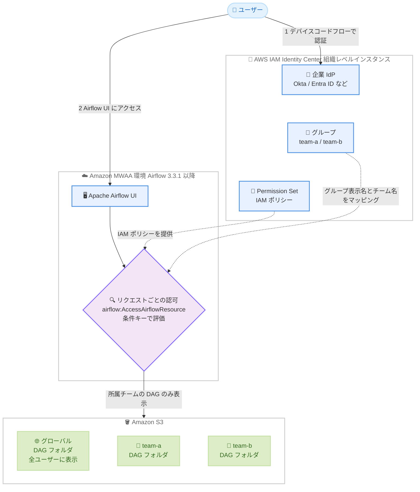

# Amazon MWAA - IAM Identity Center 統合によるきめ細かなアクセス制御とマルチチーム環境のサポート

**リリース日**: 2026 年 11 月 12 日
**サービス**: Amazon Managed Workflows for Apache Airflow (MWAA)
**機能**: IAM Identity Center 統合によるきめ細かなアクセス制御 (Fine-grained access control) とマルチチーム環境 (Multi-team environments)

📊 [このアップデートのインフォグラフィックを見る](https://takech9203.github.io/aws-news-summary/20261112-mwaa-fine-grained-access-control.html)

## 概要

Amazon Managed Workflows for Apache Airflow (MWAA) が、きめ細かなアクセス制御をサポートしました。管理者は、どのユーザーがどのワークフローやリソースにアクセスできるかを厳密に管理できるようになります。今回のアップデートは、2 つの新機能で構成されています。

1 つ目は **AWS IAM Identity Center との統合**です。ユーザーは企業の ID プロバイダー (Okta、Microsoft Entra ID、Ping など) の認証情報で Apache Airflow UI にサインインできます。認可は、IAM Identity Center の Permission Set にアタッチした IAM ポリシーを使用して、リクエストごとに評価されます。リソースタイプ (DAG、Connection、Variable、Pool など)、アクション、特定のリソース ID でアクセスをスコープする IAM 条件キーが利用できます。

2 つ目は**マルチチーム環境**です。複数のチームが 1 つの MWAA 環境を共有でき、各チームは Amazon S3 上に独自の DAG フォルダを保持します。ユーザーに表示されるのは、共有 DAG と所属チームの DAG のみで、所属チームは IAM Identity Center のグループメンバーシップによって決まります。インフラストラクチャの共有によるコスト削減と、環境設定の一元化による管理の簡素化を実現します。

**アップデート前の課題**

- 以前の MWAA では、Airflow UI へのアクセスは IAM ベースの `CreateWebLoginToken` と Airflow のロール (Admin、Op、User、Viewer など) に依存しており、特定の DAG 単位などリソース単位のきめ細かな制御が困難だった
- 企業の ID プロバイダーのユーザー・グループを直接利用した一元的なアクセスガバナンスができなかった
- チームごとに DAG を分離するには、チームごとに個別の MWAA 環境を用意する必要があり、環境ごとのコストと運用負荷が発生していた

**アップデート後の改善**

- IAM Identity Center 経由で企業 ID プロバイダーの認証情報を使用して Airflow UI にサインインでき、Permission Set の IAM ポリシーでリクエストごとに認可が評価されるようになった
- `airflow:ResourceType`、`airflow:ResourceAction`、`airflow:ResourceId` などの条件キーにより、特定の DAG のみ閲覧可能にするなど、リソース単位のきめ細かなアクセス制御が可能になった
- 1 つの MWAA 環境を最大 20 チームで共有でき、チームごとの DAG フォルダ分離と可視性制御により、環境の重複によるコストを削減できるようになった

## アーキテクチャ図



ユーザーは IAM Identity Center のデバイスコードフローで認証し、Airflow UI への各リクエストは Permission Set の IAM ポリシーと条件キーで認可されます。マルチチーム環境では、IAM Identity Center グループとチームのマッピングにより、グローバル DAG フォルダと所属チームの DAG フォルダのみが表示されます。

## サービスアップデートの詳細

### 主要機能

1. **IAM Identity Center 統合によるサインイン**
   - Airflow UI へのアクセス時に、IAM Identity Center のデバイスコードフローにリダイレクトされ、企業の ID プロバイダーの認証情報でサインインする
   - 認証後、割り当てられた Permission Set にスコープされた一時認証情報が払い出され、Airflow UI へのアクセスが許可される
   - MWAA コンソールの [Open Airflow UI] からのアクセスに加え、Airflow の直接 URL (`https://<env-id>.<region>.airflow.amazonaws.com/`) からもログイン可能
   - 統合が有効な環境では、Airflow の Security メニュー (Roles、Users、Permissions) は無効化され、アクセス制御は IAM Identity Center の Permission Set に一元化される

2. **IAM 条件キーによるきめ細かな認可**
   - 認可は `airflow:AccessAirflowResource` という IAM アクションを使用し、Airflow UI の操作ごとに評価される
   - `airflow:ResourceType` (DAG、Connection、Variable、Pool、Asset など)、`airflow:ResourceAction` (GET、POST、PUT、DELETE、LIST)、`airflow:ResourceId` (特定の DAG ID など) の条件キーでアクセスをスコープできる
   - `airflow:DagAccessEntity` 条件キーにより、DAG 内のサブリソース (TASK_LOGS、XCOM、CODE など) 単位での制御も可能
   - ポリシー変更は環境の更新なしで数分以内に反映される

3. **マルチチーム環境**
   - 1 つの MWAA 環境を複数チーム (最大 20 チーム) で共有できる
   - 環境作成時に指定する**グローバル DAG フォルダ** (全ユーザーに表示) に加え、チームごとに専用の **DAG フォルダ**を Amazon S3 上に構成できる
   - チームは、表示名がチーム名と完全一致する IAM Identity Center グループにマッピングされ、ユーザーには共有 DAG と所属チームの DAG のみが表示される
   - Apache Airflow のマルチチーム機能 (Airflow 3.3.1 時点でプレビュー・実験的機能) を基盤としている

## 技術仕様

### `airflow:AccessAirflowResource` でサポートされる条件キー

| 条件キー | タイプ | 説明 |
|------|------|------|
| `airflow:ResourceType` | String | Airflow リソースのタイプ。DAG、Connection、Variable、Pool、Asset、AssetAlias、Configuration、View、CustomView |
| `airflow:ResourceAction` | String | 実行されるアクション。GET、POST、PUT、DELETE、LIST |
| `airflow:ResourceId` | String | 特定のリソースの ID (例: DAG ID) |
| `airflow:DagAccessEntity` | String | DAG 内のサブリソース。AUDIT_LOG、CODE、DEPENDENCIES、HITL_DETAIL、RUN、TASK、TASK_INSTANCE、TASK_LOGS、VERSION、WARNING、XCOM (Airflow 3.3.1 時点) |
| `airflow:TeamNames` | ArrayOfString | ユーザーが所属する IAM Identity Center グループの一覧。`ForAnyValue:StringEquals` 演算子を使用する |

### マルチチーム環境の仕様

| 項目 | 詳細 |
|------|------|
| 対応 Airflow バージョン | Apache Airflow 3.3.1 以降 |
| チーム数の上限 | 1 環境あたり最大 20 チーム (引き上げ不可) |
| チーム名の要件 | 3〜50 文字、先頭は英数字、使用可能文字は英数字・ハイフン・アンダースコア、環境内で一意 |
| グループマッピング | IAM Identity Center グループの表示名とチーム名が完全一致 (大文字小文字を区別) |
| DAG フォルダ | グローバルフォルダとチームフォルダは重複不可 (S3 プレフィックスとして比較)。チームフォルダは別バケットも可 (実行ロールに読み取り権限が必要) |
| プラグイン・依存関係 | plugins と `requirements.txt` は環境レベルで設定され、全チームに適用 |

### Permission Set ポリシーの例 (特定の DAG へのアクセス制限)

```json
{
  "Version": "2012-10-17",
  "Statement": [
    {
      "Sid": "AllowDagGetAndList",
      "Effect": "Allow",
      "Action": "airflow:AccessAirflowResource",
      "Resource": "arn:aws:airflow:us-east-1:123456789012:environment/my-env",
      "Condition": {
        "StringEquals": {
          "airflow:ResourceType": "DAG",
          "airflow:ResourceAction": ["GET", "LIST"]
        }
      }
    },
    {
      "Sid": "AllowSpecificDagAllActions",
      "Effect": "Allow",
      "Action": "airflow:AccessAirflowResource",
      "Resource": "arn:aws:airflow:us-east-1:123456789012:environment/my-env",
      "Condition": {
        "StringEquals": {
          "airflow:ResourceType": "DAG",
          "airflow:ResourceId": "my_etl_dag"
        }
      }
    },
    {
      "Sid": "AllowIdentityStoreLookup",
      "Effect": "Allow",
      "Action": [
        "identitystore:GetUserId",
        "identitystore:DescribeUser",
        "identitystore:ListGroupMembershipsForMember",
        "identitystore:DescribeGroup"
      ],
      "Resource": "*"
    }
  ]
}
```

すべての Permission Set ポリシーには、MWAA がユーザーの表示名とグループメンバーシップを参照するための `identitystore` ステートメントが必須です。これがない場合、サインインは失敗します。また、DAG アクセスには `GET` と `LIST` の両方を必ず含める必要があります (DAG 一覧ページは `LIST`、ホームページのダッシュボードウィジェットは `ResourceId` なしの `GET` を使用するため)。

## 設定方法

### 前提条件

1. Apache Airflow バージョン 3.3.1 以降の MWAA 環境
2. **組織レベル**の IAM Identity Center インスタンス (アカウントレベルのインスタンスは Permission Set をサポートしないため非対応)
3. 企業の ID プロバイダーから SAML やフェデレーションで IAM Identity Center に同期されたユーザー・グループ (または IAM Identity Center ディレクトリで直接管理されたユーザー・グループ)
4. MWAA 環境の AWS アカウントが IAM Identity Center の組織からアクセス可能であること

### 手順

#### ステップ 1: 環境で IAM Identity Center 統合を有効化する

```bash
aws mwaa update-environment \
  --name my-env \
  --identity-center-configuration '{
    "startUrl": "https://d-xxxxxxxxxx.awsapps.com/start",
    "identityStoreId": "d-xxxxxxxxxx"
  }'
```

既存環境で IAM Identity Center 統合を有効化するコマンドです。`startUrl` にはアクセスポータル URL、`identityStoreId` には Identity Store ID を指定します (いずれも IAM Identity Center コンソールの [Settings] で確認可能)。強制更新の場合、反映に 20〜30 分かかり、環境が一時的にオフラインになります。**一度有効化すると無効化できない**ため、新規環境を並行構築して移行する方法が推奨されています。

#### ステップ 2: Permission Set を作成して IAM ポリシーをアタッチする

IAM Identity Center コンソールで Permission Set を作成し、`airflow:AccessAirflowResource` アクションと条件キーを使用したインラインポリシー (前述の例を参照) を設定します。その後、Permission Set を MWAA 環境のアカウントに対してユーザーまたはグループに割り当てます。ポリシー変更は環境更新なしで数分以内に反映されます。

#### ステップ 3: チームを設定する (マルチチーム環境を使用する場合)

MWAA コンソールまたは API で環境にチームを追加し、各チームの DAG フォルダ (S3 パス) を指定します。チーム名と完全一致する表示名の IAM Identity Center グループを作成し、メンバーを追加します。チームフォルダはグローバルフォルダや他チームのフォルダと重複しないように構成します。

#### ステップ 4: Airflow UI にサインインする

MWAA コンソールの [Open Airflow UI]、または Airflow の直接 URL にアクセスします。デバイス認証ページに表示されるワンタイムコードを検証 URL で入力し、企業の認証情報でサインインします。複数の Permission Set が割り当てられている場合は、使用するロールを選択します。

## メリット

### ビジネス面

- **コスト削減**: 複数チームが 1 つの環境のインフラストラクチャを共有することで、チームごとに環境を用意する場合と比較してコストを削減できる
- **ガバナンスの一元化**: アクセス管理が IAM Identity Center の Permission Set に集約され、企業 ID プロバイダーと連携した一元的なアクセスガバナンスを実現できる
- **管理の簡素化**: 環境設定、ネットワーク、Airflow バージョンを一度構成するだけで全チームに適用され、運用負荷が軽減される

### 技術面

- **リソース単位のきめ細かな認可**: リソースタイプ・アクション・リソース ID・DAG サブリソース単位で IAM ポリシーによる制御が可能
- **リクエストごとの認可評価**: すべての Airflow UI 操作がリクエストごとに IAM ポリシーで評価され、ポリシー変更は環境更新なしで数分以内に反映される
- **チーム単位の DAG 分離**: チームの DAG、Connection、Variable が自動的に分離され、他チームのリソースは表示・アクセスともに不可となる

## デメリット・制約事項

### 制限事項

- **Apache Airflow 3.3.1 以降が必須**: 以前のバージョンの環境では IAM Identity Center 統合を利用できない
- **一方向の有効化**: 一度 IAM Identity Center 統合を有効化すると無効化できない (チームをすべて削除しても無効化不可)
- **`InvokeRestApi` 非対応**: IAM Identity Center 統合が有効な環境では、MWAA の `InvokeRestApi` オペレーションがエラーを返す。AWS CLI や SDK から Airflow REST API を呼び出す CI/CD パイプラインやスクリプトに影響するため、プログラマティックアクセスが必要なワークフローは統合を有効化していない環境に残す必要がある
- **マルチチーム機能は実験的機能ベース**: Apache Airflow のマルチチーム機能はプレビュー段階の実験的機能であり、将来のリリースで破壊的変更や削除の可能性がある。本番クリティカルなワークロードでの利用は推奨されていない
- **チーム数の上限**: 1 環境あたり最大 20 チームで、引き上げ不可。チーム名の変更も不可 (削除して再作成が必要)
- **バージョンダウングレード制限**: チームを持つ環境は 3.3.1 より前のバージョンにダウングレードできない

### 考慮すべき点

- マルチチーム環境では DAG プロセッサー、ワーカー、メタデータベース、プラグイン、`requirements.txt` を全チームで共有するため、あるチームのワークロードが他チームのパフォーマンスに影響する可能性がある
- 異なる Airflow バージョン、VPC 構成、依存関係、コンプライアンス要件、独立したスケーリングが必要なチームには、従来どおり個別の環境が適している
- 組織レベルの IAM Identity Center インスタンスが必要であり、アカウントレベルのインスタンスでは利用できない
- IAM Identity Center の ID ストアがカスタマーマネージド KMS キーで暗号化されている場合、Permission Set ポリシーへの KMS 権限追加とキーポリシーへのクロスアカウントエントリ追加が必要
- 複数の Permission Set が割り当てられたユーザーはログイン時にロール選択が必要になるため、MWAA アクセス用に専用の Permission Set を 1 つ割り当てる構成が推奨される

## ユースケース

### ユースケース 1: 複数データチームによる単一環境の共有

**シナリオ**: データエンジニアリングチームとアナリティクスチームが、それぞれ個別の MWAA 環境を運用しており、環境の重複によるコストと管理負荷が課題となっている。両チームは同じ Airflow バージョンとネットワーク構成を利用できる。

**実装例**:
```
1. Airflow 3.3.1 の環境で IAM Identity Center 統合を有効化
2. チーム data-engineering と analytics を追加し、それぞれの DAG フォルダを設定
   - s3://amzn-s3-demo-bucket/teams/data-engineering/
   - s3://amzn-s3-demo-bucket/teams/analytics/
3. 同名の IAM Identity Center グループを作成しメンバーを割り当て
4. 共通利用するユーティリティ DAG はグローバル DAG フォルダに配置
```

**効果**: 2 環境分のインフラコストを 1 環境に集約しつつ、チーム間の DAG 分離を維持。環境設定・監視・コンプライアンス設定の管理が一元化される。

### ユースケース 2: 閲覧専用ユーザーへの読み取りアクセス付与

**シナリオ**: 運用監視チームに、本番環境の DAG 実行状況の閲覧のみを許可し、DAG のトリガーや Variable の変更は禁止したい。

**実装例**:
```json
{
  "Sid": "AllowDagRead",
  "Effect": "Allow",
  "Action": "airflow:AccessAirflowResource",
  "Resource": "arn:aws:airflow:ap-northeast-1:123456789012:environment/prod-env",
  "Condition": {
    "StringEquals": {
      "airflow:ResourceType": "DAG",
      "airflow:ResourceAction": ["GET", "LIST"]
    }
  }
}
```

**効果**: 監視チームは DAG の一覧・状態・ログを閲覧できるが、変更操作は IAM レベルで拒否される。Airflow のカスタムロール管理が不要になり、IAM Policy Simulator での検証も可能。

### ユースケース 3: 企業 IdP グループに基づく特定 DAG へのアクセス制御

**シナリオ**: チーム機能は使用せず、Okta のグループ `finance-ops` に所属するユーザーのみが経理関連の DAG にアクセスできるようにしたい。

**実装例**:
```json
{
  "Sid": "AllowFinanceDag",
  "Effect": "Allow",
  "Action": "airflow:AccessAirflowResource",
  "Resource": "arn:aws:airflow:ap-northeast-1:123456789012:environment/my-env",
  "Condition": {
    "StringEquals": {
      "airflow:ResourceType": "DAG",
      "airflow:ResourceId": "finance_monthly_close"
    },
    "ForAnyValue:StringEquals": {
      "airflow:TeamNames": ["finance-ops"]
    }
  }
}
```

**効果**: IdP のグループメンバーシップがそのまま Airflow リソースの認可に反映され、入退社や異動に伴うアクセス権の変更が IdP 側の運用だけで完結する。

## 料金

What's New の発表では、本機能自体の追加料金に関する記載はありません。MWAA の標準料金 (環境サイズとワーカー数などに基づく時間課金) が適用されます。マルチチーム環境では、チームごとに個別の環境を用意する代わりに 1 つの環境のインフラストラクチャを共有するため、コストを削減できるとされています。

詳細は [Amazon MWAA の料金ページ](https://aws.amazon.com/managed-workflows-for-apache-airflow/pricing/)を参照してください。

## 利用可能リージョン

Amazon MWAA が利用可能なすべての AWS リージョンで利用できます。対象リージョンの一覧は[ドキュメント](https://docs.aws.amazon.com/mwaa/latest/userguide/get-started.html#regions)を参照してください。

## 関連サービス・機能

- **AWS IAM Identity Center**: 認証と認可の基盤。企業 ID プロバイダーとのフェデレーション、Permission Set による権限管理を提供する (組織レベルインスタンスが必要)
- **Amazon S3**: グローバル DAG フォルダおよびチームごとの DAG フォルダの保管場所。チームフォルダは別バケットにも配置可能
- **AWS KMS**: IAM Identity Center の ID ストアがカスタマーマネージドキーで暗号化されている場合、追加の権限設定が必要
- **Apache Airflow 3.3.1**: IAM Identity Center 統合とマルチチーム環境の前提となるバージョン。マルチチーム環境は Airflow のマルチチーム機能 (実験的機能) を基盤とする

## 参考リンク

- 📊 [インフォグラフィック](https://takech9203.github.io/aws-news-summary/20261112-mwaa-fine-grained-access-control.html)
- [公式発表 (What's New)](https://aws.amazon.com/about-aws/whats-new/2026/11/mwaa-fine-grained-access-control/)
- [ドキュメント: Using IAM Identity Center with Amazon MWAA](https://docs.aws.amazon.com/mwaa/latest/userguide/identity-center-integration.html)
- [ドキュメント: Multi-team environments](https://docs.aws.amazon.com/mwaa/latest/userguide/multi-team-environments.html)
- [ドキュメント: Amazon MWAA が利用可能なリージョン](https://docs.aws.amazon.com/mwaa/latest/userguide/get-started.html#regions)
- [料金ページ](https://aws.amazon.com/managed-workflows-for-apache-airflow/pricing/)

## まとめ

Amazon MWAA の IAM Identity Center 統合により、企業 ID プロバイダーと連携したサインインと、IAM 条件キーによるリソース単位のきめ細かな認可が実現しました。さらにマルチチーム環境により、DAG を分離しながら 1 つの環境を複数チームで共有でき、コストと運用負荷を削減できます。一方で、統合の有効化は取り消しできず、`InvokeRestApi` が利用できなくなるなどの制約があるため、既存環境への適用前に影響範囲を評価し、新規環境での並行検証から始めることを推奨します。
