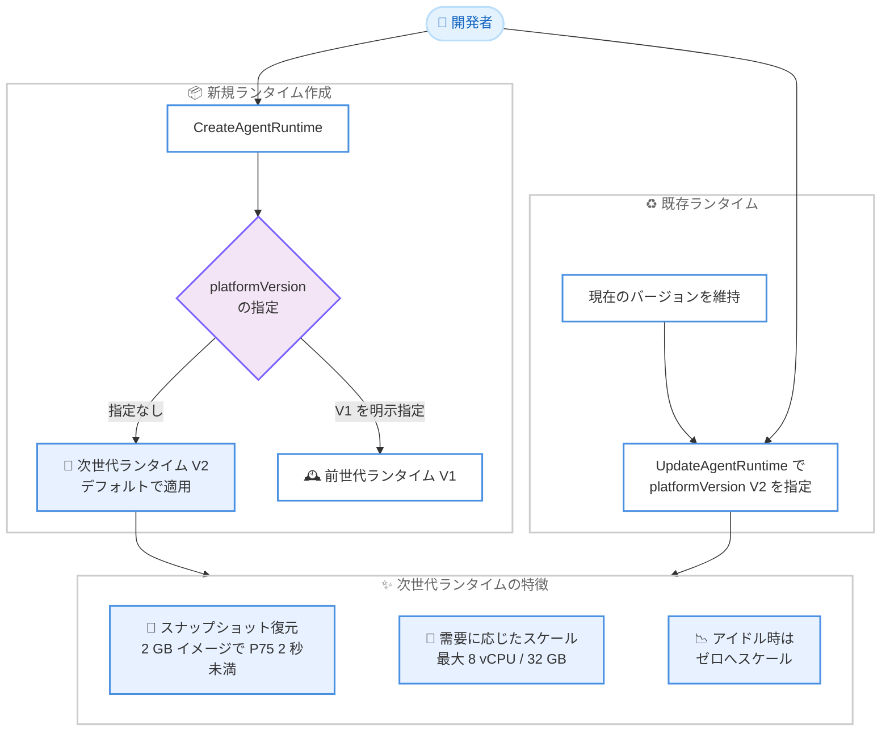

# Amazon Bedrock AgentCore - 次世代 AgentCore Runtime がデフォルトに

**リリース日**: 2026 年 11 月 12 日
**サービス**: Amazon Bedrock AgentCore
**機能**: 次世代 AgentCore Runtime (プラットフォームバージョン V2) のデフォルト化

📊 [このアップデートのインフォグラフィックを見る](https://takech9203.github.io/aws-news-summary/20261112-new-agentcore-runtime-default.html)

## 概要

Amazon Bedrock AgentCore で新規に作成されるランタイムが、次世代 AgentCore Runtime (プラットフォームバージョン V2) をデフォルトで使用するようになりました。次世代ランタイムは、初期化済みエージェントのスナップショットから各セッションを復元し、コンピュートとメモリをワークロードの需要に応じて動的にスケールし、アイドル状態のエージェントをゼロまでスケールダウンします。各セッションはこれまでどおりハードウェアで分離された専用の Firecracker microVM 内で実行されます。

次世代ランタイムでは、セッションあたり最大 8 vCPU / 32 GB メモリ、最大 10 GB (圧縮時) のコンテナイメージをサポートし、大規模コードベースのコンパイル、ブラウザ自動化、ローカルモデルのロードといった重いワークロードにも対応できます。2 GB のコンテナイメージでのセッション起動は P75 で 2 秒未満 (前世代では 29.7 秒) に短縮され、解放されたメモリは数分以内に回収されるため、マルチターンエージェントではセッションあたりの課金対象メモリを最大 68% 削減できます。

2026 年 9 月の一般提供開始時は `platformVersion` に `V2` を明示的に指定する必要がありましたが、今回のアップデートにより、東京リージョンを含む 19 リージョンで新規ランタイム作成時のデフォルトが V2 になりました。既存のランタイムは移行するまで現在のバージョンのまま維持されるため、運用中のエージェントへの影響はありません。

**アップデート前の課題**

このアップデート以前には、以下の課題がありました。

- 次世代ランタイム V2 を利用するには、ランタイムの作成・更新時に `platformVersion` を `V2` と明示的に指定する必要があった
- `platformVersion` を省略して作成したランタイムは前世代 V1 となり、コールドスタートの高速化や実使用量ベースのメモリ課金といった V2 の恩恵を意識的な設定なしには受けられなかった
- V2 の対応リージョンが限られていた (一般提供開始時は 5 リージョン)

**アップデート後の改善**

今回のアップデートにより、以下が可能になりました。

- 19 リージョンで、`platformVersion` を指定せずに作成した新規ランタイムが自動的に次世代ランタイム V2 で動作するようになった
- 新規エージェントは追加設定なしで、スナップショット復元による高速起動 (2 GB イメージで P75 2 秒未満)、実使用量ベースのメモリ課金、ゼロへのスケールを利用できるようになった
- 既存ランタイムは現在のバージョンを維持するため、任意のタイミングで `platformVersion` を `V2` に設定して移行できる。新規ランタイムを前世代に留めたい場合は `V1` を明示指定すればよい

## アーキテクチャ図



19 のデフォルト対象リージョンでは、`platformVersion` を指定せずに作成した新規ランタイムが自動的に V2 で動作します。既存ランタイムは現在のバージョンを維持し、更新時に `V2` を指定することで移行できます。

## サービスアップデートの詳細

### 主要機能

1. **新規ランタイムのデフォルトが次世代ランタイム V2 に変更**
   - 19 リージョンで、`platformVersion` を省略して作成した新規ランタイムが V2 で動作
   - 新規ランタイムを前世代に留めたい場合は `platformVersion` に `V1` を明示指定
   - デフォルトがまだ V2 になっていないリージョンでも、`V2` を明示指定すれば次世代ランタイムを利用可能

2. **既存ランタイムへの影響なし**
   - 既存のランタイムは、ユーザーが移行するまで現在のプラットフォームバージョンを維持
   - 移行は `UpdateAgentRuntime` で `platformVersion` を `V2` に設定するだけ
   - 更新時に `platformVersion` を省略した場合も、現在のバージョンが維持される

3. **スナップショット復元による高速で一貫した起動**
   - 初期化済みエージェントのスナップショットから各セッションを復元
   - 2 GB のコンテナイメージで P75 のセッション起動が 2 秒未満 (前世代は 29.7 秒)
   - コンテナイメージは最大 10 GB (圧縮時) をサポート (前世代は 2 GB)

4. **需要に応じたリソーススケーリングと実使用量ベースの課金**
   - コンピュートとメモリはワークロードの需要に応じて動的にスケールし、アイドル状態のエージェントはゼロまでスケールダウン
   - 解放されたメモリは数分以内に回収され、マルチターンエージェントではセッションあたりの課金対象メモリを最大 68% 削減
   - セッションは最大 8 vCPU / 32 GB メモリまで拡張でき、大規模コードベースのコンパイル、ブラウザ自動化、ローカルモデルのロードなどの重いワークロードに対応
   - 各セッションはハードウェアで分離された専用の Firecracker microVM 内で実行され、セキュリティモデルは従来どおり

## 技術仕様

### 前世代 V1 と次世代 V2 の比較

| 項目 | V1 | V2 |
|------|----|----|
| 新規作成時のデフォルト | 従来はデフォルト | **今回から 19 リージョンでデフォルト** |
| 起動方式 | 起動ごとに環境を初期化 | 初期化済みエージェントのスナップショットから復元 |
| セッション起動時間 | 2 GB イメージで 29.7 秒 | 2 GB イメージで P75 2 秒未満 |
| メモリ管理 | セッション終了までメモリを保持 | 解放されたメモリを数分以内に回収 (マルチターンで課金対象メモリ最大 68% 削減) |
| セッションあたりの最大リソース | - | 最大 8 vCPU / 32 GB メモリ |
| コンテナイメージサイズ上限 | 2 GB | 10 GB (圧縮時) |
| セッション分離 | 専用 Firecracker microVM | 専用 Firecracker microVM (変更なし) |
| ランタイム作成・更新の所要時間 | 数秒で READY | スナップショット準備のため数分 |

### V2 のリソース設定 (resourceConfigurations)

V2 では課金モデルを選択できます。`resourceConfigurations` を設定しない場合は従量ベース (デフォルト割り当て 2 vCPU / 8 GB、実使用分のみ課金)、設定した場合はコミット済みベースライン (より低い単価で課金され、ベースラインの最大 4 倍までバースト可能) となります。

| `minimumMemoryInMiB` | ベースライン | ピーク | ディスク |
|------|------|------|------|
| `1024` | メモリ 1 GB、0.25 vCPU | メモリ 4 GB、1 vCPU | 10 GB |
| `2048` | メモリ 2 GB、0.5 vCPU | メモリ 8 GB、2 vCPU | 10 GB |
| `4096` | メモリ 4 GB、1 vCPU | メモリ 16 GB、4 vCPU | 16 GB |
| `8192` | メモリ 8 GB、2 vCPU | メモリ 32 GB、8 vCPU | 32 GB |

### API変更履歴

今回のデフォルト変更自体は、既存の `platformVersion` フィールドのデフォルト挙動の変更であり、新しい API の追加はありません。直前に、V2 を支える関連 API 更新がリリースされています。

| 日付 | サービス | 変更内容 |
|------|----------|----------|
| 2026/11/10 | [bedrock-agentcore-control](https://awsapichanges.com/archive/changes/465577-bedrock-agentcore-control.html) | 6 updated api methods - AgentCore Runtime にウォームアップライフサイクルフック (`hooksConfiguration`) とランタイムメモリ指定 (`resourceConfigurations`) を追加 (AgentCore Gateway の `domainOverride` 対応を含む) |

## 設定方法

### 前提条件

1. 次世代ランタイムがデフォルトの 19 リージョンのいずれか、または V2 を明示指定できるリージョンを使用していること
2. エージェントのコンテナイメージ (Amazon ECR) または直接コードデプロイのアーティファクトが準備されていること
3. AgentCore Runtime 用の IAM 実行ロールが設定されていること
4. V2 ではエージェントが起動から 120 秒以内に `/ping` で正常応答する (またはウォームアップフックを構成する) よう実装されていること

### 手順

#### ステップ 1: 新規ランタイムを作成する (デフォルトで V2)

```bash
aws bedrock-agentcore-control create-agent-runtime \
  --agent-runtime-name "my-agent" \
  --role-arn "arn:aws:iam::111122223333:role/AgentExecutionRole" \
  --agent-runtime-artifact '{
    "containerConfiguration": {
      "containerUri": "111122223333.dkr.ecr.ap-northeast-1.amazonaws.com/my-agent:latest"
    }
  }' \
  --network-configuration '{"networkMode": "PUBLIC"}'
```

デフォルト対象リージョンでは `--platform-version` を省略すると次世代ランタイム V2 で作成されます。新規ランタイムを前世代に留めたい場合は `--platform-version V1` を明示的に指定します。

#### ステップ 2: 既存ランタイムを V2 に移行する

```bash
aws bedrock-agentcore-control update-agent-runtime \
  --agent-runtime-id my-agent-ABCDE12345 \
  --role-arn "arn:aws:iam::111122223333:role/AgentExecutionRole" \
  --agent-runtime-artifact '{
    "containerConfiguration": {
      "containerUri": "111122223333.dkr.ecr.ap-northeast-1.amazonaws.com/my-agent:latest"
    }
  }' \
  --network-configuration '{"networkMode": "PUBLIC"}' \
  --platform-version V2
```

既存ランタイムは移行するまで現在のバージョンのまま動作します。`update-agent-runtime` で `--platform-version V2` を指定すると次世代ランタイムに移行します。更新時に省略した場合は現在のバージョンが維持されます。

#### ステップ 3: ステータスとプラットフォームバージョンを確認する

```bash
aws bedrock-agentcore-control get-agent-runtime \
  --agent-runtime-id my-agent-ABCDE12345 \
  --query '{status: status, platformVersion: platformVersion}'
```

V2 ではスナップショットの準備のため、作成・更新からステータスが `READY` になるまで数分かかります。終端ステータスに達する前に update や delete を呼び出すと `ConflictException` が返るため、`READY` になるまでポーリングします。あわせて `platformVersion` が意図したバージョンになっていることを確認します。

## メリット

### ビジネス面

- **追加設定なしで最新の性能とコスト効率を享受**: 新規エージェントはデフォルトで高速起動と実使用量ベースのメモリ課金の恩恵を受けられ、最適化のための設定作業が不要になる
- **コスト削減**: 解放されたメモリが数分以内に回収されるため、マルチターンエージェントでセッションあたりの課金対象メモリを最大 68% 削減できる
- **ユーザー体験の向上**: 2 GB イメージでも P75 で 2 秒未満のセッション起動により、エンドユーザーへの初回応答が大幅に高速化する

### 技術面

- **重いワークロードへの対応**: セッションあたり最大 8 vCPU / 32 GB メモリ、最大 10 GB のコンテナイメージにより、大規模コードベースのコンパイル、ブラウザ自動化、ローカルモデルのロードが可能
- **サーバーレスモデルの維持**: アイドル状態のエージェントはゼロまでスケールダウンし、ハードウェアで分離された Firecracker microVM によるセッション分離も従来どおり
- **段階的な移行が可能**: 既存ランタイムは影響を受けず、`platformVersion` の指定だけで任意のタイミングで移行できる。V1 の明示指定によるオプトアウトも可能

## デメリット・制約事項

### 制限事項

- 次世代ランタイムがデフォルトになるのは 19 リージョンに限られる (それ以外のリージョンでは `V2` の明示指定が必要)
- V2 ではランタイムの作成・更新にスナップショット準備のため数分かかる (V1 は数秒)
- V2 ではコンテナが起動から 120 秒以内にヘルスチェックに応答する (またはウォームアップフックを完了する) 必要がある
- `resourceConfigurations` を設定しない場合、セッションはデフォルト割り当て (2 vCPU / 8 GB) を超えてバーストできない。最大 8 vCPU / 32 GB を利用するにはコミット済みベースラインの設定が必要

### 考慮すべき点

- `platformVersion` を指定せずにランタイムを作成する IaC テンプレートや自動化スクリプトは、デフォルト対象リージョンでは今後 V2 でランタイムを作成するようになるため、作成所要時間の変化 (数秒から数分) やコード構造の前提を確認する必要がある
- スナップショット復元を前提としたコード構造への見直しが推奨される。起動時に生成した乱数、タイムスタンプ、有効期限付き認証情報はスナップショットに固定され全インスタンスで共有されるため、リクエストハンドラー内で生成する必要がある
- V1 と V2 では時間単価と課金モデルが異なるため、ワークロードの特性 (アイドル時間の長さ、メモリ使用パターン) に応じてコストを比較検討する

## ユースケース

### ユースケース 1: 新規エージェントの迅速な本番投入

**シナリオ**: 新しいカスタマーサポートエージェントを開発し、起動性能とコスト効率を最適化した状態で本番投入したい。

**実装例**:
```
1. デフォルト対象リージョン (東京など) で create-agent-runtime を実行 (platformVersion の指定不要)
2. 依存関係のインポートやクライアント構築をモジュールスコープに配置してスナップショットに含める
3. get-agent-runtime で READY を確認し、InvokeAgentRuntime で起動時間を計測
```

**効果**: 追加設定なしで P75 2 秒未満の起動と実使用量ベースのメモリ課金を実現し、最適化作業なしに本番品質のエージェントを投入できる。

### ユースケース 2: 既存 V1 エージェントの計画的な移行

**シナリオ**: V1 で運用中のエージェントが複数あり、コールドスタートとメモリコストの改善のため V2 への移行を計画している。

**実装例**:
```
1. 開発環境のランタイムを update-agent-runtime --platform-version V2 で移行
2. 乱数・タイムスタンプ・認証情報の生成箇所をリクエストハンドラー内に移動
3. 負荷テストで起動時間と課金メトリクス CPUUsed-vCPUHours / MemoryUsed-GBHours を確認
4. 問題がなければ本番ランタイムを順次移行
```

**効果**: 既存ランタイムはデフォルト変更の影響を受けないため、検証を済ませた上で任意のタイミングで安全に移行できる。

### ユースケース 3: 重いワークロードを実行するエージェント

**シナリオ**: 大規模コードベースのコンパイルやブラウザ自動化を行うエージェントで、V1 のリソース上限とイメージサイズ上限 (2 GB) がボトルネックになっている。

**実装例**:
```
1. ツールチェーンを含む最大 10 GB のコンテナイメージを Amazon ECR に push
2. create-agent-runtime で resourceConfigurations に minimumMemoryInMiB 8192 を設定
3. セッションはベースライン 8 GB / 2 vCPU で開始し、ピーク時に最大 32 GB / 8 vCPU までバースト
```

**効果**: 大きなイメージでも高速に起動し、コンパイルやブラウザ自動化などのピーク負荷にもセッション内でスケールして対応できる。

## 料金

AgentCore Runtime は 1 秒単位の従量課金です。V2 では 2 つの課金モデルを選択できます。

- **従量ベース (デフォルト)**: `resourceConfigurations` を設定しない場合、各セッションはデフォルト割り当て (2 vCPU / 8 GB) の範囲で、エージェントが実際に使用した vCPU とメモリに対してのみ課金されます。解放されたメモリは数分以内に回収され課金対象から外れるため、マルチターンエージェントでは課金対象メモリを最大 68% 削減できます
- **コミット済みベースライン**: `resourceConfigurations` を設定すると、セッション期間中ベースライン分を低い単価で支払い、ベースラインを超えた使用分は使用した秒数のみ同じ低単価で課金されます。メモリを常時使用するエージェントや、リソース使用量が予測できるワークロードに適しています

最新の単価は [AgentCore 料金ページ](https://aws.amazon.com/bedrock/agentcore/pricing/) を参照してください。

## 利用可能リージョン

次世代 AgentCore Runtime は以下の 19 リージョンでデフォルトになりました。

- 米国東部 (バージニア北部) us-east-1
- 米国東部 (オハイオ) us-east-2
- 米国西部 (オレゴン) us-west-2
- カナダ (中部) ca-central-1
- 南米 (サンパウロ) sa-east-1
- 欧州 (フランクフルト) eu-central-1
- 欧州 (アイルランド) eu-west-1
- 欧州 (ロンドン) eu-west-2
- 欧州 (ミラノ) eu-south-1
- 欧州 (パリ) eu-west-3
- 欧州 (スペイン) eu-south-2
- 欧州 (ストックホルム) eu-north-1
- アジアパシフィック (マレーシア) ap-southeast-5
- アジアパシフィック (ムンバイ) ap-south-1
- アジアパシフィック (ソウル) ap-northeast-2
- アジアパシフィック (シンガポール) ap-southeast-1
- アジアパシフィック (シドニー) ap-southeast-2
- アジアパシフィック (タイ) ap-southeast-7
- アジアパシフィック (東京) ap-northeast-1

デフォルトになっていないリージョンでも、`platformVersion` に `V2` を明示指定することで次世代ランタイムを利用できます。

## 関連サービス・機能

- **Amazon Bedrock AgentCore**: AI エージェントの構築・デプロイ・運用のためのサービス群。Runtime のほか Memory、Identity、Gateway などで構成される
- **AgentCore Runtime ライフサイクルフック**: V2 で利用できるウォームアップフック。スナップショット取得前にメモリやディスクの準備を行い、セッション開始前の初期化を最適化できる
- **Amazon ECR**: コンテナデプロイ時のコンテナイメージの格納先。V2 では最大 10 GB (圧縮時) のイメージをサポート
- **AWS IAM**: ランタイムの実行ロールと SigV4 ベースの Inbound 認証に使用

## 参考リンク

- 📊 [インフォグラフィック](https://takech9203.github.io/aws-news-summary/20261112-new-agentcore-runtime-default.html)
- [公式発表 (What's New)](https://aws.amazon.com/about-aws/whats-new/2026/11/new-agentcore-runtime-default/)
- [AWS Blog: AWS Weekly Roundup (AgentCore Runtime V2 ほか)](https://aws.amazon.com/blogs/aws/aws-weekly-roundup-agentcore-runtime-v2-amazon-dynamodb-bulk-put-items-and-more-november-9-2026/)
- [ドキュメント: AgentCore Runtime の仕組みとプラットフォームバージョン](https://docs.aws.amazon.com/bedrock-agentcore/latest/devguide/runtime-how-it-works.html#runtime-platform-versions)
- [ドキュメント: AgentCore Runtime V2 向けのエージェント最適化](https://docs.aws.amazon.com/bedrock-agentcore/latest/devguide/runtime-v2-optimize.html)
- [料金ページ](https://aws.amazon.com/bedrock/agentcore/pricing/)
- [関連レポート: 新しい AgentCore Runtime (V2) の一般提供開始 (2026 年 9 月)](./2026-09-18-new-agentcore-runtime-generally-available.md)

## まとめ

2026 年 9 月に一般提供された次世代 AgentCore Runtime (V2) が、東京を含む 19 リージョンで新規ランタイム作成時のデフォルトになりました。新規エージェントは追加設定なしで、スナップショット復元による P75 2 秒未満の起動、最大 68% の課金対象メモリ削減、最大 8 vCPU / 32 GB へのスケールといった恩恵を受けられます。既存ランタイムは影響を受けないため安心ですが、`platformVersion` を指定しない IaC や自動化で新規作成する場合は V2 の挙動 (作成に数分かかる、スナップショット前提のコード構造) を前提に検証することを推奨します。V1 で運用中のエージェントも、この機会に V2 への移行を計画するとよいでしょう。
