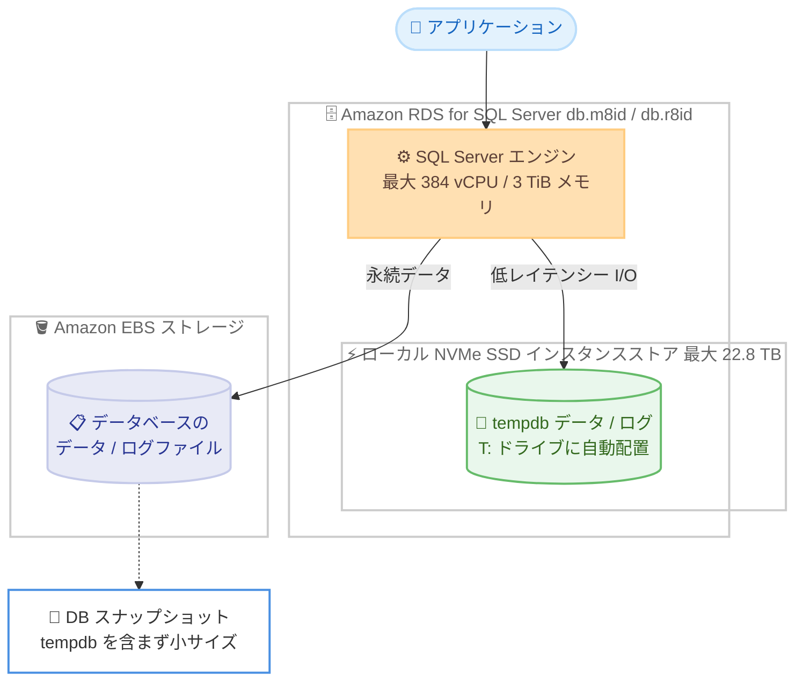

# Amazon RDS for SQL Server - M8id / R8id インスタンスのサポート

**リリース日**: 2026 年 11 月 12 日
**サービス**: Amazon RDS for SQL Server
**機能**: M8id / R8id データベースインスタンス (db.m8id / db.r8id) のサポート

📊 [このアップデートのインフォグラフィックを見る](https://takech9203.github.io/aws-news-summary/20261112-rds-sqlserver-supports-m8id-r8id-instances.html)

## 概要

Amazon RDS for SQL Server が、M8id および R8id インスタンス (db.m8id / db.r8id) のサポートを開始しました。これらのインスタンスは AWS でのみ利用可能なカスタム Intel Xeon 6 プロセッサを搭載し、ローカル NVMe SSD インスタンスストアを備えています。最大 384 vCPU、3 TiB のメモリ、22.8 TB のローカル NVMe SSD ストレージを提供し、従来の M5d / R5d インスタンスと比較して vCPU とメモリは 4 倍、ローカルストレージは 6 倍以上に拡大しています。

これらのインスタンスタイプで DB インスタンスを作成または変更すると、RDS は tempdb のデータファイルとログファイルを自動的にローカル NVMe インスタンスストアに配置します。これにより、Amazon EBS ストレージと比較して低い読み取り / 書き込みレイテンシーを実現できます。データベース本体のデータファイルとログファイルは引き続き EBS 上に保持されるため、耐久性は維持されます。

tempdb への I/O が多い SQL Server ワークロード (一時テーブル、ソート、ハッシュ結合、バージョンストアなどを多用する処理) を運用するユーザーや、より大規模なスケールアップ余地を求めるユーザーに適したアップデートです。

**アップデート前の課題**

このアップデート以前には、以下の課題や制限がありました。

- RDS for SQL Server でインスタンスストア付きの最新世代インスタンスの選択肢が限られており、tempdb 高速化には M5d / R5d (最大 96 vCPU) や x2iedn / x2m などに限定されていた
- tempdb への I/O が激しいワークロードでは、EBS ベースの tempdb がレイテンシーのボトルネックになりやすかった
- tempdb を EBS 上に置く構成では、頻繁に変化する tempdb のブロックがスナップショットサイズを増大させ、バックアップストレージの消費が大きくなるケースがあった

**アップデート後の改善**

今回のアップデートにより、以下が可能になりました。

- 最大 384 vCPU / 3 TiB メモリ / 22.8 TB ローカル NVMe SSD という大規模スペックのインスタンスを選択でき、M5d / R5d 比で vCPU とメモリが 4 倍、ローカルストレージが 6 倍以上に拡大した
- インスタンスタイプを変更するだけで tempdb が自動的にローカル NVMe インスタンスストアへ配置され、EBS より低レイテンシーな tempdb I/O を実現できる
- スナップショットに tempdb の一時ファイルが含まれないため、スナップショットサイズが小さくなり、無料バックアップ枠の消費を抑えられる

## アーキテクチャ図



db.m8id / db.r8id では tempdb のデータ / ログファイルがローカル NVMe インスタンスストアに自動配置され、データベース本体のファイルは EBS 上に保持されます。スナップショットには tempdb が含まれないためサイズが小さくなります。

## サービスアップデートの詳細

### 主要機能

1. **カスタム Intel Xeon 6 プロセッサ搭載の最新世代インスタンス**
   - AWS でのみ利用可能なカスタム Intel Xeon 6 プロセッサを搭載
   - 最大 384 vCPU、3 TiB のメモリを提供
   - M5d / R5d と比較して vCPU とメモリが 4 倍に拡大

2. **ローカル NVMe SSD インスタンスストアによる tempdb の高速化**
   - 最大 22.8 TB のローカル NVMe SSD ストレージ (M5d / R5d 比 6 倍以上)
   - DB インスタンスの作成時または変更時に、tempdb のデータ / ログファイルが自動的にインスタンスストア (`T:\rdsdbdata\DATA`) に配置される
   - EBS ストレージと比較して低い読み取り / 書き込みレイテンシーを実現
   - データベース本体のデータファイルとログファイルはインスタンスストアには配置されない

3. **バックアップストレージの効率化**
   - tempdb がインスタンスストア上にあるため、DB スナップショットに一時ファイルが含まれない
   - スナップショットサイズが小さくなり、無料バックアップ枠の消費を抑制できる

## 技術仕様

### M8id / R8id インスタンスの主な仕様

| 項目 | 詳細 |
|------|------|
| プロセッサ | カスタム Intel Xeon 6 (AWS でのみ利用可能) |
| 最大 vCPU | 384 vCPU |
| 最大メモリ | 3 TiB |
| ローカルストレージ | 最大 22.8 TB の NVMe SSD インスタンスストア |
| 従来世代との比較 | M5d / R5d 比で vCPU / メモリ 4 倍、ローカルストレージ 6 倍以上 |
| tempdb 配置 | インスタンスストア (`T:\rdsdbdata\DATA`) に自動配置 |

### tempdb のファイル配置とサイズ

RDS ユーザーガイド (instance store support for tempdb) によると、インスタンスストア対応インスタンスでは以下の動作になります。

| 項目 | 詳細 |
|------|------|
| 対応インスタンスクラス | db.m5d、db.m8id、db.r5d、db.r8id、db.x2iedn、db.x2m |
| tempdb データファイル初期サイズ | インスタンスストア容量の 80% 以上 (複数ファイルの場合は均等分割) |
| tempdb ログファイル初期サイズ | 8 MB |
| 空き容量 | ストレージ容量の 20% または 200 GB のいずれか小さい方を空けて開始 |
| 混在構成 | EBS ボリューム (`D:\rdsdbdata\DATA`) 上に追加の tempdb データ / ログファイルを作成可能 |

## 設定方法

### 前提条件

1. 利用可能リージョン (東京を含む 13 リージョン) で RDS for SQL Server を運用していること
2. インスタンスクラス変更に伴う再起動の影響を考慮したメンテナンス計画があること
3. tempdb のワークロードがインスタンスストアの容量に収まることを確認していること

### 手順

#### ステップ 1: 現在のインスタンスクラスの確認

```bash
aws rds describe-db-instances \
  --db-instance-identifier my-sqlserver-instance \
  --query "DBInstances[0].[DBInstanceClass,Engine,EngineVersion]"
```

対象の SQL Server DB インスタンスの現在のインスタンスクラス、エンジン、エンジンバージョンを表示します。

#### ステップ 2: 利用可能な db.m8id / db.r8id サイズの確認

```bash
aws rds describe-orderable-db-instance-options \
  --engine sqlserver-ee \
  --query "OrderableDBInstanceOptions[?contains(DBInstanceClass, 'db.r8id')].[DBInstanceClass,EngineVersion]" \
  --region ap-northeast-1
```

指定したリージョンとエンジン (この例では SQL Server Enterprise Edition) で注文可能な db.r8id インスタンスクラスと対応エンジンバージョンの一覧を取得します。

#### ステップ 3: インスタンスクラスの変更

```bash
aws rds modify-db-instance \
  --db-instance-identifier my-sqlserver-instance \
  --db-instance-class db.r8id.4xlarge \
  --no-apply-immediately
```

対象インスタンスのインスタンスクラスを db.r8id.4xlarge に変更します。`--no-apply-immediately` を指定すると次のメンテナンスウィンドウで適用されます。即時適用する場合は `--apply-immediately` を指定しますが、再起動が発生します。変更後、tempdb のデータ / ログファイルは自動的にインスタンスストアへ配置されます。

## メリット

### ビジネス面

- **バックアップコストの削減**: スナップショットに tempdb の一時ファイルが含まれないため、スナップショットサイズと無料バックアップ枠の消費を抑えられる
- **スケールアップによる統合**: 最大 384 vCPU / 3 TiB メモリにより、複数の中規模インスタンスを大規模インスタンスへ統合し、SQL Server ライセンスや運用の効率化を検討できる
- **移行の容易さ**: インスタンスクラスの変更のみで tempdb の高速化が有効になり、アプリケーションの変更は不要

### 技術面

- **tempdb の低レイテンシー化**: ローカル NVMe SSD への自動配置により、EBS と比較して低い読み取り / 書き込みレイテンシーを実現できる
- **大容量の一時領域**: 最大 22.8 TB のローカルストレージにより、大規模なソートや一時テーブルを使用するワークロードに対応できる
- **柔軟な構成**: インスタンスストアが不足する場合は、EBS ボリューム上に追加の tempdb ファイルを作成する混在構成も可能

## デメリット・制約事項

### 制限事項

- インスタンスストアに配置されるのは tempdb のみで、データベース本体のデータ / ログファイルは配置されない
- インスタンスストアの容量を使い切ると tempdb のトランザクションログフルやファイルグループフルのエラーが発生する可能性がある
- 利用可能リージョンは発表時点で 13 リージョンに限定される

### 考慮すべき点

- インスタンスクラス変更時には再起動が発生するため、メンテナンスウィンドウを活用した計画的な移行が必要
- `ALTER DATABASE [tempdb] MODIFY FILE` で tempdb ファイルを再配置して再起動すると、元のボリュームに孤立ファイルが残り容量を消費する場合がある (削除には AWS サポートへの連絡が必要)
- インスタンスストアを使用しない構成へ戻す場合は、インスタンスストア非対応のインスタンスクラス (db.m5、db.r5 など) へ変更する

## ユースケース

### ユースケース 1: tempdb I/O がボトルネックのバッチ処理の高速化

**シナリオ**: 夜間バッチで大量のソートや一時テーブルを使用しており、tempdb への EBS I/O レイテンシーが処理時間を長期化させている。

**実装例**:
```bash
aws rds modify-db-instance \
  --db-instance-identifier my-batch-sqlserver \
  --db-instance-class db.m8id.8xlarge \
  --no-apply-immediately
```

**効果**: tempdb がローカル NVMe SSD に配置され、ソートやハッシュ結合などの tempdb 集約的な処理のレイテンシーが低減し、バッチ処理時間の短縮が期待できます。

### ユースケース 2: M5d / R5d からの世代更新とスケールアップ

**シナリオ**: db.r5d.24xlarge (最大サイズ) で運用しているが、ワークロードの成長により CPU とメモリが不足しつつある。

**実装例**:
```bash
aws rds modify-db-instance \
  --db-instance-identifier my-core-sqlserver \
  --db-instance-class db.r8id.48xlarge \
  --apply-immediately
```

**効果**: M5d / R5d 比で 4 倍の vCPU / メモリにより、シャーディングやアプリケーション分割を行わずにスケールアップで対応でき、tempdb 用ローカルストレージも 6 倍以上に拡大します。

### ユースケース 3: スナップショットサイズの削減によるバックアップ最適化

**シナリオ**: tempdb の変更ブロックが多いワークロードで、EBS のみのインスタンスではスナップショットサイズが大きく、バックアップストレージのコストが増加している。

**実装例**:
```bash
# インスタンスストア対応クラスへ変更後、スナップショットサイズを確認
aws rds describe-db-snapshots \
  --db-instance-identifier my-sqlserver-instance \
  --query "DBSnapshots[*].[DBSnapshotIdentifier,AllocatedStorage,SnapshotCreateTime]"
```

**効果**: tempdb がスナップショットに含まれなくなるため、スナップショットサイズが小さくなり、無料バックアップ枠の消費とバックアップコストを抑制できます。

## 料金

db.m8id / db.r8id インスタンスは、既存の RDS for SQL Server インスタンスと同様の料金体系 (オンデマンドおよびリザーブドインスタンス) で利用できます。インスタンスストアはインスタンス料金に含まれ、追加料金はありません。リージョン、エディション、サイズごとの具体的な料金は料金ページを参照してください。

- [Amazon RDS for SQL Server の料金](https://aws.amazon.com/rds/sqlserver/pricing/)

## 利用可能リージョン

発表時点で以下の 13 リージョンで利用可能です。

- 米国東部 (バージニア北部)
- 米国東部 (オハイオ)
- 米国西部 (オレゴン)
- カナダ (中部)
- 欧州 (アイルランド)
- 欧州 (ロンドン)
- 欧州 (フランクフルト)
- 欧州 (ストックホルム)
- 欧州 (スペイン)
- アジアパシフィック (東京)
- アジアパシフィック (ムンバイ)
- アジアパシフィック (シドニー)
- アジアパシフィック (マレーシア)

## 関連サービス・機能

- **Amazon EBS**: データベース本体のデータ / ログファイルは引き続き EBS 上に保持され、耐久性とスナップショットによるバックアップが提供される
- **db.x2iedn / db.x2m インスタンス**: 同様に tempdb のインスタンスストア配置に対応するメモリ最適化インスタンスクラス
- **Amazon RDS Custom for SQL Server**: OS やデータベース環境へのアクセスが必要な SQL Server ワークロード向けのマネージドサービス

## 参考リンク

- 📊 [インフォグラフィック](https://takech9203.github.io/aws-news-summary/20261112-rds-sqlserver-supports-m8id-r8id-instances.html)
- [公式発表 (What's New)](https://aws.amazon.com/about-aws/whats-new/2026/11/rds-sqlserver-supports-m8id-r8id-instances)
- [Amazon RDS for SQL Server 製品ページ](https://aws.amazon.com/rds/sqlserver/)
- [tempdb のインスタンスストアサポート (ドキュメント)](https://docs.aws.amazon.com/AmazonRDS/latest/UserGuide/SQLServer.InstanceStore.html)
- [DB インスタンスクラス (ドキュメント)](https://docs.aws.amazon.com/AmazonRDS/latest/UserGuide/Concepts.DBInstanceClass.html)
- [Amazon RDS for SQL Server の料金](https://aws.amazon.com/rds/sqlserver/pricing/)

## まとめ

M8id / R8id インスタンスのサポートにより、RDS for SQL Server は最新のカスタム Intel Xeon 6 プロセッサと大容量ローカル NVMe SSD による tempdb の低レイテンシー化を、インスタンスクラスの変更だけで利用できるようになりました。東京リージョンを含む 13 リージョンで提供されるため、tempdb I/O がボトルネックとなっているワークロードや M5d / R5d からの世代更新を検討している場合は、検証環境での性能測定と移行計画の策定を推奨します。
