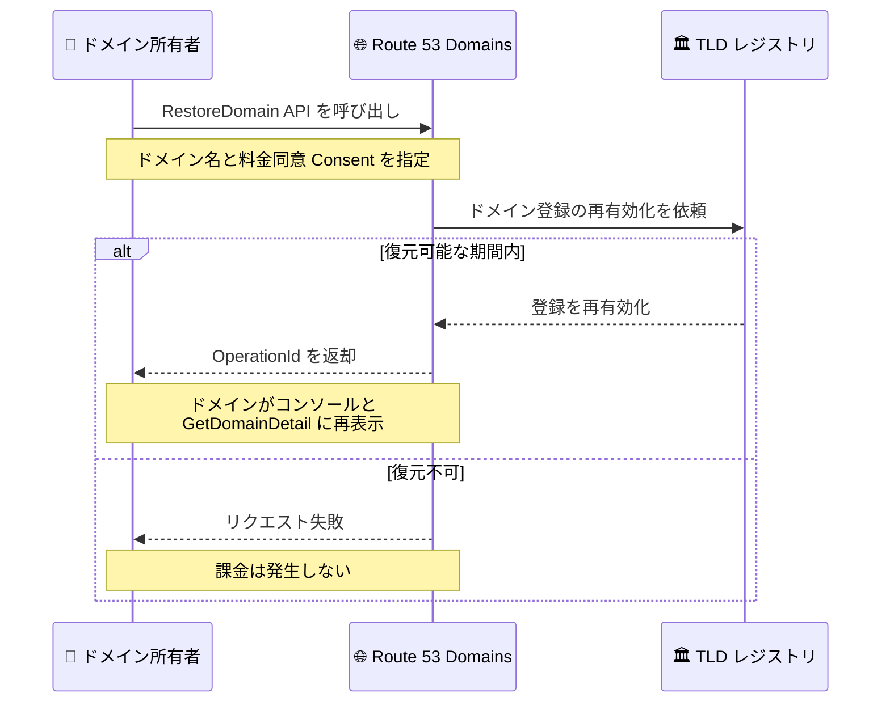

# Amazon Route 53 Domains - 期限切れ・削除済みドメインのセルフサービス復元

**リリース日**: 2026 年 11 月 12 日
**サービス**: Amazon Route 53 Domains
**機能**: 期限切れ・削除済みドメインのセルフサービス復元 (RestoreDomain API)

📊 [このアップデートのインフォグラフィックを見る](https://takech9203.github.io/aws-news-summary/20261112-route-53-domains-self-service-restore.html)

## 概要

Amazon Route 53 Domains が、期限切れまたは削除済みドメインのセルフサービス復元をサポートしました。Route 53 コンソール、AWS CLI、AWS SDK から、お客様自身でドメインの復元を実行できます。

ドメインは、更新忘れ、支払い方法の有効期限切れ、誤削除などにより失われることがあります。これまで、こうしたドメインを復元するには AWS サポートへの問い合わせが必要でしたが、今回のアップデートにより、新しく追加された RestoreDomain API を使用して、サポートを介さずに復元を完了できるようになりました。

復元のプロセスは、ドメイン名の入力、復元コストの確認、料金への同意、リクエストの送信という 4 ステップで完結します。リクエストを受け付けると、Route 53 がトップレベルドメイン (TLD) のレジストリと連携して登録を再有効化し、ドメインをお客様の AWS アカウントに戻します。

**アップデート前の課題**

- 期限切れ・削除済みドメインの復元には AWS サポートへの問い合わせが必要で、時間がかかっていた
- 復元可能な期限が限られている中で、サポートとのやり取りによる遅延が機会損失につながるリスクがあった
- 復元作業を自動化やスクリプトに組み込むことができなかった

**アップデート後の改善**

- Route 53 コンソール、AWS CLI、AWS SDK からセルフサービスでドメインを復元できるようになった
- RestoreDomain API により、復元操作をプログラムから実行できるようになった
- 復元コストを事前に確認し、同意した上でリクエストを送信できるため、意図しない課金を防止できる
- 復元できない場合はリクエストが失敗し、課金は発生しない

## アーキテクチャ図



ドメイン所有者が RestoreDomain API を呼び出すと、Route 53 が TLD レジストリと連携して登録を再有効化し、ドメインを元の AWS アカウントに戻す流れを示しています。

## サービスアップデートの詳細

### 主要機能

1. **セルフサービスによるドメイン復元**
   - Route 53 コンソール、AWS CLI、AWS SDK から復元を実行可能
   - ドメイン名の入力、復元コストの確認、料金への同意、送信の 4 ステップで完結
   - AWS サポートへの問い合わせが不要に

2. **RestoreDomain API の追加**
   - ドメイン名と料金同意 (Consent) を指定して復元をリクエスト
   - Consent パラメータで支払いに同意する上限価格 (MaxPrice) と通貨 (Currency) を指定
   - レスポンスとして OperationId が返却され、復元オペレーションの状況を追跡可能

3. **TLD レジストリとの自動連携**
   - Route 53 が TLD レジストリと連携して登録を再有効化
   - 復元に成功すると、ドメインがコンソールおよび GetDomainDetail のレスポンスに再表示される
   - 復元後の有効期限は、以前の有効期限と異なる場合がある

## 技術仕様

### 復元の条件と動作

| 項目 | 詳細 |
|------|------|
| 対象ドメイン | 遅延更新期間を過ぎた期限切れドメイン、または削除済みドメイン |
| 実行アカウント | ドメインが登録されていた AWS アカウントから実行する必要がある |
| 対応 TLD | 多くの TLD レジストリが復元をサポート (すべてではない) |
| 復元可能期間 | 期限切れ・削除後に復元できる期間は各 TLD レジストリが決定 |
| 復元失敗時 | ドメインが復元できない場合、リクエストは失敗し課金は発生しない |
| 復元後の有効期限 | 以前の有効期限と異なる場合がある |

### API 変更履歴

| 日付 | サービス | 変更内容 |
|------|----------|----------|
| 2026/11/05 | [Amazon Route 53 Domains](https://awsapichanges.com/archive/changes/7e892e-route53domains.html) | 1 new api method - セルフサービスのドメイン復元を行う RestoreDomain API を追加 |

### RestoreDomain API の呼び出し例 (Python SDK)

```python
response = client.restore_domain(
    DomainName='example.com',
    Consent={
        'MaxPrice': 123.0,
        'Currency': 'USD'
    }
)
# レスポンス
# {
#     'OperationId': 'string'
# }
```

Consent パラメータで同意する上限価格と通貨を指定します。レスポンスの OperationId を使用して、復元オペレーションの進捗を追跡できます。

## 設定方法

### 前提条件

1. 復元対象のドメインが登録されていた AWS アカウントを使用できること
2. 対象ドメインの TLD レジストリが復元をサポートしていること
3. TLD ごとに定められた復元可能期間内であること

### 手順

#### ステップ 1: TLD の復元サポート状況と復元可能期間を確認

[Route 53 で登録できるドメイン](https://docs.aws.amazon.com/Route53/latest/DeveloperGuide/registrar-tld-list.html) のドキュメントで、対象ドメインの TLD を検索し、「ドメインの更新と復元の期限」セクションの値を確認します。TLD によって復元の可否と復元可能期間が異なります。

#### ステップ 2: 復元料金を確認

```bash
aws route53domains get-domain-prices \
  --tld com \
  --region us-east-1
```

GetDomainPrices API で対象 TLD の復元料金を確認します。通常のドメインの復元料金は [Route 53 のドメイン登録料金表](https://d32ze2gidvkk54.cloudfront.net/Amazon_Route_53_Domain_Registration_Pricing_20140731.pdf) の Restoration Price 列にも記載されています。プレミアムドメインの場合は料金がドメイン名ごとに異なるため、Route 53 コンソールでの検索または GetDomainPrices API での確認が必要です。

#### ステップ 3: ドメインを復元

```bash
aws route53domains restore-domain \
  --domain-name example.com \
  --consent MaxPrice=123.0,Currency=USD \
  --region us-east-1
```

RestoreDomain API を呼び出してドメインの復元をリクエストします。ドメインが登録されていた AWS アカウントから実行する必要があります。復元に成功すると、ドメインが Route 53 コンソールに再表示されます。

## メリット

### ビジネス面

- **ダウンタイムの最小化**: サポートへの問い合わせを待たずに即座に復元を開始でき、ドメイン喪失によるサービス停止やブランド毀損のリスクを低減できる
- **機会損失の防止**: 復元可能期間が限られる中で、迅速な対応により第三者にドメインを取得されるリスクを低減できる
- **コストの透明性**: 復元コストを事前に確認して同意した上でリクエストするため、想定外の課金を回避できる

### 技術面

- **プログラマブルな復元**: RestoreDomain API により、復元操作を運用スクリプトや自動化ワークフローに組み込める
- **オペレーション追跡**: OperationId により復元オペレーションの状況を追跡できる
- **安全な失敗動作**: 復元できない場合はリクエストが失敗し課金が発生しないため、安心して試行できる

## デメリット・制約事項

### 制限事項

- すべての TLD レジストリが復元をサポートしているわけではない
- 復元可能期間は TLD レジストリごとに異なり、期間を過ぎると復元できない
- 汎用 TLD (gTLD) で登録から 5 日以内に削除されたドメインには、標準の 30 日間の償還期間 (redemption period) が適用されず、誰でも即座に再登録できる
- 復元料金の支払いに AWS クレジットは使用できない

### 考慮すべき点

- 復元は通常、ドメインの新規登録や更新よりも高額になる
- 復元後の有効期限は以前の有効期限と異なる場合があるため、復元後に有効期限を確認することを推奨
- そもそもドメインを失わないよう、自動更新の有効化と支払い方法の有効期限管理が重要

## ユースケース

### ユースケース 1: 更新忘れによる期限切れドメインの復元

**シナリオ**: 支払い方法の有効期限切れにより自動更新が失敗し、ドメインが遅延更新期間を過ぎて期限切れになった。

**実装例**:
```bash
# 復元料金を確認
aws route53domains get-domain-prices --tld com --region us-east-1

# ドメインを復元
aws route53domains restore-domain \
  --domain-name example.com \
  --consent MaxPrice=123.0,Currency=USD \
  --region us-east-1
```

**効果**: サポートへの問い合わせを待たずに復元を開始でき、ドメインを使用するサービスの停止時間を最小化できる。

### ユースケース 2: 誤削除したドメインの即時復旧

**シナリオ**: 運用作業中に誤って本番利用中のドメインを削除してしまった。

**実装例**:
```bash
# ドメインを復元
aws route53domains restore-domain \
  --domain-name example.com \
  --consent MaxPrice=123.0,Currency=USD \
  --region us-east-1

# オペレーションの状況を確認
aws route53domains get-operation-detail \
  --operation-id <OperationId> \
  --region us-east-1
```

**効果**: 復元可能期間内であれば、第三者に取得される前に迅速にドメインを取り戻せる。

### ユースケース 3: 復元手順の運用 Runbook への組み込み

**シナリオ**: 多数のドメインを管理する組織で、ドメイン喪失時の復旧手順を標準化したい。

**実装例**:
```python
import boto3

client = boto3.client('route53domains', region_name='us-east-1')

response = client.restore_domain(
    DomainName='example.com',
    Consent={
        'MaxPrice': 123.0,
        'Currency': 'USD'
    }
)
print(response['OperationId'])
```

**効果**: API ベースの標準化された復旧手順により、担当者によらず迅速かつ確実にドメインを復元できる。

## 料金

ドメインの復元には復元料金が発生します。復元料金は、通常、ドメインの新規登録や更新よりも高額です。

- 通常ドメインの復元料金は、[Route 53 のドメイン登録料金表](https://d32ze2gidvkk54.cloudfront.net/Amazon_Route_53_Domain_Registration_Pricing_20140731.pdf) の Restoration Price 列を参照
- プレミアムドメインの復元料金はドメイン名ごとに異なるため、Route 53 コンソールでの検索または GetDomainPrices API で確認
- 復元料金の支払いに AWS クレジットは使用できない
- 復元に失敗した場合、課金は発生しない

## 利用可能リージョン

Amazon Route 53 Domains はグローバルサービスです。API エンドポイントは米国東部 (バージニア北部) リージョン (us-east-1) で提供されます。

## 関連サービス・機能

- **Amazon Route 53 (DNS)**: 復元したドメインのホストゾーンで DNS レコードを管理。ドメイン期限切れ中に DNS 解決が停止していた場合、復元後の動作確認が必要
- **GetDomainDetail API**: 復元成功後、ドメインの詳細 (有効期限など) を確認するために使用
- **GetDomainPrices API**: TLD ごとの復元料金を事前に確認するために使用
- **GetOperationDetail API**: RestoreDomain が返す OperationId を使用して復元オペレーションの進捗を追跡

## 参考リンク

- 📊 [インフォグラフィック](https://takech9203.github.io/aws-news-summary/20261112-route-53-domains-self-service-restore.html)
- [公式発表 (What's New)](https://aws.amazon.com/about-aws/whats-new/2026/11/route-53-domains-self-service-restore/)
- [ドキュメント: Restoring an expired or deleted domain](https://docs.aws.amazon.com/Route53/latest/DeveloperGuide/domain-restore-expired.html)
- [ドキュメント: RestoreDomain API リファレンス](https://docs.aws.amazon.com/Route53/latest/APIReference/API_domains_RestoreDomain.html)
- [ドキュメント: Route 53 で登録できるドメイン (TLD リスト)](https://docs.aws.amazon.com/Route53/latest/DeveloperGuide/registrar-tld-list.html)
- [Amazon Route 53 Domains](https://aws.amazon.com/route53/domains/)
- [料金ページ](https://aws.amazon.com/route53/pricing/)

## まとめ

Amazon Route 53 Domains のセルフサービス復元により、更新忘れや誤削除で失われたドメインを、AWS サポートを介さずコンソール・CLI・SDK から迅速に取り戻せるようになりました。復元可能期間は TLD ごとに限られるため、ドメイン喪失に気づいたら速やかに TLD の復元サポート状況を確認し、RestoreDomain API で復元を実行することを推奨します。あわせて、自動更新の有効化と支払い方法の管理により、そもそもドメインを失わない運用を徹底することが重要です。
