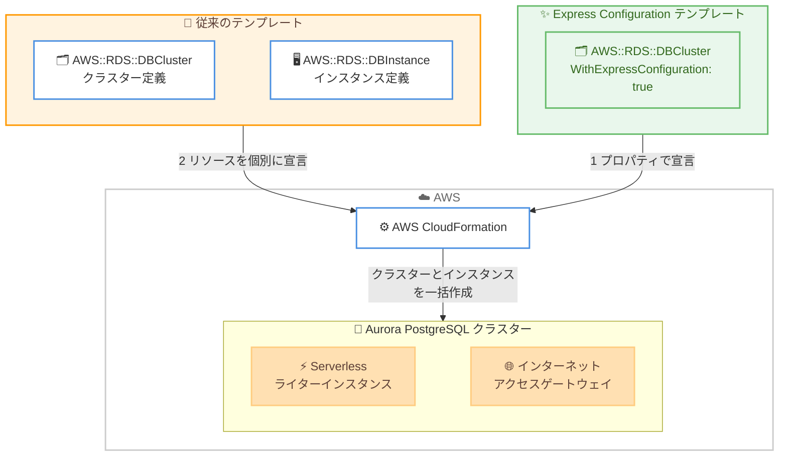

# Amazon Aurora PostgreSQL - Express Configuration の CloudFormation サポート

**リリース日**: 2026 年 11 月 13 日
**サービス**: Amazon Aurora PostgreSQL / AWS CloudFormation
**機能**: AWS::RDS::DBCluster リソースの WithExpressConfiguration プロパティによる express configuration クラスターの作成

📊 [このアップデートのインフォグラフィックを見る](https://takech9203.github.io/aws-news-summary/20261113-aurora-postgresql-cloudformation.html)

## 概要

Amazon Aurora PostgreSQL の express configuration が AWS CloudFormation に対応しました。`AWS::RDS::DBCluster` リソースに新しく追加された `WithExpressConfiguration` プロパティ (createOnly、Boolean 型) を使用することで、クラスターとそのプライマリ DB インスタンスを 1 つのプロパティ宣言で作成できます。

Express configuration は、事前設定済みのデフォルト構成により Aurora PostgreSQL Serverless データベースを数秒で作成し、すぐにクエリを実行できる簡素化されたデータベース作成エクスペリエンスです。これまでコンソール、AWS CLI、SDK で利用可能でしたが、今回のアップデートにより CloudFormation テンプレートからも利用できるようになり、Infrastructure as Code (IaC) によるデプロイ自動化と express configuration の高速な作成体験を両立できます。

テンプレート内で DB インスタンスを個別のリソースとしてモデル化する必要がなくなるため、テンプレートが簡素化され、IaC によるクラスター管理が容易になります。

**アップデート前の課題**

- Express configuration はコンソール、AWS CLI、SDK からのみ利用可能で、CloudFormation テンプレートでは作成できなかった
- CloudFormation で Aurora クラスターを作成する場合、`AWS::RDS::DBCluster` と `AWS::RDS::DBInstance` の 2 つのリソースを個別に定義する必要があった
- 数秒でデータベースを作成できる express configuration の利点を、IaC ベースのワークフローに組み込めなかった

**アップデート後の改善**

- `WithExpressConfiguration` プロパティの宣言だけで、クラスターとプライマリ DB インスタンスの両方を作成できるようになった
- DB インスタンスを個別にモデル化する必要がなくなり、テンプレートが簡素化された
- Express configuration の高速な作成体験を CloudFormation によるデプロイ自動化と組み合わせられるようになった

## アーキテクチャ図



従来は DBCluster と DBInstance の 2 リソースを個別に定義する必要がありましたが、`WithExpressConfiguration` プロパティにより DBCluster リソース 1 つの宣言でクラスターと Serverless ライターインスタンスが一括作成されます。

## サービスアップデートの詳細

### 主要機能

1. **WithExpressConfiguration プロパティ**
   - `AWS::RDS::DBCluster` リソースに追加された Boolean 型のプロパティ
   - createOnly プロパティであり、作成後に変更するとリソースの置き換え (Replacement) が発生する
   - ライター DB インスタンスを作成し、残りのプロパティにデフォルト値を設定する
   - Aurora PostgreSQL DB クラスターのみサポート

2. **テンプレートの簡素化**
   - `AWS::RDS::DBInstance` リソースを個別に定義する必要がない
   - CloudFormation はライター DB インスタンスを管理対象外とする。管理が必要な場合は `AWS::RDS::DBInstance` リソースとしてスタックにインポートできる
   - CloudFormation が DB クラスターを削除すると、ライター DB インスタンスも併せて削除される

3. **Express configuration のデフォルト構成**
   - Aurora Serverless インスタンスとして作成され、数秒で利用可能になる
   - インターネットアクセスゲートウェイがデフォルトで有効化され、VPN や AWS Direct Connect なしでセキュアに接続できる
   - IAM データベース認証が有効化され、一時トークンベースのアクセスでデータを保護する
   - VPC には関連付けられず、アベイラビリティーゾーンは自動的に選択される

## 技術仕様

### WithExpressConfiguration プロパティ

| 項目 | 詳細 |
|------|------|
| リソース | `AWS::RDS::DBCluster` |
| プロパティ名 | `WithExpressConfiguration` |
| 型 | Boolean |
| 必須 | いいえ |
| 更新動作 | Replacement (createOnly) |
| 対象エンジン | Aurora PostgreSQL のみ |

### Express configuration の主なデフォルト設定

| 設定 | デフォルト値と制約 |
|------|------|
| DB インスタンスクラス | Aurora Serverless インスタンス (作成後に変更可能) |
| エンジンバージョン | デフォルトのメジャー/マイナーバージョン (アップグレードは可能、ダウングレードは不可) |
| 暗号化 | AWS/RDS サービス所有キーで暗号化 (変更不可、カスタマーマネージドキーは使用不可) |
| 認証 | IAM データベース認証のみ (変更不可) |
| VPC | 関連付けなし。インターネットアクセスゲートウェイ経由で接続 |
| ストレージ | Aurora Standard (作成後に変更可能) |
| データベースポート | 5432 (変更不可) |
| パラメータグループ | デフォルトパラメータグループ (作成後に変更可能) |

### テンプレート例

```yaml
AWSTemplateFormatVersion: "2010-09-09"
Resources:
  ExpressCluster:
    Type: AWS::RDS::DBCluster
    Properties:
      DBClusterIdentifier: sample-express-cluster
      Engine: aurora-postgresql
      WithExpressConfiguration: true
```

`WithExpressConfiguration: true` を宣言するだけで、クラスターと Serverless ライターインスタンスの両方が作成されます。

## 設定方法

### 前提条件

1. Aurora PostgreSQL express configuration が利用可能なリージョンであること
2. CloudFormation スタックの実行ロールに `rds:CreateDBCluster`、`rds:CreateDBInstance`、`rds:EnableInternetAccessGateway`、`ec2:DescribeAvailabilityZones`、`iam:CreateServiceLinkedRole` の権限があること
3. データベースに接続する IAM アイデンティティに `rds-db:connect` 権限があること

### 手順

#### ステップ 1: テンプレートの作成

```yaml
Resources:
  ExpressCluster:
    Type: AWS::RDS::DBCluster
    Properties:
      DBClusterIdentifier: my-express-cluster
      Engine: aurora-postgresql
      WithExpressConfiguration: true
```

`AWS::RDS::DBCluster` リソースに `WithExpressConfiguration: true` を指定したテンプレートを作成します。`AWS::RDS::DBInstance` リソースの定義は不要です。

#### ステップ 2: スタックのデプロイ

```bash
aws cloudformation deploy \
  --template-file template.yaml \
  --stack-name my-express-db-stack
```

CloudFormation スタックをデプロイします。クラスターと Serverless ライターインスタンスが一括で作成され、インターネットアクセスゲートウェイと IAM 認証が自動的に構成されます。

#### ステップ 3: データベースへの接続

```bash
# IAM 認証トークンを生成して psql で接続
aws rds generate-db-auth-token \
  --hostname <クラスターのライターエンドポイント> \
  --port 5432 \
  --username postgres
```

作成されたクラスターには、インターネットアクセスゲートウェイ経由で IAM 認証トークンを使用して接続します。RDS コンソールの「接続とセキュリティ」タブからコードスニペットや CloudShell による接続も利用できます。

## メリット

### ビジネス面

- **開発スピードの向上**: 数秒で利用可能になる express configuration を IaC パイプラインに組み込むことで、開発環境や検証環境の立ち上げを高速化できる
- **運用コストの削減**: テンプレートのリソース定義が減り、レビューやメンテナンスの負担が軽減される
- **ガバナンスの強化**: 手動のコンソール操作に頼らず、CloudFormation による再現可能で監査可能なデプロイが実現できる

### 技術面

- **テンプレートの簡素化**: DBCluster と DBInstance の 2 リソース定義が 1 つのプロパティ宣言に集約される
- **一貫した構成**: インターネットアクセスゲートウェイ、IAM 認証、暗号化などのベストプラクティスに沿ったデフォルト構成が自動適用される
- **柔軟な拡張**: 作成後にリーダーインスタンスの追加、インスタンスタイプの変更、ストレージタイプの変更などが可能

## デメリット・制約事項

### 制限事項

- Aurora PostgreSQL のみサポートされ、Aurora MySQL では利用できない
- `WithExpressConfiguration` は createOnly プロパティのため、作成後に値を変更するとクラスターの置き換えが発生する
- CloudFormation はライター DB インスタンスを直接管理しない。管理するにはスタックへのインポートが必要
- クラスターは VPC に関連付けられず、カスタマーマネージド KMS キー、特定のエンジンバージョン指定、Secrets Manager によるパスワード管理は使用できない
- Aurora Global Database、Aurora Limitless Database、RDS Proxy、Zero-ETL 統合、Blue/Green Deployments、Babelfish などの VPC を前提とする機能はサポートされない
- IPv6 はサポートされず、IPv4 のみ利用可能

### 考慮すべき点

- CloudFormation がクラスターを削除すると、ライター DB インスタンスも併せて削除されるため、削除保護やスナップショット運用を検討する必要がある
- インターネットアクセスゲートウェイは無効化できないため、VPC 内に閉じたネットワーク構成が必須の本番環境では full configuration を検討する必要がある
- 認証は IAM データベース認証のみで、トークンの有効期限は 15 分のため、接続ツール側の対応状況を確認する必要がある

## ユースケース

### ユースケース 1: 開発環境の迅速なプロビジョニング

**シナリオ**: 開発チームごとに検証用の Aurora PostgreSQL 環境を CloudFormation で払い出したいが、テンプレートの定義量を最小限にしたい。

**実装例**:
```yaml
Resources:
  DevCluster:
    Type: AWS::RDS::DBCluster
    Properties:
      DBClusterIdentifier: dev-team-a-cluster
      Engine: aurora-postgresql
      WithExpressConfiguration: true
```

**効果**: 最小限のテンプレートで数秒で利用可能なデータベースを払い出せる。VPC やサブネットグループの設計が不要なため、ネットワーク構成の調整を待たずに開発を開始できる。

### ユースケース 2: CI/CD パイプラインでの一時的なテスト用データベース

**シナリオ**: 統合テストの実行ごとに独立したデータベースを作成し、テスト完了後に破棄したい。

**実装例**:
```bash
# テスト開始時にスタックを作成
aws cloudformation deploy \
  --template-file test-db.yaml \
  --stack-name test-db-${BUILD_ID}

# テスト完了後にスタックを削除 (ライターインスタンスも併せて削除される)
aws cloudformation delete-stack --stack-name test-db-${BUILD_ID}
```

**効果**: 作成も削除も 1 スタック操作で完結し、インスタンスの削除漏れによるコスト発生を防止できる。Serverless のため、テスト負荷に応じて自動的にスケーリングする。

### ユースケース 3: プロトタイピング環境のコード管理

**シナリオ**: 新規プロダクトのプロトタイピングで、外部の開発ツールや SaaS から直接接続できるデータベースを IaC で管理したい。

**実装例**:
```yaml
Resources:
  PrototypeCluster:
    Type: AWS::RDS::DBCluster
    Properties:
      DBClusterIdentifier: prototype-cluster
      Engine: aurora-postgresql
      WithExpressConfiguration: true
      DeletionProtection: false
```

**効果**: インターネットアクセスゲートウェイと IAM 認証により、VPN なしでセキュアに外部ツールから接続できる環境を、テンプレートとしてバージョン管理できる。

## 料金

CloudFormation サポート自体に追加料金はありません。Express configuration で作成されるクラスターには、Aurora Serverless の通常の料金 (ACU 時間、ストレージ、I/O) が適用されます。Aurora PostgreSQL の express configuration は AWS Free Tier でも利用できます。

## 利用可能リージョン

Aurora PostgreSQL の express configuration が提供されているすべての AWS リージョンで利用可能です。ドキュメントによると、express configuration は AWS GovCloud (US)、中東 (UAE)、中東 (バーレーン) を除くすべての AWS リージョンでサポートされています。

## 関連サービス・機能

- **AWS CloudFormation**: 今回のアップデートの対象。`AWS::RDS::DBCluster` リソースで express configuration を宣言的に管理できるようになった
- **Amazon Aurora Serverless v2**: Express configuration で作成されるインスタンスのバックエンド。ワークロードに応じて自動的にスケーリングする
- **AWS Identity and Access Management (IAM)**: Express configuration クラスターの認証方式。一時トークンによるパスワードレス認証を提供する
- **AWS Free Tier**: Aurora PostgreSQL の express configuration は無料利用枠の対象

## 参考リンク

- 📊 [インフォグラフィック](https://takech9203.github.io/aws-news-summary/20261113-aurora-postgresql-cloudformation.html)
- [公式発表 (What's New)](https://aws.amazon.com/about-aws/whats-new/2026/11/aurora-postgresql-cloudformation/)
- [ドキュメント: Create with express configuration (Amazon Aurora User Guide)](https://docs.aws.amazon.com/AmazonRDS/latest/AuroraUserGuide/CHAP_GettingStartedAurora.AuroraPostgreSQL.ExpressConfig.html)
- [ドキュメント: AWS::RDS::DBCluster (CloudFormation Template Reference)](https://docs.aws.amazon.com/AWSCloudFormation/latest/TemplateReference/aws-resource-rds-dbcluster.html)
- [料金ページ: Amazon Aurora の料金](https://aws.amazon.com/rds/aurora/pricing/)

## まとめ

Aurora PostgreSQL の express configuration が CloudFormation に対応し、`WithExpressConfiguration` プロパティの宣言だけでクラスターとプライマリ DB インスタンスを一括作成できるようになりました。数秒で利用可能になるデータベースを IaC パイプラインに組み込めるため、開発環境や CI/CD でのテスト用データベースの管理が大幅に簡素化されます。VPC 非関連付けや IAM 認証のみといった express configuration 固有の制約を確認した上で、開発・検証用途から活用を検討することを推奨します。
