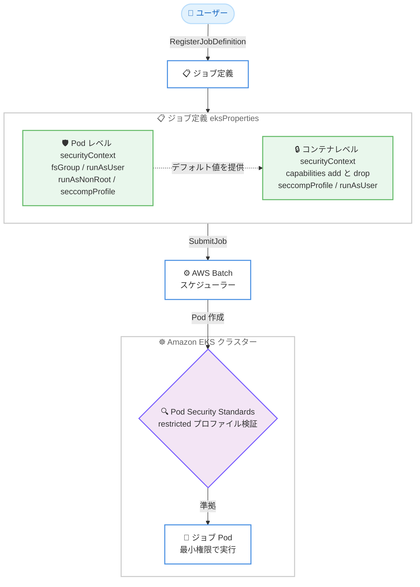

# AWS Batch - Amazon EKS ジョブ定義での Linux capabilities、seccomp、Pod レベルセキュリティ設定のサポート

**リリース日**: 2026 年 11 月 13 日
**サービス**: AWS Batch (Amazon EKS)
**機能**: Kubernetes セキュリティコンテキスト設定の拡張 (Linux capabilities、seccompProfile、Pod レベル設定)

📊 [このアップデートのインフォグラフィックを見る](https://takech9203.github.io/aws-news-summary/20261113-aws-batch-eks-security-context.html)

## 概要

AWS Batch が、Amazon EKS 上で実行するジョブ定義において、追加の Kubernetes セキュリティコンテキスト設定をサポートしました。今回のアップデートにより、コンテナレベルで Linux capabilities と seccomp プロファイルを指定できるようになったほか、`fsGroup` などの Pod レベルのセキュリティ設定も定義できるようになりました。

この機能強化により、Kubernetes Pod Security Standards の restricted プロファイルを適用している EKS クラスターでも、AWS Batch ジョブを必要最小限の権限とシステムコールのみで実行できるようになります。セキュリティ基準の厳しい環境 (金融、医療、規制産業など) でバッチワークロードを運用するユーザーにとって、ガバナンス要件と AWS Batch のフルマネージドなジョブスケジューリングを両立できる重要なアップデートです。

設定は RegisterJobDefinition API を通じて行い、コンテナの `securityContext` に `capabilities` と `seccompProfile` を、`podProperties` の `securityContext` に Pod 全体のデフォルト設定を指定します。コンテナレベルの設定は Pod レベルのデフォルトを上書きします。

**アップデート前の課題**

このアップデート以前には、以下の課題がありました。

- 以前はジョブ定義のコンテナ `securityContext` で `runAsUser`、`runAsGroup`、`runAsNonRoot` などは指定できたものの、Linux capabilities の追加・削除 (`capabilities.add` / `capabilities.drop`) や seccomp プロファイルを指定できなかった
- Pod Security Standards の restricted プロファイルでは「すべての capabilities の drop」や「seccomp プロファイルの明示的な設定」が要求されるため、restricted プロファイルを適用した EKS クラスターで AWS Batch ジョブを実行することが困難だった
- `fsGroup` などの Pod レベルのセキュリティ設定を定義できず、共有ボリュームのファイル所有権の制御などに制約があった

**アップデート後の改善**

今回のアップデートにより、以下が可能になりました。

- コンテナレベルの `securityContext` で Linux capabilities の追加・削除と seccomp プロファイル (`RuntimeDefault`、`Localhost`、`Unconfined`) を指定できるようになった
- `podProperties` の `securityContext` で `fsGroup`、`runAsUser`、`runAsGroup`、`runAsNonRoot`、`seccompProfile` といった Pod 全体のデフォルト設定を定義できるようになった
- Pod Security Standards の restricted プロファイルを適用した EKS クラスターでも、最小権限の原則に沿って AWS Batch ジョブを実行できるようになった
- コンソール、AWS CLI、AWS SDK、AWS CloudFormation のいずれからも設定できる

## アーキテクチャ図



ジョブ定義に Pod レベルとコンテナレベルのセキュリティコンテキストを設定し、restricted プロファイルを適用した EKS クラスターでも検証を通過して最小権限でジョブ Pod が実行される流れを示しています。コンテナレベルの設定は Pod レベルのデフォルトを上書きします。

## サービスアップデートの詳細

### 主要機能

1. **Linux capabilities の制御 (コンテナレベル)**
   - コンテナの `securityContext.capabilities` で `add` と `drop` を指定可能
   - Pod Security Standards の restricted プロファイルで要求される「ALL の drop」と「NET_BIND_SERVICE のみの add」といった構成を実現できる
   - 不要なカーネル権限を排除し、コンテナエスケープなどのリスクを低減

2. **seccomp プロファイルの指定 (コンテナレベル / Pod レベル)**
   - `seccompProfile.type` に `RuntimeDefault`、`Localhost`、`Unconfined` を指定可能
   - `Localhost` タイプの場合は `localhostProfile` でノード上のプロファイルパスを指定
   - ジョブが発行できるシステムコールを必要最小限に制限できる

3. **Pod レベルのセキュリティ設定**
   - `podProperties.securityContext` で `fsGroup`、`runAsUser`、`runAsGroup`、`runAsNonRoot`、`seccompProfile` を定義可能
   - `fsGroup` によりボリュームのファイル所有権とアクセス権を Pod 単位で制御できる
   - Pod レベルの設定はコンテナのデフォルトとして機能し、コンテナレベルの設定が優先される

## 技術仕様

### サポートされるセキュリティコンテキスト設定

| 設定項目 | Pod レベル | コンテナレベル |
|------|------|------|
| `runAsUser` | ✓ | ✓ (既存サポート) |
| `runAsGroup` | ✓ | ✓ (既存サポート) |
| `runAsNonRoot` | ✓ | ✓ (既存サポート) |
| `seccompProfile` | ✓ (新規) | ✓ (新規) |
| `capabilities` (add / drop) | - | ✓ (新規) |
| `fsGroup` | ✓ (新規) | - |

### API変更履歴

| 日付 | サービス | 変更内容 |
|------|----------|----------|
| 2026/11/09 | [AWS Batch](https://awsapichanges.com/archive/changes/588ec7-batch.html) | 3 updated api methods - RegisterJobDefinition、DescribeJobDefinitions、DescribeJobs に EKS セキュリティコンテキスト設定 (Pod レベルの fsGroup、runAsUser、runAsGroup、runAsNonRoot、seccompProfile、コンテナレベルの capabilities、seccompProfile) を追加 |

### ジョブ定義の設定例

```json
{
  "jobDefinitionName": "restricted-eks-job",
  "type": "container",
  "eksProperties": {
    "podProperties": {
      "securityContext": {
        "fsGroup": 2000,
        "runAsNonRoot": true,
        "seccompProfile": {
          "type": "RuntimeDefault"
        }
      },
      "containers": [
        {
          "image": "public.ecr.aws/amazonlinux/amazonlinux:2023",
          "command": ["sleep", "60"],
          "securityContext": {
            "runAsUser": 1000,
            "runAsGroup": 3000,
            "runAsNonRoot": true,
            "capabilities": {
              "drop": ["ALL"]
            },
            "seccompProfile": {
              "type": "RuntimeDefault"
            }
          }
        }
      ]
    }
  }
}
```

## 設定方法

### 前提条件

1. AWS Batch on Amazon EKS のセットアップが完了していること (EKS クラスターと AWS Batch コンピューティング環境の接続)
2. ジョブ定義を登録するための IAM 権限 (`batch:RegisterJobDefinition` など) があること
3. `Localhost` タイプの seccomp プロファイルを使用する場合は、ノード上に該当プロファイルが配置されていること

### 手順

#### ステップ1: セキュリティコンテキストを含むジョブ定義の登録

```bash
aws batch register-job-definition \
  --job-definition-name restricted-eks-job \
  --type container \
  --eks-properties file://eks-properties.json
```

`eks-properties.json` に Pod レベルとコンテナレベルの `securityContext` を含む EKS プロパティを定義し、ジョブ定義として登録します。コンテナレベルの設定は Pod レベルのデフォルトを上書きします。

#### ステップ2: ジョブの送信

```bash
aws batch submit-job \
  --job-name secure-batch-job \
  --job-queue my-eks-job-queue \
  --job-definition restricted-eks-job
```

登録したジョブ定義を指定して EKS 向けジョブキューにジョブを送信します。AWS Batch が設定されたセキュリティコンテキストを適用した Pod を EKS クラスター上に作成します。

#### ステップ3: 設定内容の確認

```bash
aws batch describe-job-definitions \
  --job-definition-name restricted-eks-job \
  --status ACTIVE
```

登録済みジョブ定義のセキュリティコンテキスト設定を確認します。DescribeJobs でも実行中ジョブに適用された設定を確認できます。

## メリット

### ビジネス面

- **コンプライアンス対応の強化**: Pod Security Standards の restricted プロファイルなど、組織のセキュリティ基準を維持したままバッチワークロードを運用できる
- **運用コストの削減**: セキュリティ要件のためにクラスターの例外設定やカスタムコントローラーを用意する必要がなくなり、ガバナンスの一貫性を保てる
- **リスク低減**: 最小権限の原則に基づくジョブ実行により、侵害時の影響範囲を限定できる

### 技術面

- **きめ細かな権限制御**: Linux capabilities の add / drop により、ジョブごとに必要なカーネル権限のみを付与できる
- **システムコールの制限**: seccomp プロファイルにより、コンテナが発行できるシステムコールを制限し攻撃対象領域を縮小できる
- **柔軟な設定階層**: Pod レベルでデフォルトを定義し、必要なコンテナのみ個別に上書きする運用が可能

## デメリット・制約事項

### 制限事項

- 本機能は AWS Batch on Amazon EKS のジョブ定義が対象であり、ECS / Fargate ベースの AWS Batch ジョブには適用されない
- `capabilities` はコンテナレベルのみ、`fsGroup` は Pod レベルのみで設定可能であり、Kubernetes のセキュリティコンテキスト仕様に準拠した使い分けが必要
- `Localhost` タイプの seccomp プロファイルは、実行先ノードにプロファイルファイルが存在している必要がある

### 考慮すべき点

- capabilities を過度に制限するとジョブが実行時エラーになる可能性があるため、ワークロードが必要とする権限を事前に検証する必要がある
- 既存のジョブ定義に設定を追加する場合、ジョブ定義の新しいリビジョンを登録し、ジョブ送信時の参照先を更新する必要がある
- コンテナレベルの設定が Pod レベルのデフォルトを上書きするという優先順位を理解した上で設計する必要がある

## ユースケース

### ユースケース1: restricted プロファイル適用クラスターでのバッチ実行

**シナリオ**: 全社セキュリティポリシーとして Pod Security Standards の restricted プロファイルを namespace に適用している EKS クラスターで、夜間のデータ処理バッチを AWS Batch で実行したい。

**実装例**:
```json
{
  "securityContext": {
    "runAsNonRoot": true,
    "allowPrivilegeEscalation": false,
    "capabilities": { "drop": ["ALL"] },
    "seccompProfile": { "type": "RuntimeDefault" }
  }
}
```

**効果**: restricted プロファイルの検証を通過する Pod を AWS Batch が作成できるため、ポリシーの例外設定なしでバッチワークロードを運用できる。

### ユースケース2: 低番号ポートを使用するジョブへの最小権限付与

**シナリオ**: 1024 番未満のポートへのバインドが必要なネットワーク処理ジョブを、root 実行や特権コンテナを使わずに実行したい。

**実装例**:
```json
{
  "securityContext": {
    "runAsNonRoot": true,
    "capabilities": {
      "drop": ["ALL"],
      "add": ["NET_BIND_SERVICE"]
    }
  }
}
```

**効果**: すべての capabilities を削除した上で NET_BIND_SERVICE のみを追加することで、必要最小限の権限でジョブを実行でき、セキュリティリスクを最小化できる。

### ユースケース3: 共有ボリュームを使用するマルチコンテナジョブ

**シナリオ**: init コンテナでデータを準備し、メインコンテナで処理するジョブにおいて、非 root ユーザー間で共有ボリュームのファイルにアクセスしたい。

**実装例**:
```json
{
  "podProperties": {
    "securityContext": {
      "fsGroup": 2000,
      "runAsNonRoot": true
    }
  }
}
```

**効果**: Pod レベルの `fsGroup` によりボリュームのグループ所有権が統一され、複数コンテナ間で権限エラーなくファイルを共有できる。

## 料金

AWS Batch 自体に追加料金はありません。本機能にも追加料金は発生せず、バッチジョブの実行に使用する EKS クラスター (コントロールプレーン) と EC2 インスタンスなどのコンピューティングリソースに対してのみ料金が発生します。

## 利用可能リージョン

AWS Batch が利用可能なすべての AWS リージョンでサポートされます。詳細は [AWS リージョン別サービス一覧](https://aws.amazon.com/about-aws/global-infrastructure/regional-product-services/) を参照してください。

## 関連サービス・機能

- **Amazon EKS**: AWS Batch ジョブの実行基盤となるマネージド Kubernetes サービス。Pod Security Standards の適用主体
- **Kubernetes Pod Security Standards**: privileged / baseline / restricted の 3 段階で Pod のセキュリティ要件を定義する Kubernetes 標準
- **AWS CloudFormation**: `AWS::Batch::JobDefinition` リソースで今回のセキュリティコンテキスト設定を IaC として管理可能
- **AWS Batch on Amazon ECS / Fargate**: EKS 以外の AWS Batch 実行環境。本アップデートの対象外

## 参考リンク

- 📊 [インフォグラフィック](https://takech9203.github.io/aws-news-summary/20261113-aws-batch-eks-security-context.html)
- [公式発表 (What's New)](https://aws.amazon.com/about-aws/whats-new/2026/11/aws-batch-eks-security-context/)
- [AWS Batch User Guide - Amazon EKS ジョブ定義パラメータ](https://docs.aws.amazon.com/batch/latest/userguide/job_definition_parameters.html#job-definition-parameters-eks-properties)
- [API 変更詳細 (awsapichanges.com)](https://awsapichanges.com/archive/changes/588ec7-batch.html)
- [AWS Batch 料金](https://aws.amazon.com/batch/pricing/)

## まとめ

AWS Batch on Amazon EKS が Linux capabilities、seccomp プロファイル、Pod レベルのセキュリティ設定をサポートしたことで、Pod Security Standards の restricted プロファイルを適用した厳格なセキュリティ環境でもバッチワークロードを実行できるようになりました。EKS 上で AWS Batch を利用しているユーザーは、既存ジョブ定義に `capabilities.drop: ["ALL"]` と `seccompProfile: RuntimeDefault` を追加し、最小権限の原則に沿った構成への移行を検討することを推奨します。
