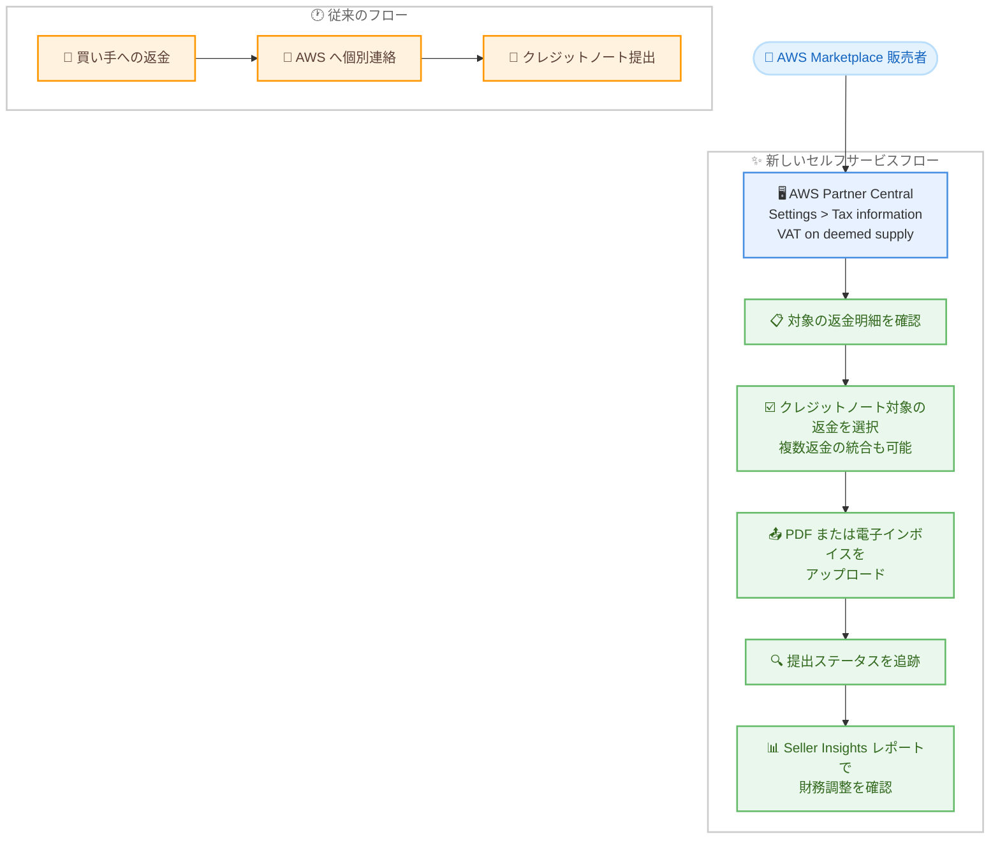

# AWS Marketplace - みなし供給の返金に対する VAT クレジットノートのセルフサービス提出

**リリース日**: 2026 年 11 月 13 日
**サービス**: AWS Marketplace
**機能**: VAT credit notes for deemed supply refunds

📊 [このアップデートのインフォグラフィックを見る](https://takech9203.github.io/aws-news-summary/20261113-aws-marketplace-vat-credit-notes.html)

## 概要

AWS Marketplace は、返金されたみなし供給 (deemed supply) 取引に対する VAT クレジットノートを、AWS Partner Central のセルフサービスで提出できる機能を発表しました。みなし供給とは、AWS Marketplace が税務上の販売者とみなされる取引形態で、EU 加盟国、ノルウェー、英国などの対象国では、販売者と AWS Marketplace の間で VAT (付加価値税) の精算が発生します。

買い手への返金が行われた場合、すでに支払われた VAT を調整するために販売者はクレジットノートを AWS に提出する必要があります。今回のアップデートにより、この提出プロセスが Partner Central 上で完結するセルフサービス方式になり、提出ステータスの追跡や Seller Insights レポートでの財務調整の確認も可能になりました。CPPO (Channel Partner Private Offer) 取引を含む対象取引がサポートされます。

**アップデート前の課題**

- 買い手への返金後、販売者は AWS に個別に連絡してクレジットノートを提出する必要があった
- 提出プロセスが手動のやり取りに依存し、ステータスの可視性が低かった
- 返金ごとの個別対応が必要で、複数返金の一括処理ができなかった

**アップデート後の改善**

- Partner Central の VAT on deemed supply セクションで、対象の返金明細をセルフサービスで確認・選択できるようになった
- PDF または該当する電子インボイス形式をアップロードし、提出ステータスを追跡できるようになった
- 複数の対象返金を 1 つのクレジットノートに統合できるようになった
- 関連する財務調整を Seller Insights レポートで確認できるようになった

## アーキテクチャ図



従来は AWS への個別連絡が必要だったクレジットノート提出が、Partner Central 上のセルフサービスフローで完結するようになりました。

## サービスアップデートの詳細

### 主要機能

1. **対象返金明細のセルフサービス確認**
   - Partner Central の VAT on deemed supply セクションで、クレジットノート提出の対象となる返金明細を一覧表示
   - クレジットノートでカバーする返金を販売者自身が選択可能
   - CPPO 取引を含む対象取引に対応

2. **クレジットノートのアップロードとステータス追跡**
   - PDF または該当国の電子インボイス形式でクレジットノートをアップロード
   - 提出後のステータスを Partner Central 上で追跡可能
   - 国ごとのインボイス要件および電子インボイス要件は引き続き適用される

3. **複数返金の統合提出**
   - 該当する場合、複数の対象返金を 1 つのクレジットノートに統合して提出可能
   - 返金ごとに個別のクレジットノートを作成する手間を削減

4. **Seller Insights レポートとの連携**
   - クレジットノート提出に伴う財務調整を Seller Insights レポートで確認可能
   - 税務・経理チームによる照合作業を効率化

## 技術仕様

### 機能の詳細

| 項目 | 詳細 |
|------|------|
| 提出場所 | AWS Partner Central > Settings > Tax information > VAT on deemed supply |
| 対象取引 | みなし供給の返金取引 (CPPO 取引を含む) |
| 対応ファイル形式 | PDF または該当国の電子インボイス形式 |
| 複数返金の統合 | 対象となる複数の返金を 1 つのクレジットノートに統合可能 |
| ステータス追跡 | Partner Central 上で提出ステータスを確認可能 |
| 財務調整の確認 | Seller Insights レポート |
| 対象国 | 対応する EU 加盟国、ノルウェー、英国 |

## 設定方法

### 前提条件

1. AWS Marketplace の販売者として登録済みであること
2. AWS Partner Central へのアクセス権限があること
3. みなし供給の対象国 (EU 加盟国、ノルウェー、英国) での返金済み取引が存在すること

### 手順

#### ステップ 1: VAT on deemed supply セクションへ移動

AWS Partner Central にサインインし、Settings > Tax information > VAT on deemed supply に移動します。ここでみなし供給に関する VAT 情報とクレジットノート提出機能にアクセスできます。

#### ステップ 2: 対象の返金明細を確認・選択

VAT on deemed supply セクションで、クレジットノート提出の対象となる返金明細を確認します。クレジットノートでカバーする返金を選択します。複数の対象返金がある場合は、1 つのクレジットノートに統合することもできます。

#### ステップ 3: クレジットノートをアップロード

PDF または該当国の電子インボイス形式でクレジットノートをアップロードします。国ごとのインボイス要件に準拠したフォーマットを使用してください。

#### ステップ 4: 提出ステータスと財務調整を確認

提出後、Partner Central 上でステータスを追跡します。提出が処理されると、関連する財務調整を Seller Insights レポートで確認できます。

## メリット

### ビジネス面

- **業務効率の向上**: AWS への個別連絡が不要になり、返金に伴う税務処理のリードタイムを短縮できる
- **コンプライアンスの確保**: 返金済みみなし供給取引の VAT 調整を適時に実施でき、各国の税務要件への準拠を維持しやすくなる
- **財務の透明性**: Seller Insights レポートで財務調整を確認でき、経理・税務チームの照合作業が容易になる

### 技術面

- **セルフサービス化**: 対象返金の確認からクレジットノート提出、ステータス追跡まで Partner Central 上で完結する
- **一括処理**: 複数の返金を 1 つのクレジットノートに統合でき、提出作業を削減できる
- **電子インボイス対応**: PDF に加えて該当国の電子インボイス形式をサポートし、各国の電子インボイス義務化に対応できる

## デメリット・制約事項

### 制限事項

- 対象は、対応する EU 加盟国、ノルウェー、英国におけるみなし供給の返金取引に限定される
- 国ごとのインボイス要件および電子インボイス要件は引き続き適用され、販売者側で準拠したフォーマットを用意する必要がある
- 日本を含む上記以外の国・地域のみなし供給取引は本機能の対象外

### 考慮すべき点

- クレジットノートの内容 (金額、税率、記載事項) は各国の VAT 規則に準拠している必要があるため、税務担当者との連携が推奨される
- 既存の運用で AWS への連絡ベースの提出フローを使用している場合は、新しいセルフサービスフローへの移行を検討する

## ユースケース

### ユースケース 1: EU 域内の買い手への返金に伴う VAT 調整

**シナリオ**: ISV がドイツの買い手に販売した SaaS 製品について返金が発生し、すでに精算済みの VAT を調整する必要がある。

**実装例**:
```
1. Partner Central > Settings > Tax information > VAT on deemed supply を開く
2. 対象の返金明細を確認し、クレジットノート対象として選択
3. ドイツの要件に準拠したクレジットノート PDF をアップロード
4. 提出ステータスを追跡し、Seller Insights で財務調整を確認
```

**効果**: AWS への個別連絡なしで VAT 調整が完結し、処理時間と運用負荷を削減できる。

### ユースケース 2: 複数返金の一括クレジットノート提出

**シナリオ**: 月次で複数の返金が発生した販売者が、同一買い手に対する複数の返金をまとめて処理したい。

**実装例**:
```
1. VAT on deemed supply セクションで当月の対象返金明細を一覧表示
2. 統合可能な複数の返金を選択し、1 つのクレジットノートに統合
3. 統合したクレジットノートをアップロードして提出
```

**効果**: 返金ごとの個別提出が不要になり、月次の税務処理工数を削減できる。

### ユースケース 3: CPPO 取引の返金処理

**シナリオ**: チャネルパートナーを経由した CPPO 取引で英国の買い手への返金が発生し、VAT クレジットノートの提出が必要になった。

**実装例**:
```
1. VAT on deemed supply セクションで CPPO 取引の返金明細を確認
2. 英国の電子インボイス要件に該当する場合は、対応フォーマットでアップロード
3. 提出ステータスを追跡
```

**効果**: CPPO のような複雑な取引形態でも、直接販売と同じセルフサービスフローで VAT 調整を完了できる。

## 料金

本機能の利用に追加料金は発生しません。AWS Marketplace の標準的な販売者向け料金体系が適用されます。

## 利用可能リージョン

対応する EU 加盟国、ノルウェー、英国におけるみなし供給の対象取引で利用可能です。本機能は AWS Partner Central を通じて提供されます。

## 関連サービス・機能

- **AWS Partner Central**: 販売者向けのポータル。本機能の提出フローは Partner Central の Tax information 設定内で提供される
- **AWS Marketplace Seller Insights**: 販売データや財務データのレポート機能。クレジットノート提出に伴う財務調整を確認できる
- **Channel Partner Private Offer (CPPO)**: チャネルパートナー経由のプライベートオファー。本機能の対象取引に含まれる

## 参考リンク

- 📊 [インフォグラフィック](https://takech9203.github.io/aws-news-summary/20261113-aws-marketplace-vat-credit-notes.html)
- [公式発表 (What's New)](https://aws.amazon.com/about-aws/whats-new/2026/11/aws-marketplace-vat-credit-notes/)
- [ドキュメント: VAT on deemed supply](https://docs.aws.amazon.com/marketplace/latest/userguide/vat-on-deemed-supply.html)
- [ドキュメント: Deemed Supply FAQs](https://docs.aws.amazon.com/marketplace/latest/userguide/vat-deemed-supply-faq.html)

## まとめ

今回のアップデートにより、EU 加盟国、ノルウェー、英国でのみなし供給返金に伴う VAT クレジットノート提出が、AWS Partner Central のセルフサービスで完結するようになりました。対象国で AWS Marketplace 販売を行う販売者は、Partner Central の Settings > Tax information > VAT on deemed supply から新しいフローを確認し、税務・経理チームと連携して運用プロセスへの組み込みを検討することを推奨します。
