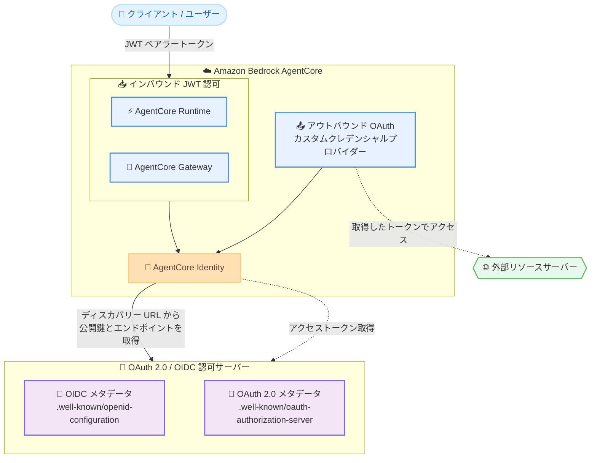

# Amazon Bedrock AgentCore Identity - OAuth 2.0 ディスカバリー URL のサポート

**リリース日**: 2026 年 11 月 13 日
**サービス**: Amazon Bedrock AgentCore Identity
**機能**: OAuth 2.0 認可サーバーディスカバリー URL (RFC 8414) のサポート

📊 [このアップデートのインフォグラフィックを見る](https://takech9203.github.io/aws-news-summary/20261113-bedrock-agentcore-oauth2-discovery.html)

## 概要

Amazon Bedrock AgentCore Identity が、OAuth 2.0 認可サーバーディスカバリー URL をサポートしました。対象はインバウンド JWT 認可 (AgentCore Runtime / Gateway への受信リクエストの認証・認可) とアウトバウンド OAuth クレデンシャルプロバイダー (エージェントが外部リソースサーバーへアクセスするためのトークン取得) の 2 つのユースケースです。JWT オーソライザーやカスタム OAuth クレデンシャルプロバイダーを設定する際に、OpenID Connect (OIDC) のディスカバリー URL と OAuth 2.0 Authorization Server Metadata (RFC 8414) のディスカバリー URL のいずれも指定できるようになりました。

従来、AgentCore Identity は OIDC ディスカバリー URL (`/.well-known/openid-configuration`) のみを受け付けていました。OIDC を使用しない純粋な OAuth 2.0 認可サーバーはメタデータを別の well-known パス (`/.well-known/oauth-authorization-server`) で公開するため、AgentCore と組み合わせて利用できませんでした。今回のアップデートにより、OIDC 非対応の社内認可サーバーや OAuth 2.0 のみを実装するサードパーティー IdP とも、エンドポイントの自動ディスカバリーを使った連携が可能になります。

**アップデート前の課題**

- AgentCore Identity は OIDC ディスカバリー URL のみを受け付けており、OIDC を実装しない OAuth 2.0 認可サーバーは利用できなかった
- OAuth 2.0 のみの認可サーバーはメタデータを `/.well-known/oauth-authorization-server` という別のパスで公開するため、ディスカバリー URL の検証でエラーになった
- OIDC 非対応の IdP と連携するには、IdP 側に OIDC 対応を追加するなどの回避策が必要だった

**アップデート後の改善**

- JWT オーソライザーの設定時に OIDC / OAuth 2.0 いずれのディスカバリー URL も指定可能になった
- カスタム OAuth クレデンシャルプロバイダーの設定時も同様に両形式のディスカバリー URL を指定可能になった
- OIDC を使用しない OAuth 2.0 認可サーバーでも、エンドポイント情報の自動取得による簡素な設定が可能になった

## アーキテクチャ図



AgentCore Identity は、設定されたディスカバリー URL (OIDC または OAuth 2.0) から公開鍵や認可サーバーのエンドポイント情報を自動取得し、インバウンドの JWT 検証とアウトバウンドのトークン取得の両方で利用します。

## サービスアップデートの詳細

### 主要機能

1. **インバウンド JWT 認可での OAuth 2.0 ディスカバリー URL サポート**
   - AgentCore Runtime / Gateway の JWT オーソライザー (`CustomJWTAuthorizerConfiguration`) の `discoveryUrl` に、OIDC 形式に加えて OAuth 2.0 Authorization Server Metadata (RFC 8414) 形式の URL を指定可能
   - 受信リクエストの JWT 検証時に、ディスカバリー URL から公開鍵 (JWKS) と認可サーバーエンドポイントを自動取得
   - IdP 非依存の設計で、OAuth 2.0 互換の任意の IdP と連携可能

2. **アウトバウンドカスタム OAuth クレデンシャルプロバイダーでのサポート**
   - カスタムプロバイダーの「Discovery URL」設定で、`/.well-known/openid-configuration` と `/.well-known/oauth-authorization-server` のいずれのパスも受け付け
   - エンドポイント情報を自動取得するため、issuer、認可エンドポイント、トークンエンドポイントを個別に手動設定する必要がない
   - 自動ディスカバリーが利用できないプロバイダー向けには、従来どおり手動設定 (Manual config) も選択可能

3. **OIDC 非対応の認可サーバーとの連携**
   - OIDC を実装しない純粋な OAuth 2.0 認可サーバー (社内認可基盤やサードパーティー製品) をそのまま利用可能
   - IdP 側に OIDC 対応を追加する改修が不要

## 技術仕様

### ディスカバリー URL の形式

| 項目 | 詳細 |
|------|------|
| OIDC ディスカバリー URL | `https://{issuer}/.well-known/openid-configuration` |
| OAuth 2.0 ディスカバリー URL | `https://{issuer}/.well-known/oauth-authorization-server` (RFC 8414) |
| JWT オーソライザーの URL パターン | `^[^\s?#]+/\.well-known/(openid-configuration\|oauth-authorization-server)(/[^\s?#]+)?$` |
| 対象ユースケース | インバウンド JWT 認可 (Runtime / Gateway)、アウトバウンド OAuth クレデンシャルプロバイダー |

### JWT オーソライザーの検証項目

| 検証項目 | 内容 |
|----------|------|
| Allowed audiences | JWT の `aud` クレームと照合する許可オーディエンスのリスト |
| Allowed clients | JWT の `client_id` クレームと照合する許可クライアント ID のリスト |
| Allowed scopes | 許可スコープのリスト。トークン内のスコープのうち少なくとも 1 つが一致する必要がある |
| Required custom claims | カスタムクレームの名前・型・一致条件 (EQUALS / CONTAINS / CONTAINS_ANY) を指定する検証ルール |

JWT オーソライザーの設定では、allowed audiences、allowed clients、allowed scopes、required custom claims のうち少なくとも 1 つの指定が必要です。複数指定した場合はすべてが検証されます。

### JWT オーソライザー設定例

```json
{
  "customJWTAuthorizer": {
    "discoveryUrl": "https://auth.example.com/.well-known/oauth-authorization-server",
    "allowedClients": ["my-agent-client-id"],
    "allowedScopes": ["agent:invoke"]
  }
}
```

## 設定方法

### 前提条件

1. Amazon Bedrock AgentCore が利用可能なリージョンを使用していること
2. 連携する認可サーバーが OIDC または OAuth 2.0 (RFC 8414) のメタデータを well-known パスで公開していること
3. アウトバウンド認証の場合、認可サーバーでクライアント登録を行い、クライアント ID (必要に応じてクライアントシークレット) を取得済みであること

### 手順

#### ステップ 1: 認可サーバーのディスカバリー URL を確認する

```bash
# OAuth 2.0 認可サーバーメタデータの取得例
curl -s https://auth.example.com/.well-known/oauth-authorization-server
```

認可サーバーのメタデータが取得できることを確認します。OIDC 対応サーバーの場合は `/.well-known/openid-configuration` を使用します。レスポンスには issuer、トークンエンドポイント、JWKS URI などのエンドポイント情報が含まれます。

#### ステップ 2: インバウンド JWT オーソライザーを設定する

```bash
aws bedrock-agentcore-control create-agent-runtime \
  --agent-runtime-name my-agent \
  --agent-runtime-artifact '{"containerConfiguration": {"containerUri": "<ECR イメージ URI>"}}' \
  --role-arn arn:aws:iam::123456789012:role/AgentCoreRuntimeRole \
  --network-configuration '{"networkMode": "PUBLIC"}' \
  --authorizer-configuration '{
    "customJWTAuthorizer": {
      "discoveryUrl": "https://auth.example.com/.well-known/oauth-authorization-server",
      "allowedClients": ["my-agent-client-id"]
    }
  }'
```

AgentCore Runtime の作成時に、OAuth 2.0 ディスカバリー URL を指定した JWT オーソライザーを設定しています。AgentCore Gateway の場合は `create-gateway` コマンドで同じ `customJWTAuthorizer` 構成を指定します。

#### ステップ 3: アウトバウンドのカスタム OAuth クレデンシャルプロバイダーを設定する

AgentCore Identity コンソールの「Outbound Auth」セクションで「Add OAuth client」を選択し、以下を設定します。

1. Provider で「Custom provider」を選択
2. Provider configurations で「Discovery URL」を選択し、OIDC または OAuth 2.0 のディスカバリー URL を入力
3. クライアント認証方式、クライアント ID、クライアントシークレット (または Secrets Manager の ARN) を設定
4. 「Add OAuth Client」を選択して作成

作成後に発行される ARN をエージェントコードから参照することで、認証情報をアプリケーションに埋め込まずにトークンを取得できます。

## メリット

### ビジネス面

- **既存認可基盤の活用**: OIDC 非対応の社内 OAuth 2.0 認可サーバーをそのまま利用でき、IdP 側の改修コストが不要
- **導入障壁の低減**: 利用中の IdP の仕様に合わせて AgentCore を柔軟に導入でき、エージェント活用の展開を加速できる
- **追加コストなし**: 追加料金なしで利用可能

### 技術面

- **標準準拠**: RFC 8414 (OAuth 2.0 Authorization Server Metadata) に準拠したディスカバリーに対応し、幅広い IdP と相互運用可能
- **設定の簡素化**: ディスカバリー URL の指定だけでエンドポイント情報を自動取得でき、手動でのエンドポイント個別設定が不要
- **インバウンド / アウトバウンド両対応**: JWT 検証とトークン取得の両ユースケースで同じディスカバリー方式を利用可能

## デメリット・制約事項

### 制限事項

- ディスカバリー URL は `/.well-known/openid-configuration` または `/.well-known/oauth-authorization-server` を含む形式である必要がある
- インバウンド JWT オーソライザーでは、allowed audiences、allowed clients、allowed scopes、required custom claims のうち少なくとも 1 つの指定が必須
- 自動ディスカバリーに対応していない認可サーバーの場合は、手動設定でエンドポイントを個別に指定する必要がある

### 考慮すべき点

- 認可サーバーが公開するメタデータの内容 (JWKS URI、トークンエンドポイントなど) が正しく設定されていることを事前に確認する必要がある
- VPC 内にホストされたプライベート IdP と連携する場合は、プライベートエンドポイント設定 (Managed VPC または Self-managed Lattice) の構成が別途必要
- プライベート CA 発行の TLS 証明書を使用する IdP の場合は、ルート CA 証明書の設定が必要

## ユースケース

### ユースケース 1: 社内 OAuth 2.0 認可基盤によるエージェント API の保護

**シナリオ**: OIDC を実装していない社内標準の OAuth 2.0 認可サーバーを使用して、AgentCore Runtime 上のエージェントへのアクセスを制御したい。

**実装例**:
```json
{
  "customJWTAuthorizer": {
    "discoveryUrl": "https://internal-auth.example.co.jp/.well-known/oauth-authorization-server",
    "allowedAudiences": ["agentcore-runtime"],
    "allowedScopes": ["agent:invoke"]
  }
}
```

**効果**: 社内認可基盤を改修することなく、発行された JWT によるエージェントへのアクセス制御を実現できる。

### ユースケース 2: OAuth 2.0 のみ対応のサードパーティー API への安全なアクセス

**シナリオ**: エージェントから、OIDC 非対応で OAuth 2.0 のみを実装するサードパーティーのリソースサーバー API にアクセスしたい。

**実装例**:
```
AgentCore Identity コンソール > Outbound Auth > Add OAuth client
- Provider: Custom provider
- Discovery URL: https://partner-api.example.com/.well-known/oauth-authorization-server
- Client ID / Client secret: パートナー発行の値を設定
```

**効果**: エンドポイントの手動設定なしでクレデンシャルプロバイダーを構成でき、認証情報をコードに埋め込まずにトークンを取得できる。

### ユースケース 3: 複数 IdP が混在する環境での Gateway 統合

**シナリオ**: OIDC 対応の IdP と OAuth 2.0 のみの IdP が混在する組織で、AgentCore Gateway 経由のツールアクセスを各チームの IdP で認可したい。

**実装例**:
```bash
# チーム A 向け Gateway は OIDC ディスカバリー URL を使用
# チーム B 向け Gateway は OAuth 2.0 ディスカバリー URL を使用
aws bedrock-agentcore-control create-gateway \
  --name team-b-gateway \
  --authorizer-type CUSTOM_JWT \
  --authorizer-configuration '{
    "customJWTAuthorizer": {
      "discoveryUrl": "https://team-b-auth.example.com/.well-known/oauth-authorization-server",
      "allowedClients": ["team-b-client"]
    }
  }' \
  --protocol-type MCP \
  --role-arn arn:aws:iam::123456789012:role/GatewayRole
```

**効果**: IdP の種類を問わず同一の設定モデルで Gateway の認可を構成でき、マルチチーム環境での運用を統一できる。

## 料金

本機能は追加料金なしで利用できます。Amazon Bedrock AgentCore 自体の利用料金は従量課金で発生します。詳細は [Amazon Bedrock AgentCore の料金ページ](https://aws.amazon.com/bedrock/agentcore/pricing/) を参照してください。

## 利用可能リージョン

Amazon Bedrock AgentCore が利用可能なすべての AWS リージョンで利用できます。

## 関連サービス・機能

- **Amazon Bedrock AgentCore Runtime**: エージェントの実行環境。インバウンド JWT オーソライザーでアクセスを保護する対象
- **Amazon Bedrock AgentCore Gateway**: ツールやリソースへのゲートウェイ。Runtime と同じ JWT オーソライザー構成を使用
- **AWS Secrets Manager**: アウトバウンド OAuth クライアントのクライアントシークレットを安全に参照する際に使用
- **Amazon Cognito**: OIDC 対応のマネージド IdP。ビルトインプロバイダーとしても利用可能

## 参考リンク

- 📊 [インフォグラフィック](https://takech9203.github.io/aws-news-summary/20261113-bedrock-agentcore-oauth2-discovery.html)
- [公式発表 (What's New)](https://aws.amazon.com/about-aws/whats-new/2026/11/bedrock-agentcore-oauth2-discovery/)
- [ドキュメント: Configure inbound JWT authorizer](https://docs.aws.amazon.com/bedrock-agentcore/latest/devguide/inbound-jwt-authorizer.html)
- [ドキュメント: Add OAuth client using custom provider](https://docs.aws.amazon.com/bedrock-agentcore/latest/devguide/identity-add-oauth-client-custom.html)
- [料金ページ](https://aws.amazon.com/bedrock/agentcore/pricing/)

## まとめ

Amazon Bedrock AgentCore Identity が OAuth 2.0 認可サーバーディスカバリー URL (RFC 8414) に対応し、OIDC を実装しない認可サーバーともインバウンド JWT 認可・アウトバウンド OAuth の両方で連携できるようになりました。OIDC 非対応の社内認可基盤やサードパーティー IdP を利用している場合は、JWT オーソライザーやカスタムクレデンシャルプロバイダーの設定で OAuth 2.0 ディスカバリー URL の利用を検討してください。
