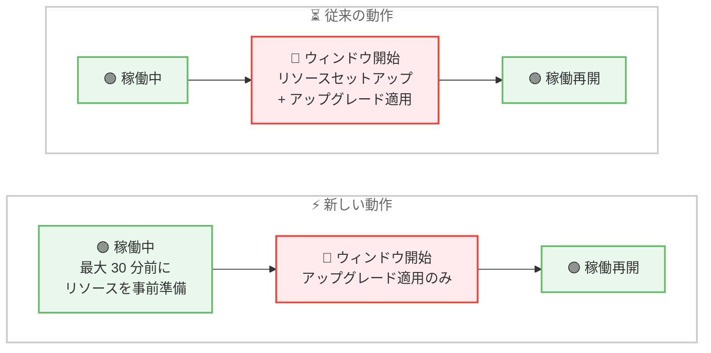

# Amazon RDS for Oracle - 自動マイナーバージョンアップグレードとスケジュールされたメンテナンスのダウンタイム短縮

**リリース日**: 2026 年 11 月 13 日
**サービス**: Amazon RDS for Oracle
**機能**: メンテナンス準備 (Maintenance Preparation) によるダウンタイム短縮

📊 [このアップデートのインフォグラフィックを見る](https://takech9203.github.io/aws-news-summary/20261113-rds-oracle-reduces-maintenance-downtime-for-amvu-scheduled-upgrades.html)

## 概要

Amazon RDS for Oracle が、自動マイナーバージョンアップグレード (AMVU) と、メンテナンスウィンドウ内で実行されるマイナーバージョンアップグレードおよび OS 更新のダウンタイムを短縮しました。マイナーバージョンアップグレードや OS 更新の適用には新しいリソースのプロビジョニングが必要ですが、従来はメンテナンス開始後にこのセットアップが行われるため停止時間が長くなっていました。

今回のアップデートにより、Amazon RDS はメンテナンスウィンドウの最大 30 分前にリソースの準備 (ステージング) を開始します。準備中も DB インスタンスは `available` ステータスを維持してトラフィックを処理し続けるため、ウィンドウが開いたときのオフライン時間が短縮されます。この改善は Enterprise Edition と Standard Edition 2 の両方に適用され、AMVU を有効にしているインスタンスでは追加の操作なしで自動的に恩恵を受けられます。

準備処理はユーザーの操作をブロックしません。ユーザーの変更が準備と競合した場合はステージング済みリソースを破棄してユーザーの変更を優先し、準備が完了しなかった場合も従来どおりメンテナンスウィンドウ内でメンテナンスが実行されます。準備の開始・完了・失敗を通知する新しい RDS イベントも追加されました。

**アップデート前の課題**

- メンテナンスに必要なリソースのセットアップがメンテナンス開始後に行われるため、ダウンタイムが長くなっていた
- マイナーバージョンアップグレードや OS 更新のたびに、リソースプロビジョニングを含む時間がそのまま停止時間に含まれていた
- ダウンタイムを短縮するには Oracle レプリカを利用した手動の切り替えなど、追加の運用作業が必要だった

**アップデート後の改善**

- メンテナンスウィンドウの最大 30 分前にリソースが事前ステージングされ、ウィンドウ開始後のオフライン時間が短縮された
- AMVU を有効にしているインスタンスは、追加設定なしで自動的にダウンタイム短縮の恩恵を受けられるようになった
- 準備の開始・完了・失敗・ロールバックを RDS イベントで把握できるようになり、メンテナンスの可観測性が向上した

## アーキテクチャ図



従来はメンテナンスウィンドウ開始後にリソースのセットアップが行われていましたが、新しい動作ではウィンドウの最大 30 分前に DB インスタンスを稼働させたまま準備が行われるため、オフライン時間が短縮されます。

## サービスアップデートの詳細

### 主要機能

1. **メンテナンスリソースの事前ステージング**
   - メンテナンスウィンドウの最大 30 分前に、ダウンタイムを必要としない準備作業を実行する
   - 準備中も DB インスタンスのステータスは `available` のまま、接続と API リクエストを通常どおり受け付ける
   - ステージングされたリソースに対する課金は発生しない

2. **対象となるメンテナンス**
   - マイナーバージョンアップグレード (AMVU によりスケジュールされたアップグレードを含む)
   - `system-update` メンテナンスアクションを使用する OS 更新
   - いずれもメンテナンスウィンドウ内で適用される場合のみ準備が行われる

3. **ユーザー操作を優先する安全設計**
   - 準備処理がユーザーの操作をブロック・遅延させることはない
   - DB インスタンスへの操作が準備と競合した場合、RDS はステージング済みリソースをロールバックし、ユーザーの操作を続行する
   - 準備が完了できなかった場合でも、メンテナンスはウィンドウ内で (準備なしで) 実行される

4. **メンテナンス準備イベントの追加**
   - 準備の開始・完了・失敗・ロールバックを通知する 4 つの RDS イベントが追加された
   - ソースタイプは DB インスタンス、カテゴリは `maintenance`

## 技術仕様

### メンテナンス準備の動作

| 項目 | 詳細 |
|------|------|
| 準備開始タイミング | メンテナンスウィンドウの最大 30 分前 |
| 準備中のインスタンス状態 | `available` (接続・API リクエストを通常どおり受け付け) |
| 対象メンテナンス | マイナーバージョンアップグレード、OS 更新 (`system-update`) |
| 対象外 | リードレプリカ、メジャーバージョンアップグレード、即時適用 (apply immediately) の更新 |
| 準備失敗時の動作 | 準備なしでメンテナンスをウィンドウ内に実行 |
| 競合時の動作 | ステージング済みリソースをロールバックし、ユーザー操作を優先 |
| 追加料金 | なし (ステージングされたリソースへの課金なし) |
| 対象エディション | Enterprise Edition、Standard Edition 2 |

### メンテナンス準備イベント

| イベント ID | 内容 |
|------------|------|
| RDS-EVENT-0624 | メンテナンスのためのリソース準備を開始した |
| RDS-EVENT-0625 | メンテナンスのためのリソースをステージングした |
| RDS-EVENT-0626 | リソースをステージングできなかった。準備なしでメンテナンスを適用する |
| RDS-EVENT-0627 | DB インスタンスへの操作が準備と競合したため、ステージング済みリソースをロールバックした |

これらのイベントを受け取るには、`maintenance` カテゴリのイベント通知をサブスクライブします。

## 設定方法

### 前提条件

1. RDS for Oracle の DB インスタンス (Enterprise Edition または Standard Edition 2) を利用していること
2. マイナーバージョンアップグレードまたは OS 更新をメンテナンスウィンドウ内で適用すること (即時適用は対象外)
3. 準備イベントを受け取る場合は、RDS イベント通知のサブスクリプションを設定すること

### 手順

本機能は自動的に有効化されるため、ユーザー側での有効化操作は不要です。以下は AMVU の有効化とイベント通知の設定例です。

#### ステップ 1: 自動マイナーバージョンアップグレードの有効化

```bash
aws rds modify-db-instance \
  --db-instance-identifier my-oracle-instance \
  --auto-minor-version-upgrade \
  --apply-immediately
```

DB インスタンスの自動マイナーバージョンアップグレード (AMVU) を有効化します。AMVU が有効なインスタンスは、スケジュールされたアップグレード時に自動的にメンテナンス準備の恩恵を受けられます。

#### ステップ 2: メンテナンスウィンドウの確認

```bash
aws rds describe-db-instances \
  --db-instance-identifier my-oracle-instance \
  --query "DBInstances[0].PreferredMaintenanceWindow"
```

現在設定されているメンテナンスウィンドウを確認します。準備処理はこのウィンドウの最大 30 分前に開始されるため、ウィンドウ直前の変更操作を避ける計画に役立ちます。

#### ステップ 3: メンテナンスイベント通知のサブスクライブ

```bash
aws rds create-event-subscription \
  --subscription-name oracle-maintenance-events \
  --sns-topic-arn arn:aws:sns:ap-northeast-1:123456789012:rds-maintenance \
  --source-type db-instance \
  --event-categories maintenance
```

`maintenance` カテゴリのイベントサブスクリプションを作成し、準備の開始 (RDS-EVENT-0624)、完了 (0625)、失敗 (0626)、ロールバック (0627) を SNS 経由で受け取れるようにします。

## メリット

### ビジネス面

- **サービス停止時間の短縮**: メンテナンスによるオフライン時間が短縮され、アプリケーションの可用性が向上する
- **追加コストなし**: 事前ステージングされるリソースに課金は発生せず、無料でダウンタイム短縮の恩恵を受けられる
- **運用負荷の軽減**: ユーザー側の設定変更は不要で、AMVU を有効にしているだけで自動的に適用される

### 技術面

- **非ブロッキングな準備処理**: 準備中も DB インスタンスは通常どおり稼働し、ユーザーの操作が優先される
- **フェイルセーフな設計**: 準備が失敗してもメンテナンス自体は従来どおり実行されるため、メンテナンスの確実性は損なわれない
- **可観測性の向上**: 新しい RDS イベントにより、準備の進行状況や失敗を監視・自動化に組み込める

## デメリット・制約事項

### 制限事項

- リードレプリカは準備の対象外
- メジャーバージョンアップグレードは対象外
- 即時適用 (apply immediately) したアップグレード・更新は対象外 (メンテナンスウィンドウ内で適用される場合のみ準備が行われる)

### 考慮すべき点

- メンテナンスウィンドウ開始前の 30 分間に DB インスタンスへ不要な変更を行うと、準備と競合してロールバックが発生し、ダウンタイム短縮の効果が得られない可能性がある
- 競合によるロールバックがメンテナンスウィンドウ中に発生した場合、準備なしの場合よりもメンテナンスが長くかかることがある
- ダウンタイムが「短縮」されるものであり、ゼロダウンタイムになるわけではない

## ユースケース

### ユースケース 1: AMVU によるパッチ適用の停止時間最小化

**シナリオ**: 基幹業務システムの RDS for Oracle で AMVU を有効にしており、セキュリティパッチを含むマイナーバージョンを自動適用しているが、適用時の停止時間を可能な限り短くしたい。

**実装例**:
```bash
aws rds modify-db-instance \
  --db-instance-identifier prod-oracle \
  --auto-minor-version-upgrade
```

**効果**: AMVU によりスケジュールされたアップグレードが事前ステージングの対象となり、追加作業なしでメンテナンス時の停止時間が短縮される。

### ユースケース 2: メンテナンス準備状況の監視と自動化

**シナリオ**: 運用チームがメンテナンスの準備状況を把握し、準備に失敗した場合 (RDS-EVENT-0626) はウィンドウ中の停止時間が長くなる可能性を事前に関係者へ通知したい。

**実装例**:
```bash
aws rds create-event-subscription \
  --subscription-name oracle-prep-monitoring \
  --sns-topic-arn arn:aws:sns:ap-northeast-1:123456789012:ops-alerts \
  --source-type db-instance \
  --source-ids prod-oracle \
  --event-categories maintenance
```

**効果**: 準備の開始・完了・失敗をリアルタイムで検知し、SNS から Slack や運用ツールへ連携することで、メンテナンス当日の影響予測と関係者への事前連絡が可能になる。

### ユースケース 3: OS 更新のダウンタイム短縮

**シナリオ**: `system-update` メンテナンスアクションが保留中の RDS for Oracle インスタンスについて、メンテナンスウィンドウ内での適用を計画している。

**実装例**:
```bash
aws rds describe-pending-maintenance-actions \
  --resource-identifier arn:aws:rds:ap-northeast-1:123456789012:db:prod-oracle
```

**効果**: 保留中の OS 更新をメンテナンスウィンドウ内で適用するよう計画すれば、事前ステージングによりウィンドウ中のオフライン時間が短縮される。即時適用では準備が行われない点に注意する。

## 料金

追加料金なしで利用できます。準備のためにステージングされるリソースに対して課金は発生しません。

## 利用可能リージョン

Amazon RDS for Oracle が提供されているすべての AWS 商用リージョンおよび AWS GovCloud (US) リージョンで利用可能です。

## 関連サービス・機能

- **Amazon RDS イベント通知**: メンテナンス準備の開始・完了・失敗を `maintenance` カテゴリのイベントとして通知する
- **Amazon SNS**: RDS イベントの通知先として利用し、運用チームへのアラートや自動化のトリガーに活用できる
- **Amazon RDS Blue/Green Deployments**: メジャーバージョンアップグレードなど、本機能の対象外となる変更のダウンタイムを最小化する選択肢となる

## 参考リンク

- 📊 [インフォグラフィック](https://takech9203.github.io/aws-news-summary/20261113-rds-oracle-reduces-maintenance-downtime-for-amvu-scheduled-upgrades.html)
- [公式発表 (What's New)](https://aws.amazon.com/about-aws/whats-new/2026/11/rds-oracle-reduces-maintenance-downtime-for-amvu-scheduled-upgrades/)
- [ドキュメント: Maintenance preparation in RDS for Oracle](https://docs.aws.amazon.com/AmazonRDS/latest/UserGuide/maintenance-preparation.html)
- [ドキュメント: Maintaining a DB instance](https://docs.aws.amazon.com/AmazonRDS/latest/UserGuide/USER_UpgradeDBInstance.Maintenance.html)
- [ドキュメント: RDS event messages](https://docs.aws.amazon.com/AmazonRDS/latest/UserGuide/USER_Events.Messages.html)
- [Amazon RDS for Oracle 製品ページ](https://aws.amazon.com/rds/oracle/)

## まとめ

RDS for Oracle のマイナーバージョンアップグレードと OS 更新において、リソースの事前ステージングによりメンテナンス時のダウンタイムが短縮されました。ユーザー側の設定変更は不要で追加料金もかからないため、すべての RDS for Oracle 利用者が自動的に恩恵を受けられます。`maintenance` カテゴリのイベント通知をサブスクライブして準備状況を監視するとともに、メンテナンスウィンドウ開始前 30 分間は DB インスタンスへの不要な変更を避けることを推奨します。
