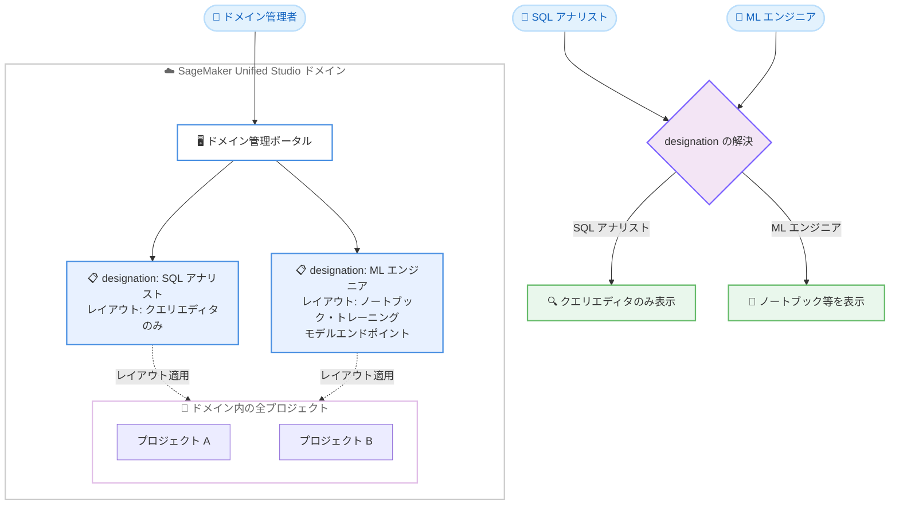

# Amazon SageMaker Unified Studio - Designation ごとのレイアウトカスタマイズ

**リリース日**: 2026 年 11 月 13 日
**サービス**: Amazon SageMaker Unified Studio
**機能**: Layout Customization for Designations

📊 [このアップデートのインフォグラフィックを見る](https://takech9203.github.io/aws-news-summary/20261113-sagemaker-studio-layout-customization.html)

## 概要

Amazon SageMaker Unified Studio が、designation (職務区分) ごとのレイアウトカスタマイズに対応しました。ドメイン管理者は、各プロジェクトメンバーの designation に基づいて、ポータルの左ナビゲーションに表示するツールやページを制御できるようになります。レイアウトは designation の定義内で一度設定するだけで、ドメイン内のすべてのプロジェクトに適用されるため、プロジェクトごとの個別設定は不要です。

designation は、プロジェクトレベルでメンバーが実行できるアクションを制御する名前付き権限セットで、AWS 管理の designation (Owner と Contributor) とドメイン管理者が作成するカスタム designation の 2 種類があります。今回のアップデートにより、権限制御に加えて、ユーザーインターフェースの表示内容もロールごとに最適化できるようになりました。例えば、SQL アナリスト向けの designation にはクエリエディタのみを表示し、ML エンジニア向けの designation にはノートブック、トレーニングジョブ、モデルエンドポイントを表示するといった使い分けが可能です。

データエンジニアリング、分析、機械学習など複数の職務が混在するチームで SageMaker Unified Studio を利用している組織にとって、ロールに応じたシンプルで混乱の少ないユーザー体験を提供できる重要なアップデートです。

**アップデート前の課題**

このアップデート以前には、以下の課題がありました。

- 役割に関係なく、すべてのプロジェクトメンバーが同一のインターフェースを見ており、自分の業務に不要なツールまで表示されていた
- 不要なツールの表示がユーザーの混乱を招き、ガバナンス上の懸念にもつながっていた
- ロールごとに表示を最適化する手段がなく、ユーザー教育やドキュメントで補う必要があった

**アップデート後の改善**

今回のアップデートにより、以下が可能になりました。

- ドメイン管理者が designation ごとに、表示するツールと左ナビゲーション項目を定義できるようになった
- レイアウトを designation 内で一度定義すれば、ドメイン内の全プロジェクトに自動適用され、プロジェクト単位の設定が不要になった
- メンバーがプロジェクトを開くと designation が解決され、そのレイアウトに含まれるツールのみが表示されるため、ロールに応じたシンプルな画面を提供できるようになった

## アーキテクチャ図



ドメイン管理者が designation ごとにレイアウトを一度定義すると、ドメイン内の全プロジェクトに適用されます。メンバーがプロジェクトを開くと designation が解決され、そのレイアウトに含まれるツールのみが左ナビゲーションに表示されます。

## サービスアップデートの詳細

### 主要機能

1. **designation ごとのレイアウトカスタマイズ**
   - 各 designation に最大 1 つのレイアウトカスタマイズを設定可能
   - AWS 管理の designation (Owner、Contributor) とカスタム designation の両方に設定可能
   - レイアウトは左ナビゲーションに表示するツールとページを制御する
   - 設定はドメイン管理ポータルでのみ可能 (API と AWS CLI は非対応)

2. **ドメインレベルでの一元管理**
   - designation の定義内でレイアウトを一度設定すると、ドメイン内のすべてのプロジェクトに適用される
   - プロジェクトごとの個別設定は不要で、運用負荷を削減できる
   - Data Analytics、AI/ML、Generative AI、IDE などのナビゲーションカテゴリを制御できる

3. **表示制御と権限制御の分離**
   - レイアウトカスタマイズはポータル上の表示のみを変更し、designation が定義する権限や API アクセスには影響しない
   - ツールを非表示にしてもナビゲーションから消えるだけで、designation が許可していれば API 経由でのアクションは引き続き実行可能
   - 非表示ページへ URL で直接アクセスすると、アクセス拒否ページが表示される

4. **複数 designation と新規ツールの扱い**
   - 複数の designation を持つメンバーには、すべての designation のレイアウトの和集合が表示される
   - レイアウトが設定された designation では、新しくリリースされたナビゲーション項目は、管理者が明示的に追加するまで非表示のまま維持される
   - レイアウトカスタマイズを設定していない designation では、後から追加される新しいナビゲーションリンクを含む、デフォルトの左ナビゲーション全体が表示される

## 技術仕様

### designation とレイアウトカスタマイズの仕様

| 項目 | 詳細 |
|------|------|
| designation の種類 | 管理 designation (Owner、Contributor)、カスタム designation |
| 権限定義 | Cedar ポリシー言語で定義された DataZone API アクションのセット |
| レイアウト数 | 1 designation につき最大 1 つ |
| 設定方法 | ドメイン管理ポータルのみ (API と AWS CLI は非対応) |
| 適用範囲 | ドメイン内のすべてのプロジェクト |
| 制御対象カテゴリ | Data Analytics、AI/ML、Generative AI、IDE などの左ナビゲーション項目 |
| 複数 designation 保持時 | すべてのレイアウトの和集合を表示 |
| 非表示ページへの直接アクセス | アクセス拒否ページを表示 |

### IAM との関係

designation は IAM と組み合わせた多層アクセス制御として機能します。

- IAM は AWS API 境界で DataZone や SageMaker のオペレーション呼び出し可否を評価する
- designation はプロジェクト内で、割り当てられた権限セットがアクションを許可するかを評価する
- アクションが成功するには両方のレイヤーで許可が必要で、IAM の Deny は designation の権限に関係なくアクションをブロックする
- designation の利用にあたり、既存の IAM ポリシーの変更は不要

## 設定方法

### 前提条件

1. Amazon SageMaker Unified Studio の V2 ドメインを利用していること (カスタム designation は V1 ドメイン非対応)
2. ドメイン管理者権限を持っていること
3. レイアウトを適用する designation (管理またはカスタム) が存在すること

### 手順

#### ステップ 1: ドメイン管理ポータルで designation を開く

Amazon SageMaker Unified Studio のドメイン管理ポータルにサインインし、designation の管理画面を開きます。レイアウトカスタマイズは API や AWS CLI では設定できないため、必ずポータルから操作します。

#### ステップ 2: designation にレイアウトカスタマイズを設定する

対象の designation を選択し、レイアウトカスタマイズの設定で、左ナビゲーションに表示するナビゲーション項目 (Data Analytics、AI/ML、Generative AI、IDE など) を選択します。例えば、SQL アナリスト向けの designation ではクエリエディタのみを選択します。

#### ステップ 3: プロジェクトメンバーに designation を割り当てる

プロジェクトオーナーが、各メンバー (IAM ロール、IAM ユーザー、SSO ユーザー、SSO グループ) に designation を割り当てます。メンバーがプロジェクトを開くと designation が解決され、設定したレイアウトに含まれるツールのみが表示されます。

## メリット

### ビジネス面

- **ユーザー体験の向上**: 各ロールに必要なツールだけが表示されるため、ユーザーの混乱が減り、オンボーディングも容易になる
- **ガバナンスの強化**: ロールに応じた画面を提供することで、不要なツールへの誤アクセスや混乱に起因するガバナンス上の懸念を低減できる
- **運用負荷の削減**: ドメインレベルで一度設定すれば全プロジェクトに適用されるため、プロジェクトごとの設定作業が不要になる

### 技術面

- **権限制御との分離**: 表示制御 (レイアウト) と権限制御 (Cedar ベースの permission set) が独立しており、UI の簡素化と API アクセスの柔軟性を両立できる
- **一貫性のある適用**: designation はドメインレベルで定義され、プロジェクト単位で割り当てられるため、組織全体で一貫した表示と権限の制御を実現できる
- **新機能の表示制御**: レイアウトを設定した designation では、新しくリリースされるナビゲーション項目が自動では表示されず、管理者が確認してから展開できる

## デメリット・制約事項

### 制限事項

- レイアウトカスタマイズの設定はドメイン管理ポータルのみで、API と AWS CLI では設定できない
- 各 designation に設定できるレイアウトカスタマイズは 1 つまで
- カスタム designation は V2 ドメインのプロジェクトでのみ利用可能 (V1 ドメイン非対応)
- ドメインの admin プロジェクトではカスタム designation を作成・割り当てできない

### 考慮すべき点

- レイアウトはあくまで表示のみの制御であり、権限制御ではない。ツールを非表示にしても、designation が許可していれば API 経由でアクションを実行できるため、アクセス制限が目的の場合は designation の権限設定や IAM で制御する必要がある
- 複数の designation を持つメンバーには和集合のレイアウトが表示されるため、グループ経由の designation 継承も含めて設計する必要がある
- レイアウトを設定した designation では、新しいナビゲーション項目が自動表示されないため、新機能リリース時に管理者による追加作業が必要になる

## ユースケース

### ユースケース 1: SQL アナリスト向けのシンプルな分析環境

**シナリオ**: データ分析チームの SQL アナリストは、クエリエディタでのデータ分析のみを行い、ML 関連のツールは使用しない。

**実装例**:
```text
1. カスタム designation「SQL Analyst」を作成し、クエリ実行に必要な権限を付与
2. レイアウトカスタマイズでクエリエディタのみを表示するよう設定
3. 分析チームの SSO グループに designation を割り当て
```

**効果**: アナリストにはクエリエディタだけが表示され、不要なツールによる混乱がなくなり、分析業務に集中できる。

### ユースケース 2: ML エンジニア向けのフル機能環境

**シナリオ**: ML エンジニアは、ノートブックでの開発、トレーニングジョブの実行、モデルエンドポイントの管理を日常的に行う。

**実装例**:
```text
1. カスタム designation「ML Engineer」を作成し、ML 関連の権限を付与
2. レイアウトカスタマイズでノートブック、トレーニングジョブ、
   モデルエンドポイントを表示するよう設定
3. ML チームのメンバーに designation を割り当て
```

**効果**: ML エンジニアには必要なツール一式が表示され、同じプロジェクト内でもロールごとに最適化された画面を提供できる。

### ユースケース 3: 大規模組織での全社標準レイアウトの展開

**シナリオ**: 数十のプロジェクトを運用する大規模組織で、職務ごとの標準的な画面構成を全プロジェクトに統一的に適用したい。

**実装例**:
```text
1. 職務ごとのカスタム designation (データエンジニア、アナリスト、
   ML エンジニアなど) をドメインレベルで定義
2. 各 designation にレイアウトカスタマイズを設定
3. 各プロジェクトのオーナーがメンバーに designation を割り当て
```

**効果**: ドメインレベルの一度の設定で全プロジェクトに標準レイアウトが適用され、プロジェクトごとの設定作業なしに一貫したユーザー体験とガバナンスを実現できる。

## 料金

レイアウトカスタマイズ機能自体に追加料金はありません。Amazon SageMaker Unified Studio の利用料金は、基盤となる各サービス (コンピューティング、ストレージなど) の使用量に基づいて課金されます。詳細は料金ページを参照してください。

## 利用可能リージョン

Amazon SageMaker Unified Studio が利用可能なすべての AWS リージョンで利用できます。対応リージョンの一覧は [サポートリージョン](https://docs.aws.amazon.com/sagemaker-unified-studio/latest/adminguide/supported-regions.html) を参照してください。

## 関連サービス・機能

- **Amazon DataZone**: designation の権限は DataZone API アクションのセットとして定義されており、SageMaker Unified Studio のガバナンス基盤を提供する
- **AWS IAM**: designation と IAM は多層アクセス制御として連携し、両方のレイヤーで許可されたアクションのみが実行される
- **Amazon QuickSight**: QuickSight ブループリントを使用するプロジェクトでは、カスタム designation のメンバーはフォルダへの viewer アクセスとなるなど、designation 固有の考慮事項がある

## 参考リンク

- 📊 [インフォグラフィック](https://takech9203.github.io/aws-news-summary/20261113-sagemaker-studio-layout-customization.html)
- [公式発表 (What's New)](https://aws.amazon.com/about-aws/whats-new/2026/11/sagemaker-studio-layout-customization/)
- [ドキュメント: Designations](https://docs.aws.amazon.com/sagemaker-unified-studio/latest/adminguide/designations.html)
- [ドキュメント: サポートリージョン](https://docs.aws.amazon.com/sagemaker-unified-studio/latest/adminguide/supported-regions.html)
- [料金ページ](https://aws.amazon.com/sagemaker/pricing/)

## まとめ

Amazon SageMaker Unified Studio のレイアウトカスタマイズにより、designation ごとにロールに最適化された画面をドメイン全体へ一括適用できるようになりました。複数の職務が混在するチームで SageMaker Unified Studio を利用している場合は、まず SQL アナリストや ML エンジニアなどの代表的なロールについて designation とレイアウトを定義し、段階的に展開することを推奨します。レイアウトは表示のみの制御である点に留意し、アクセス制限は designation の権限設定と IAM で行ってください。
