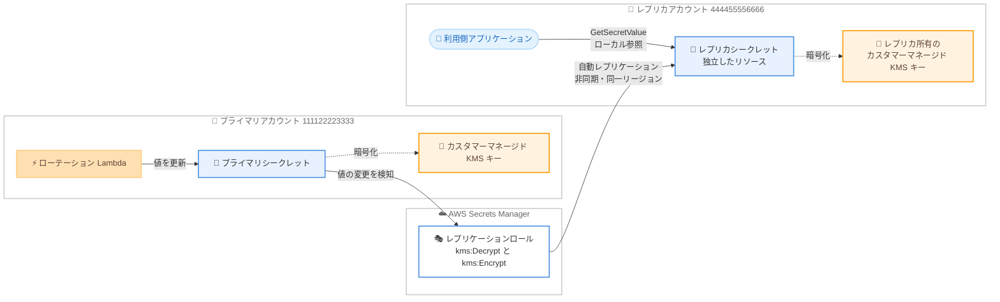

# AWS Secrets Manager - クロスアカウントレプリケーション

**リリース日**: 2026 年 11 月 13 日
**サービス**: AWS Secrets Manager
**機能**: クロスアカウントレプリケーション (Cross-account replication)

📊 [このアップデートのインフォグラフィックを見る](https://takech9203.github.io/aws-news-summary/20261113-secrets-manager-cross-account.html)

## 概要

AWS Secrets Manager がクロスアカウントレプリケーションに対応しました。プライマリシークレットの同期コピー (レプリカ) を別の AWS アカウントに保持できるようになり、クロスアカウントアクセス、バックアップ、災害対策 (DR) に活用できます。従来から提供されていたマルチリージョンレプリケーション機能を、アカウント境界を越えて拡張するアップデートです。

プラットフォームチームやセキュリティチームがシークレットを一元的に所有・ローテーションしながら、利用側の各アカウントは常に最新のローカルコピーを取得できます。従来のクロスアカウント共有で必要だった KMS キーの共有やクロスアカウントのシークレットリソースポリシーの管理は不要になります。レプリカは完全に独立したリソースであり、レプリカアカウントが所有するカスタマーマネージド KMS キーで暗号化され、ローテーションを含むプライマリ側の値の変更時に自動更新されます。

また、ランサムウェアやアカウント侵害から隔離された専用の復旧用アカウントに、重要なシークレットのライブコピーを保持する DR 用途にも有効です。必要に応じてレプリカをスタンドアロンのシークレットに昇格させることもできます。

**アップデート前の課題**

- 以前はシークレットをアカウント間で共有するには、クロスアカウントのリソースポリシーと KMS キーポリシーの両方を設定・維持する必要があった
- 利用側アカウントはプライマリアカウントのシークレットをリモート参照するため、プライマリアカウントの障害や侵害時にシークレットへアクセスできなくなるリスクがあった
- シークレットのバックアップコピーを別アカウントに保持するには、独自の同期の仕組みを構築・運用する必要があった

**アップデート後の改善**

- 利用側アカウントは自アカウント内のローカルなレプリカシークレットを参照でき、KMS キー共有やクロスアカウントシークレットポリシーが不要になった
- プライマリシークレットの値が変更 (ローテーション含む) されるたびに、レプリカが自動的に更新されるようになった
- 隔離された復旧用アカウントに重要シークレットのライブコピーを保持でき、必要時にスタンドアロンシークレットへ昇格できるようになった

## アーキテクチャ図



プライマリアカウントのシークレット値が変更されると、Secrets Manager がレプリケーションロールを使用してプライマリ側 KMS キーで復号し、レプリカ側 KMS キーで再暗号化して、レプリカアカウントのシークレットへ自動的に伝播します。利用側アプリケーションは自アカウント内のレプリカをローカルに参照できます。

## サービスアップデートの詳細

### 主要機能

1. **アカウント間のシークレット自動同期**
   - プライマリシークレットの値が変更されるたびに、Secrets Manager が新しい値をレプリカへ自動的に伝播する
   - 自動ローテーションによる値の変更もレプリカに反映されるため、利用側アカウントは常に最新の値を取得できる
   - レプリケーションは非同期かつ結果整合性であり、`DescribeSecret` でレプリケーションステータスを確認できる

2. **双方の合意に基づくセットアップモデル**
   - レプリカアカウントの所有者が、プライマリシークレットの ARN を参照するレプリカシークレットを作成する
   - プライマリアカウントの所有者が `AssociateCrossAccountReplica` でレプリカを関連付けることで、レプリケーションが開始される
   - `ReplicaRestriction` パラメータで、同一 AWS Organizations 内 (`SameOrg`) に限定するか制限なし (`NoRestriction`) かを指定できる

3. **独立したリソースとしてのレプリカ**
   - レプリカは独自のリソースポリシー、KMS キー、ライフサイクルを持つ独立したシークレット
   - レプリカアカウントが所有するカスタマーマネージド KMS キーで暗号化される (AWS マネージドキー `aws/secretsmanager` は使用不可)
   - タグとリソースポリシーは各アカウントが個別に管理する (レプリケーション対象外)
   - レプリケーションを停止することで、レプリカをスタンドアロンのシークレットに昇格できる

4. **柔軟な認可モデル**
   - 推奨はレプリケーションロール方式。Secrets Manager が IAM ロールを引き受け、プライマリ側 KMS キーの `kms:Decrypt` とレプリカ側 KMS キーの `kms:Encrypt` を実行する
   - レプリケーションロールを指定しない場合は Forward Access Session (FAS) 方式となり、`PutSecretValue` 等を呼び出した ID の権限でレプリケーションが実行される

## 技術仕様

### レプリケーションの仕様

| 項目 | 詳細 |
|------|------|
| リージョン | プライマリとレプリカは同一リージョンである必要がある |
| レプリカ数 | 1 つのプライマリシークレットにつきクロスアカウントレプリカは最大 1 つ |
| 暗号化 | レプリカはカスタマーマネージド KMS キーが必須。レプリケーションロール方式ではプライマリ側もカスタマーマネージドキーが必須 |
| 同期方式 | 非同期・結果整合性。値の変更をトリガーに自動伝播 |
| レプリケーション対象 | シークレット値とバージョンデータ、説明、シークレットタイプ、バージョンとステージングラベルのマッピング |
| レプリケーション対象外 | タグ、リソースポリシー、KMS キー |
| ステータス | `Pending` / `InProgress` / `InSync` / `Failed` / `Detached` |

### API 変更履歴

| 日付 | サービス | 変更内容 |
|------|----------|----------|
| 2026/11/12 | [secretsmanager](https://awsapichanges.com/archive/changes/981bee-secretsmanager.html) | 3 new 7 updated api methods - `AssociateCrossAccountReplica`、`DisassociateCrossAccountReplica`、`ListResourcePolicies` の新 API 追加。`CreateSecret` に `CrossAccountPrimaryARN`、`DescribeSecret` に `CrossAccountPrimary` / `CrossAccountReplicas`、リソースポリシー関連 API に `PolicyName` を追加 |

### 新規 API の概要

```python
# プライマリアカウント側: レプリカを関連付けてレプリケーションを開始
client.associate_cross_account_replica(
    SecretId='string',
    CrossAccountReplicaARN='string',
    ReplicaRestriction='SameOrg'|'NoRestriction',
    ReplicationRoleARN='string'
)

# プライマリアカウント側: レプリケーションを解除
client.disassociate_cross_account_replica(
    SecretId='string',
    CrossAccountReplicaARN='string'
)
```

## 設定方法

### 前提条件

1. プライマリアカウントとレプリカアカウントの 2 つの AWS アカウント (プライマリとレプリカのシークレットは同一リージョン)
2. レプリカアカウントが所有するカスタマーマネージド KMS キー (レプリカの暗号化用)
3. レプリケーションロール方式を使用する場合、プライマリシークレットもカスタマーマネージド KMS キーで暗号化されていること

### 手順

#### ステップ 1: レプリカアカウントで KMS キーポリシーを設定

```json
{
  "Sid": "AllowPrimaryAccountEncrypt",
  "Effect": "Allow",
  "Principal": {
    "AWS": "arn:aws:iam::111122223333:role/SecretsManagerCrossAccountReplicationRole"
  },
  "Action": "kms:Encrypt",
  "Resource": "*",
  "Condition": {
    "StringEquals": {
      "kms:EncryptionContext:SecretARN": "arn:aws:secretsmanager:us-east-2:444455556666:secret:MyReplicaSecret-a1b2c3"
    }
  }
}
```

レプリカ側 KMS キーのキーポリシーに、プライマリアカウント側のレプリケーションロールからの `kms:Encrypt` を許可するステートメントを追加します。`kms:EncryptionContext:SecretARN` 条件により、このキーの利用をレプリカシークレットに限定できます。

#### ステップ 2: レプリカアカウントでレプリカシークレットを作成

```bash
aws secretsmanager create-secret \
  --name MyReplicaSecret \
  --kms-key-id arn:aws:kms:us-east-2:444455556666:key/replica-key-id \
  --cross-account-primary-arn arn:aws:secretsmanager:us-east-2:111122223333:secret:MyPrimarySecret-a1b2c3 \
  --region us-east-2
```

レプリカアカウントで、`CreateSecret` の新パラメータ `CrossAccountPrimaryARN` にプライマリシークレットの ARN を指定し、カスタマーマネージド KMS キーを指定してレプリカシークレットを作成します。作成直後のレプリケーションステータスは `Pending` です。

#### ステップ 3: プライマリアカウントでレプリケーションロールを作成

```json
{
  "Version": "2012-10-17",
  "Statement": [
    {
      "Sid": "DecryptPrimarySecretKey",
      "Effect": "Allow",
      "Action": "kms:Decrypt",
      "Resource": "arn:aws:kms:us-east-2:111122223333:key/primary-key-id"
    },
    {
      "Sid": "EncryptReplicaSecretKey",
      "Effect": "Allow",
      "Action": "kms:Encrypt",
      "Resource": "arn:aws:kms:us-east-2:444455556666:key/replica-key-id"
    }
  ]
}
```

`secretsmanager.amazonaws.com` を信頼する IAM ロールを作成し、プライマリ側 KMS キーの `kms:Decrypt` とレプリカ側 KMS キーの `kms:Encrypt` を許可する権限ポリシーを付与します。信頼ポリシーには `aws:SourceAccount` と `aws:SourceArn` 条件を設定し、混乱した代理問題を防止することが推奨されます。プライマリ側 KMS キーのキーポリシーにも、このロールからの `kms:Decrypt` を許可するステートメントを追加します。

#### ステップ 4: プライマリアカウントでレプリカを関連付け

```bash
aws secretsmanager associate-cross-account-replica \
  --secret-id MyPrimarySecret \
  --cross-account-replica-arn arn:aws:secretsmanager:us-east-2:444455556666:secret:MyReplicaSecret-a1b2c3 \
  --replica-restriction SameOrg \
  --replication-role-arn arn:aws:iam::111122223333:role/SecretsManagerCrossAccountReplicationRole \
  --region us-east-2
```

プライマリアカウントの所有者が `AssociateCrossAccountReplica` を呼び出してレプリカを関連付けると、レプリケーションが開始されます。`--replica-restriction SameOrg` により、同一 AWS Organizations 内のアカウントに限定できます。

#### ステップ 5: レプリケーションステータスを確認

```bash
aws secretsmanager describe-secret \
  --secret-id MyPrimarySecret \
  --region us-east-2
```

`DescribeSecret` のレスポンスに追加された `CrossAccountReplicas` フィールドでレプリケーションステータスを確認します。`InSync` になれば、レプリカはプライマリと同じ値を保持しています。レプリカアカウント側では `CrossAccountPrimary` フィールドで確認できます。

## メリット

### ビジネス面

- **シークレット管理の一元化**: プラットフォーム / セキュリティチームがシークレットの所有とローテーションを一元的に担い、利用側チームは自アカウント内のコピーを参照するだけでよいため、組織全体のガバナンスが向上する
- **ランサムウェア / アカウント侵害対策**: 隔離された復旧用アカウントに重要シークレットのライブコピーを保持でき、プライマリアカウントが侵害されても業務継続に必要な認証情報を確保できる
- **運用コストの削減**: アカウント間のシークレット同期を独自に構築・運用する必要がなくなる

### 技術面

- **クロスアカウント設定の簡素化**: KMS キー共有やクロスアカウントのシークレットリソースポリシーの設定・維持が不要になる
- **ローテーションとの自動連携**: ローテーションを含む値の変更が自動的にレプリカへ伝播され、利用側は常に最新の値を取得できる
- **独立した暗号化とアクセス制御**: レプリカはレプリカアカウント所有のカスタマーマネージド KMS キーで暗号化され、リソースポリシーやタグも独立して管理できる
- **昇格可能なレプリカ**: 必要時にレプリケーションを解除してスタンドアロンシークレットに昇格でき、DR フェイルオーバーに対応できる

## デメリット・制約事項

### 制限事項

- プライマリとレプリカのシークレットは同一リージョンに存在する必要がある (リージョンをまたぐ場合は既存のマルチリージョンレプリケーションと組み合わせる)
- 1 つのプライマリシークレットに対してクロスアカウントレプリカは 1 つのみ作成できる
- レプリカの暗号化にはカスタマーマネージド KMS キーが必須で、AWS マネージドキー `aws/secretsmanager` は使用できない
- レプリケーションロール方式では、プライマリシークレットもカスタマーマネージド KMS キーで暗号化されている必要がある

### 考慮すべき点

- レプリケーションは非同期・結果整合性のため、値の変更直後はレプリカに最新値が反映されていない可能性がある。`DescribeSecret` でステータスを監視する運用が必要
- 組織の RCP (リソースコントロールポリシー) や SCP (サービスコントロールポリシー) が KMS 操作をブロックすると、ID ポリシーとキーポリシーで許可されていてもレプリケーションが失敗する
- FAS 方式を使用する場合、プライマリシークレットを更新するすべての ID にレプリカ側 KMS キーへのクロスアカウント `kms:Encrypt` 権限が必要となるため、多くのケースではレプリケーションロール方式が推奨される
- レプリカごとにシークレットの保管料金が発生するため、レプリカ数に応じたコストを考慮する

## ユースケース

### ユースケース 1: プラットフォームチームによるシークレットの一元管理と配布

**シナリオ**: 中央のセキュリティアカウントでデータベース認証情報を一元管理し、自動ローテーションを実施している。各ワークロードアカウントのアプリケーションが同じ認証情報を利用する必要がある。

**実装例**:
```bash
# ワークロードアカウント側でレプリカを作成
aws secretsmanager create-secret \
  --name shared/db-credentials \
  --kms-key-id <ワークロードアカウントの CMK> \
  --cross-account-primary-arn <セキュリティアカウントのシークレット ARN>

# セキュリティアカウント側で関連付け
aws secretsmanager associate-cross-account-replica \
  --secret-id shared/db-credentials \
  --cross-account-replica-arn <ワークロードアカウントのレプリカ ARN> \
  --replica-restriction SameOrg \
  --replication-role-arn <レプリケーションロール ARN>
```

**効果**: ローテーション後の新しい認証情報が自動的にワークロードアカウントへ伝播され、各アプリケーションはクロスアカウント権限なしでローカルのシークレットを参照するだけでよい。

### ユースケース 2: ランサムウェア対策としての隔離復旧用アカウント

**シナリオ**: 本番アカウントが侵害された場合に備え、厳格にアクセス制限された復旧用アカウントに重要シークレットのライブコピーを保持したい。

**実装例**:
```bash
# 復旧用アカウントにレプリカを作成し、本番アカウントから関連付け
# 障害発生時はレプリケーションを解除してスタンドアロンに昇格
aws secretsmanager disassociate-cross-account-replica \
  --secret-id <プライマリシークレット> \
  --cross-account-replica-arn <復旧用アカウントのレプリカ ARN>
```

**効果**: 本番アカウントが侵害されても、隔離されたアカウントに最新のシークレットが保持されており、スタンドアロンシークレットへ昇格して復旧作業を迅速に開始できる。

### ユースケース 3: マルチアカウント環境での DR フェイルオーバー

**シナリオ**: アカウント単位の障害ドメイン分離を採用しており、スタンバイアカウントへのフェイルオーバー時にアプリケーションが同じシークレットを利用する必要がある。

**実装例**:
```bash
# スタンバイアカウントのレプリカのステータスを定期監視
aws secretsmanager describe-secret \
  --secret-id <レプリカシークレット> \
  --query 'CrossAccountPrimary.ReplicationStatus'
```

**効果**: フェイルオーバー時にシークレットを手動で移行する必要がなく、スタンバイアカウント内の `InSync` 状態のレプリカを即座に利用して RTO を短縮できる。

## 料金

Secrets Manager の標準料金体系が適用されます。レプリカシークレットは独立したシークレットとして保管料金の対象となります。詳細は [AWS Secrets Manager 料金ページ](https://aws.amazon.com/secrets-manager/pricing/) を参照してください。

### 料金例

| 使用量 | 月額料金 (概算) |
|--------|------------------|
| プライマリシークレット 1 件 | $0.40 |
| クロスアカウントレプリカ 1 件 | $0.40 |
| API コール | 10,000 コールあたり $0.05 |

※ 上記は米国東部リージョンの標準的なシークレット料金に基づく概算です。最新の料金は料金ページで確認してください。

## 利用可能リージョン

AWS Secrets Manager が利用可能なすべての AWS リージョンで利用できます。詳細は [AWS リージョン別サービス一覧](https://aws.amazon.com/about-aws/global-infrastructure/regional-product-services/) を参照してください。

## 関連サービス・機能

- **AWS KMS**: レプリカはレプリカアカウント所有のカスタマーマネージドキーで暗号化される。レプリケーション時には Secrets Manager がプライマリ側キーで復号し、レプリカ側キーで再暗号化する
- **Secrets Manager マルチリージョンレプリケーション**: 既存のリージョン間レプリケーション機能。今回のアップデートはこれをアカウント境界を越えて拡張するもので、組み合わせることでリージョンとアカウントの両方にまたがる冗長化が可能
- **AWS Organizations**: `ReplicaRestriction` の `SameOrg` 設定により、レプリケーション先を同一組織内のアカウントに限定できる
- **AWS IAM**: レプリケーションロール (推奨) または Forward Access Session により、クロスアカウントの KMS 操作を認可する

## 参考リンク

- 📊 [インフォグラフィック](https://takech9203.github.io/aws-news-summary/20261113-secrets-manager-cross-account.html)
- [公式発表 (What's New)](https://aws.amazon.com/about-aws/whats-new/2026/11/secrets-manager-cross-account/)
- [ドキュメント: Replicate secrets across AWS accounts](https://docs.aws.amazon.com/secretsmanager/latest/userguide/cross-account-replicate-secrets.html)
- [ドキュメント: How Secrets Manager authorizes cross-account replication](https://docs.aws.amazon.com/secretsmanager/latest/userguide/cross-account-replicate-permissions.html)
- [API リファレンス: AssociateCrossAccountReplica](https://docs.aws.amazon.com/secretsmanager/latest/apireference/API_AssociateCrossAccountReplica.html)
- [料金ページ](https://aws.amazon.com/secrets-manager/pricing/)

## まとめ

AWS Secrets Manager のクロスアカウントレプリケーションにより、KMS キー共有やクロスアカウントポリシーの複雑な設定なしに、シークレットの一元管理と自動配布、そして侵害から隔離されたバックアップが実現できます。マルチアカウント環境でシークレットを共有している組織や、ランサムウェア対策・DR 戦略を強化したい組織は、独自の同期の仕組みからの移行とレプリケーションロール方式での導入を検討することを推奨します。
