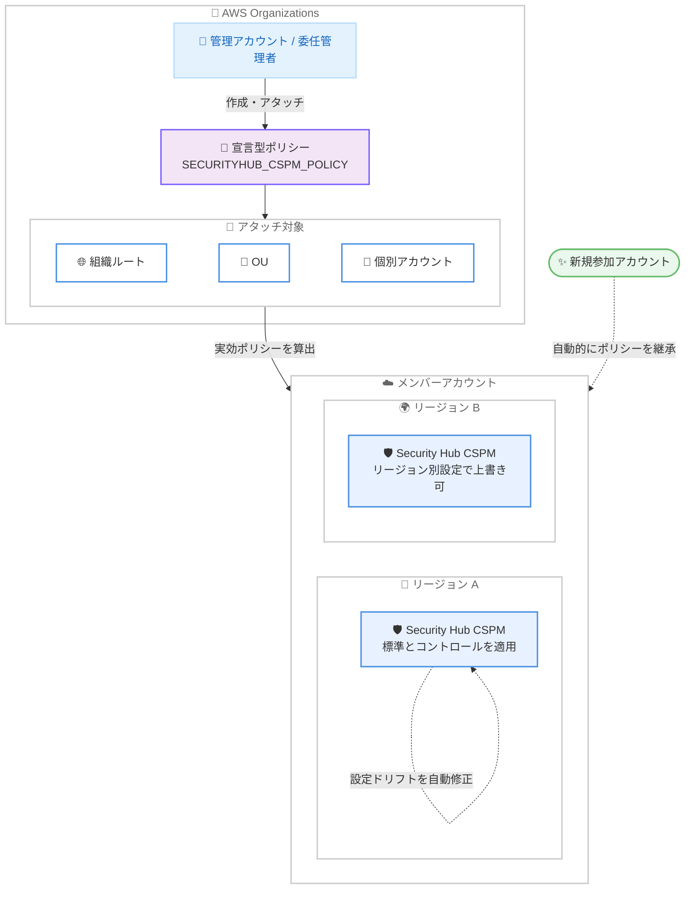

# AWS Security Hub CSPM - AWS Organizations 宣言型ポリシーによる一元設定のサポート

**リリース日**: 2026 年 11 月 13 日
**サービス**: AWS Security Hub CSPM (Cloud Security Posture Management)
**機能**: AWS Organizations 宣言型ポリシー (declarative policies) による一元設定

📊 [このアップデートのインフォグラフィックを見る](https://takech9203.github.io/aws-news-summary/20261113-security-hub-cspm-org-policies.html)

## 概要

AWS Security Hub CSPM が AWS Organizations の宣言型ポリシー (declarative policies) に対応しました。ポリシータイプ `SECURITYHUB_CSPM_POLICY` を使用して、組織内の全アカウント・全リージョンで Security Hub CSPM を一元的に有効化し、有効にするセキュリティ標準、コントロール、カスタムコントロールパラメータを 1 つのポリシーで定義できます。組織ルート、OU、個別アカウントを対象にポリシーをアタッチでき、特定のアカウントとリージョンの組み合わせに限定した設定も可能です。

ポリシーがアタッチされたアカウントの設定は常にポリシーと一致するように維持されるため、設定ドリフトを防止できます。また、組織に新規参加したアカウントにも自動的にポリシーが適用され、作成時点からベースラインのセキュリティ設定が保証されます。宣言型ポリシーは Amazon GuardDuty、Amazon Inspector、AWS Security Hub などの他のセキュリティサービスと同じ管理モデルであり、今後 Security Hub CSPM を組織レベルで管理する際の推奨方式となります。既存の central configuration (一元設定) からの移行プロセスも Security Hub CSPM コンソールに用意されており、既存の設定ポリシーを宣言型ポリシーに変換して適用できます。

**アップデート前の課題**

- Security Hub CSPM の組織全体の管理には独自機能である central configuration を使用する必要があり、GuardDuty や Inspector など他のセキュリティサービスの宣言型ポリシーとは管理方法が分かれていた
- サービスごとに異なる設定管理の仕組みを学習・運用する必要があり、マルチアカウント環境のガバナンス運用が煩雑だった
- AWS Organizations のポリシー管理 (継承、OU 単位の適用、ポリシーの統合) と同じモデルで Security Hub CSPM を扱うことができなかった

**アップデート後の改善**

- AWS Organizations の宣言型ポリシーで Security Hub CSPM の有効化、セキュリティ標準、コントロール、カスタムパラメータを一元定義できるようになった
- リージョン別の設定 (`default` 設定のリージョン単位の上書き) が可能になり、リージョン固有のコンプライアンス要件に対応できるようになった
- GuardDuty、Inspector、Security Hub と管理方法が統一され、組織のセキュリティサービス全体を同じモデルで運用できるようになった
- ポリシーが適用されたアカウントでは管理対象の設定変更がブロックされ、設定ドリフトが自動的に修正されるようになった

## アーキテクチャ図



管理アカウントまたは委任管理者が宣言型ポリシーを作成して組織ルート・OU・アカウントにアタッチすると、AWS Organizations が各アカウントの実効ポリシーを算出し、Security Hub CSPM が対象リージョンごとに標準とコントロールの設定を適用・維持します。

## サービスアップデートの詳細

### 主要機能

1. **組織全体の一元的な有効化と設定**
   - `enable_in_regions` / `disable_in_regions` で Security Hub CSPM を有効化・無効化するリージョンを指定
   - `ALL_SUPPORTED` を指定すると、現在および将来追加されるすべてのリージョンが対象になる
   - どちらのリストにも含まれないリージョンはポリシーの管理対象外 (ungoverned) となり、既存設定が維持される
   - 両リストに同じリージョンがある場合は無効化 (disable) が優先される

2. **セキュリティ標準・コントロールの宣言的な定義**
   - `cspm_standards_controls` オブジェクトで有効化する標準 (`enabled_standards`)、コントロールの既定ステータス (`default_control_association_status`)、個別コントロールの有効化・無効化 (`enabled_controls` / `disabled_controls`)、カスタムコントロールパラメータ (`custom_control_parameters`) を定義
   - ポリシーに記載のない標準は無効として管理され、未指定のパラメータはデフォルト値が使用される
   - `disabled_controls` は `enabled_controls` より優先され、両者は `default_control_association_status` より優先される

3. **リージョン別設定のサポート**
   - `default` 設定がポリシーで有効化されたすべてのリージョンに適用される
   - リージョン名 (例: `us-east-1`) をキーとする設定ブロックを追加すると、そのリージョンでは `default` 設定を完全に置き換えられる
   - リージョン固有のコンプライアンス要件 (例: 特定リージョンのみ PCI DSS を有効化) に対応可能

4. **新規アカウントへの自動適用と設定ドリフト防止**
   - 組織に参加したアカウントや、ポリシーがアタッチされた OU に移動したアカウントは自動的にポリシーを継承
   - ポリシーが管理する設定は対象アカウントのコンソールや API から変更できず、設定変更はポリシーの更新によってのみ行う
   - ポリシーの適用は結果整合性で動作し、Security Hub CSPM が定期的に設定ドリフトを自動修正する

5. **central configuration からの移行ツール**
   - Security Hub CSPM コンソールに移行プロセスが用意され、既存の central configuration ポリシーを宣言型ポリシーに変換して適切に適用できる
   - 宣言型ポリシーと central configuration は相互排他であり、移行するまでは central configuration を引き続き使用可能
   - 宣言型ポリシーは central configuration と同じ完全ガバナンスモデルを採用しているため、移行しても結果の設定は変わらない

## 技術仕様

### ポリシーの主要要素

| 項目 | 詳細 |
|------|------|
| ポリシータイプ | `SECURITYHUB_CSPM_POLICY` |
| トップレベルキー | `securityhub_cspm` |
| `cspm_enablement` | `enable_in_regions` と `disable_in_regions` の両方が必須 (空リスト可)。disable が優先 |
| `cspm_standards_controls` | 必須。`default` ブロックに `default_control_association_status` (`ENABLED` / `DISABLED`) が必須 |
| リージョン別設定 | リージョン名キーのブロックが `default` を完全に置き換える |
| 継承演算子 | `@@assign` (上書き)、`@@append` (追加)、`@@remove` (削除)。`@@operators_allowed_for_child_policies` で子ポリシーの操作を制限可能 |
| アタッチ対象 | 組織ルート、OU、個別アカウント。複数ポリシーは実効ポリシーとして統合される |
| ポリシー管理者 | 管理アカウント、または委任ポリシー (delegation policy) で権限を付与された委任管理者 |

### API 変更履歴

| 日付 | サービス | 変更内容 |
|------|----------|----------|
| 2026/11/13 | [securityhub](https://awsapichanges.com/archive/changes/b4312b-securityhub.html) | 6 updated api methods - Security Hub CSPM Central Configuration に新しい DISABLED ステータスを追加 |

### ポリシー例: 全リージョンで FSBP 標準を有効化

```json
{
  "securityhub_cspm": {
    "cspm_enablement": {
      "enable_in_regions": {
        "@@assign": ["ALL_SUPPORTED"]
      },
      "disable_in_regions": {
        "@@assign": []
      }
    },
    "cspm_standards_controls": {
      "default": {
        "enabled_standards": {
          "@@assign": ["aws-foundational-security-best-practices/v/1.0.0"]
        },
        "controls_configuration": {
          "default_control_association_status": {
            "@@assign": "ENABLED"
          }
        }
      }
    }
  }
}
```

このポリシーは、Security Hub CSPM が利用可能な現在および将来のすべてのリージョンで Security Hub CSPM を有効化し、AWS Foundational Security Best Practices v1.0.0 標準とその全コントロールを有効にします。

## 設定方法

### 前提条件

1. AWS Organizations で Security Hub CSPM の信頼されたアクセス (trusted access) を有効化していること
2. Security Hub CSPM の委任管理者を指定していること (推奨)。委任管理者がポリシーを管理する場合は委任ポリシーのアタッチも必要
3. 組織ルートで Security Hub CSPM ポリシータイプを有効化していること

### 手順

#### ステップ 1: ポリシータイプの有効化

```bash
aws organizations enable-policy-type \
  --root-id r-xxxx \
  --policy-type SECURITYHUB_CSPM_POLICY
```

組織ルートで Security Hub CSPM ポリシータイプを有効化します。これにより組織内で宣言型ポリシーの作成・アタッチが可能になります。

#### ステップ 2: 宣言型ポリシーの作成

```bash
aws organizations create-policy \
  --name "securityhub-cspm-baseline" \
  --description "Organization-wide Security Hub CSPM baseline" \
  --type SECURITYHUB_CSPM_POLICY \
  --content file://securityhub-cspm-policy.json
```

前述のポリシー例のような JSON ファイルを指定して、Security Hub CSPM の宣言型ポリシーを作成します。有効化するリージョン、標準、コントロールをこの JSON で宣言します。

#### ステップ 3: ポリシーのアタッチ

```bash
aws organizations attach-policy \
  --policy-id p-xxxxxxxx \
  --target-id r-xxxx
```

作成したポリシーを組織ルート (全アカウントに適用)、OU、または個別アカウントにアタッチします。アタッチ後、AWS Organizations が実効ポリシーを算出し、Security Hub CSPM が対象リージョンに設定を適用します。

#### ステップ 4: central configuration からの移行 (既存ユーザーの場合)

既存の central configuration を使用している場合は、Security Hub CSPM コンソールの移行プロセスを使用して、既存の設定ポリシーを宣言型ポリシーに変換・適用します。宣言型ポリシーと central configuration は相互排他のため、移行完了までは central configuration を引き続き使用できます。

## メリット

### ビジネス面

- **ガバナンスの統一**: GuardDuty、Inspector、Security Hub と同じ管理モデルに統一され、組織全体のセキュリティサービス運用を標準化できる
- **コンプライアンスの自動維持**: 新規アカウントにもベースライン設定が自動適用され、組織の成長に合わせてセキュリティポスチャの一貫性を保てる
- **運用負荷の削減**: 1 つのポリシーで全アカウント・全リージョンの設定を宣言でき、アカウントごとの個別設定作業が不要になる

### 技術面

- **設定ドリフトの防止**: ポリシーが管理する設定はアカウント側で変更できず、ドリフトは自動的に修正される
- **柔軟なスコープ設定**: 組織ルート・OU・アカウント単位のアタッチ、リージョン別設定、継承演算子による子ポリシーの拡張・制限が可能
- **将来リージョンへの自動対応**: `ALL_SUPPORTED` 指定により、新しいリージョンの追加時も自動的にカバーされる

## デメリット・制約事項

### 制限事項

- 宣言型ポリシーと central configuration は相互排他であり、同時に使用できない
- マルチクラウド標準・コントロール (例: Azure) の設定には対応していない
- サービスマネージド標準 (例: AWS Control Tower のサービスマネージド標準) の設定には対応していない
- `default_control_association_status` が `ENABLED` の場合は `enabled_controls` を、`DISABLED` の場合は `disabled_controls` を記載できない

### 考慮すべき点

- ポリシーの適用は結果整合性 (非同期) で行われるため、設定反映までに時間差が生じる場合がある
- ポリシーが管理する設定は対象アカウントのコンソール・API から変更できなくなるため、個別アカウントでの例外対応はポリシー設計 (OU 構成や子ポリシー) で考慮する必要がある
- ポリシーをデタッチした場合、設定は直前の状態のまま維持されてアカウントは自己管理に戻るが、以降の自動設定は行われない
- 既存の central configuration ユーザーは、移行前に Security Hub CSPM ユーザーガイドの移行手順を確認することが推奨される

## ユースケース

### ユースケース 1: 組織全体のセキュリティベースライン

**シナリオ**: セキュリティチームが、すべてのアカウント・すべてのリージョンで AWS Foundational Security Best Practices 標準を実行したい。

**実装例**:
```
組織ルートに以下を定義したポリシーをアタッチ:
- enable_in_regions: ALL_SUPPORTED
- enabled_standards: aws-foundational-security-best-practices/v/1.0.0
- default_control_association_status: ENABLED
```

**効果**: 新規アカウントや新規リージョンも自動的にカバーされ、組織全体で一貫したベースラインが維持される。

### ユースケース 2: リージョン固有のコンプライアンス要件

**シナリオ**: 多国籍企業が、カード会員データを処理する特定リージョンのみで PCI DSS 標準を実行する必要がある。

**実装例**:
```
- default ブロック: 組織全体のベースライン標準を定義
- 対象リージョン (例: us-east-1) のブロック: ベースラインに加えて
  pci-dss 標準を含む設定で default を上書き
```

**効果**: リージョンごとのコンプライアンス要件を 1 つのポリシーで表現でき、対象外リージョンの不要なコスト増を回避できる。

### ユースケース 3: OU 単位のワークロード別設定

**シナリオ**: プラットフォームチームがベースラインを組織ルートで定義しつつ、決済ワークロード用 OU にはより厳格な標準を追加したい。

**実装例**:
```
親ポリシー (組織ルート):
- enabled_standards に @@operators_allowed_for_child_policies: @@append を設定
子ポリシー (決済 OU):
- enabled_standards に @@append で pci-dss/v/4.0.1 を追加
```

**効果**: 決済 OU のアカウントのみ両方の標準が有効になり、他のアカウントはベースライン標準のみを実行する。継承演算子により子ポリシーの変更範囲を制御できる。

## 料金

宣言型ポリシー自体に追加料金はありません。Security Hub CSPM の利用料金 (セキュリティチェック数などに基づく従量課金) が適用されます。Security Hub CSPM は AWS 無料利用枠で 30 日間無料で試用できます。詳細は [Security Hub CSPM 料金ページ](https://aws.amazon.com/security-hub/pricing/) を参照してください。

## 利用可能リージョン

すべての AWS 商用リージョン、AWS GovCloud (US) リージョン、中国リージョンで利用可能です。

## 関連サービス・機能

- **AWS Organizations**: 宣言型ポリシーの作成・アタッチ・継承管理を担う基盤。SCP や RCP がアクセス制御を行うのに対し、宣言型ポリシーはサービス設定のベースラインを強制する
- **AWS Security Hub**: Security Hub (リスク分析・対応の統合サービス) も同様に宣言型ポリシーで管理可能。Security Hub と Security Hub CSPM は委任管理者を共有する
- **Amazon GuardDuty / Amazon Inspector**: 同じ宣言型ポリシーモデルで組織全体の有効化・設定を管理できるセキュリティサービス
- **AWS Control Tower**: 宣言型ポリシーは AWS Control Tower コンソールからも設定可能で、ランディングゾーンのガバナンスと組み合わせられる

## 参考リンク

- 📊 [インフォグラフィック](https://takech9203.github.io/aws-news-summary/20261113-security-hub-cspm-org-policies.html)
- [公式発表 (What's New)](https://aws.amazon.com/about-aws/whats-new/2026/11/security-hub-cspm-org-policies/)
- [ドキュメント: Security Hub CSPM policies (AWS Organizations ユーザーガイド)](https://docs.aws.amazon.com/organizations/latest/userguide/orgs_manage_policies_security_hub_cspm.html)
- [ドキュメント: Security Hub CSPM policy syntax and examples](https://docs.aws.amazon.com/organizations/latest/userguide/orgs_manage_policies_security_hub_cspm_syntax.html)
- [ドキュメント: Managing accounts using organization policies (Security Hub CSPM ユーザーガイド)](https://docs.aws.amazon.com/securityhub/latest/userguide/accounts-orgs-policies.html)
- [ドキュメント: Declarative policies in AWS Organizations](https://docs.aws.amazon.com/organizations/latest/userguide/orgs_manage_policies_declarative.html)
- [料金ページ](https://aws.amazon.com/security-hub/pricing/)

## まとめ

Security Hub CSPM の組織管理が AWS Organizations の宣言型ポリシーに統合され、GuardDuty や Inspector と同じモデルでマルチアカウント環境のセキュリティポスチャ管理を標準化できるようになりました。宣言型ポリシーは今後の推奨方式であるため、central configuration を使用している組織はコンソールの移行プロセスを確認し、計画的な移行を検討することを推奨します。新規に Security Hub CSPM を組織展開する場合は、最初から宣言型ポリシーでの構成を選択するとよいでしょう。
