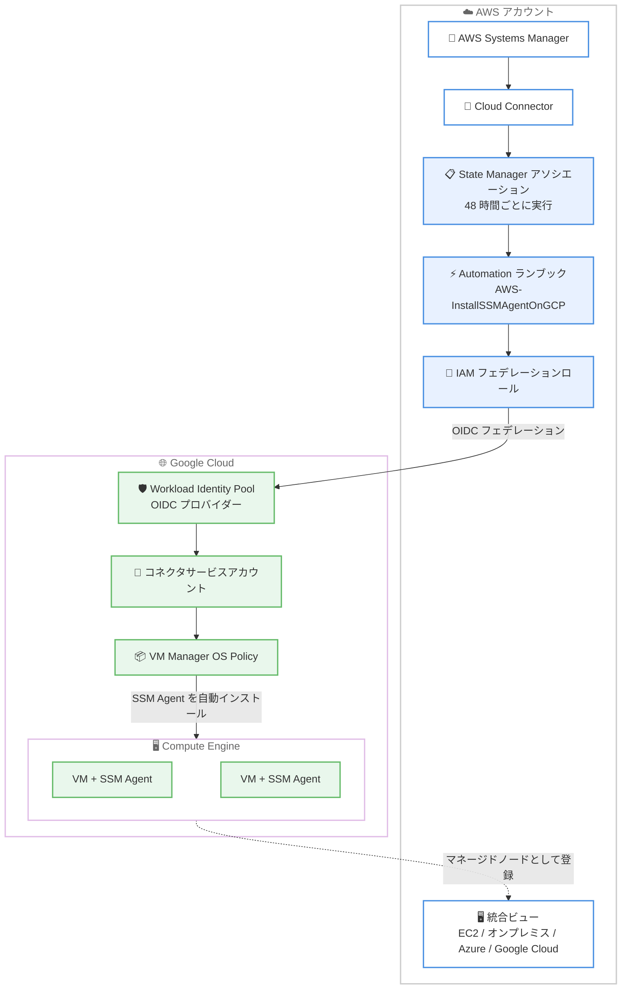

# AWS Systems Manager - Google Cloud VM の一元管理オンボーディング対応

**リリース日**: 2026 年 11 月 13 日
**サービス**: AWS Systems Manager
**機能**: Cloud Connector による Google Cloud VM のオンボーディング対応

📊 [このアップデートのインフォグラフィックを見る](https://takech9203.github.io/aws-news-summary/20261113-systems-manager-google-cloud-support.html)

## 概要

AWS Systems Manager の Cloud Connector が、マルチクラウドオンボーディング対応を Google Cloud に拡張しました。これにより、既存の Google Cloud VM (Compute Engine インスタンス) を手動のエージェントインストールなしで Systems Manager に接続し、AWS、オンプレミス、Azure のリソースと並べて一元管理できるようになりました。

Cloud Connector は SSM Agent を Google Cloud VM に大規模に自動デプロイします。接続された VM は EC2 インスタンス、オンプレミスサーバー、その他のマルチクラウドリソースと統合ビューに表示され、Session Manager、Automation ランブック、Run Command、State Manager、Patch Manager、Inventory を 4 つの環境 (AWS、オンプレミス、Azure、Google Cloud) にまたがる単一のワークフローで利用できます。複数のクラウドにまたがるサーバーフリートを運用するエンタープライズの運用チームにとって、運用プラクティスの標準化と運用負荷の削減につながるアップデートです。

**アップデート前の課題**

- Cloud Connector のマルチクラウド対応は Azure のみで、Google Cloud VM を Systems Manager で管理するには、ハイブリッドアクティベーションを手動で作成し、各 VM に SSM Agent を個別にインストールする必要があった
- マルチクラウド環境では、クラウドごとに個別の管理ツールと運用手順を整備する必要があり、環境ごとの設定が分断されていた
- Google Cloud 側で新規作成された VM を Systems Manager の管理下に入れるには、その都度手動のオンボーディング作業が必要だった

**アップデート後の改善**

- Cloud Connector を作成して VM オンボーディングを有効化するだけで、対象の Google Cloud プロジェクト内の VM に SSM Agent が自動デプロイされ、マネージドノードとして登録されるようになった
- OIDC ベースのワークロードアイデンティティフェデレーションにより、長期的な認証情報を交換することなく AWS と Google Cloud を安全に接続できるようになった
- オンボーディング用の State Manager アソシエーションが 48 時間ごとに実行され、後から作成された VM も自動的に検出・オンボーディングされるようになった

## アーキテクチャ図



Cloud Connector が OIDC ベースのワークロードアイデンティティフェデレーションで Google Cloud に接続し、Automation ランブックと GCP の VM Manager OS Policy を利用して SSM Agent を自動デプロイする流れを示しています。オンボーディングされた VM は EC2 やオンプレミスサーバーと同じ統合ビューで管理できます。

## サービスアップデートの詳細

### 主要機能

1. **Google Cloud VM の自動オンボーディング**
   - Cloud Connector を作成し VM オンボーディングを有効化すると、`AWSSSMGcpConnector-{CONNECTOR_ID}` という State Manager アソシエーションが作成され、`AWS-InstallSSMAgentOnGCP` Automation ランブックが実行される
   - ランブックは、ハイブリッドアクティベーションの作成と VM メタデータへの書き込み、GCP VM Manager OS Policy オーケストレーターによる SSM Agent のインストール、マネージドノードとしてのオンライン確認という 3 つの子ランブックを順次実行する
   - アソシエーションは作成時と、その後 48 時間ごとに実行され、新規作成された VM も自動的にオンボーディングされる

2. **OIDC ワークロードアイデンティティフェデレーションによる安全な接続**
   - AWS 側の IAM フェデレーションロールと Google Cloud 側の Workload Identity Pool / OIDC プロバイダーを組み合わせ、長期的な認証情報を使わずにクロスクラウド認証を実現
   - Google Cloud 側ではコネクタ用サービスアカウントを作成し、フェデレーションロールに `roles/iam.workloadIdentityUser` による権限借用を許可する

3. **統合ビューと既存ツールによる一元管理**
   - オンボーディングされた Google Cloud VM はハイブリッドマネージドノードとして動作し、EC2 インスタンス、オンプレミスサーバー、Azure VM と同じ画面に表示される
   - Session Manager、Automation ランブック、Run Command、State Manager、Patch Manager、Inventory を単一のワークフローで利用可能
   - 各マネージドインスタンスには `CloudConnector` タグが自動的に付与される

4. **AWS Config 連携 (オプション)**
   - Cloud Connector の作成時に、AWS Config で GCP リソースの状態を記録するかどうかを選択可能 (デフォルトで有効、作成後は変更不可)
   - AWS Config コネクタもワークロードアイデンティティフェデレーションを使用し、Pub/Sub 経由で監査ログを収集する
   - 今回の API 更新により、AWS Config コネクタなしで SSM Cloud Connector のみを作成することも可能になった

## 技術仕様

### Cloud Connector for Google Cloud の主な仕様

| 項目 | 詳細 |
|------|------|
| 対応スコープ | 特定の GCP プロジェクト指定、または GCP 組織全体 |
| Cloud Connector 数の上限 | AWS アカウントあたり 10 個 |
| プロジェクトターゲット数 | Cloud Connector あたり最大 75 プロジェクト、AWS アカウント全体で最大 100 プロジェクト |
| 認証方式 | OIDC ベースのワークロードアイデンティティフェデレーション |
| エージェント配布方式 | GCP VM Manager OS Policy オーケストレーター経由で SSM Agent を自動インストール |
| オンボーディング周期 | State Manager アソシエーションが 48 時間ごとに実行 |
| ノード種別 | ハイブリッドマネージドノード (ハイブリッドアクティベーション) |
| ソースタイプ | `compute.googleapis.com/Instance` |

### API 変更履歴

| 日付 | サービス | 変更内容 |
|------|----------|----------|
| 2026/11/13 | [ssm](https://awsapichanges.com/archive/changes/b4312b-ssm.html) | 9 updated api methods - Cloud Connector への GCP 対応追加。`CreateCloudConnector` / `GetCloudConnector` / `UpdateCloudConnector` に `GcpConfiguration` (OrganizationId、WorkloadIdentityPoolProvider、ServiceAccountEmail、Projects) を追加。`ListCloudConnectors` に `Provider` (Azure / GCP) とフィルタキー `ProjectId` / `OrganizationId` を追加。`ValidateCloudConnector` に GCP スコープの検証結果を追加。`DescribeInstanceInformation` / `ListNodes` などで `SourceType` に `compute.googleapis.com/Instance` を追加 |

### CreateCloudConnector の GCP 設定例

```json
{
  "DisplayName": "my-gcp-connector",
  "RoleArn": "arn:aws:iam::123456789012:role/service-role/SSM-GCPRole-my-gcp-connector",
  "Configuration": {
    "GcpConfiguration": {
      "OrganizationId": "123456789012",
      "WorkloadIdentityPoolProvider": "projects/1234567890/locations/global/workloadIdentityPools/connector-pool/providers/connector-oidc",
      "ServiceAccountEmail": "aws-ssm-connector@my-host-project.iam.gserviceaccount.com",
      "Targets": {
        "Projects": [
          {
            "ProjectId": "my-target-project",
            "ProjectDisplayName": "My Target Project"
          }
        ]
      }
    }
  }
}
```

## 設定方法

### 前提条件

1. AWS アカウントが `sts:GetWebIdentityToken` アクションを制限する SCP の対象になっていないこと
2. AWS 側で Systems Manager 用 GCP フェデレーションロールなどの IAM ロールを準備すること (コンソールのウィザードでは自動作成可能)
3. GCP 側で必要な API (iam、iamcredentials、sts、cloudresourcemanager、compute、cloudasset、osconfig、progressiverollout、serviceusage など) をホストプロジェクトで有効化すること
4. GCP 側で Workload Identity Pool、OIDC プロバイダー、コネクタサービスアカウントを作成すること (コンソールのウィザードが生成するセットアップスクリプトを Google Cloud Shell で実行すれば自動設定される)

### 手順

#### ステップ 1: GCP 側のフェデレーション設定

```bash
# Workload Identity Pool を作成
gcloud iam workload-identity-pools create connector-pool-123456789012 \
  --project=my-host-project \
  --location=global \
  --display-name="AWS SSM Connector"

# AWS を信頼する OIDC プロバイダーを作成
gcloud iam workload-identity-pools providers create-oidc connector-oidc \
  --project=my-host-project \
  --location=global \
  --workload-identity-pool=connector-pool-123456789012 \
  --issuer-uri="{AWS_OIDC_ISSUER_URL}" \
  --allowed-audiences="https://sts.googleapis.com" \
  --attribute-mapping="google.subject=assertion.sub" \
  --attribute-condition="assertion.sub in ['arn:aws:iam::123456789012:role/service-role/SSM-GCPRole-my-gcp-connector']"
```

GCP 側に AWS からの OIDC トークンを信頼する Workload Identity Pool とプロバイダーを作成しています。これにより、AWS の IAM フェデレーションロールが長期認証情報なしで GCP のサービスアカウントの権限を借用できるようになります。AWS Management Console から作成する場合は、ウィザードが生成するセットアップスクリプトを Google Cloud Shell で実行するだけでこの設定が完了します。

#### ステップ 2: Cloud Connector の作成

```bash
aws ssm create-cloud-connector \
  --display-name "my-gcp-connector" \
  --role-arn "arn:aws:iam::123456789012:role/service-role/SSM-GCPRole-my-gcp-connector" \
  --configuration '{
    "GcpConfiguration": {
      "WorkloadIdentityPoolProvider": "projects/1234567890/locations/global/workloadIdentityPools/connector-pool-123456789012/providers/connector-oidc",
      "ServiceAccountEmail": "aws-ssm-connector@my-host-project.iam.gserviceaccount.com",
      "Targets": {"Projects": [{"ProjectId": "my-target-project"}]}
    }
  }'
```

GCP のホストプロジェクトとターゲットプロジェクト (または組織全体) を Systems Manager に登録する Cloud Connector を作成しています。AWS Config でリソース記録を行う場合は、事前に AWS Config コネクタを作成し `--config-connector-arn` で指定します。

#### ステップ 3: 接続の検証と VM オンボーディングの有効化

```bash
# 接続設定を検証
aws ssm validate-cloud-connector --cloud-connector-id "{CONNECTOR_ID}"
```

`ValidateCloudConnector` API で、GCP 側の API 有効化漏れや権限不足 (`TargetApiDisabled`、`TargetMissingPermissions` など) を事前に検出できます。検証後、コンソールまたは CLI で VM オンボーディングを有効化すると、State Manager アソシエーションが作成され、`AWS-InstallSSMAgentOnGCP` ランブックが対象 VM への SSM Agent 自動デプロイを開始します。オンボーディング完了後は、統合ビューで Google Cloud VM を確認し、Session Manager や Patch Manager から操作できます。

## メリット

### ビジネス面

- **運用の標準化**: AWS、オンプレミス、Azure、Google Cloud の 4 環境を単一ワークフローで管理でき、クラウドごとに異なる運用手順やツールを維持するコストを削減できる
- **マルチクラウド戦略の柔軟性**: 既存の Google Cloud 資産を活かしながら、運用管理基盤を AWS に統合でき、M&A や部門統合などで複数クラウドが混在する場合にも対応しやすい
- **オンボーディング工数の削減**: エージェントの手動インストールやアクティベーションの個別管理が不要になり、大規模フリートの管理開始までの時間を短縮できる

### 技術面

- **セキュアなクロスクラウド認証**: OIDC ワークロードアイデンティティフェデレーションにより、GCP のサービスアカウントキーなどの長期認証情報を AWS 側に保存する必要がない
- **継続的な自動検出**: State Manager アソシエーションが 48 時間ごとに実行され、新規 VM も自動的にオンボーディングされるため、構成ドリフトを防止できる
- **既存ツールの再利用**: Session Manager、Run Command、Patch Manager、Inventory など既存の Systems Manager 機能とランブック資産をそのまま Google Cloud VM に適用できる

## デメリット・制約事項

### 制限事項

- Cloud Connector は AWS アカウントあたり最大 10 個、GCP プロジェクトターゲットは Cloud Connector あたり最大 75 個、アカウント全体で最大 100 個まで
- AWS Config によるリソース記録の有効 / 無効は Cloud Connector 作成時にのみ選択可能で、作成後は変更できない
- GCP 組織全体をターゲットにする場合は組織 ID の指定が必須。また AWS Config 記録を行う場合、ホストプロジェクトが組織に属するなら組織 ID が必要

### 考慮すべき点

- Google Cloud VM はハイブリッドマネージドノードとして扱われるため、Session Manager、Run Command、Patch Manager は従量課金の対象となる
- AWS Config 記録を有効にすると、GCP リソースの記録開始時点から AWS Config の利用料金が発生する
- GCP 側で付与する `compute.instances.setMetadata` 権限は VM のメタデータ (起動スクリプトを含む) の編集を許可するため、Systems Manager で管理するプロジェクトにのみ付与するべき
- GCP 側で VM Manager (OS Config) の full feature set の有効化や、複数の API 有効化、サービスエージェントへのロール付与が必要であり、組織ポリシー (`iam.disableCrossProjectServiceAccountUsage`) の調整が必要になる場合がある

## ユースケース

### ユースケース 1: マルチクラウド環境のパッチ管理の統合

**シナリオ**: AWS と Google Cloud の両方でサーバーを運用している企業が、パッチ適用の基準とレポートをクラウド横断で統一したい。

**実装例**:
```
1. Cloud Connector を作成し、Google Cloud の対象プロジェクトをオンボーディング
2. Patch Manager のパッチベースラインとメンテナンスウィンドウを定義
3. タグ (CloudConnector タグなど) でターゲットを指定し、EC2 と Google Cloud VM に同じパッチポリシーを適用
4. パッチコンプライアンスレポートを統合ビューで確認
```

**効果**: クラウドごとに別々だったパッチ運用を一本化し、コンプライアンス状況を単一のダッシュボードで把握できる。

### ユースケース 2: 踏み台サーバーレスなセキュアアクセス

**シナリオ**: Google Cloud VM への SSH アクセスのために踏み台サーバーと鍵管理を運用しており、監査対応の負荷が高い。

**実装例**:
```
1. Cloud Connector で Google Cloud VM をオンボーディング
2. Session Manager で VM にアクセス (SSH ポートの公開や鍵配布が不要)
3. セッションログを S3 / CloudWatch Logs に記録し、IAM ポリシーでアクセスを制御
```

**効果**: インバウンドポートを開放せずに Google Cloud VM へアクセスでき、アクセス証跡も AWS 側で一元的に記録できる。

### ユースケース 3: 新規 VM の自動オンボーディングによる管理漏れ防止

**シナリオ**: 開発チームが Google Cloud 上で頻繁に VM を作成・削除しており、管理対象への登録漏れが発生している。

**実装例**:
```
1. Cloud Connector のターゲットに開発用 GCP プロジェクト (または組織全体) を指定
2. VM オンボーディングを有効化し、State Manager アソシエーションを稼働させる
3. 48 時間ごとの自動実行で新規 VM が自動的にマネージドノード化
4. Inventory でソフトウェア構成を自動収集し、コンプライアンスを監視
```

**効果**: 人手を介さずに新規 VM が管理下に入るため、シャドー IT や管理漏れのリスクを低減できる。

## 料金

Cloud Connector でオンボーディングされた Google Cloud VM はハイブリッドマネージドノードとして扱われます。ハイブリッドマネージドノードでは、Session Manager、Run Command、Patch Manager は従量課金 (pay-as-you-go) の対象です。また、AWS Config によるリソース記録を有効にした場合は、AWS Config の利用料金が別途発生します。詳細は [AWS Systems Manager の料金ページ](https://aws.amazon.com/systems-manager/pricing/) および [AWS Config の料金ページ](https://aws.amazon.com/config/pricing/) を参照してください。

## 利用可能リージョン

以下のリージョンで利用可能です。

- **米国東部**: バージニア北部、オハイオ
- **米国西部**: 北カリフォルニア、オレゴン
- **アフリカ**: ケープタウン
- **アジアパシフィック**: 香港、ハイデラバード、ジャカルタ、マレーシア、メルボルン、ムンバイ、ニュージーランド、大阪、ソウル、シンガポール、シドニー、台北、タイ、東京
- **カナダ**: 中部、カルガリー
- **欧州**: フランクフルト、アイルランド、ロンドン、ミラノ、パリ、スペイン、ストックホルム、チューリッヒ
- **イスラエル**: テルアビブ
- **メキシコ**: 中部
- **南米**: サンパウロ

## 関連サービス・機能

- **AWS Systems Manager Session Manager**: オンボーディングした Google Cloud VM へのブラウザベース / CLI ベースのセキュアなシェルアクセスを提供
- **AWS Systems Manager Patch Manager / State Manager / Run Command / Inventory**: Google Cloud VM を含むマルチクラウドフリートへのパッチ適用、構成管理、コマンド実行、インベントリ収集を実現
- **AWS Config**: Cloud Connector 経由で GCP リソースの構成状態を記録し、AWS リソースと合わせた構成管理を可能にする (オプション)
- **AWS IAM**: OIDC ワークロードアイデンティティフェデレーションの基盤となるフェデレーションロール、Automation ディスパッチロール、Automation 実行ロールを提供
- **Google Cloud VM Manager**: OS Policy オーケストレーターとして SSM Agent の大規模インストールを担う GCP 側のコンポーネント

## 参考リンク

- 📊 [インフォグラフィック](https://takech9203.github.io/aws-news-summary/20261113-systems-manager-google-cloud-support.html)
- [公式発表 (What's New)](https://aws.amazon.com/about-aws/whats-new/2026/11/systems-manager-google-cloud-support/)
- [ドキュメント: Set up a Cloud Connector for Google Cloud Platform in Systems Manager](https://docs.aws.amazon.com/systems-manager/latest/userguide/systems-manager-cloud-connector-gcp.html)
- [ドキュメント: Enable VM onboarding](https://docs.aws.amazon.com/systems-manager/latest/userguide/cloud-connector-gcp-enable-vm-onboarding.html)
- [ドキュメント: Managing nodes in hybrid and multicloud environments](https://docs.aws.amazon.com/systems-manager/latest/userguide/systems-manager-hybrid-multicloud.html)
- [API 変更履歴 (awsapichanges.com)](https://awsapichanges.com/archive/changes/b4312b-ssm.html)
- [料金ページ](https://aws.amazon.com/systems-manager/pricing/)

## まとめ

AWS Systems Manager Cloud Connector の Google Cloud 対応により、Azure に続き Google Cloud の VM も手動のエージェントインストールなしで Systems Manager の管理下に置けるようになり、AWS、オンプレミス、Azure、Google Cloud の 4 環境を単一のワークフローで一元管理できるようになりました。マルチクラウド環境でサーバーフリートを運用しているチームは、まず検証用の GCP プロジェクトで Cloud Connector と VM オンボーディングを試し、Session Manager や Patch Manager による統合運用の効果を確認することを推奨します。
