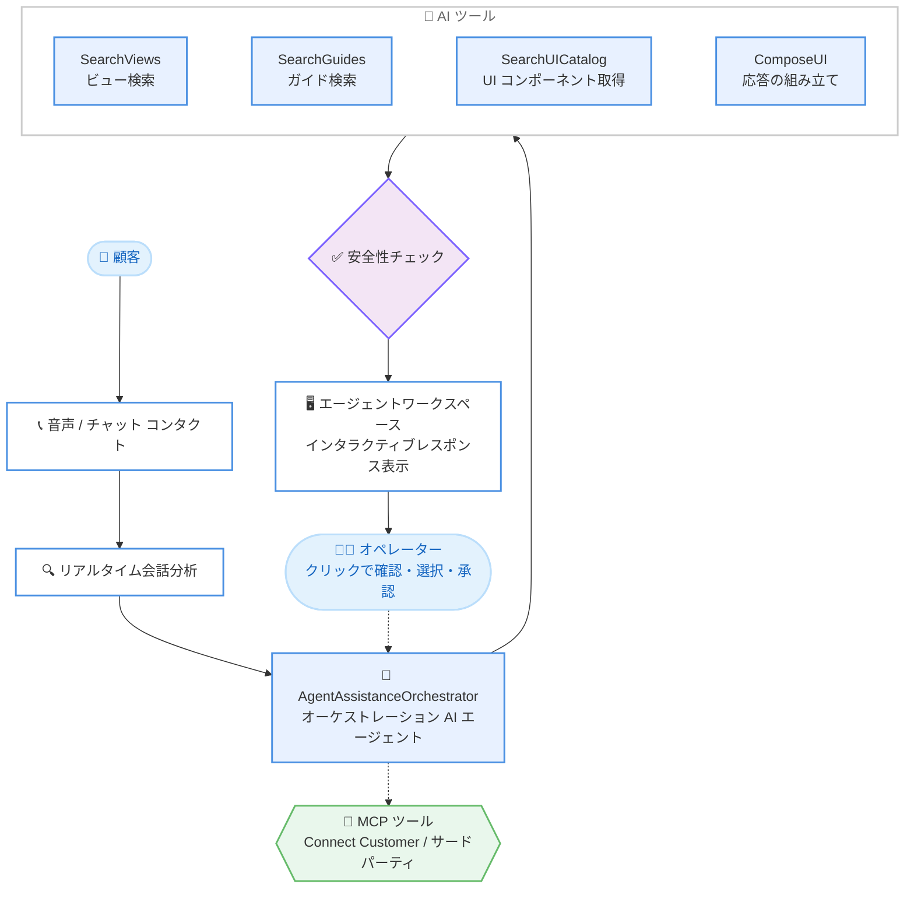

# Amazon Connect - Customer agent assist のインタラクティブレスポンス対応

**リリース日**: 2026 年 11 月 16 日
**サービス**: Amazon Connect
**機能**: Customer agent assist のインタラクティブレスポンス (カード、カルーセル、ボタン、入力フィールド)

📊 [このアップデートのインフォグラフィックを見る](https://takech9203.github.io/aws-news-summary/20261116-Connect-Custom-agent-interactive-responses.html)

## 概要

Amazon Connect Customer agent assist が、カード、カルーセル、ボタン、入力フィールドなどのインタラクティブコンポーネントをサポートしました。AI エージェントは会話のコンテキストをリアルタイムに分析し、Connect Customer またはサードパーティサービスの MCP ツールを使用して、コンタクトセンターのオペレーター (エージェント) に代わってアクションの推奨、情報の取得、タスクの実行を行います。

インタラクティブレスポンスにより、オペレーターはアクションごとに個別のリクエストを手動入力することなく、情報の確認、詳細の提供、選択肢の選択、アクションの承認を行えます。AI エージェントはステップバイステップガイド、ケース、顧客プロファイル、サードパーティアプリケーションも推奨でき、オペレーターは 1 クリックでそれらを開けます。

たとえば、顧客が請求への異議を申し立てる電話をかけてきた場合、AI エージェントは顧客の最近の取引のインタラクティブなリストを動的に生成します。オペレーターは対象の取引を選択し、必要な詳細を提供または確認して、アクションを承認します。AI エージェントは接続されたツールを使用して異議申し立てリクエストを作成し、エージェントワークスペースに確認結果を表示します。

**アップデート前の課題**

- AI エージェントの応答はプレーンテキストのみで、オペレーターは提案された各アクションを手動で入力・実行する必要があった
- 取引の選択や詳細の確認など、構造化された情報のやり取りをテキストベースで行う必要があり、対応時間が長くなりがちだった
- ステップバイステップガイドやケース、顧客プロファイルを開くには、オペレーターが別途ナビゲーションする必要があった

**アップデート後の改善**

- AI エージェントがビュー (カード、カルーセル、ボタン、入力フィールドなど) を使ったインタラクティブな応答を会話内にインラインで表示できるようになった
- オペレーターはクリック操作だけで情報の確認、選択、アクションの承認を完了でき、会話から離れる必要がなくなった
- ステップバイステップガイド、ケース、顧客プロファイル、サードパーティアプリケーションを 1 クリックで開けるようになった
- AI エージェントが MCP ツール経由でタスクを実行し、結果をエージェントワークスペースに直接表示できるようになった

## アーキテクチャ図



AI エージェントが会話をリアルタイムに分析し、ビューやガイドを検索して UI コンポーネントからインタラクティブレスポンスを組み立て、安全性チェックを通過した応答をエージェントワークスペースに表示する流れを示しています。

## サービスアップデートの詳細

### 主要機能

1. **インタラクティブコンポーネントによる応答**
   - カード、カルーセル、ボタン、入力フィールドなどのコンポーネントを使用した応答を会話内にインライン表示
   - 事前定義したビューを優先して使用し、適合するビューがない場合はカスタム AI エージェントで許可されたコンポーネントから独自のレイアウト (カード、サマリー、短いフォームなど) を構成
   - 適合するビューもコンポーネントもない場合はプレーンテキストで応答

2. **プロアクティブな推奨と応答**
   - 顧客が問題を説明した時点で、オペレーターが入力する前に AI エージェントが応答を提案
   - オペレーターからの質問に対する応答にも対応

3. **MCP ツールによるタスク実行**
   - Connect Customer またはサードパーティサービスの MCP ツールを使用して、情報の取得やタスクの実行をオペレーターに代わって実施
   - 例: 異議申し立てリクエストの作成と確認結果のワークスペース表示

4. **1 クリックで開けるリソース推奨**
   - ステップバイステップガイド、ケース、顧客プロファイル、サードパーティアプリケーションを推奨し、ボタンから直接起動

5. **応答の安全性チェック**
   - 表示前にすべてのインタラクティブレスポンスを検査し、安全でないリンクや、存在しない・許可されていないコンポーネントやアクションを拒否
   - チェックを通過しない場合は「Unable to complete the request.」と [Retry] ボタンを表示し、リクエストごとに最大 3 回まで再試行可能

## 技術仕様

### インタラクティブレスポンスで使用する AI ツール

| ツール | 役割 | 固定される入力値 | AI エージェントに必要な権限 |
|------|------|------|------|
| SearchViews | 公開済みビューの検索 | 公開済みビューのみ、最大 100 件 | Views - View |
| SearchGuides | ステップバイステップガイドの検索 | タグ Guide = true かつ公開済みのみ、最大 100 件 | Contact Control Panel - Access |
| SearchUICatalog | 使用可能な UI コンポーネントとアクションの取得 | views カタログ、選択したコンポーネントに限定。デフォルトは Button と ViewReference | Connect assistant - View |
| ComposeUI | 完成した応答の agent assist への送信 | なし | Connect assistant - View |
| ListUICatalog | views カタログの全コンポーネント一覧の取得 (オプション) | catalogId = views | Connect assistant - View |

### デフォルトの UI コンポーネント

| コンポーネント | 動作 |
|------|------|
| Button | 1 クリックアクションを提供。ガイドの開始、アプリ・ケース・顧客プロファイルのオープン、選択内容の AI エージェントへの返送 |
| ViewReference | 会話のデータを埋め込んだ事前定義ビューの表示 |

カスタム AI エージェントの SearchUICatalog ツールで Card、Header、AttributeSection、Alert などのコンポーネントを追加で許可すると、AI エージェントが独自のレイアウトを構成できます。

### オペレーターに必要なセキュリティプロファイル権限

| 権限 | 用途 |
|------|------|
| Workspace Applications: Connect assistant - View | agent assist とその応答の表示 |
| Agent Applications: Custom views - Access | エージェントワークスペースでのビューとガイドの表示 |
| Views - View | 作成したビューの表示 |
| Cases / Customer profiles の View・Create・Edit | ケースと顧客プロファイルのボタン利用 |

## 設定方法

### 前提条件

1. インスタンスで AI エージェントの初期セットアップ (ドメインとナレッジベース) が完了していること
2. オペレーターにコンタクトをルーティングするフローに Connect assistant ブロックが含まれていること
3. 音声コンタクトでのプロアクティブ応答には、フローでリアルタイム会話分析が有効であること
4. チャットコンタクトには、AI チャット向けメッセージストリーミングが有効であること (無効の場合、チャットにインタラクティブレスポンスは表示されない)
5. オプション: ケースと顧客プロファイルのボタンを使用する場合、Cases と Customer Profiles が有効であること

### 手順

#### ステップ 1: インタラクティブレスポンスを有効化

インタラクティブレスポンスはシステム AI エージェント **AgentAssistanceOrchestrator** を使用します。全コンタクトまたは特定フローのいずれかで有効化します。

- **全コンタクト**: AI agent designer の [AI agents] で、Default AI Agent Configurations の [Answer recommendation] を [N/A] に設定。回答推奨 AI エージェントが未選択の場合、agent assist は AgentAssistanceOrchestrator を使用
- **特定フロー**: Connect assistant ブロックでオーケストレーション AI エージェントを選択。特定キューでのパイロット運用に利用可能

#### ステップ 2: ビューを検出可能にする

1. ビューを公開する (AI エージェントは公開済みビューのみを検索、1 回の検索で最大 100 件)
2. 顧客が使う言葉でビューの名前と説明を記述する (AI エージェントは名前と説明にリクエストをマッチング)
3. ビューの入力スキーマで入力を宣言する (AI エージェントが会話から入力を補完。必須入力を補完できないビューは表示されない)

#### ステップ 3: ステップバイステップガイドを検出可能にする

公開済みかつタグ `Guide` = `true` が付与されたガイドのみが検索対象となるため、対象のガイドにタグを付与します。

#### ステップ 4: オペレーターに権限を割り当てる

オペレーターのセキュリティプロファイルに、前述の「オペレーターに必要なセキュリティプロファイル権限」を追加します。

#### ステップ 5 (オプション): カスタム AI エージェントを作成

AI エージェントの動作を変更する場合 (独自レイアウトの構成を許可するなど) は、AgentAssistanceOrchestrator のコピーからカスタム AI エージェントを作成します。

1. AI agent designer で [Create AI agent] を選択し、[AI agent type] に [Orchestration] を指定
2. [Copy from existing] で [AgentAssistanceOrchestrator] を選択 (インタラクティブレスポンス用の全ツールが含まれる)
3. [Tools] の [SearchUICatalog] を編集し、使用を許可するコンポーネント (Card、Header、AttributeSection、Alert など) を選択
4. AI エージェントにツールの権限をカバーするセキュリティプロファイルを割り当て
5. 公開して、ステップ 1 と同様にデフォルトまたはフローの Connect assistant ブロックで選択

#### ステップ 6: テスト

エージェントワークスペースで agent assist を開き、Connect assistant ブロックを通るフローのテストチャットを受け付けます。顧客としてビューがカバーする問題を説明し、ビューが表示されることを確認します。

## メリット

### ビジネス面

- **対応時間の短縮**: オペレーターがクリック操作だけで確認・選択・承認を完了でき、平均処理時間 (AHT) の短縮が期待できる
- **オペレーター体験の向上**: アクションごとの手動入力やアプリケーション間の移動が不要になり、会話に集中できる
- **初回解決率の向上**: AI エージェントが文脈に応じたガイドやケース、顧客プロファイルを 1 クリックで提示し、適切な解決への誘導を支援

### 技術面

- **既存ビュー資産の活用**: Connect Customer のビュー機能で構築した UI をそのまま AI エージェントの応答として再利用できる
- **ガバナンスを維持した拡張**: 許可したコンポーネントのみ使用でき、表示前の安全性チェックにより不正なリンクや未許可のアクションを拒否
- **MCP ツールによる連携**: Connect Customer およびサードパーティサービスへのタスク実行を標準化されたツール経由で実現

## デメリット・制約事項

### 制限事項

- ビューとガイドの検索は 1 回につき最大 100 件で、公開済み (ガイドはタグ `Guide` = `true` 付き) のみが対象
- チャットでは AI チャット向けメッセージストリーミングが有効でない場合、インタラクティブレスポンスが表示されない
- 音声コンタクトでのプロアクティブ応答には、フローでのリアルタイム会話分析の有効化が必要
- システム AI エージェント AgentAssistanceOrchestrator は直接編集できず、カスタマイズにはコピーの作成が必要
- 安全性チェックを通過しない応答の再試行は、リクエストごとに最大 3 回まで

### 考慮すべき点

- AI エージェントはビューの名前・説明にリクエストをマッチングするため、顧客が使う言葉での命名・説明の整備が精度を左右する
- AI エージェントが使用できるツールはセキュリティプロファイルの許可範囲に依存するため、オペレーターと AI エージェント双方の権限設計が必要
- 独自レイアウトの構成を許可する場合、使用を許可するコンポーネントの範囲を業務要件に合わせて検討する必要がある

## ユースケース

### ユースケース 1: 請求への異議申し立て対応

**シナリオ**: 顧客が身に覚えのない請求について電話で問い合わせる。

**実装例**:
```text
1. AI エージェントが会話から「異議申し立て」の意図を検出
2. MCP ツールで顧客の最近の取引を取得し、インタラクティブなリストを動的に生成
3. オペレーターが対象取引を選択し、必要な詳細を確認・入力して承認
4. AI エージェントが接続されたツールで異議申し立てリクエストを作成し、
   確認結果をエージェントワークスペースに表示
```

**効果**: 取引検索、別システムでの申請作成、結果確認といった複数の手作業がクリック操作に置き換わり、対応時間を短縮。

### ユースケース 2: ステップバイステップガイドへの誘導

**シナリオ**: 解約手続きなど、手順が定められた業務をオペレーターが実施する。

**実装例**:
```text
1. 解約手続きのガイドを公開し、タグ Guide = true を付与
2. 顧客が解約を申し出ると、AI エージェントが SearchGuides でガイドを検索
3. ガイドを開くボタンを含むインタラクティブレスポンスを会話内に表示
4. オペレーターが 1 クリックでガイドを起動し、手順に沿って対応
```

**効果**: ガイドを探す時間を削減し、新人オペレーターでも標準化された手順で対応可能。

### ユースケース 3: 既存ビューを活用した情報確認フォーム

**シナリオ**: 住所変更の受付時に、必要な項目を構造化されたフォームで確認する。

**実装例**:
```text
1. 住所変更確認用のビューを作成し、入力スキーマで必須入力を宣言して公開
2. ビューの名前と説明を顧客の言葉 (「住所変更」「引っ越し」など) で記述
3. AI エージェントが会話から入力値を補完してビューを表示
4. オペレーターが内容を確認・修正して承認
```

**効果**: 聞き取り漏れや入力ミスを防ぎ、既存のビュー資産を AI エージェントの応答として再利用。

## 料金

Customer agent assist の既存の料金体系に準じます。詳細は [Amazon Connect の料金ページ](https://aws.amazon.com/connect/pricing/) を参照してください。

## 利用可能リージョン

Amazon Connect Customer agent assist が利用可能なすべての AWS リージョンで利用できます。

## 関連サービス・機能

- **Amazon Connect ビュー**: エージェントワークスペースの UI をカスタマイズする機能。インタラクティブレスポンスの表示に使用される
- **Amazon Connect ステップバイステップガイド**: オペレーター向けのガイド付きワークフロー。AI エージェントが推奨しボタンから起動可能
- **Amazon Connect Cases / Customer Profiles**: ケースと顧客プロファイルのボタン表示に連携
- **Contact Lens リアルタイム会話分析**: 音声コンタクトでのプロアクティブ応答に必要な会話分析機能
- **MCP (Model Context Protocol)**: AI エージェントが Connect Customer やサードパーティサービスのツールを呼び出すためのプロトコル

## 参考リンク

- 📊 [インフォグラフィック](https://takech9203.github.io/aws-news-summary/20261116-Connect-Custom-agent-interactive-responses.html)
- [公式発表 (What's New)](https://aws.amazon.com/about-aws/whats-new/2026/11/Connect-Custom-agent-interactive-responses)
- [ドキュメント: Use Connect Customer agentic assistance](https://docs.aws.amazon.com/connect/latest/adminguide/agentic-assistance.html)
- [ドキュメント: Use interactive responses in agent assist](https://docs.aws.amazon.com/connect/latest/adminguide/agent-assist-interactive-responses.html)
- [料金ページ](https://aws.amazon.com/connect/pricing/)

## まとめ

Customer agent assist のインタラクティブレスポンス対応により、AI エージェントの支援がテキスト提案からクリック操作で完結するアクション実行へと進化しました。既存のビューやステップバイステップガイドを公開・タグ付けするだけで活用できるため、Amazon Connect でエージェント支援を利用中の場合は、まず特定フローでのパイロット運用から試すことを推奨します。
