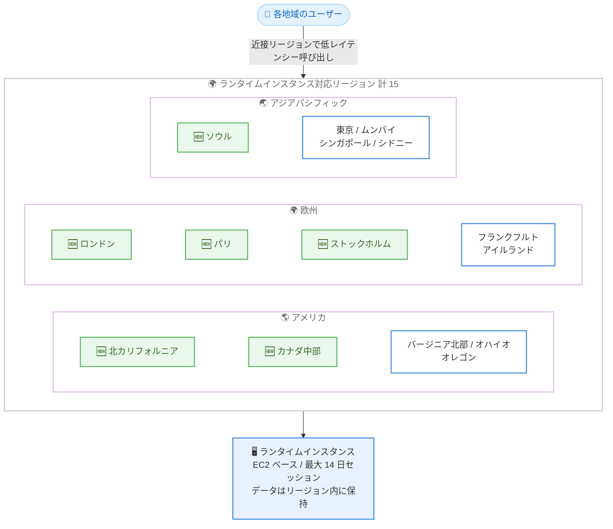

# Amazon Bedrock AgentCore - ランタイムインスタンスが 6 リージョンに拡大

**リリース日**: 2026 年 11 月 16 日
**サービス**: Amazon Bedrock AgentCore
**機能**: ランタイムインスタンス (Runtime Instances) の利用可能リージョン拡大

📊 [このアップデートのインフォグラフィックを見る](https://takech9203.github.io/aws-news-summary/20261116-agentcore-aws-regions.html)

## 概要

Amazon Bedrock AgentCore のランタイムインスタンスが、新たに 6 つの AWS リージョン (米国西部 (北カリフォルニア)、カナダ (中部)、欧州 (ロンドン)、欧州 (パリ)、欧州 (ストックホルム)、アジアパシフィック (ソウル)) で利用可能になりました。これにより、ランタイムインスタンスの対応リージョンは東京を含む合計 15 リージョンに拡大しました。

ランタイムインスタンスは、2026 年 8 月に一般提供が開始されたコンピュートオプションで、AI エージェントを AWS がマネージドする Amazon EC2 インスタンス上で実行します。プロビジョニング、パッチ適用、スケーリング、ライフサイクル管理は AgentCore が処理するため、インフラ運用は不要です。GPU アクセラレーテッド、メモリ最適化、コンピューティング最適化といったインスタンスタイプを選択でき、最大 14 日間の長時間エージェントセッションをサポートします。

今回のリージョン拡大により、エージェントをユーザーのより近くで実行して呼び出しレイテンシーを低減できるほか、インスタンス、ストレージボリューム、セッションデータをリージョン内に保持できるため、英国、フランス、北欧、カナダ、韓国などのデータレジデンシー要件を持つワークロードにも対応しやすくなります。

**アップデート前の課題**

- ランタイムインスタンスの対応リージョンは 9 リージョンに限られており、ロンドン、パリ、ストックホルム、ソウル、カナダ (中部)、北カリフォルニアのユーザーは最寄りのリージョンでランタイムインスタンスを利用できなかった
- 英国、フランス、北欧、カナダ、韓国などにデータレジデンシー要件がある場合、ランタイムインスタンスを採用できない、または遠方のリージョンを使わざるを得なかった
- 遠方のリージョンでエージェントを実行すると、エンドユーザーからの呼び出しレイテンシーが増加していた

**アップデート後の改善**

- 新たに 6 リージョンが追加され、合計 15 リージョンでランタイムインスタンスを利用できるようになった
- エージェントをユーザーに近いリージョンで実行し、呼び出しレイテンシーを低減できるようになった
- インスタンス、ストレージボリューム、セッションデータを該当リージョン内に保持できるようになり、各国のデータレジデンシー要件を満たしやすくなった

## アーキテクチャ図



今回追加された 6 リージョン (🆕) により、ユーザーに近いリージョンでエージェントを実行し、レイテンシー低減とデータレジデンシー要件への対応が可能になります。

## サービスアップデートの詳細

### 主要機能

1. **新たに 6 リージョンでランタイムインスタンスが利用可能に**
   - 米国西部 (北カリフォルニア)、カナダ (中部)、欧州 (ロンドン)、欧州 (パリ)、欧州 (ストックホルム)、アジアパシフィック (ソウル) が追加
   - 対応リージョンは合計 15 リージョンに拡大
   - 利用方法は既存リージョンと同様で、キャパシティプロバイダーを作成してエージェントをアタッチするだけ

2. **呼び出しレイテンシーの低減**
   - エージェントをエンドユーザーに近いリージョンで実行できるため、エージェント呼び出しのレイテンシーを低減できる
   - 対話型エージェントなどレスポンス性能が重要なワークロードに有効

3. **データレジデンシー要件への対応**
   - インスタンス、ストレージボリューム、セッションデータを該当リージョン内に保持できる
   - 英国、フランス、北欧、カナダ、韓国などのデータレジデンシー要件を持つワークロードでランタイムインスタンスを採用可能になった

### ランタイムインスタンスの特徴 (再掲)

ランタイムインスタンスは、サーバーレス microVM を補完するコンピュートオプションです。

- AWS がマネージドする Amazon EC2 インフラストラクチャ上でエージェントを実行 (プロビジョニング、パッチ適用、スケーリング、ライフサイクル管理は AgentCore が担当)
- GPU アクセラレーテッド、メモリ最適化、コンピューティング最適化などのインスタンスタイプを選択可能
- 最大 14 日間の長時間エージェントセッションをサポート (サーバーレス microVM は最大 8 時間)
- エージェントのデプロイ方法や呼び出し方法は microVM と共通

## 技術仕様

### 追加されたリージョン

| リージョン | リージョンコード |
|------|------|
| 米国西部 (北カリフォルニア) | us-west-1 |
| カナダ (中部) | ca-central-1 |
| 欧州 (ロンドン) | eu-west-2 |
| 欧州 (パリ) | eu-west-3 |
| 欧州 (ストックホルム) | eu-north-1 |
| アジアパシフィック (ソウル) | ap-northeast-2 |

### API 変更履歴

今回のアップデートはリージョン拡大であり、新しい API の追加や変更はありません。

## 設定方法

### 前提条件

1. 追加された 6 リージョンを含む、ランタイムインスタンス対応リージョンのいずれかを使用していること
2. キャパシティプロバイダー用の VPC、サブネット、セキュリティグループが準備されていること
3. インフラ管理用のサービスロールとエージェント実行用の IAM ロールを作成できる権限があること

### 手順

#### ステップ 1: 新リージョンでキャパシティプロバイダーを作成する

```bash
aws bedrock-agentcore-control create-capacity-provider \
  --region eu-west-2 \
  --capacity-provider-name "my-capacity-provider" \
  --instance-type "g6.xlarge" \
  --network-configuration '{
    "subnetIds": ["subnet-0123456789abcdef0"],
    "securityGroupIds": ["sg-0123456789abcdef0"]
  }' \
  --role-arn "arn:aws:iam::111122223333:role/AgentCoreInfraRole"
```

追加されたリージョン (この例ではロンドン) でキャパシティプロバイダーを作成します。必要な EC2 インスタンスタイプ、VPC ネットワーク設定、インフラ管理用のサービスロールを指定します。

#### ステップ 2: エージェントランタイムをキャパシティプロバイダーにアタッチして作成する

```bash
aws bedrock-agentcore-control create-agent-runtime \
  --region eu-west-2 \
  --agent-runtime-name "my-agent" \
  --role-arn "arn:aws:iam::111122223333:role/AgentExecutionRole" \
  --agent-runtime-artifact '{
    "containerConfiguration": {
      "containerUri": "111122223333.dkr.ecr.eu-west-2.amazonaws.com/my-agent:latest"
    }
  }' \
  --network-configuration '{"networkMode": "PUBLIC"}'
```

同じリージョンでエージェントランタイムを作成し、キャパシティプロバイダーにアタッチします。デプロイ方法や呼び出し方法はサーバーレス microVM と共通です。詳細な手順は [Get started with Instances](https://docs.aws.amazon.com/bedrock-agentcore/latest/devguide/runtime-instances-getting-started.html) を参照してください。

## メリット

### ビジネス面

- **データレジデンシー要件への対応**: セッションデータやストレージをリージョン内に保持できるため、英国、フランス、北欧、カナダ、韓国などの規制要件を持つ業界でもランタイムインスタンスを採用できる
- **ユーザー体験の向上**: ユーザーに近いリージョンでエージェントを実行することで、呼び出しレイテンシーが低減し、対話型エージェントの応答性が向上する
- **採用範囲の拡大**: これまで対応リージョンの制約でランタイムインスタンスを見送っていたワークロードでも採用を検討できる

### 技術面

- **既存ワークフローをそのまま利用可能**: 新リージョンでも既存リージョンと同じ API、デプロイ方法、呼び出し方法でランタイムインスタンスを利用できる
- **マルチリージョン展開が容易**: 同一構成のキャパシティプロバイダーとランタイムを複数リージョンに展開し、地域ごとにエージェントを配置できる
- **GPU などの特殊ハードウェアを各地域で利用可能**: ローカルモデルの実行などリソース集約型ワークロードを、ユーザーに近いリージョンで実行できる

## デメリット・制約事項

### 制限事項

- 対応リージョンは 15 リージョンであり、すべての AWS リージョンで利用できるわけではない
- 利用したいインスタンスタイプ (特に GPU インスタンス) が、該当リージョンで提供されているかは別途確認が必要

### 考慮すべき点

- ランタイムインスタンスは、標準の Amazon EC2 コストに加えてマネージドなプロビジョンドコンピュートの料金が発生する。EC2 インスタンスの料金はリージョンにより異なるため、リージョン選択時にコストを確認する
- 短時間・イベント駆動の呼び出しが中心であれば、従量課金のサーバーレス microVM の方が適する場合がある

## ユースケース

### ユースケース 1: 欧州のデータレジデンシー要件を満たす長時間エージェント

**シナリオ**: 英国の金融機関が、顧客データを英国内に保持しながら、複数日にわたる調査・分析エージェントを運用したい。

**実装例**:
```
1. eu-west-2 (ロンドン) でキャパシティプロバイダーを作成
2. エージェントランタイムをアタッチしてデプロイ
3. 最大 14 日間のセッションで分析ワークフローを実行
```

**効果**: インスタンス、ストレージ、セッションデータが英国内に保持され、データレジデンシー要件を満たしつつ長時間ワークフローを実行できる。

### ユースケース 2: 韓国ユーザー向け対話型エージェントの低レイテンシー化

**シナリオ**: 韓国のエンドユーザー向けに GPU を利用するエージェントを提供しており、これまで東京リージョンから提供していたため呼び出しレイテンシーが課題だった。

**実装例**:
```
1. ap-northeast-2 (ソウル) に同一構成のキャパシティプロバイダーとランタイムを作成
2. 韓国ユーザーからの呼び出しをソウルリージョンのエンドポイントに切り替え
```

**効果**: ユーザーに近いリージョンでエージェントが実行され、呼び出しレイテンシーが低減し応答性が向上する。

### ユースケース 3: 北米でのマルチリージョン展開

**シナリオ**: カナダのデータ保護要件があるワークロードと、米国西海岸ユーザー向けワークロードを、それぞれのリージョンで運用したい。

**実装例**:
```
1. ca-central-1 (カナダ中部) と us-west-1 (北カリフォルニア) にそれぞれキャパシティプロバイダーを作成
2. 同一のコンテナイメージを各リージョンの Amazon ECR に配置してランタイムをデプロイ
```

**効果**: データをカナダ国内に保持しつつ、米国西海岸ユーザーにも低レイテンシーでエージェントを提供できる。

## 料金

ランタイムインスタンスでは、標準の Amazon EC2 コストに加えて、マネージドなプロビジョンドコンピュートに対する料金が発生します。EC2 インスタンスの料金はリージョンごとに異なるため、新リージョンでの利用時はコストを確認してください。最新の料金は [AgentCore 料金ページ](https://aws.amazon.com/bedrock/agentcore/pricing/) を参照してください。

## 利用可能リージョン

ランタイムインスタンスは以下の 15 リージョンで利用可能です (🆕 は今回追加)。

- 米国東部 (バージニア北部) us-east-1
- 米国東部 (オハイオ) us-east-2
- 🆕 米国西部 (北カリフォルニア) us-west-1
- 米国西部 (オレゴン) us-west-2
- 🆕 カナダ (中部) ca-central-1
- 欧州 (フランクフルト) eu-central-1
- 欧州 (アイルランド) eu-west-1
- 🆕 欧州 (ロンドン) eu-west-2
- 🆕 欧州 (パリ) eu-west-3
- 🆕 欧州 (ストックホルム) eu-north-1
- アジアパシフィック (ムンバイ) ap-south-1
- 🆕 アジアパシフィック (ソウル) ap-northeast-2
- アジアパシフィック (シンガポール) ap-southeast-1
- アジアパシフィック (シドニー) ap-southeast-2
- アジアパシフィック (東京) ap-northeast-1

## 関連サービス・機能

- **Amazon Bedrock AgentCore Runtime**: エージェントの実行基盤。サーバーレス microVM とランタイムインスタンスの 2 つのコンピュートオプションを提供
- **Amazon EC2**: ランタイムインスタンスの実行基盤。GPU アクセラレーテッド、メモリ最適化、コンピューティング最適化などのインスタンスタイプを利用
- **Amazon ECR**: エージェントのコンテナイメージの格納先。マルチリージョン展開時は各リージョンにイメージを配置

## 参考リンク

- 📊 [インフォグラフィック](https://takech9203.github.io/aws-news-summary/20261116-agentcore-aws-regions.html)
- [公式発表 (What's New)](https://aws.amazon.com/about-aws/whats-new/2026/11/agentcore-aws-regions/)
- [ドキュメント: Runtime Instances とキャパシティプロバイダー](https://docs.aws.amazon.com/bedrock-agentcore/latest/devguide/runtime-instances.html)
- [ドキュメント: AgentCore の対応リージョン](https://docs.aws.amazon.com/bedrock-agentcore/latest/devguide/agentcore-regions.html)
- [料金ページ](https://aws.amazon.com/bedrock/agentcore/pricing/)
- [関連レポート: ランタイムインスタンスの一般提供開始 (2026 年 8 月)](./2026-08-06-aws-bedrock-agentcore-runtime-instances-generally-available.md)
- [関連レポート: 次世代 AgentCore Runtime がデフォルトに (2026 年 11 月)](./2026-11-12-new-agentcore-runtime-default.md)

## まとめ

AgentCore のランタイムインスタンスが新たに 6 リージョンに拡大し、合計 15 リージョンで利用可能になりました。英国、フランス、北欧、カナダ、韓国、米国西海岸のユーザーに近い場所でエージェントを実行できるようになり、呼び出しレイテンシーの低減とデータレジデンシー要件への対応が容易になります。これまで対応リージョンの制約でランタイムインスタンスの採用を見送っていた場合は、この機会に最寄りリージョンでの利用を検討するとよいでしょう。
