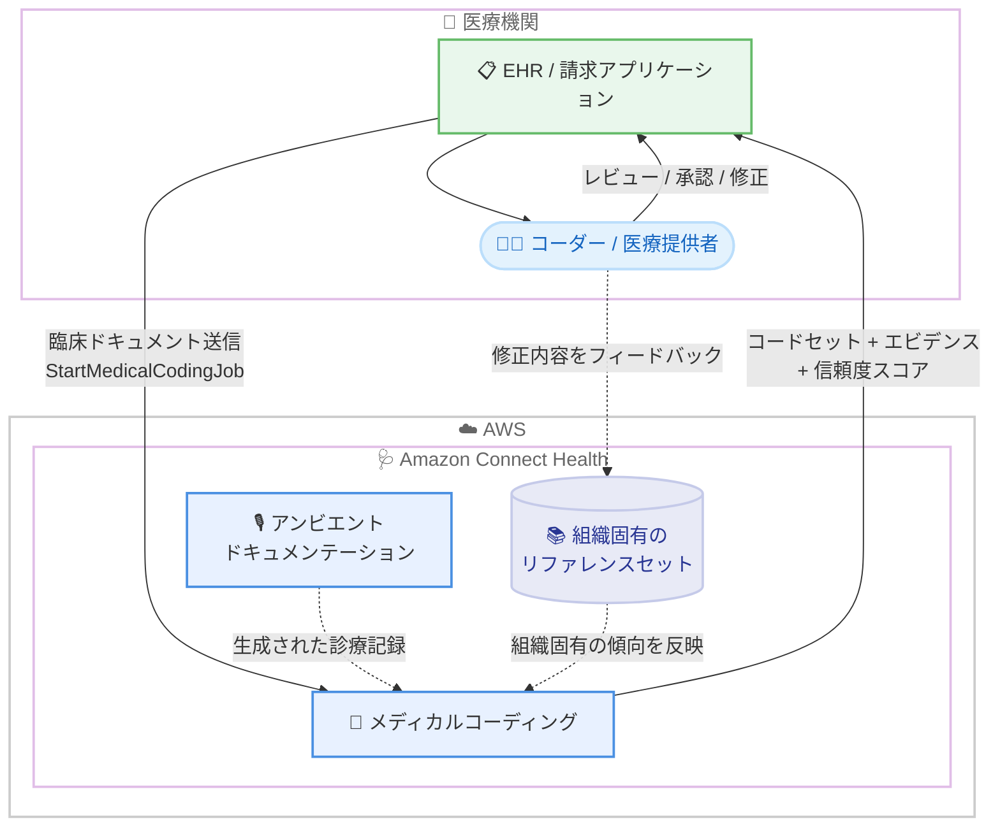

# Amazon Connect Health - メディカルコーディング (パブリックプレビュー)

**リリース日**: 2026 年 11 月 16 日
**サービス**: Amazon Connect Health
**機能**: メディカルコーディング (Medical coding)

📊 [このアップデートのインフォグラフィックを見る](https://takech9203.github.io/aws-news-summary/20261116-amazon-connect-health-medical-coding.html)

## 概要

Amazon Connect Health のメディカルコーディング機能がパブリックプレビューとして発表されました。Amazon Connect Health は、患者エンゲージメントからポイントオブケアのワークフローまで、医療チームと連携して動作する HIPAA 対応の AI サービスです。今回の新機能は、既存の臨床ドキュメント (診療記録) を分析し、ICD-10-CM 診断コード、CPT 処置・サービスコード、E/M レベル、モディファイアを含む請求コードセットを自動生成します。

生成されたすべてのコードには、根拠となる診療記録内のエビデンスへのリンクと信頼度スコアが付与されます。提案されたコードは、医療提供者またはコーダーがレビューして承認した後に請求へ利用されるため、人間による最終確認を前提とした設計になっています。Amazon Connect Health SDK を通じて電子カルテ (EHR) や請求アプリケーションに組み込むことも、Amazon Connect Health のアンビエントドキュメンテーション機能と組み合わせて利用することも可能です。

対象ユーザーは、医療機関の収益サイクル管理 (RCM) チーム、メディカルコーダー、および医療系アプリケーションを開発するヘルスケア IT ベンダーです。

**アップデート前の課題**

- 患者の診療ごとに、コーダーが臨床ノートを読み、診断に ICD-10-CM コード、処置・サービスに CPT コードとモディファイアを手作業で割り当てる必要があった
- 外来・遠隔診療では、文書化された医学的意思決定 (MDM) から E/M レベルを判断する熟練した手作業が診療のたびに繰り返されていた
- コーディングのバックログにより請求 (クレーム) 提出が遅延し、コーディングエラーが支払い拒否、再作業、コンプライアンスリスクにつながっていた

**アップデート後の改善**

- 臨床ドキュメントから診断コード、処置・サービスコード、モディファイア、E/M レベルを含む完全なコードセットを AI が自動生成できるようになった
- 各コードに根拠となるエビデンスと 0 から 1 の信頼度スコアが付与され、コーダーはゼロから構築するのではなくレビューに集中できるようになった
- 過去にコーディング済みの診療データをアップロードして組織固有のコーディングリファレンスセットを構築でき、コーダーの修正内容がフィードバックされて提案精度が継続的に向上するようになった

## アーキテクチャ図



EHR や請求アプリケーションから臨床ドキュメントを送信すると、メディカルコーディングがエビデンスと信頼度スコア付きのコードセットを返し、コーダーのレビュー・修正結果が組織固有のリファレンスセットに反映されて精度が向上する流れを示しています。

## サービスアップデートの詳細

### 主要機能

1. **請求コードセットの自動生成**
   - 臨床ドキュメントから ICD-10-CM 診断コードを、ドキュメントが裏付ける最も具体的なレベルで生成
   - 処置・サービスに対する CPT コードを生成し、文書化された医学的意思決定 (MDM) から E/M レベルを導出
   - 報告方法に影響する状況がある場合は CPT モディファイアを付与
   - 各 CPT コードを医学的必要性を裏付ける ICD-10-CM コードにリンク (コードリンケージ)

2. **エビデンスと信頼度スコアによるレビュー支援**
   - すべての提案コードに、根拠となる診療記録内の該当箇所への参照 (エビデンス) を付与
   - 医学的必要性、診断と治療の整合性、コードの具体性を反映した 0 から 1 の信頼度スコアを付与
   - アプリケーション側で、信頼度に応じて診療ごとのレビュー深度を制御可能

3. **組織固有のカスタマイズ**
   - プレビュー期間中、過去にコーディング済みの診療データを任意でアップロードし、組織に合わせたコーディングリファレンスセットを構築可能
   - コーダーによる修正がリファレンスセットにフィードバックされ、以降の提案精度が向上
   - ターゲットコードリストや過去のコーディングサンプルを用いたモデルの適応も可能

4. **柔軟な統合方式**
   - Amazon Connect Health SDK により、既存の EHR や請求アプリケーションへ組み込み可能
   - Amazon Connect Health のアンビエントドキュメンテーション機能と組み合わせ、診療記録の生成からコーディングまでを一貫して実行可能
   - コンタクトセンターは不要で、ポイントオブケアエージェントとして単体で利用可能

## 技術仕様

### 生成されるコードセット

| コードセット | 対象 | 出力内容 |
|------|------|------|
| ICD-10-CM | 診断 | 文書化された各状態に対し、ドキュメントが裏付ける最も具体的なレベルのコード |
| CPT | 処置・サービス (E/M 診療を含む) | 処置・サービスコード。MDM から導出された E/M レベルを含む |
| CPT モディファイア | サービスの報告方法に影響する状況 | ドキュメントが必要とする場合のモディファイア |
| コードリンケージ | 医学的必要性 | 各 CPT コードと、それを裏付ける ICD-10-CM コードのリンク |
| エビデンス | 監査可能性 | 各コードを裏付けるノート内の該当箇所への参照 |
| 信頼度 | レビューの優先順位付け | 各コードに対する 0 から 1 のスコア |

### API

ドキュメントによると、メディカルコーディングは 2 つの非同期 API を通じて自身のアプリケーションに統合します。

| API | 役割 |
|------|------|
| `StartMedicalCodingJob` | 臨床ドキュメントを入力としてコーディングジョブを開始 |
| `GetMedicalCodingJob` | ジョブのステータスと結果 (構造化された JSON 出力) を取得 |

リクエストの `encounterContext` (診療の種類・設定) と `patientContext` (患者のステータス・属性) はオプションですが、適用されるコードに直接影響するため、最適な性能を得るには指定が重要です。

## 設定方法

### 前提条件

1. AWS アカウントと、米国東部 (バージニア北部) または米国西部 (オレゴン) リージョンへのアクセス
2. プレビューへのアクセス。ドキュメントによると、アクセスのリクエストには AWS アカウントチームへの連絡が必要です
3. コーディング対象の臨床ドキュメント (テキスト) を送信できるアプリケーション環境

### 手順

#### ステップ1: プレビューアクセスのリクエスト

AWS アカウントチームに連絡し、メディカルコーディングのプレビューアクセスをリクエストします。組織のターゲットコードリストや過去のコーディングサンプルを用いたモデル適応についても、アカウントチームと調整できます。

#### ステップ2: コーディングジョブの開始

```bash
# 臨床ドキュメントを入力としてコーディングジョブを開始するイメージ
# 実際のパラメータはユーザーガイドの Medical coding inputs を参照
aws connecthealth start-medical-coding-job \
  --region us-east-1 \
  --cli-input-json file://coding-job-input.json
```

`StartMedicalCodingJob` API で臨床テキストと、任意の `encounterContext`、`patientContext` を送信し、非同期のコーディングジョブを開始します。コンテキスト情報を提供することでコード選択の精度が向上します。

#### ステップ3: 結果の取得とレビューワークフローへの統合

```bash
# ジョブのステータスと結果を取得するイメージ
aws connecthealth get-medical-coding-job \
  --region us-east-1 \
  --job-id <ジョブ ID>
```

`GetMedicalCodingJob` API でジョブの完了を確認し、構造化された JSON 形式のコードセット (コード、リンケージ、エビデンス、信頼度) を取得します。取得した結果をコーダーのワークベンチや EHR のレビュー画面に表示し、承認・修正のワークフローに組み込みます。

## メリット

### ビジネス面

- **収益サイクルの加速**: コーディングのバックログを削減し、請求提出までのリードタイムを短縮できる
- **支払い拒否・再作業の削減**: 診断コードと処置コードがリンクされた請求可能な形で生成され、医学的必要性の裏付けを確認しやすくなるため、コーディングエラー起因の否認リスクを低減できる
- **コーダーの生産性向上**: コードセットをゼロから構築する作業が、エビデンス付き提案のレビュー作業に変わり、熟練コーダーがより複雑な症例に集中できる

### 技術面

- **監査可能性**: すべてのコードにエビデンスと信頼度スコアが付与され、監査担当者やコーダーが検証に必要な情報を得られる
- **柔軟な統合**: 構造化 JSON 出力により、ポイントオブケア、コーダーワークベンチ、自動化パイプラインのいずれにも組み込める。コンタクトセンターは不要
- **継続的な精度向上**: コーダーの修正が組織固有のリファレンスセットにフィードバックされ、利用するほど提案精度が向上する

## デメリット・制約事項

### 制限事項

- プレビュー段階の機能であり、仕様や提供状況は変更される可能性がある。ドキュメントによると、プレビュー機能は本番環境での使用は推奨されない
- 利用可能リージョンは米国東部 (バージニア北部) と米国西部 (オレゴン) の 2 リージョンのみで、日本リージョンでは利用できない
- 外来診療のプロフェッショナルコーディングに最適化されており、入院施設コーディング (ICD-10-PCS や DRG 割り当て) はサポートされない
- プライマリケアの外来・遠隔診療に最適化されており、その他の専門科のドキュメントも送信できるが、提案精度が低下する可能性があるため特に注意深いレビューが必要

### 考慮すべき点

- 提案されたコードは、医療提供者またはコーダーによるレビューと承認を経てから請求に使用する運用設計が前提となる
- `encounterContext` と `patientContext` はオプションだが、コード選択の精度に直接影響するため、可能な限り提供することが推奨される
- 米国の医療請求コード体系 (ICD-10-CM、CPT、E/M) を対象としており、日本の診療報酬制度には対応していない
- 料金に関する情報は発表に含まれていないため、利用前に AWS アカウントチームへの確認が必要

## ユースケース

### ユースケース1: コーダーワークベンチでのコンピュータ支援コーディング

**シナリオ**: 医療機関の RCM チームが、コーダーの作業負荷増大とコーディングバックログに悩んでいる。

**実装例**:
```
1. EHR から診療終了後の臨床ノートを StartMedicalCodingJob に送信
2. GetMedicalCodingJob で ICD-10-CM / CPT / E/M レベル / モディファイアの
   提案と信頼度スコアを取得
3. コーダーワークベンチに提案コードとエビデンス (ノート内の根拠箇所) を表示
4. コーダーがレビュー・修正・承認し、修正内容をリファレンスセットにフィードバック
```

**効果**: コーダーがコードセット構築作業からレビュー作業へ移行し、1 診療あたりの処理時間を短縮。バックログ削減により請求提出が早まる。

### ユースケース2: アンビエントドキュメンテーションと組み合わせた診療後の即時コーディング

**シナリオ**: 遠隔診療プラットフォームで、診察の記録作成から請求コーディングまでの事務作業を最小化したい。

**実装例**:
```
1. Amazon Connect Health のアンビエントドキュメンテーションで
   診察会話から臨床ノートを自動生成
2. 生成されたノートをそのままメディカルコーディングに入力
   (encounterContext に遠隔診療である旨を設定)
3. 診察直後に医師が提案コードをエビデンスとともに確認・承認
```

**効果**: 診察から請求可能なコードセット確定までの時間を大幅に短縮し、医師の事務負担を軽減。

### ユースケース3: 信頼度スコアに基づくレビュー深度の自動振り分け

**シナリオ**: 大量の診療を処理する医療グループが、限られたコーダーリソースをリスクの高い症例に集中させたい。

**実装例**:
```
1. すべての診療をメディカルコーディングで処理
2. アプリケーション側で信頼度スコアに応じてルーティング
   - 高信頼度: 簡易レビューキューへ
   - 低信頼度または高額請求: 熟練コーダーの詳細レビューキューへ
3. 修正結果をリファレンスセットに反映し、振り分け精度を継続改善
```

**効果**: レビューリソースの最適配分により、スループットとコンプライアンスの両立を実現。

## 料金

発表およびドキュメントに料金情報は含まれていません。パブリックプレビュー期間中の料金については、AWS アカウントチームまたは [Amazon Connect Health 製品ページ](https://aws.amazon.com/health/connect-health/) で最新情報を確認してください。

## 利用可能リージョン

パブリックプレビューとして以下の 2 リージョンで利用可能です。

- 米国東部 (バージニア北部) - us-east-1
- 米国西部 (オレゴン) - us-west-2

## 関連サービス・機能

- **Amazon Connect Health アンビエントドキュメンテーション**: 診察会話から臨床ノートを自動生成する機能。生成したノートをメディカルコーディングの入力として直接利用できる
- **Amazon Connect Health SDK**: EHR や請求アプリケーションにメディカルコーディングを組み込むための SDK
- **AWS HealthScribe**: 医療会話から臨床ノートを生成する HIPAA 対応サービス。臨床ドキュメント生成という点で関連する

## 参考リンク

- 📊 [インフォグラフィック](https://takech9203.github.io/aws-news-summary/20261116-amazon-connect-health-medical-coding.html)
- [公式発表 (What's New)](https://aws.amazon.com/about-aws/whats-new/2026/11/amazon-connect-health-medical-coding/)
- [ドキュメント (Medical coding - Amazon Connect Health User Guide)](https://docs.aws.amazon.com/connecthealth/latest/userguide/medical-coding.html)
- [Amazon Connect Health 製品ページ](https://aws.amazon.com/health/connect-health/)

## まとめ

Amazon Connect Health のメディカルコーディングは、米国医療機関の収益サイクルにおける最大のボトルネックの一つであるコーディング作業を、エビデンスと信頼度スコア付きの AI 提案によって支援するパブリックプレビュー機能です。人間によるレビュー・承認を前提とした設計で、監査可能性と精度の継続的改善を両立しています。米国市場向けのヘルスケアソリューションを扱う場合は、アンビエントドキュメンテーションとの組み合わせを含め、プレビューでの評価を検討する価値があります。
