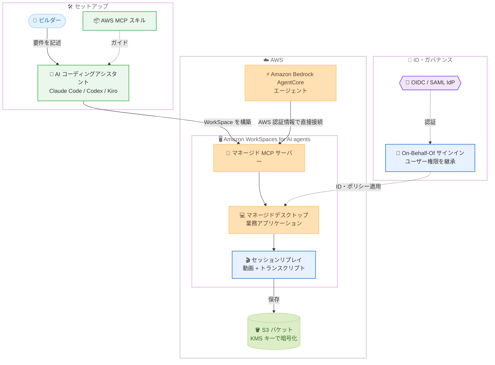

# Amazon WorkSpaces - AI エージェントのセットアップ・接続・ガバナンス強化

**リリース日**: 2026 年 11 月 16 日
**サービス**: Amazon WorkSpaces (Amazon WorkSpaces for AI agents)
**機能**: AI エージェントの簡易セットアップ、OIDC 認証・On-Behalf-Of サインイン、セッションリプレイ

📊 [このアップデートのインフォグラフィックを見る](https://takech9203.github.io/aws-news-summary/20261116-amazon-workspaces-AI-agents-connect-govern.html)

## 概要

Amazon WorkSpaces for AI agents に、AI エージェントのセットアップ・接続・ガバナンスを強化する複数の新機能が追加されました。2026 年 6 月に一般提供が開始された WorkSpaces for AI agents は、AI エージェントがマネージドなデスクトップ環境経由で業務アプリケーションを操作できる機能です。今回のアップデートは、パイロット段階のエージェントを、エンタープライズの ID 管理・ポリシー・監査統制のもとで本番運用へ移行させることを目的としています。

セットアップ面では、Claude Code、Codex、Kiro といった AI コーディングアシスタントに要件を伝えるだけで、AWS の MCP スキルにガイドされた形で WorkSpace 環境を構築できるようになりました。Amazon Bedrock AgentCore 上で構築したエージェントは、エージェントコードを書かずに AWS 認証情報で直接接続できます。ID 管理面では、従来の SAML に加えて OIDC 互換の ID プロバイダーによる認証と、サインインしたユーザーの権限を継承する On-Behalf-Of サインインがサポートされました。監査面では、セッションのスクリーンショットを動画化し、エージェントの操作内容を平易な文章のトランスクリプトとして記録するセッションリプレイ機能が追加されています。

**アップデート前の課題**

- エージェント用の WorkSpace 環境は手動でマシン構成を行う必要があり、セットアップに手間がかかった
- エージェントの認証は SAML と IAM が中心で、OIDC ベースの ID プロバイダーを利用する組織では統合が難しかった
- エージェントを特定ユーザーの権限・グループポリシーのもとで動作させる標準的な仕組みがなかった
- 監査証跡はスクリーンショットやツール呼び出しログが中心で、セッション全体を後から効率的にレビューする手段が限られていた

**アップデート後の改善**

- AI コーディングアシスタント (Claude Code、Codex、Kiro) に要件を記述するだけで、調整可能なデフォルト設定を使って WorkSpace を構築できるようになった
- Amazon Bedrock AgentCore 上のエージェントは、エージェントコードを書かずに AWS 認証情報で直接接続できるようになった
- 新しいツーリングにより、エージェントが 1 回の呼び出しで複数のアクションを実行でき、基盤モデルが元々サポートする computer use アクションを活用できるため、コストが低減し精度が向上した
- OIDC 互換の任意の ID プロバイダーで認証でき、サインインを組織の IdP に直接ルーティングできるようになった
- On-Behalf-Of サインインにより、エージェントがサインインユーザーのディレクトリ ID・権限・グループポリシーを継承して動作できるようになった
- セッションリプレイにより、スクリーンショットを動画に変換し、操作内容のトランスクリプトと合わせて自組織の S3 バケットに独自キーで暗号化して保存できるようになった

## アーキテクチャ図



AI コーディングアシスタントが MCP スキルのガイドに従って WorkSpace 環境を構築し、Bedrock AgentCore のエージェントは AWS 認証情報で直接接続します。認証は OIDC / SAML IdP 経由で行われ、On-Behalf-Of サインインによりユーザーの権限がエージェントに適用されます。セッションは動画とトランスクリプトとして S3 に暗号化保存されます。

## サービスアップデートの詳細

### 主要機能

1. **AI コーディングアシスタントによる簡易セットアップ**
   - マシン構成を手動で行う代わりに、エージェントに必要な要件を Claude Code、Codex、Kiro などの AI コーディングアシスタントに記述するだけでセットアップできます
   - アシスタントは AWS の MCP スキルにガイドされ、調整可能なデフォルト設定を使用して WorkSpace を構築します
   - 環境構築の試行錯誤が減り、エージェントの本番投入までの時間を短縮できます

2. **Amazon Bedrock AgentCore との直接接続**
   - Amazon Bedrock AgentCore 上で構築したエージェントを、エージェントコードを書かずに AWS 認証情報で直接接続できます
   - 新しいツーリングにより、エージェントは 1 回の呼び出しで複数のアクションを実行でき、基盤モデルが元々サポートする computer use アクションを活用できます
   - これにより呼び出し回数が減り、コストの低減と精度の向上につながります

3. **OIDC 認証と On-Behalf-Of サインイン**
   - 既存の SAML サポートに加えて、OIDC 互換の任意の ID プロバイダーでエージェントを認証できるようになりました
   - 管理者はサインインを組織の IdP に直接ルーティングでき、ユーザーは普段の企業認証情報をそのまま使用できます
   - On-Behalf-Of サインインにより、エージェントはサインインしたユーザーとして動作し、そのユーザーのディレクトリ ID・権限・グループポリシーを継承します

4. **セッションリプレイによる監査**
   - セッションのスクリーンショットを動画に変換し、エージェントの操作内容を平易な文章で記録したトランスクリプトと組み合わせて提供します
   - 記録は自組織の Amazon S3 バケットに保存され、独自の KMS キーで暗号化できます
   - セキュリティレビューやコンプライアンス監査において、エージェントの行動を効率的に確認できます

5. **イメージビルダーでのエージェントアクセス**
   - API 変更により、イメージビルダーでもエージェントアクセス設定がサポートされました
   - AI エージェントがイメージ作成前にアプリケーションのインストール・設定・テストを実行できます

## 技術仕様

### エージェントアクセス設定 AgentAccessConfig の主な項目

| 項目 | 詳細 |
|------|------|
| AgentAction | `COMPUTER_VISION`、`COMPUTER_INPUT`、`FORWARD_MCP_TOOLS` を個別に許可・拒否 |
| ReplaySessionEnabled | セッションリプレイの有効化 (スタック設定に追加) |
| KmsKeyArn | リプレイ記録の暗号化に使用する KMS キー |
| S3BucketArn | スクリーンショット・記録の保存先 S3 バケット |
| ScreenshotsUploadEnabled | スクリーンショットアップロードの有効化 |
| UserControlMode | `VIEW_ONLY`、`VIEW_STOP`、`DISABLED` による人間の監視・介入モード |

### 認証方式

| 認証方式 | 詳細 |
|----------|------|
| IAM | AWS 認証情報による接続。Bedrock AgentCore からの直接接続にも使用 |
| SAML | 従来からサポートされているフェデレーション認証 |
| OIDC | 今回追加。OIDC 互換の任意の ID プロバイダーと連携可能 |
| On-Behalf-Of | サインインユーザーのディレクトリ ID・権限・グループポリシーをエージェントが継承 |

### API 変更履歴

| 日付 | サービス | 変更内容 |
|------|----------|----------|
| 2026/11/13 | [appstream2](https://awsapichanges.com/archive/changes/b4312b-appstream2.html) | 1 new 8 updated api methods - イメージビルダーへの AgentAccessConfig 追加、スタックへの ReplaySessionEnabled / KmsKeyArn 追加 (CreateStack、UpdateStack、CreateImageBuilder、UpdateImageBuilder など) |

## 設定方法

### 前提条件

1. AWS アカウントと Amazon WorkSpaces Applications (AppStream 2.0) を利用できる権限
2. エージェント用のスタック・フリートを構成できる IAM 権限
3. OIDC / SAML 認証を使用する場合は、連携先 ID プロバイダーの設定情報
4. セッションリプレイを使用する場合は、保存先の S3 バケットと KMS キー

### 手順

#### ステップ 1: AI コーディングアシスタントで環境を構築

AWS の MCP スキルを導入した Claude Code、Codex、Kiro などの AI コーディングアシスタントに、エージェントに必要な環境 (アプリケーション、ネットワーク、権限など) を自然言語で記述します。アシスタントが調整可能なデフォルト設定を使用して WorkSpace を構築します。

#### ステップ 2: セッションリプレイを有効化

```bash
aws appstream update-stack \
  --name my-agent-stack \
  --agent-access-config '{
    "Settings": [
      {"AgentAction": "COMPUTER_VISION", "Permission": "ENABLED"},
      {"AgentAction": "COMPUTER_INPUT", "Permission": "ENABLED"},
      {"AgentAction": "FORWARD_MCP_TOOLS", "Permission": "ENABLED"}
    ],
    "S3BucketArn": "arn:aws:s3:::my-agent-replay-bucket",
    "ScreenshotsUploadEnabled": true,
    "ReplaySessionEnabled": true,
    "KmsKeyArn": "arn:aws:kms:us-east-1:123456789012:key/xxxx",
    "UserControlMode": "VIEW_STOP"
  }'
```

スタックのエージェントアクセス設定を更新し、セッションリプレイを有効化しています。記録は指定した S3 バケットに保存され、指定した KMS キーで暗号化されます。`UserControlMode` を `VIEW_STOP` にすると、人間の監視者がセッションを閲覧し、必要に応じて停止できます。

#### ステップ 3: ID プロバイダーと On-Behalf-Of サインインを設定

組織の OIDC 互換 ID プロバイダーをサインイン先として設定し、エージェントがサインインユーザーの ID・権限・グループポリシーを継承して動作するように構成します。具体的な設定手順は [エージェントアクセスのドキュメント](https://docs.aws.amazon.com/appstream2/latest/developerguide/agent-access.html) を参照してください。

## メリット

### ビジネス面

- **本番移行の加速**: パイロット段階のエージェントを、エンタープライズの ID・ポリシー・監査統制のもとで本番運用へ移行しやすくなります
- **監査対応の効率化**: セッションリプレイの動画とトランスクリプトにより、セキュリティレビューやコンプライアンス監査でエージェントの行動を短時間で確認できます
- **既存 ID 基盤の活用**: 組織が既に導入している OIDC / SAML の ID プロバイダーとアクセスポリシーをそのままエージェントに適用できます

### 技術面

- **セットアップの自動化**: AI コーディングアシスタントと MCP スキルにより、手動のマシン構成が不要になります
- **コストと精度の最適化**: 1 回の呼び出しで複数アクションを実行でき、基盤モデルの computer use アクションを活用することで、呼び出し回数の削減と精度向上を両立します
- **権限管理の簡素化**: On-Behalf-Of サインインにより、エージェント専用の権限体系を別途設計せず、ユーザーの既存権限とグループポリシーを継承できます
- **データ主権の確保**: リプレイ記録は自組織の S3 バケットに独自の KMS キーで暗号化して保存されます

## デメリット・制約事項

### 制限事項

- Bedrock AgentCore とのコード不要の直接接続は、AgentCore 上に構築されたエージェントが対象です
- セッションリプレイの保存には自組織の S3 バケットの用意が必要で、ストレージコストが発生します
- 公式発表では利用可能リージョンが明示されていないため、利用前に対応状況の確認が必要です

### 考慮すべき点

- On-Behalf-Of サインインではエージェントがユーザーの権限をそのまま継承するため、対象ユーザーの権限設計 (最小権限の原則) がこれまで以上に重要になります
- セッションリプレイには画面情報が含まれるため、保存先 S3 バケットのアクセス制御と KMS キーのポリシーを厳格に管理する必要があります
- AI コーディングアシスタントによるセットアップはデフォルト設定を使用するため、本番投入前にネットワークやセキュリティ設定のレビューが推奨されます

## ユースケース

### ユースケース 1: AgentCore エージェントによるデスクトップ業務の自動化

**シナリオ**: Amazon Bedrock AgentCore 上で構築した業務エージェントに、API のない社内デスクトップアプリケーションの操作を追加したい。

**実装例**:
```
1. AgentCore のエージェントから AWS 認証情報で WorkSpaces の MCP サーバーに直接接続
2. エージェントコードを変更せず、デスクトップ操作タスクを委譲
3. 1 回の呼び出しで複数アクションをまとめて実行し、呼び出し回数を削減
```

**効果**: エージェントコードの追加開発なしでデスクトップ操作を組み込め、呼び出し回数の削減によりコストと応答時間を抑えられます。

### ユースケース 2: 金融機関におけるエージェント操作の監査

**シナリオ**: 金融機関が、取引処理を行うエージェントの全操作をコンプライアンス監査向けに記録・レビューする必要がある。

**実装例**:
```
1. スタックで ReplaySessionEnabled を有効化し、保存先 S3 バケットと KMS キーを指定
2. 監査時はセッションの動画とトランスクリプトを参照
3. UserControlMode を VIEW_STOP に設定し、異常時は人間が即時停止
```

**効果**: スクリーンショットを個別に確認する代わりに、動画と平易な文章のトランスクリプトでエージェントの行動を効率的にレビューでき、監査証跡は独自キーで暗号化して保全できます。

### ユースケース 3: 企業 IdP と連携したユーザー代理実行

**シナリオ**: 従業員ごとにアクセス可能な業務システムが異なる企業で、各従業員の権限の範囲内でのみエージェントに作業させたい。

**実装例**:
```
1. 組織の OIDC 互換 IdP をサインイン先として設定
2. On-Behalf-Of サインインを構成し、エージェントがサインインユーザーの
   ディレクトリ ID・権限・グループポリシーを継承
3. 従業員は普段の企業認証情報でサインイン
```

**効果**: エージェント用の権限体系を別途構築することなく、既存のディレクトリとグループポリシーによる統制をエージェントにそのまま適用できます。

## 料金

今回の公式発表では、新機能に関する個別の料金情報は明示されていません。WorkSpaces for AI agents の料金はアクティブなセッション時間に基づいてスケールするモデルです。セッションリプレイを使用する場合は、保存先 S3 バケットのストレージ料金と KMS キーの利用料金が別途発生します。最新の料金は公式料金ページを確認してください。

## 利用可能リージョン

公式発表では利用可能リージョンの一覧は明示されていません。利用前に公式ドキュメントで最新のリージョン対応状況を確認してください。

## 関連サービス・機能

- **Amazon WorkSpaces / WorkSpaces Applications**: 本機能の基盤となるマネージドデスクトップインフラストラクチャ
- **Amazon Bedrock AgentCore**: 本アップデートでコード不要の直接接続が可能になったエージェント構築・実行基盤
- **Model Context Protocol (MCP)**: エージェントとの標準的な接続プロトコル。セットアップをガイドする AWS MCP スキルにも利用
- **Amazon S3 / AWS KMS**: セッションリプレイ記録の保存と独自キーによる暗号化
- **AWS IAM / Active Directory / OIDC・SAML IdP**: エージェントの認証と権限管理

## 参考リンク

- 📊 [インフォグラフィック](https://takech9203.github.io/aws-news-summary/20261116-amazon-workspaces-AI-agents-connect-govern.html)
- [公式発表 (What's New)](https://aws.amazon.com/about-aws/whats-new/2026/11/amazon-workspaces-AI-agents-connect-govern)
- [2026 年 6 月の一般提供開始の発表](https://aws.amazon.com/about-aws/whats-new/2026/06/amazon-workspaces-ai/)
- [ドキュメント (Provide agents access to WorkSpaces)](https://docs.aws.amazon.com/appstream2/latest/developerguide/agent-access.html)
- [製品ページ (Amazon WorkSpaces for AI agents)](https://aws.amazon.com/workspaces/ai-agents/)

## まとめ

今回のアップデートにより、Amazon WorkSpaces for AI agents は「エージェントを素早く作って接続し、企業統制のもとで運用する」ための機能群が大きく強化されました。特に OIDC 対応と On-Behalf-Of サインインは既存の ID 基盤をそのまま活用でき、セッションリプレイは監査対応の実用性を高めます。2026 年 6 月の GA 以降に概念実証を進めてきた組織は、これらの新機能を活用して本番移行とガバナンス体制の整備を検討することを推奨します。
