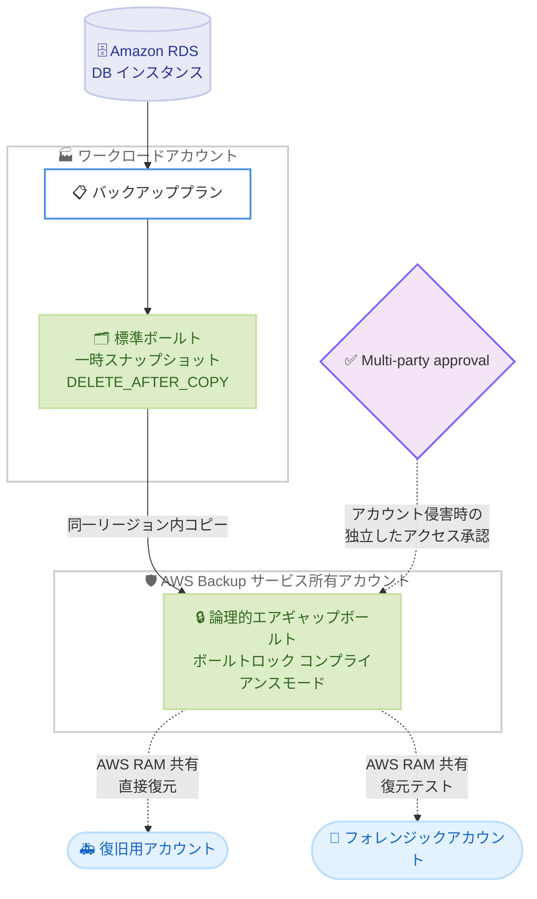

# AWS Backup - 論理的エアギャップボールトの Amazon RDS サポート

**リリース日**: 2026 年 11 月 16 日
**サービス**: AWS Backup
**機能**: 論理的エアギャップボールトにおける Amazon RDS DB インスタンスのサポート

📊 [このアップデートのインフォグラフィックを見る](https://takech9203.github.io/aws-news-summary/20261116-aws-backup-air-gapped-vault-rds.html)

## 概要

AWS Backup の論理的エアギャップボールト (logically air-gapped vault) が、Amazon Relational Database Service (Amazon RDS) DB インスタンスをサポートしました。論理的エアギャップボールトは、コンプライアンスモードの AWS Backup Vault Lock がデフォルトで有効化された、不変 (イミュータブル) かつ分離されたバックアップを保存する特殊なボールトです。リカバリポイントは AWS Backup サービス所有アカウントに保存され、お客様の本番環境のセキュリティ境界の外側で保護されます。

今回のアップデートにより、ランサムウェア、内部不正、アカウント侵害といった脅威から Amazon RDS のバックアップを保護できるようになりました。AWS Resource Access Manager (RAM) によるアカウント間・AWS Organizations 間でのボールト共有と、共有先アカウントからの直接復元により、データ損失イベントからの復旧時間を短縮できます。また、アカウント全体が侵害された場合でも、Multi-party approval により独立したアクセス経路を確保できます。

**アップデート前の課題**

- Amazon RDS DB インスタンスのバックアップは論理的エアギャップボールトに保存できず、ランサムウェアやアカウント侵害に対するエアギャップ保護を RDS に適用できなかった
- RDS バックアップの不変性を確保するには標準ボールトでボールトロックを個別に設定する必要があり、ボールトはお客様アカウント内に存在するため、アカウント侵害時のリスクが残っていた
- 侵害発生時に別アカウントから RDS バックアップを直接復元する仕組みがなく、復旧前にスナップショットのコピーが必要で RTO が長くなっていた

**アップデート後の改善**

- Amazon RDS DB インスタンスのバックアップを論理的エアギャップボールトに保存し、不変性と分離による保護を適用できるようになった
- バックアッププランで RDS DB インスタンスを割り当て、同一リージョン内の論理的エアギャップボールトをコピー先として指定するだけで利用を開始できる
- AWS RAM でボールトを復旧用アカウントやフォレンジックアカウントに共有し、コピー不要の直接復元や復元テストを実行できるようになった

## アーキテクチャ図



RDS バックアップは一時スナップショットを経由して同一リージョン内の論理的エアギャップボールトへコピーされ、AWS RAM で共有された復旧用・フォレンジックアカウントから直接復元できます。

## サービスアップデートの詳細

### 主要機能

1. **Amazon RDS バックアップの不変・分離保管**
   - RDS DB インスタンスのバックアップを論理的エアギャップボールトに保存可能
   - ボールトはコンプライアンスモードのボールトロックが常に有効で、保持期間が終了するまでリカバリポイントの変更・削除は不可
   - リカバリポイントは AWS Backup サービス所有アカウントに保存され、本番環境のセキュリティ境界から分離される
   - AWS 所有キー (デフォルト) またはカスタマーマネージドキー (CMK) による暗号化

2. **RDS 専用のコピーワークフロー**
   - バックアッププランで RDS DB インスタンスを割り当て、同一リージョン内の論理的エアギャップボールトをコピー先に指定する
   - AWS Backup はまず標準ボールトに `DELETE_AFTER_COPY` ライフサイクルの一時スナップショットを作成し、その後エアギャップボールトへコピーする
   - コピーが失敗した場合、一時リカバリポイントは指定した保持期間に従って保持される (利用可能だがエアギャップ保護はなし)
   - 論理的エアギャップボールトをプライマリバックアップターゲットとして指定することも可能

3. **AWS RAM 共有と直接復元**
   - ボールトを AWS RAM で復旧用アカウントやフォレンジックアカウントに共有可能 (AWS Organizations 外のアカウントへの共有もサポート)
   - 共有先アカウントからコピー操作なしで直接復元ジョブを開始でき、大規模データベースでも復旧を即座に開始できる
   - 復元テスト機能と統合し、フォレンジックアカウントでのリカバリポイントの定期検証が可能 (EventBridge と Lambda による行数やスキーマ整合性のカスタムチェックを `PutRestoreValidationResult` API で報告)

4. **Multi-party approval によるアクセス保護**
   - ボールト所有アカウントや AWS Organization 全体が侵害された場合でも、IAM Identity Center の承認者チームによる承認を経て復旧用アカウントにアクセスを付与できる
   - 単独のユーザーだけではアクセスを許可できないため、内部不正にも有効

## 技術仕様

### 論理的エアギャップボールトと RDS サポートの仕様

| 項目 | 詳細 |
|------|------|
| 対象リソース | Amazon RDS DB インスタンス |
| コピー先の制約 | DB インスタンスと同一アカウント・同一リージョンの論理的エアギャップボールトのみ |
| クロスリージョンコピー | RDS バックアップを含む場合、論理的エアギャップボールトとの間では現在利用不可 |
| 継続バックアップ (PITR) | 論理的エアギャップボールトでは非サポート (スナップショットのみ保存可能) |
| ソースの暗号化要件 | AWS マネージドキー `aws/rds` で暗号化された DB インスタンスのバックアップはコピー不可 (CMK 暗号化または非暗号化が必要) |
| ボールトの暗号化 | AWS 所有キー (デフォルト) またはカスタマーマネージドキー |
| 最小保持期間 | 7 日以上で設定 (論理的エアギャップボールト共通の仕様) |
| ボールトロック | コンプライアンスモードが常に有効 (解除不可) |
| 設定方法 | AWS Backup コンソール、AWS CLI、AWS SDK |

### API 変更履歴

今回のアップデートに直接関連する AWS Backup の API 変更は、awsapichanges.com では確認されていません (2026 年 11 月 17 日時点)。なお、直近では 2026 年 11 月 12 日に [backup](https://awsapichanges.com/archive/changes/981bee-backup.html) の SNS 通知タイプ追加に伴う 2 件のメソッド更新がありますが、本アップデートとは別のものです。既存のバックアッププランおよびコピー API で対応します。

### CMK 暗号化ボールトからの復元時のキーポリシー

カスタマーマネージドキーで暗号化された共有論理的エアギャップボールトから RDS DB インスタンスを復元する場合、キーポリシーで復元ロールとアカウントの AWS Backup サービスリンクロールにキーの使用を許可する必要があります。詳細は[公式ドキュメントのキーポリシー設定](https://docs.aws.amazon.com/aws-backup/latest/devguide/logicallyairgappedvault.html)を参照してください。

## 設定方法

### 前提条件

1. 論理的エアギャップボールトが利用可能なリージョンであること
2. 対象の RDS DB インスタンスが CMK で暗号化されているか、非暗号化であること (AWS マネージドキー `aws/rds` は不可)
3. コピー先の論理的エアギャップボールトが DB インスタンスと同一アカウント・同一リージョンにあること

### 手順

#### ステップ 1: 論理的エアギャップボールトの作成 (未作成の場合)

```bash
aws backup create-logically-air-gapped-backup-vault \
  --backup-vault-name MyRDSLAGVault \
  --min-retention-days 30 \
  --max-retention-days 3650
```

最小保持期間 30 日、最大保持期間 3,650 日の論理的エアギャップボールトを作成します。ボールトロックはコンプライアンスモードで自動的に有効化され、解除できません。

#### ステップ 2: バックアッププランで RDS のコピーアクションを設定

```bash
aws backup update-backup-plan \
  --backup-plan-id <plan-id> \
  --backup-plan '{
    "BackupPlanName": "DailyRDSPlan",
    "Rules": [{
      "RuleName": "DailyRDSToLAGVault",
      "TargetBackupVaultName": "Default",
      "ScheduleExpression": "cron(0 5 * * ? *)",
      "Lifecycle": {"DeleteAfterDays": 35},
      "CopyActions": [{
        "DestinationBackupVaultArn": "arn:aws:backup:ap-northeast-1:123456789012:backup-vault:MyRDSLAGVault",
        "Lifecycle": {"DeleteAfterDays": 365}
      }]
    }]
  }'
```

毎日実行されるバックアップルールに、同一リージョンの論理的エアギャップボールトへのコピーアクションを追加します。コピー先の保持期間 (365 日) はボールトの最小・最大保持期間の範囲内である必要があります。RDS の場合、AWS Backup は一時スナップショットを標準ボールトに作成した後、エアギャップボールトへコピーします。

#### ステップ 3: 復旧用アカウントへのボールト共有

```bash
aws ram create-resource-share \
  --name RDSLAGVaultShare \
  --resource-arns "arn:aws:backup:ap-northeast-1:123456789012:backup-vault:MyRDSLAGVault" \
  --principals "999999999999"
```

AWS RAM のリソース共有を作成し、復旧用アカウント (例: 999999999999) に論理的エアギャップボールトを共有します。共有先アカウントでは、コピー操作なしでボールト内のリカバリポイントから RDS DB インスタンスを直接復元できます。

#### ステップ 4: 共有先アカウントからの直接復元

```bash
aws backup start-restore-job \
  --recovery-point-arn "arn:aws:backup:ap-northeast-1:123456789012:recovery-point:xxxxxxxx" \
  --iam-role-arn "arn:aws:iam::999999999999:role/BackupRestoreRole" \
  --metadata '{"DBInstanceIdentifier": "restored-db", "DBInstanceClass": "db.r6g.large"}'
```

共有先の復旧用アカウントから復元ジョブを開始します。CMK 暗号化のボールトの場合は、事前にキーポリシーで復元ロールとサービスリンクロールにキーの使用を許可しておく必要があります。

## メリット

### ビジネス面

- **ランサムウェア・サイバー攻撃への耐性**: 不変かつ本番環境から分離されたバックアップにより、攻撃者がバックアップを削除・暗号化するリスクを低減し、事業継続性を確保できる
- **コンプライアンス要件への対応**: コンプライアンスモードのボールトロックにより、保持期間中のバックアップの改変・削除が不可能であることを監査に対して示せる
- **復旧時間の短縮**: 共有先アカウントからの直接復元により、コピー待ち時間なしで復旧を開始でき、データ損失イベント時のダウンタイムを削減できる

### 技術面

- **既存ワークフローとの統合**: バックアッププランにコピーアクションを追加するだけで利用でき、RDS 専用の一時スナップショットワークフローは AWS Backup が自動的に処理する
- **多層防御のアクセス制御**: AWS RAM 共有に加え、Multi-party approval によりアカウントや Organization 全体の侵害時にも独立した承認経路でアクセスを確保できる
- **復元テストの自動化**: 復元テスト機能と組み合わせて、フォレンジックアカウントでのリカバリポイント検証を定期的に自動実行できる

## デメリット・制約事項

### 制限事項

- RDS バックアップのコピー先は、DB インスタンスと同一アカウント・同一リージョンの論理的エアギャップボールトに限定される
- RDS バックアップを含む場合、論理的エアギャップボールトとの間のクロスリージョンコピーは現在利用できない
- 継続バックアップ (ポイントインタイムリカバリ) は論理的エアギャップボールトでは利用できず、スナップショットのみ保存される。ボールトの RPO はスナップショットの取得頻度に依存する
- AWS マネージドキー `aws/rds` で暗号化された DB インスタンスのバックアップはコピーできない。CMK への移行 (スナップショットのコピー・復元やブルー/グリーンデプロイメント) が必要

### 考慮すべき点

- PITR が必要な場合は、標準ボールトでの継続バックアップと論理的エアギャップボールトへのスナップショットコピーを併用する設計が推奨される
- エアギャップボールトへのコピーが失敗した場合、一時リカバリポイントは標準ボールトに保持されるが、エアギャップ保護は適用されない点に注意が必要
- ボールトロックがコンプライアンスモードで固定されるため、保持期間の設計は慎重に行う必要がある (保持期間終了まで削除不可)
- 脅威モデルに応じて、ローカル標準ボールト (運用復旧・PITR)、同一リージョンのエアギャップボールト (サイバー復旧)、クロスリージョン標準コピー (リージョン障害対策) の組み合わせを検討する

## ユースケース

### ユースケース 1: ランサムウェア対策としての RDS バックアップ保護

**シナリオ**: 基幹システムのデータベースを Amazon RDS で運用しており、ランサムウェア攻撃によるバックアップの削除・暗号化リスクに備えたい。

**実装例**:
```
日次バックアップルール
  → 標準ボールト (運用復旧用、PITR 併用)
  → 同一リージョンの論理的エアギャップボールトへコピー (保持期間 1 年)
  → ボールトを AWS RAM で復旧用アカウントに共有
```

**効果**: 本番アカウントが侵害されてもバックアップは不変かつ分離された状態で保護され、復旧用アカウントから直接復元して迅速に業務を再開できる。

### ユースケース 2: アカウント侵害時の独立した復旧経路の確保

**シナリオ**: AWS Organization 全体が侵害される最悪のシナリオに備え、単独の管理者では解除できない復旧アクセスの仕組みを構築したい。

**実装例**:
```
Multi-party approval チームを IAM Identity Center で構成
承認者と復旧用アカウントを別の復旧専用 Organization に配置
侵害発生時: 承認者チームの承認を経て復旧用アカウントにボールトアクセスを付与
```

**効果**: ボールト所有アカウントや Organization が信頼できない状況でも、複数の承認者による独立した承認経路で RDS バックアップへのアクセスを確保できる。

### ユースケース 3: フォレンジックアカウントでの定期復元テスト

**シナリオ**: 規制要件により、RDS バックアップが実際に復元可能であることを定期的に検証し、証跡を残す必要がある。

**実装例**:
```
論理的エアギャップボールトをフォレンジックアカウントに共有
復元テストプランでテスト用 VPC・サブネットグループに定期復元
EventBridge + Lambda で行数・スキーマ整合性を検証し
PutRestoreValidationResult API で結果を記録
```

**効果**: 復元可能性の検証を自動化し、テスト後のリソースは自動クリーンアップされるため、低コストで監査証跡を継続的に取得できる。

## 料金

論理的エアギャップボールト内のストレージおよび復元の料金は、AWS Backup の料金体系に基づいて課金されます。論理的エアギャップボールトのストレージ料金は標準のウォームストレージとは異なる料金区分が適用されるため、詳細は [AWS Backup 料金ページ](https://aws.amazon.com/backup/pricing/)を参照してください。なお、RDS のコピーワークフローで作成される一時スナップショットは `DELETE_AFTER_COPY` ライフサイクルによりコピー完了後に削除されます。

## 利用可能リージョン

論理的エアギャップボールトと Amazon RDS の両方が利用可能なほとんどの AWS リージョンで利用できます。詳細なリージョン別対応状況は、[AWS Backup ドキュメントのリソース別機能可用性](https://docs.aws.amazon.com/aws-backup/latest/devguide/backup-feature-availability.html#features-by-resource)を確認してください。

## 関連サービス・機能

- **Amazon RDS**: 今回のアップデートで論理的エアギャップボールトの保護対象に追加されたマネージドリレーショナルデータベースサービス
- **AWS Backup Vault Lock**: バックアップの不変性を保証する機能。論理的エアギャップボールトではコンプライアンスモードが常に有効
- **AWS RAM**: 論理的エアギャップボールトをアカウント間・Organizations 間で共有し、共有先からの直接復元を可能にするリソース共有サービス
- **Multi-party approval**: アカウント侵害時に承認者チームの承認を経てボールトアクセスを付与する機能。IAM Identity Center と連携
- **AWS Backup 復元テスト**: リカバリポイントの復元可能性を定期的に自動検証する機能。フォレンジックアカウントでのテストと組み合わせ可能

## 参考リンク

- 📊 [インフォグラフィック](https://takech9203.github.io/aws-news-summary/20261116-aws-backup-air-gapped-vault-rds.html)
- [公式発表 (What's New)](https://aws.amazon.com/about-aws/whats-new/2026/11/aws-backup-air-gapped-vault-rds/)
- [AWS Blog: Introducing AWS Backup logically air-gapped vault support for Amazon RDS](https://aws.amazon.com/blogs/storage/introducing-aws-backup-logically-air-gapped-vault-support-for-amazon-rds/)
- [ドキュメント: Logically air-gapped vault](https://docs.aws.amazon.com/aws-backup/latest/devguide/logicallyairgappedvault.html)
- [ドキュメント: Multi-party approval](https://docs.aws.amazon.com/aws-backup/latest/devguide/multipartyapproval.html)
- [ドキュメント: リソース別機能可用性](https://docs.aws.amazon.com/aws-backup/latest/devguide/backup-feature-availability.html#features-by-resource)
- [料金ページ](https://aws.amazon.com/backup/pricing/)

## まとめ

論理的エアギャップボールトが Amazon RDS をサポートしたことで、ランサムウェアやアカウント侵害からデータベースバックアップを保護する多層防御戦略を RDS にも適用できるようになりました。RDS を基幹システムで利用している場合は、既存のバックアッププランに同一リージョンのエアギャップボールトへのコピーアクションを追加し、AWS RAM による復旧用アカウントへの共有を構成することを推奨します。PITR はエアギャップボールトでは利用できないため、標準ボールトでの継続バックアップとの併用設計と、AWS マネージドキー `aws/rds` で暗号化されたインスタンスの CMK への移行を事前に確認してください。
