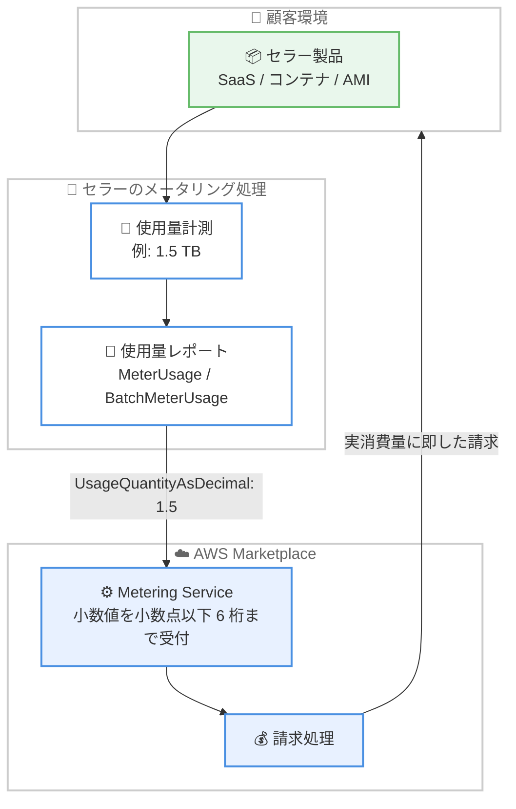

# AWS Marketplace Metering Service - 小数点以下の使用量レポートのサポート

**リリース日**: 2026 年 11 月 16 日
**サービス**: AWS Marketplace Metering Service
**機能**: MeterUsage / BatchMeterUsage API における小数値の使用量レポート

📊 [このアップデートのインフォグラフィックを見る](https://takech9203.github.io/aws-news-summary/20261116-aws-marketplace-metering-service-decimal-usage-quantities.html)

## 概要

AWS Marketplace Metering Service が、MeterUsage API および BatchMeterUsage API で小数点以下の使用量数値 (decimal usage quantities) をサポートしました。これまで AWS Marketplace の出品者 (セラー) は、顧客の使用量を整数値でのみレポートできましたが、今回のアップデートにより小数点以下 6 桁までの値をレポートできるようになります。

これにより、たとえば「1 TB または 2 TB」に丸めることなく「1.5 TB のストレージ使用量」をそのままレポートするなど、顧客の実際の消費量に即した単位での価格設定とメータリングが可能になります。従量課金型 (usage-based pricing) の SaaS 製品やコンテナ製品を AWS Marketplace で販売する ISV・セラーにとって、課金精度の向上と価格設計の柔軟性向上につながるアップデートです。

既存の整数値によるレポートとの後方互換性は維持されており、整数値をレポートしている既存のインテグレーションは変更なしでそのまま動作します。

**アップデート前の課題**

- 以前は MeterUsage / BatchMeterUsage API で使用量を整数値でしかレポートできなかった
- 実際の消費量が 1.5 TB のような小数値の場合、切り上げまたは切り捨てによる丸めが必要で、顧客への請求額が実消費量と乖離していた
- 丸め誤差を避けるため、セラー側で「GB 単位に変換して整数化する」など、課金ディメンション設計の工夫 (細かい単位の採用) が必要だった

**アップデート後の改善**

- 今回のアップデートにより、小数点以下 6 桁までの使用量を文字列形式でそのままレポートできるようになった
- 実際の消費量に一致する単位での価格設定・メータリングが可能になり、課金の透明性と精度が向上した
- タグベースの使用量配分 (UsageAllocation) でも小数値 (AllocatedUsageQuantityAsDecimal) が利用可能になり、コスト配分の精度も向上した
- 既存の整数値レポートはそのまま動作するため、移行作業は不要

## アーキテクチャ図



セラー製品が計測した小数値の使用量を、新しいパラメータ経由で Metering Service にそのままレポートし、実消費量に即した請求が行われる流れを示しています。

## サービスアップデートの詳細

### 主要機能

1. **MeterUsage API での小数値サポート**
   - 新しいリクエストパラメータ `UsageQuantityAsDecimal` が追加された
   - 小数点以下 6 桁までの使用量を文字列として指定可能
   - SaaS 製品やコンテナ製品からの単一レコードの使用量レポートに使用

2. **BatchMeterUsage API での小数値サポート**
   - 使用量レコード (UsageRecord) に新しいフィールド `QuantityAsDecimal` が追加された
   - 複数顧客分の使用量を一括レポートする SaaS 製品のメータリングで利用可能
   - レスポンスの `Results` および `UnprocessedRecords` にも同フィールドが反映される

3. **使用量配分 (UsageAllocation) での小数値サポート**
   - タグベースで使用量を配分する UsageAllocation に `AllocatedUsageQuantityAsDecimal` が追加された
   - MeterUsage / BatchMeterUsage の両方で利用可能
   - 顧客側のコスト配分 (部門別・プロジェクト別) も小数精度で実現できる

4. **後方互換性の維持**
   - 整数値をレポートする既存のインテグレーションは変更なしで引き続き動作する
   - 既存の `UsageQuantity` / `Quantity` / `AllocatedUsageQuantity` パラメータはそのまま利用可能

## 技術仕様

### 新規パラメータ

| API | 新規パラメータ | 説明 |
|------|------|------|
| MeterUsage | `UsageQuantityAsDecimal` | 小数値の使用量 (文字列、小数点以下 6 桁まで) |
| BatchMeterUsage | `QuantityAsDecimal` | UsageRecord 内の小数値の使用量 (文字列) |
| MeterUsage / BatchMeterUsage | `AllocatedUsageQuantityAsDecimal` | UsageAllocation 内の小数値の配分量 (文字列) |

### API変更履歴

| 日付 | サービス | 変更内容 |
|------|----------|----------|
| 2026/11/11 | [AWSMarketplace Metering](https://awsapichanges.com/archive/changes/082701-metering.marketplace.html) | 2 updated api methods - MeterUsage と BatchMeterUsage に `UsageQuantityAsDecimal`、`QuantityAsDecimal`、`AllocatedUsageQuantityAsDecimal` フィールドを追加 |

### API リクエスト例 (boto3)

```python
# MeterUsage: 小数値の使用量をレポート
response = client.meter_usage(
    ProductCode="your-product-code",
    Timestamp=datetime(2026, 11, 16),
    UsageDimension="StorageUsageTB",
    UsageQuantityAsDecimal="1.5",
    DryRun=False,
)
```

## 設定方法

### 前提条件

1. AWS Marketplace に製品 (SaaS、コンテナなど) を出品しており、カスタムメータリングを使用していること
2. 製品のメータリング実装が AWS SDK または AWS CLI から MeterUsage / BatchMeterUsage を呼び出せること
3. 最新の AWS SDK / AWS CLI にアップデートしていること (新パラメータを利用するため)

### 手順

#### ステップ1: SDK のアップデート

```bash
pip install --upgrade boto3
```

小数値パラメータに対応した最新バージョンの AWS SDK にアップデートします。

#### ステップ2: 小数値での使用量レポートに切り替え

```python
import boto3
from datetime import datetime, timezone

client = boto3.client("meteringmarketplace", region_name="us-east-1")

response = client.meter_usage(
    ProductCode="your-product-code",
    Timestamp=datetime.now(timezone.utc),
    UsageDimension="StorageUsageTB",
    UsageQuantityAsDecimal="1.523456",
    DryRun=True,
)
print(response)
```

整数の `UsageQuantity` の代わりに `UsageQuantityAsDecimal` に小数値を文字列で指定して使用量をレポートします。まず `DryRun=True` で権限と呼び出しの妥当性を検証します。

#### ステップ3: バッチレポートと使用量配分の更新 (SaaS 製品の場合)

```python
response = client.batch_meter_usage(
    ProductCode="your-product-code",
    UsageRecords=[
        {
            "Timestamp": datetime.now(timezone.utc),
            "CustomerIdentifier": "customer-id",
            "Dimension": "StorageUsageTB",
            "QuantityAsDecimal": "1.5",
            "UsageAllocations": [
                {
                    "AllocatedUsageQuantityAsDecimal": "0.9",
                    "Tags": [{"Key": "Department", "Value": "Engineering"}],
                },
                {
                    "AllocatedUsageQuantityAsDecimal": "0.6",
                    "Tags": [{"Key": "Department", "Value": "Marketing"}],
                },
            ],
        },
    ],
)
```

BatchMeterUsage で複数顧客分の使用量を小数値でレポートします。UsageAllocations を使用すると、タグ単位の小数精度でのコスト配分も可能です。

## メリット

### ビジネス面

- **課金精度の向上**: 実際の消費量と請求額の乖離がなくなり、顧客への請求の透明性と信頼性が向上する
- **柔軟な価格設計**: TB 単位や時間単位など、顧客にとって直感的な単位をそのまま課金ディメンションとして採用できる
- **顧客満足度の向上**: 切り上げによる過剰請求がなくなり、「使った分だけ支払う」という従量課金の価値提案を正確に実現できる

### 技術面

- **メータリング実装の簡素化**: 小数値を整数化するための単位変換ロジック (TB を GB に変換するなど) が不要になる
- **後方互換性**: 既存の整数ベースの実装はそのまま動作するため、段階的な移行が可能
- **コスト配分の精度向上**: タグベースの UsageAllocation でも小数値が使えるため、顧客側の部門別コスト配分も正確になる

## デメリット・制約事項

### 制限事項

- 小数値は小数点以下 6 桁までに制限される
- 小数値は数値型ではなく文字列型 (`string`) としてパラメータに指定する必要がある
- 新パラメータの利用には、対応バージョンの AWS SDK / AWS CLI へのアップデートが必要

### 考慮すべき点

- 小数値課金へ切り替える場合、製品の価格ディメンション設計 (単価設定) との整合性を確認する必要がある
- 既存の整数パラメータと新しい小数パラメータが混在しないよう、メータリング実装の方針を統一することが望ましい
- 請求金額の計算結果が従来の丸め方式と変わるため、切り替え前に顧客への請求影響をテスト (DryRun など) で確認するべきである

## ユースケース

### ユースケース1: ストレージ系 SaaS の TB 単位課金

**シナリオ**: ストレージサービスを提供する SaaS セラーが、顧客の実使用量 1.5 TB を正確に課金したい。従来は GB 単位への変換または TB 単位への丸めが必要だった。

**実装例**:
```python
client.meter_usage(
    ProductCode="storage-saas",
    Timestamp=datetime.now(timezone.utc),
    UsageDimension="StorageTB",
    UsageQuantityAsDecimal="1.5",
)
```

**効果**: 1 TB や 2 TB への丸めが不要になり、実使用量どおりの請求が可能。単位変換ロジックも削減できる。

### ユースケース2: コンピューティング時間の分単位・秒単位課金

**シナリオ**: 分析ワークロードを提供するコンテナ製品で、ジョブの実行時間 (例: 2.75 時間) に応じて課金したい。

**実装例**:
```python
client.meter_usage(
    ProductCode="analytics-container",
    Timestamp=datetime.now(timezone.utc),
    UsageDimension="ComputeHours",
    UsageQuantityAsDecimal="2.75",
)
```

**効果**: 時間単位に切り上げることなく、実行時間に比例した公平な課金を実現できる。

### ユースケース3: マルチテナント SaaS での部門別コスト配分

**シナリオ**: マルチテナント SaaS で、顧客企業内の部門ごとの使用量をタグで配分し、小数精度でコスト配分レポートを提供したい。

**実装例**:
```python
client.batch_meter_usage(
    ProductCode="multi-tenant-saas",
    UsageRecords=[{
        "Timestamp": datetime.now(timezone.utc),
        "CustomerIdentifier": "customer-a",
        "Dimension": "DataProcessedTB",
        "QuantityAsDecimal": "3.2",
        "UsageAllocations": [
            {"AllocatedUsageQuantityAsDecimal": "2.1",
             "Tags": [{"Key": "Team", "Value": "DataScience"}]},
            {"AllocatedUsageQuantityAsDecimal": "1.1",
             "Tags": [{"Key": "Team", "Value": "BI"}]},
        ],
    }],
)
```

**効果**: 顧客は AWS Cost Explorer などでタグ別に小数精度のコストを把握でき、社内チャージバックの精度が向上する。

## 料金

公式発表に料金に関する記載はありません。本機能は MeterUsage / BatchMeterUsage API の拡張であり、追加料金に関するアナウンスはありません。AWS Marketplace の販売に伴う手数料は、従来どおり AWS Marketplace のセラー向け料金体系に従います。

## 利用可能リージョン

AWS Marketplace Metering Service が利用可能なすべての AWS リージョンで利用できます。対象リージョンの一覧は [Metering Service のリージョン一覧](https://docs.aws.amazon.com/marketplace/latest/developerguide/metering-regions.html) を参照してください。

## 関連サービス・機能

- **AWS Marketplace**: 本機能の対象となるマーケットプレイス。SaaS、コンテナ、AMI 製品などの従量課金販売でメータリングを使用する
- **AWS Marketplace Entitlement Service**: 契約ベース製品のエンタイトルメント確認に使用するサービスで、メータリングと組み合わせて利用されることが多い
- **AWS Cost Explorer / コスト配分タグ**: UsageAllocation のタグと連携し、購入者側でのコスト可視化・配分に活用できる

## 参考リンク

- 📊 [インフォグラフィック](https://takech9203.github.io/aws-news-summary/20261116-aws-marketplace-metering-service-decimal-usage-quantities.html)
- [公式発表 (What's New)](https://aws.amazon.com/about-aws/whats-new/2026/11/aws-marketplace-metering-service-decimal-usage-quantities/)
- [MeterUsage API リファレンス](https://docs.aws.amazon.com/marketplace/latest/APIReference/API_marketplace-metering_MeterUsage.html)
- [BatchMeterUsage API リファレンス](https://docs.aws.amazon.com/marketplace/latest/APIReference/API_marketplace-metering_BatchMeterUsage.html)
- [Metering Service のリージョン一覧](https://docs.aws.amazon.com/marketplace/latest/developerguide/metering-regions.html)

## まとめ

AWS Marketplace Metering Service が小数点以下 6 桁までの使用量レポートに対応し、セラーは顧客の実消費量に即した正確な従量課金を実現できるようになりました。既存の整数値レポートは後方互換で動作するため、移行リスクは小さいアップデートです。AWS Marketplace で従量課金製品を販売しているセラーは、SDK をアップデートのうえ、丸め処理を行っている既存のメータリング実装を新しい小数値パラメータへ移行することを推奨します。
