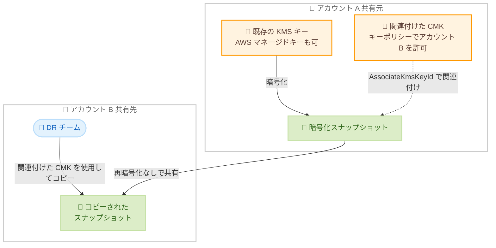

# Amazon EBS - スナップショットへの追加 KMS キーの関連付け

**リリース日**: 2026 年 11 月 16 日
**サービス**: Amazon Elastic Block Store (Amazon EBS)
**機能**: 暗号化スナップショットへの追加 KMS キーの関連付け (Associated KMS keys)

📊 [このアップデートのインフォグラフィックを見る](https://takech9203.github.io/aws-news-summary/20261116-ebs-snapshots-associate-kms-keys.html)

## 概要

Amazon EBS は、暗号化されたスナップショットに追加の AWS KMS キーを関連付ける機能を発表しました。これにより、スナップショットのデータを再暗号化することなく、アカウント間での暗号化スナップショットの共有とコピーが可能になります。バックアップ管理者や災害対策 (DR) チームにとって、クロスアカウントのバックアップ・DR ワークフローを大幅に簡素化するアップデートです。

関連付けた KMS キー (Associated KMS key) は、スナップショットを暗号化している既存の KMS キーを置き換えたり変更したりするものではありません。関連付けを行ってもスナップショットのデータは再暗号化されず、既存キーへのアクセス権が付与されることもありません。関連付けたキーへのアクセス権を持つプリンシパルは、既存キーへのアクセス権なしでスナップショットのデータにアクセスし、クロスアカウントでの共有とコピーを実行できます。

特に大きな価値があるのは、AWS マネージドキー (AMK) で暗号化されたスナップショットの共有です。AWS マネージドキーはキーポリシーを変更できないため、従来は他アカウントへの共有が不可能でしたが、カスタマーマネージドキー (CMK) を追加で関連付けることで共有が可能になります。

**アップデート前の課題**

- 暗号化スナップショットは単一の KMS キーで保護され、そのキーへのアクセス権を持つユーザーしかデータへのアクセスや他アカウントへのコピーができなかった
- AWS マネージドキーで暗号化されたスナップショットは、キーポリシーを変更できないため他アカウントと共有できなかった
- 他アカウントと共有するには、カスタマーマネージドキーで再暗号化したコピーを作成する必要があり、時間とコストがかかっていた

**アップデート後の改善**

- 再暗号化なしで、追加の CMK を関連付けるだけで暗号化スナップショットをアカウント間で共有・コピーできるようになった
- AWS マネージドキーで暗号化されたスナップショットも、CMK を関連付けることで他アカウントと共有できるようになった
- 既存の暗号化キーへのアクセス権を共有先に付与する必要がなくなり、最小権限の原則に沿ったクロスアカウントバックアップ・DR 構成が容易になった

## アーキテクチャ図



アカウント A の暗号化スナップショットに CMK を追加で関連付け、その CMK へのアクセスをアカウント B に許可することで、既存の暗号化キーを共有せずにスナップショットをクロスアカウントでコピーできます。

## サービスアップデートの詳細

### 主要機能

1. **追加 KMS キーの関連付け**
   - 暗号化スナップショットにカスタマーマネージドキーを追加で関連付け可能
   - 関連付けは既存の暗号化キーを置き換えず、データの再暗号化も発生しない
   - 関連付けたキーへのアクセス権を持つプリンシパルが、クロスアカウントでの共有とコピーのためにスナップショットのデータにアクセス可能

2. **AWS マネージドキーで暗号化されたスナップショットの共有**
   - 従来は共有不可能だった AWS マネージドキー暗号化スナップショットも、CMK を関連付けることで他アカウントと共有可能に
   - クロスアカウントバックアップ、災害対策、コンプライアンス要件への対応が容易に

3. **関連付けの管理**
   - AWS マネジメントコンソール、AWS CLI、AWS SDK、PowerShell から操作可能
   - コンソールでは [Actions] - [Snapshot settings] - [Manage associated KMS keys] から関連付け・解除を実行
   - `describe-snapshots` の `AssociatedKmsKeys` フィールドで関連付け状況を確認可能

## 技術仕様

### 関連付けの要件と動作

| 項目 | 詳細 |
|------|------|
| 対象スナップショット | 暗号化スナップショットのみ |
| 関連付け可能なキー | カスタマーマネージドキーのみ (AWS マネージドキーは不可) |
| 再暗号化 | 発生しない (既存の暗号化キーは変更されない) |
| Archive ティア | 関連付け不可 |
| ボリューム作成 | 暗号化スナップショットからのボリューム作成には既存の暗号化キーへのアクセスが必要 |
| Local Zones / Outposts | Local Zones のローカル・リージョナルスナップショット、Outposts の Local snapshots に関連付け可能 |

### API 変更

今回のアップデートに伴い、以下の EC2 API / CLI コマンドが利用可能です (公式ドキュメントで確認)。

| 操作 | API / CLI |
|------|-----------|
| KMS キーの関連付け | `AssociateKmsKeyId` / `aws ec2 associate-kms-key-id` |
| KMS キーの関連付け解除 | `DisassociateKmsKeyId` / `aws ec2 disassociate-kms-key-id` |
| 関連付け状況の確認 | `DescribeSnapshots` の `AssociatedKmsKeys` フィールド |

### 必要な権限

関連付け・解除には以下の権限が必要です。

- IAM 権限: `ec2:AssociateKmsKeyId` および `ec2:DisassociateKmsKeyId`
- Amazon EBS が KMS キーを使用するために必要な AWS KMS 権限一式

クロスアカウントで関連付けたキーを使用するには、以下の両方を満たす必要があります。

1. 関連付けた KMS キーのキーポリシーが、共有先アカウントのプリンシパルにキーの使用を許可している
2. 共有先アカウントのプリンシパルの IAM ポリシーが、関連付けた KMS キーの使用を許可している

どちらか一方だけでは不十分です。

## 設定方法

### 前提条件

1. 暗号化された EBS スナップショットが存在すること
2. 関連付けるカスタマーマネージドキーが作成済みであること
3. `ec2:AssociateKmsKeyId` と必要な KMS 権限を持つ IAM プリンシパルで操作すること

### 手順

#### ステップ 1: KMS キーをスナップショットに関連付ける

```bash
aws ec2 associate-kms-key-id \
    --snapshot-id snap-1234567890abcdef0 \
    --kms-key-id arn:aws:kms:us-east-1:111122223333:key/1234abcd-12ab-34cd-56ef-1234567890ab
```

暗号化スナップショットに追加のカスタマーマネージドキーを関連付けます。既存の暗号化キーは変更されず、再暗号化も行われません。

#### ステップ 2: 関連付け状況を確認する

```bash
aws ec2 describe-snapshots \
    --filters Name=snapshot-id,Values=snap-1234567890abcdef0
```

スナップショットの詳細を取得し、`AssociatedKmsKeys` フィールドで関連付けられた KMS キーを確認します。

#### ステップ 3: 共有先アカウントにキーの使用を許可する

関連付けた CMK のキーポリシーで共有先アカウントのプリンシパルにキーの使用を許可し、共有先アカウント側でも IAM ポリシーでそのキーの使用を許可します。その後、スナップショットを共有先アカウントに共有すると、共有先は関連付けたキーを使用してスナップショットをコピーできます。

#### ステップ 4: 不要になったら関連付けを解除する

```bash
aws ec2 disassociate-kms-key-id \
    --snapshot-id snap-1234567890abcdef0 \
    --kms-key-id arn:aws:kms:us-east-1:111122223333:key/1234abcd-12ab-34cd-56ef-1234567890ab
```

スナップショットから関連付けた KMS キーを解除します。以降、そのキーではスナップショットのデータにアクセスできなくなります。

## メリット

### ビジネス面

- **DR ワークフローの高速化**: 再暗号化コピーが不要になり、クロスアカウントの災害対策ワークフローを迅速に構築できる
- **コスト削減**: 共有のためだけに再暗号化したスナップショットコピーを作成・保管する必要がなくなる
- **コンプライアンス対応**: 既存の暗号化キーを共有せずにデータ共有を実現でき、キー管理の統制を維持しやすい

### 技術面

- **最小権限の実現**: 共有先には関連付けたキーへのアクセスのみを許可し、既存の暗号化キーへのアクセスを付与する必要がない
- **AWS マネージドキーの制約解消**: 従来共有できなかった AWS マネージドキー暗号化スナップショットの共有が可能になる
- **運用の簡素化**: コンソール、CLI、SDK、PowerShell から数ステップで関連付けを管理できる

## デメリット・制約事項

### 制限事項

- 暗号化されていないスナップショットには KMS キーを関連付けできない
- 関連付けできるのはカスタマーマネージドキーのみで、AWS マネージドキーは関連付けできない
- スナップショットが既に使用しているキー (既存の暗号化キーまたは関連付け済みのキー) は関連付けできない
- Archive ティアのスナップショットには関連付けできない

### 考慮すべき点

- 暗号化スナップショットからボリュームを作成するには、関連付けたキーではなく既存の暗号化キーへのアクセスが必要
- クロスアカウント利用にはキーポリシーと IAM ポリシーの両方での許可が必要 (片方のみでは不十分)
- 認可エラーが発生した場合は、エラーメッセージで示された KMS キーの権限を確認し、CloudTrail イベント履歴でどのキーが使用されたかを調査する

## ユースケース

### ユースケース 1: AWS マネージドキー暗号化スナップショットのクロスアカウント共有

**シナリオ**: デフォルトの AWS マネージドキー (`aws/ebs`) で暗号化されたスナップショットを、別アカウントのバックアップ集約基盤にコピーしたい。従来は再暗号化コピーの作成が必須だった。

**実装例**:
```bash
# CMK をスナップショットに関連付け
aws ec2 associate-kms-key-id \
    --snapshot-id snap-1234567890abcdef0 \
    --kms-key-id arn:aws:kms:us-east-1:111122223333:key/1234abcd-12ab-34cd-56ef-1234567890ab
```

**効果**: 再暗号化なしで AWS マネージドキー暗号化スナップショットを共有でき、バックアップ集約の工数と時間を削減できる。

### ユースケース 2: 既存キーを共有しないクロスアカウント DR

**シナリオ**: 本番アカウントのスナップショットを DR アカウントにコピーしたいが、セキュリティポリシー上、本番の暗号化キーを他アカウントに開放できない。

**実装例**:
```
1. DR 共有専用の CMK を作成し、キーポリシーで DR アカウントに使用を許可
2. その CMK をスナップショットに関連付け
3. DR アカウント側の IAM ポリシーで CMK の使用を許可
4. DR アカウントが関連付けた CMK を使用してスナップショットをコピー
```

**効果**: 本番の暗号化キーへのアクセスを一切付与せず、最小権限でクロスアカウント DR を実現できる。

### ユースケース 3: 共有専用キーによるアクセスのライフサイクル管理

**シナリオ**: 監査やデータ移行のために一時的にスナップショットを他アカウントへ共有し、完了後はアクセスを確実に取り消したい。

**実装例**:
```bash
# 移行完了後、関連付けを解除してアクセスを取り消し
aws ec2 disassociate-kms-key-id \
    --snapshot-id snap-1234567890abcdef0 \
    --kms-key-id arn:aws:kms:us-east-1:111122223333:key/1234abcd-12ab-34cd-56ef-1234567890ab
```

**効果**: 関連付けの解除だけで共有先からのデータアクセスを遮断でき、一時的な共有のライフサイクル管理が容易になる。

## 料金

今回の発表では、本機能に関する追加料金の記載はありません。関連するリソースには標準料金 (EBS スナップショットのストレージ料金、カスタマーマネージドキーに対する AWS KMS の料金など) が適用されます。詳細は各サービスの料金ページを確認してください。

## 利用可能リージョン

以下の環境で利用可能です。

- すべての AWS 商用リージョン
- 中国リージョン
- AWS GovCloud (US)
- AWS European Sovereign Cloud (ドイツ)
- AWS Local Zones および AWS Outposts

## 関連サービス・機能

- **AWS KMS**: 関連付けるカスタマーマネージドキーの作成・キーポリシー管理に使用
- **AWS Backup**: クロスアカウントバックアップ戦略全体の中で本機能を補完的に活用可能
- **AWS CloudTrail**: 認可エラー時にどの KMS キーが使用されたかをイベント履歴で確認可能
- **Amazon Data Lifecycle Manager**: スナップショットのライフサイクル管理と組み合わせた運用が可能

## 参考リンク

- 📊 [インフォグラフィック](https://takech9203.github.io/aws-news-summary/20261116-ebs-snapshots-associate-kms-keys.html)
- [公式発表 (What's New)](https://aws.amazon.com/about-aws/whats-new/2026/11/ebs-snapshots-associate-kms-keys/)
- [ドキュメント: Associated KMS keys](https://docs.aws.amazon.com/ebs/latest/userguide/associated-kms-keys.html)
- [AWS CLI: associate-kms-key-id](https://docs.aws.amazon.com/cli/latest/reference/ec2/associate-kms-key-id.html)
- [AWS CLI: disassociate-kms-key-id](https://docs.aws.amazon.com/cli/latest/reference/ec2/disassociate-kms-key-id.html)
- [KMS キーへのアクセス評価](https://docs.aws.amazon.com/kms/latest/developerguide/policy-evaluation.html)

## まとめ

暗号化 EBS スナップショットに追加の KMS キーを関連付けることで、再暗号化なしのクロスアカウント共有・コピーが可能になり、従来不可能だった AWS マネージドキー暗号化スナップショットの共有も実現できるようになりました。クロスアカウントバックアップや DR を運用しているチームは、再暗号化コピーを前提とした既存ワークフローを見直し、関連付けキーによるシンプルな共有構成への移行を検討することを推奨します。
