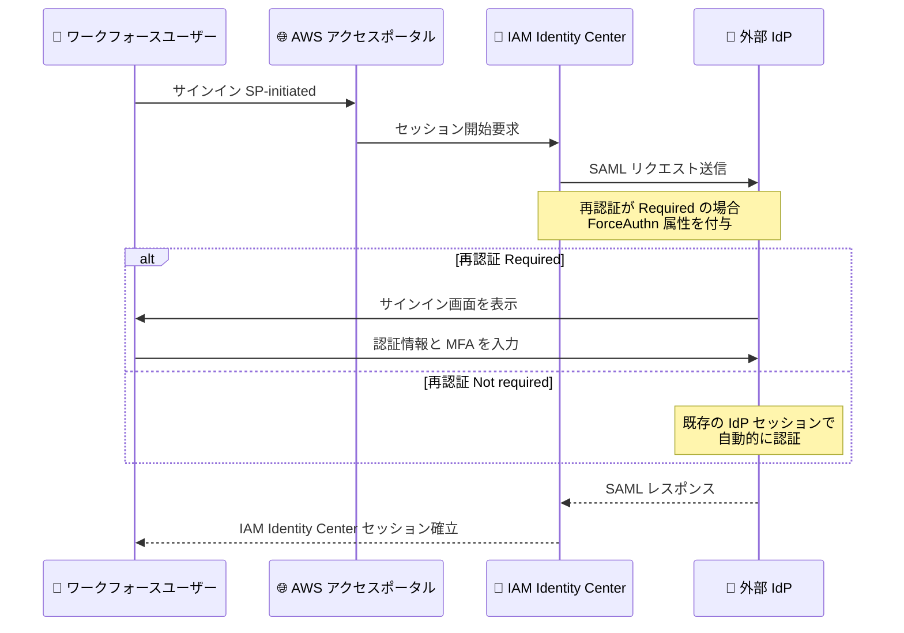

# AWS IAM Identity Center - SAML リクエストでの ForceAuthn サポート

**リリース日**: 2026 年 11 月 16 日
**サービス**: AWS IAM Identity Center
**機能**: SAML リクエストにおける ForceAuthn 属性のサポート (ユーザー再認証の必須化)

📊 [このアップデートのインフォグラフィックを見る](https://takech9203.github.io/aws-news-summary/20261116-iam-identity-center-reauth.html)

## 概要

AWS IAM Identity Center が、SAML 2.0 の `ForceAuthn` 属性をサポートしました。これにより、ワークフォースユーザーの IAM Identity Center セッションが期限切れになった際に、外部 ID プロバイダー (IdP) での再認証を必須にできるようになりました。

これまでのデフォルト動作では、IAM Identity Center のセッションが期限切れになると、ユーザーの既存の IdP セッションを通じて自動的にセッションが更新され、ユーザーが再度サインインを求められることはありませんでした。この自動更新は利便性が高い一方で、定期的な明示的本人確認を求める厳格なセキュリティ・コンプライアンス要件を持つ組織にとっては不十分な場合がありました。

今回のアップデートにより、ユーザー再認証を「Required」に設定すると、セッション期限切れ時に IAM Identity Center が IdP へ送信する SAML リクエストに `ForceAuthn` 属性が付与され、ユーザーは IdP で再度認証を行う必要があります。外部 IdP を ID ソースとして使用するすべての IAM Identity Center インスタンス (組織インスタンスおよびアカウントインスタンス) で設定できます。

**アップデート前の課題**

- セッション期限切れ時に既存の IdP セッションで自動的にセッションが更新されるため、ユーザーに明示的な再認証を強制できなかった
- セッション開始のたびに本人確認を求めるセキュリティ・コンプライアンス要件を IAM Identity Center 単体では満たせなかった
- 定期的な認証情報と MFA の再入力を強制するには、IdP 側のセッション管理のみに依存する必要があった

**アップデート後の改善**

- セッション期限切れ時に外部 IdP での再認証 (認証情報の入力と、IdP が要求する場合は MFA) を必須にできるようになった
- SAML 2.0 標準の `ForceAuthn` 属性を利用するため、標準準拠の IdP であれば追加の開発なしに利用できる
- 設定変更が AWS CloudTrail に記録されるため、有効化・無効化の監査が可能になった

## アーキテクチャ図



AWS アクセスポータルからのサインイン (SP-initiated) 時に、再認証設定が「Required」の場合は SAML リクエストに `ForceAuthn` 属性が付与され、既存の IdP セッションの有無にかかわらずユーザーは IdP で再認証を求められます。

## サービスアップデートの詳細

### 主要機能

1. **ユーザー再認証の必須化設定**
   - 外部 IdP 設定に「User re-authentication」設定が追加され、「Require」または「Do not require」を選択可能
   - デフォルトは「Not required」(従来どおり既存の IdP セッションによる自動更新)
   - 「Required」に設定すると、ユーザーインタラクティブセッションの期限切れ時に IdP での再認証を要求

2. **SAML 2.0 ForceAuthn 属性による標準準拠の実装**
   - IAM Identity Center が IdP へ送信する SAML リクエストに `ForceAuthn` 属性を追加することで再認証を要求
   - IdP が `ForceAuthn` 属性を尊重する場合、既存の IdP セッションがあってもサインイン画面が表示される
   - 組織インスタンス・アカウントインスタンスのどちらでも、外部 IdP を ID ソースとする場合に設定可能

3. **CloudTrail による設定変更の監査**
   - 設定変更は CloudTrail イベント `UpdateExternalIdPConfigurationForDirectory` (イベントソース: `sso-directory.amazonaws.com`) として記録される
   - `requestParameters.idpSAMLConfig.forceAuthn` の値 (`ENABLED` など) で設定内容を確認可能
   - いつ・誰が再認証設定を有効化・無効化したかを追跡できる

## 技術仕様

### 設定項目と動作

| 項目 | 詳細 |
|------|------|
| 設定名 | Require user re-authentication (ユーザー再認証の必須化) |
| 設定値 | Required / Not required (デフォルト: Not required) |
| 対象インスタンス | 外部 IdP を ID ソースとする組織インスタンスおよびアカウントインスタンス |
| 適用範囲 | SP-initiated サインイン (AWS アクセスポータル URL からのサインイン) のみ |
| 実装方式 | SAML リクエストへの SAML 2.0 `ForceAuthn` 属性の付与 |
| 既存セッションへの影響 | 設定変更時にアクティブなセッションは中断・終了されない |
| 監査 | CloudTrail イベント `UpdateExternalIdPConfigurationForDirectory` に記録 |

### CloudTrail イベントの例

管理者がユーザー再認証を「Required」に設定した際の CloudTrail イベントの関連フィールドは以下のとおりです。

```json
{
  "eventName": "UpdateExternalIdPConfigurationForDirectory",
  "eventSource": "sso-directory.amazonaws.com",
  "requestParameters": {
    "idpSAMLConfig": {
      "forceAuthn": "ENABLED"
    }
  }
}
```

## 設定方法

### 前提条件

1. IAM Identity Center のインスタンス (組織インスタンスまたはアカウントインスタンス) が有効化されていること
2. ID ソースとして外部 IdP (SAML 2.0 対応) が接続されていること
3. 使用する IdP が SAML リクエストの `ForceAuthn` 属性を尊重すること (IdP のドキュメントで要確認)

### 手順

#### ステップ 1: 認証設定画面を開く

1. [IAM Identity Center コンソール](https://console.aws.amazon.com/singlesignon) を開く
2. [Settings] を選択する
3. [Settings] ページで [Identity source] タブを選択し、[Sign-in] セクションで [Manage authentication] を選択する

#### ステップ 2: ユーザー再認証を必須に設定する

1. [User sign-in configurations] カードの [Require user re-authentication] の横にある [Edit] を選択する
2. [User re-authentication] で以下のいずれかを選択する
   - [Require]: アクティブな IdP セッションがあっても、IAM Identity Center セッションの期限切れごとに IdP での認証を必須にする
   - [Do not require]: アクティブな IdP セッションがある限りサインイン状態を維持する (デフォルト)
3. [Save changes] を選択する

設定後、[Identity source] タブの [Require user re-authentication] に「Required」または「Not required」が表示されます。変更は新規の SP-initiated サインインに適用され、保存時にアクティブなセッションは中断されません。

#### ステップ 3: 動作をテストする

1. AWS アクセスポータル URL (例: `https://d-xxxxxxxxxx.awsapps.com/start`) を開き、外部 IdP でサインインする
2. AWS アクセスポータルのナビゲーションバーで [Sign out] を選択する
3. 同じページで [Sign in] を選択する

アクティブな IdP セッションがあるにもかかわらず IdP のサインイン画面が表示され、認証を求められれば設定は正常に動作しています。再認証が求められない場合は、トラブルシューティングドキュメントの「Users are not prompted to re-authenticate」を確認します。

## メリット

### ビジネス面

- **コンプライアンス要件への対応**: セッション開始のたびに本人確認を求める規制・社内ポリシーに、追加コストなしで対応できる
- **セキュリティポスチャの向上**: 共有端末や離席時のリスクを低減し、AWS リソースへのアクセス時点での本人性を担保できる
- **監査対応の容易化**: CloudTrail による設定変更の記録で、統制状況を監査人に提示しやすくなる

### 技術面

- **標準準拠の実装**: SAML 2.0 標準の `ForceAuthn` 属性を使用するため、標準準拠の IdP であれば追加開発なしに利用できる
- **簡単な設定**: コンソールの設定変更のみで有効化でき、アプリケーション側の変更は不要
- **既存セッションへの無影響**: 設定変更時にアクティブなセッションは中断されないため、業務影響なく段階的に導入できる

## デメリット・制約事項

### 制限事項

- SP-initiated サインイン (AWS アクセスポータル URL からのサインイン) にのみ適用される。IdP のポータルやアプリケーションダッシュボードから開始する IdP-initiated サインインでは SAML リクエストが送信されないため、この設定は効果がない
- IdP が `ForceAuthn` 属性を尊重する場合にのみ機能する。Okta や Google Workspace など、IdP 固有の既知の問題についてはトラブルシューティングドキュメントの確認が必要
- 外部 IdP を ID ソースとする場合のみ利用可能 (Identity Center ディレクトリや AWS Managed Microsoft AD を ID ソースとする場合は対象外)

### 考慮すべき点

- サインインプロンプトの頻度が増加する。セッション期限切れのたびに認証情報の入力 (IdP が MFA を要求する場合は MFA も) が必要になるため、セッション継続時間の設定を同時に見直すことが推奨される
- 設定変更はすでにアクティブなセッションには適用されない。既存セッションを即時終了したい場合は、ワークフォースユーザーのアクティブセッションの表示・終了機能を併用する

## ユースケース

### ユースケース 1: 金融機関における定期的な本人確認の強制

**シナリオ**: 金融機関のセキュリティポリシーで、AWS 環境へのアクセスセッション開始時に必ず MFA を含む本人確認を行うことが義務付けられている。

**実装例**:
```
1. IAM Identity Center のユーザー再認証を「Required」に設定
2. セッション継続時間を 8 時間などポリシーに沿った値に設定
3. IdP 側で MFA を必須化
```

**効果**: セッション期限切れごとに IdP での認証と MFA が強制され、既存 IdP セッションによる自動更新を防止できる。

### ユースケース 2: 設定変更の監査体制の整備

**シナリオ**: 監査要件により、認証強度に関わる設定の変更履歴を追跡・報告する必要がある。

**実装例**:
```
CloudTrail で以下の条件のイベントをフィルタリング
- eventName: UpdateExternalIdPConfigurationForDirectory
- eventSource: sso-directory.amazonaws.com
- requestParameters.idpSAMLConfig.forceAuthn の値を確認
```

**効果**: 再認証設定の有効化・無効化の履歴を CloudTrail から抽出し、監査証跡として提示できる。

### ユースケース 3: 共有端末環境でのセッション乗っ取りリスクの低減

**シナリオ**: コールセンターや工場など、複数のユーザーが端末を共有する環境で AWS アクセスポータルを利用している。

**実装例**:
```
1. ユーザー再認証を「Required」に設定
2. セッション継続時間を短め (例: 1〜4 時間) に設定
3. ユーザーには AWS アクセスポータル URL からのサインイン (SP-initiated) を周知
```

**効果**: 前のユーザーの IdP セッションが残っていても、セッション期限切れ後は必ず再認証が要求され、なりすましアクセスのリスクを低減できる。

## 料金

この機能は追加料金なしで利用できます。IAM Identity Center 自体も無料で提供されています。

## 利用可能リージョン

IAM Identity Center が利用可能なすべての AWS リージョンで利用できます。

## 関連サービス・機能

- **AWS CloudTrail**: 再認証設定の変更イベント (`UpdateExternalIdPConfigurationForDirectory`) を記録し、監査を可能にする
- **IAM Identity Center セッション管理**: セッション継続時間の設定とアクティブセッションの表示・終了機能。再認証の頻度はセッション継続時間に依存するため、併せて設計する
- **外部 ID プロバイダー連携 (SAML 2.0)**: Okta、Microsoft Entra ID、Google Workspace などの外部 IdP を ID ソースとして利用する機能。本機能の前提となる

## 参考リンク

- 📊 [インフォグラフィック](https://takech9203.github.io/aws-news-summary/20261116-iam-identity-center-reauth.html)
- [公式発表 (What's New)](https://aws.amazon.com/about-aws/whats-new/2026/11/iam-identity-center-reauth/)
- [ドキュメント: Require user re-authentication](https://docs.aws.amazon.com/singlesignon/latest/userguide/require-user-reauthentication.html)
- [ドキュメント: External identity providers](https://docs.aws.amazon.com/singlesignon/latest/userguide/manage-your-identity-source-idp.html)
- [ドキュメント: Logging IAM Identity Center API calls with AWS CloudTrail](https://docs.aws.amazon.com/singlesignon/latest/userguide/logging-using-cloudtrail.html)

## まとめ

IAM Identity Center が SAML 2.0 の `ForceAuthn` 属性をサポートしたことで、セッション期限切れ時に外部 IdP での再認証を必須化でき、厳格なセキュリティ・コンプライアンス要件に標準機能で対応できるようになりました。外部 IdP を利用している組織は、IdP の `ForceAuthn` 対応状況とセッション継続時間の設定を確認したうえで、要件に応じた有効化を検討することを推奨します。
