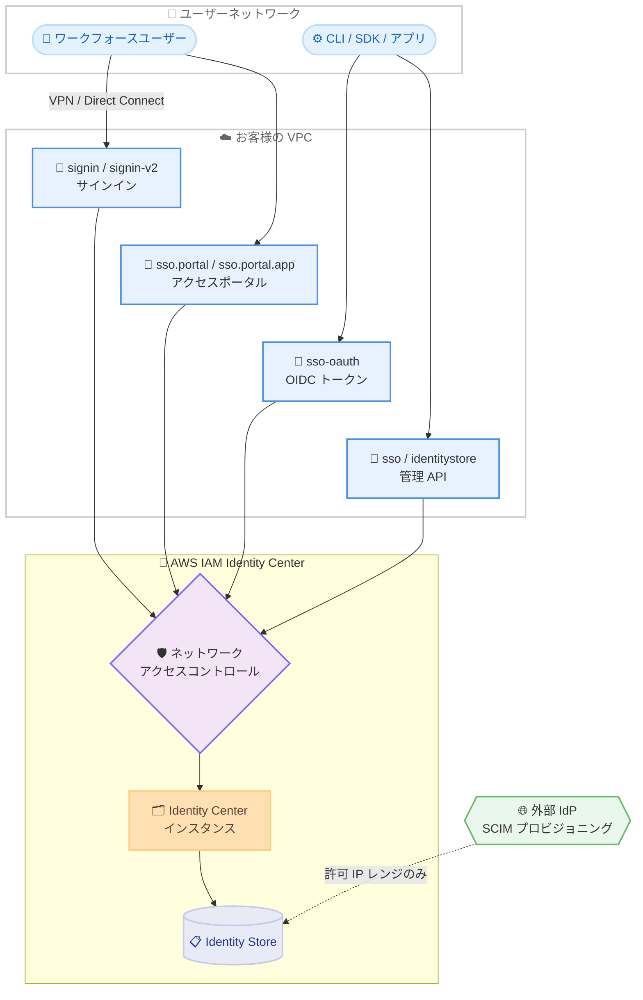

# AWS IAM Identity Center - VPC エンドポイントとネットワークアクセスコントロールのサポート

**リリース日**: 2026 年 11 月 16 日
**サービス**: AWS IAM Identity Center
**機能**: インターフェイス VPC エンドポイント (AWS PrivateLink) およびネットワークアクセスコントロール

📊 [このアップデートのインフォグラフィックを見る](https://takech9203.github.io/aws-news-summary/20261116-iam-identity-center-vpc-endpoints.html)

## 概要

AWS IAM Identity Center が、AWS PrivateLink を利用したインターフェイス VPC エンドポイントと、ネットワークアクセスコントロールをサポートしました。これにより、AWS アクセスポータルへのワークフォースサインイン、アプリケーション認可、管理 API へのアクセスを、インターネットを経由せずに AWS のプライベートネットワーク内で完結させることができます。

これまで IAM Identity Center は VPC エンドポイント経由のトラフィックを拒否していたため、サインインや API 呼び出しはすべてパブリックエンドポイントを経由する必要がありました。今回のアップデートにより、AWS アクセスポータルとサービス API の両方に対して VPC エンドポイントを作成できるようになり、サインイントラフィックは AWS Sign-in の VPC エンドポイントを経由してルーティングされます。さらに、VPC エンドポイントポリシーとインスタンスレベルのネットワークアクセスコントロールを組み合わせることで、「どのネットワークから」「どの Identity Center インスタンスへ」アクセスできるかを厳密に制御できます。

このアップデートは、金融、公共、医療など、ID 基盤へのアクセス経路を閉域に限定する要件を持つ組織や、データ境界 (Data Perimeter) 戦略を推進する組織にとって重要な機能強化です。

**アップデート前の課題**

- IAM Identity Center は VPC エンドポイント経由のトラフィックを拒否していたため、サインイン・API トラフィックはすべてパブリックエンドポイント経由だった
- 閉域網要件を持つ組織では、ID 基盤へのアクセスにインターネット経路が残ることがコンプライアンス上の課題だった
- IAM Identity Center へのアクセス元ネットワークをサービス側で制限する手段がなく、不正なネットワークからのサインイン試行を境界レベルで防げなかった
- 外部 IdP からの SCIM プロビジョニングトラフィックの送信元を制限できなかった

**アップデート後の改善**

- AWS アクセスポータル、サインイン、OIDC、管理 API など用途別のインターフェイス VPC エンドポイントを作成し、トラフィックを AWS ネットワーク内に閉じられるようになった
- VPC エンドポイントポリシーで、プライベート接続経由でアクセス可能な AWS Organizations、アカウント、リソース (Identity Center インスタンスなど) を制限できるようになった
- インスタンスレベルのネットワークアクセスコントロールにより、すべてのアクセスを VPC エンドポイント経由に強制したり、特定の IP レンジや VPC を信頼したり、特定アプリケーションを適用除外にできるようになった
- 外部 IdP からの SCIM プロビジョニングトラフィックを既知の IP レンジに制限できるようになった

## アーキテクチャ図



ユーザーとアプリケーションのトラフィックは用途別のインターフェイス VPC エンドポイントを経由して IAM Identity Center に到達し、インスタンスレベルのネットワークアクセスコントロールで評価されます。外部 IdP からの SCIM プロビジョニングは VPC エンドポイントを使用せず、Identity Store 側の IP アドレス制限で制御します。

## サービスアップデートの詳細

### 主要機能

1. **インターフェイス VPC エンドポイントのサポート**
   - AWS PrivateLink によるプライベート接続で、インターネットゲートウェイ、NAT デバイス、VPN 接続なしに IAM Identity Center へアクセス可能
   - 管理操作用 (`sso`、`identitystore`)、サインイン用 (`signin`、`signin-v2`)、OIDC トークン用 (`sso-oauth`)、AWS アクセスポータル用 (`sso.portal.app`、`sso.portal`) の 7 種類のエンドポイントタイプを提供
   - サインインエンドポイントは AWS Console Private Access と共有されるため、既存のエンドポイントにポリシーステートメントを追加する形で利用

2. **VPC エンドポイントポリシー**
   - プライベート接続経由でアクセス可能な Identity Center インスタンスやアプリケーションを制限
   - `sso`、`identitystore`、`sso-oauth` エンドポイントでは標準のリソースコンテキストキー (`aws:ResourceOrgID`、`aws:ResourceAccount`) や `Resource` 要素でのインスタンス ARN 指定を使用
   - AWS アクセスポータルと AWS マネージドアプリケーションのエンドポイントでは `aws:IdentityCenterInstanceArn`、`aws:IdentityCenterInstanceOrgId` などの専用コンテキストキーを使用

3. **ネットワークアクセスコントロール (インスタンスレベルの強制)**
   - `sso-admin update-instance` API の `network-configuration` で設定 (デフォルトは無効)
   - `VpceAccessRequired: true` で、すべてのサインイン・認可リクエストを自アカウント (アカウントインスタンス) または自組織 (組織インスタンス) の VPC エンドポイント経由に強制
   - `RestrictSourceVpcs` で特定 VPC への限定、`AllowSourceIps` でパブリック IP レンジの例外許可、`ExcludeApplicationArns` で特定アプリケーションの OAuth トークン操作を適用除外に設定可能
   - `sso:VpceAccessRequired` 条件キーを使った SCP により、メンバーアカウントによる設定の無効化を組織全体で防止可能

4. **SCIM プロビジョニングのネットワーク制御**
   - SCIM トラフィックは外部 IdP のインフラから発信されるため、VPC エンドポイントではなく IP アドレス制限で制御
   - `identitystore update-identity-store` API の `NetworkConfiguration` で `VpceAccessRequired`、`ApiRestrictSourceVpcs`、`ApiAllowSourceIps`、`ScimAllowSourceIps` を設定
   - `identitystore:VpceAccessRequired` 条件キーを使った SCP で Identity Store の設定も保護可能

## 技術仕様

### インターフェイス VPC エンドポイントの種類

| 用途 | サービス名 | 説明 |
|------|-----------|------|
| SSO Admin | `com.amazonaws.{region}.sso` | インスタンス、アプリケーション、許可セット、割り当ての管理操作 |
| Identity Store | `com.amazonaws.{region}.identitystore` | ユーザー・グループ管理と ID ルックアップ操作 |
| サインイン | `com.amazonaws.{region}.signin` | ブラウザベースの対話型ワークフォースサインイン (標準パーティションのみ、IPv4) |
| サインイン デュアルスタック | `com.amazonaws.{region}.signin-v2` | 対話型サインインに `signin` と併せて必要 (GovCloud ではこちらが主エンドポイント) |
| OIDC | `com.amazonaws.{region}.sso-oauth` | AWS CLI などの OAuth 2.0 認証・トークン作成 |
| アクセスポータル Web サイト | `com.amazonaws.{region}.sso.portal.app` | アクセスポータルの静的アセット配信 (エンドポイントポリシー非対応) |
| アクセスポータルバックエンド | `com.amazonaws.{region}.sso.portal` | アカウント一覧表示、IAM 認証情報生成などのバックエンド API |

### ネットワークアクセスコントロールの設定項目

| フィールド | 説明 |
|-----------|------|
| `VpceAccessRequired` | `true` で VPC エンドポイント経由のアクセスを強制 (デフォルト: `false`) |
| `RestrictSourceVpcs` | 許可する VPC の ARN リスト。指定時はリスト内の VPC からのリクエストのみ許可 |
| `AllowSourceIps` | VPC エンドポイント要件をバイパスできる IPv4 / IPv6 CIDR レンジ |
| `ExcludeApplicationArns` | OAuth トークン操作のネットワーク制御評価をスキップするアプリケーション ARN リスト (ユーザーサインインは引き続き評価) |

### API変更履歴

| 日付 | サービス | 変更内容 |
|------|----------|----------|
| 2026/11/12 | [sso](https://awsapichanges.com/archive/changes/981bee-sso.html) | 2 updated api methods - IAM Identity Center インスタンスのネットワークコントロール対応。インスタンスと AWS マネージドアプリケーションへのアクセスを組織内の VPC エンドポイント経由に限定し、特定の VPC、IP レンジ、アプリケーション例外で境界を調整可能に |
| 2026/09/29 | [identitystore](https://awsapichanges.com/archive/changes/e9bb16-identitystore.html) | 3 new 17 updated api methods - Identity Store API と SCIM アクセスを信頼済みネットワークに制限するネットワークアクセスコントロールのサポートなど |

### VPC エンドポイントポリシーの例

SSO Admin エンドポイントで、自組織の Identity Center インスタンスへの管理アクセスのみを許可する例。

```json
{
    "Version": "2012-10-17",
    "Statement": [
        {
            "Sid": "AllowAdminSameOrg",
            "Effect": "Allow",
            "Principal": "*",
            "Action": "sso:*",
            "Resource": "*",
            "Condition": {
                "StringEquals": {
                    "aws:ResourceOrgID": "o-xxxxxxxxxxx"
                }
            }
        }
    ]
}
```

メンバーアカウントによるネットワークコントロール無効化を防ぐ SCP の例。

```json
{
    "Version": "2012-10-17",
    "Statement": [
        {
            "Sid": "EnforceVpceAccess",
            "Effect": "Deny",
            "Action": "sso:UpdateInstance",
            "Resource": "*",
            "Condition": {
                "BoolIfExists": {
                    "sso:VpceAccessRequired": "false"
                }
            }
        }
    ]
}
```

## 設定方法

### 前提条件

1. IAM Identity Center インスタンス (組織インスタンスまたはアカウントインスタンス) が有効化されていること
2. VPC エンドポイントを作成する VPC とサブネット、およびオンプレミスからの接続経路 (VPN / Direct Connect) が用意されていること
3. ID ソースが外部 IdP または Identity Center の Identity Store であること (AWS Managed Microsoft AD / セルフマネージド AD は VPC エンドポイント利用時は非サポート)

### 手順

#### ステップ1: インターフェイス VPC エンドポイントの作成

```bash
# サインイン用エンドポイントの作成例 (signin と signin-v2 の両方が必要)
aws ec2 create-vpc-endpoint \
    --vpc-id vpc-0a1b2c3d4e5f67890 \
    --vpc-endpoint-type Interface \
    --service-name com.amazonaws.ap-northeast-1.signin \
    --subnet-ids subnet-xxxxxxxx \
    --security-group-ids sg-xxxxxxxx \
    --private-dns-enabled

# OIDC、アクセスポータルなど必要な用途のエンドポイントも同様に作成
# com.amazonaws.ap-northeast-1.signin-v2
# com.amazonaws.ap-northeast-1.sso-oauth
# com.amazonaws.ap-northeast-1.sso.portal
# com.amazonaws.ap-northeast-1.sso.portal.app
```

利用する機能に応じたサービス名でインターフェイス VPC エンドポイントを作成します。ワークフォースアクセスにはサインイン、OIDC、アクセスポータルの各エンドポイント、管理操作には `sso` と `identitystore` のエンドポイントを作成します。

#### ステップ2: VPC エンドポイントポリシーの設定

```bash
aws ec2 modify-vpc-endpoint \
    --vpc-endpoint-id vpce-xxxxxxxx \
    --policy-document file://endpoint-policy.json
```

各エンドポイントにポリシーをアタッチし、アクセス可能な Identity Center インスタンスや組織を制限します。ポリシーを設定しない場合、デフォルトポリシーはエンドポイント経由のフルアクセスを許可する点に注意が必要です。

#### ステップ3: ネットワークアクセスコントロールの有効化

```bash
aws sso-admin update-instance \
    --instance-arn arn:aws:sso:::instance/ssoins-1234567890abcdef \
    --network-configuration '{
        "VpceAccessRequired": true,
        "RestrictSourceVpcs": ["arn:aws:ec2:ap-northeast-1:111122223333:vpc/vpc-0a1b2c3d4e5f67890"],
        "AllowSourceIps": ["203.0.113.0/24"]
    }'
```

インスタンスのネットワークコントロールを有効化し、VPC エンドポイント経由のアクセスを必須にします。この操作はインスタンスのプライマリリージョンでのみ実行可能で、設定は他リージョンに自動的にレプリケートされます。設定がリクエスト自身をブロックする場合はロックアウト防止チェックにより `ValidationException` で拒否されます。

#### ステップ4: SCIM プロビジョニングの IP 制限 (外部 IdP 利用時)

```bash
aws identitystore update-identity-store \
    --identity-store-id d-1234567890 \
    --network-configuration '{
        "VpceAccessRequired": true,
        "ApiAllowSourceIps": ["203.0.113.0/24"],
        "ScimAllowSourceIps": ["198.51.100.0/24"]
    }'
```

Identity Store のネットワーク境界を有効化し、外部 IdP が公開する SCIM 送信元 IP レンジを `ScimAllowSourceIps` に追加します。`VpceAccessRequired` を `true` にして `ScimAllowSourceIps` を空のままにすると SCIM プロビジョニングがすべてブロックされるため、必ず同時に設定します。

## メリット

### ビジネス面

- **コンプライアンス対応**: ID 基盤へのアクセス経路を閉域に限定でき、金融・公共・医療などの規制業界のネットワーク要件を満たしやすくなる
- **データ境界戦略の完成度向上**: これまで Identity Center がカバーできなかったネットワーク境界 (Network Perimeter) を ID 基盤にも適用でき、組織全体のデータ境界戦略を強化できる
- **追加コストなし**: ネットワークアクセスコントロール自体は追加料金なしで利用可能 (VPC エンドポイントには PrivateLink の標準料金が発生)

### 技術面

- **プライベート接続**: サインイン、アクセスポータル、管理 API のトラフィックが AWS ネットワーク内に閉じ、パブリック IP アドレスが不要になる
- **多層防御**: VPC エンドポイントポリシー (経路側)、ネットワークアクセスコントロール (インスタンス側)、SCP (組織ガバナンス) の 3 層で制御できる
- **柔軟な例外設定**: `AllowSourceIps` による既知ネットワークの許可や `ExcludeApplicationArns` によるアプリケーション単位の除外で、段階的な導入が可能
- **ロックアウト防止**: 設定変更がリクエスト自身をブロックする場合は API が拒否するため、誤設定による管理不能状態を防げる

## デメリット・制約事項

### 制限事項

- ID ソースとして AWS Managed Microsoft AD およびセルフマネージド AD は、VPC エンドポイント利用時には非サポート (外部 IdP または Identity Store を使用する必要がある)
- VPC エンドポイントのクロスアカウントアクセスは非サポート
- 標準パーティションの `signin` エンドポイントは IPv4 のみのため、対話型サインインには `signin-v2` エンドポイントも併せて必要
- SCIM プロビジョニングは VPC エンドポイントを使用できず、IP アドレス制限でのみ制御可能
- アクセスポータル Web サイトエンドポイント (`sso.portal.app`) は静的アセット配信専用で、エンドポイントポリシー非対応
- ネットワーク設定の合計サイズに上限があり、超過すると `ValidationException` が発生する

### 考慮すべき点

- `UpdateInstance` / `UpdateIdentityStore` の `network-configuration` は完全置換方式のため、1 つのフィールドだけを変更する場合も保持したい値をすべて含めて指定する必要がある
- AWS マネージドアプリケーションがネットワークコンテキスト転送に対応する前にネットワークコントロールを有効化すると、そのアプリケーション経由のリクエストが拒否されるため、事前の対応状況確認が必要
- IdP-initiated サインインを利用している場合、リクエストが VPC エンドポイント外から発信されるため、SAML 設定でアクセスポータルのリレーステート経由に変更するか、`awsapps.com` へのネットワークアクセス許可が必要
- ベアラートークン操作 (デバイスコードフローの `CreateToken` など) には IAM 認証情報が含まれないため、`aws:PrincipalOrgId` などのプリンシパル条件では制限できず、リソースコンテキストキーを使用する必要がある
- サインインエンドポイントは AWS Console Private Access と共有されるため、両方を利用する場合は双方のポリシーステートメントを含める必要がある

## ユースケース

### ユースケース1: 閉域網からの AWS アクセスポータル利用

**シナリオ**: 金融機関が、オンプレミスから Direct Connect 経由でのみ AWS を利用する方針を採っており、AWS アクセスポータルへのサインインもインターネットを経由させたくない。

**実装例**:
```bash
# signin / signin-v2 / sso.portal / sso.portal.app / sso-oauth の
# VPC エンドポイントを作成した上で、インスタンスに強制を設定
aws sso-admin update-instance \
    --instance-arn arn:aws:sso:::instance/ssoins-1234567890abcdef \
    --network-configuration '{"VpceAccessRequired": true}'
```

**効果**: サインインからアカウントアクセスまでの全トラフィックが AWS ネットワーク内に閉じ、パブリックネットワークからのサインイン試行はサービス側で拒否される。

### ユースケース2: SCP による組織全体でのネットワーク境界強制

**シナリオ**: マルチアカウント環境で、各メンバーアカウントの管理者が Identity Center アカウントインスタンスのネットワークコントロールを勝手に無効化できないようにしたい。

**実装例**:
```json
{
    "Version": "2012-10-17",
    "Statement": [
        {
            "Sid": "EnforceVpceAccess",
            "Effect": "Deny",
            "Action": "sso:UpdateInstance",
            "Resource": "*",
            "Condition": {
                "BoolIfExists": {
                    "sso:VpceAccessRequired": "false"
                }
            }
        }
    ]
}
```

**効果**: `VpceAccessRequired` を `false` にする `UpdateInstance` 呼び出しが組織全体で拒否され、ネットワーク境界の設定が恒久的に維持される。

### ユースケース3: CI/CD やリモートワーカー向けの段階的導入

**シナリオ**: VPC エンドポイント強制を導入したいが、オフィスの固定 IP からのアクセスと、特定の AWS マネージドアプリケーション (Amazon Q など) の利用は維持したい。

**実装例**:
```bash
aws sso-admin update-instance \
    --instance-arn arn:aws:sso:::instance/ssoins-1234567890abcdef \
    --network-configuration '{
        "VpceAccessRequired": true,
        "AllowSourceIps": ["203.0.113.0/24"],
        "ExcludeApplicationArns": [
            "arn:aws:qbusiness:ap-northeast-1:111122223333:application/a1b2c3d4-5678-90ab-cdef-EXAMPLE33333"
        ]
    }'
```

**効果**: オフィスの固定 IP からは従来どおりアクセス可能なまま VPC エンドポイント強制を有効化でき、除外したアプリケーションの OAuth トークン操作は影響を受けずに段階的な移行が実現する。

## 料金

IAM Identity Center のネットワークアクセスコントロールは追加料金なしで利用できます。

インターフェイス VPC エンドポイントには AWS PrivateLink の標準料金 (エンドポイント時間あたりの料金とデータ処理料金) が適用されます。詳細は [AWS PrivateLink の料金ページ](https://aws.amazon.com/privatelink/pricing/) を参照してください。

## 利用可能リージョン

すべての AWS 商用リージョンおよび AWS GovCloud (US) リージョンで利用可能です (東京・大阪リージョンを含む)。

## 関連サービス・機能

- **AWS PrivateLink**: インターフェイス VPC エンドポイントの基盤技術。トラフィックを AWS ネットワーク内に閉じるプライベート接続を提供
- **AWS Console Private Access**: サインインエンドポイント (`signin` / `signin-v2`) を共有。マネジメントコンソールへのプライベートアクセスと組み合わせて利用
- **AWS Organizations / SCP**: `sso:VpceAccessRequired` および `identitystore:VpceAccessRequired` 条件キーを使った組織全体でのネットワーク境界強制
- **AWS IAM**: データ境界戦略におけるアイデンティティ境界・リソース境界・ネットワーク境界の構成要素として連携

## 参考リンク

- 📊 [インフォグラフィック](https://takech9203.github.io/aws-news-summary/20261116-iam-identity-center-vpc-endpoints.html)
- [公式発表 (What's New)](https://aws.amazon.com/about-aws/whats-new/2026/11/iam-identity-center-vpc-endpoints/)
- [ドキュメント: AWS PrivateLink for IAM Identity Center](https://docs.aws.amazon.com/singlesignon/latest/userguide/vpc-interface-endpoints.html)
- [IAM Identity Center 製品ページ](https://aws.amazon.com/iam/identity-center/)
- [AWS PrivateLink 料金ページ](https://aws.amazon.com/privatelink/pricing/)

## まとめ

IAM Identity Center の VPC エンドポイントとネットワークアクセスコントロールのサポートにより、これまでパブリック経由が必須だった ID 基盤へのアクセスを AWS ネットワーク内に閉じられるようになり、組織のデータ境界戦略の最後のピースが埋まりました。閉域要件を持つ組織は、まず VPC エンドポイントの作成とエンドポイントポリシーの設定から始め、マネージドアプリケーションの対応状況と SCIM の IP 制限を確認した上で、`VpceAccessRequired` の有効化と SCP による強制へ段階的に進めることを推奨します。
