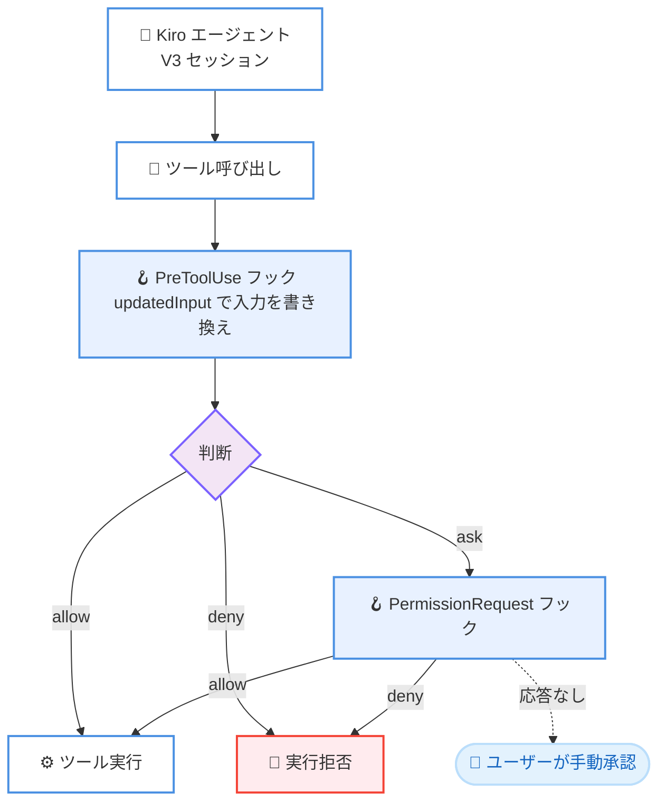

# Kiro - ツール入力を書き換えるフックと Enterprise 向けリアルタイムイベント

**リリース日**: 2026 年 11 月 16 日
**サービス**: Kiro
**機能**: ツール入力の書き換え・権限プロンプトに応答するフック (CLI 3.4.0) / リアルタイムイベントとプライベート接続 (Kiro Enterprise)

📊 [このアップデートのインフォグラフィックを見る](https://takech9203.github.io/aws-news-summary/20261116-kiro-changelog-2026-11-16.html)

## 概要

2026 年 11 月 16 日、Kiro のチェンジログに 2 件のアップデートが公開されました。1 件目は Kiro CLI 3.4.0 のリリースで、ツール呼び出しの入力を実行前に書き換えたり、権限プロンプトにスクリプトで応答したりできるフックが追加されました。これにより、V3 セッションのすべてのツール呼び出しに対して、ユーザーが手動で承認するのを待つことなく、チームのルールをスクリプトで自動適用できるようになります。あわせて `/memories` の設定が 4 つの選択肢になり、クラウドセッションの再開や一覧表示がより多くの場所で可能になったほか、ヘッドレス実行、コンテキストウィンドウ、MCP、検索、`/tangent`、`/rewind`、表示に関する修正が含まれています。

2 件目は Kiro Enterprise 向けの「リアルタイムイベントとプライベート接続」です。管理者は、各 LLM リクエストと完了したツール呼び出しをリアルタイムの OpenTelemetry イベントとしてストリーミングするか、日次の CSV レポートと OpenTelemetry メトリクスを使って整合済みのトレンドを把握できます。クレジット、モデル、会話、応答時間、ツールの実行結果、クライアントバージョン、エージェントモードを追跡でき、観測可能性ツールへより豊富なアクティビティデータを送信できます。

開発チームのガバナンスを自動化したい管理者と、Kiro の利用状況を組織の観測基盤に統合したいエンタープライズ管理者の双方にとって重要なアップデートです。

**アップデート前の課題**

- V3 セッションで権限が必要なツール呼び出しは、ユーザーが 1 件ずつ手動で承認する必要があった
- フックからツール呼び出しの入力内容を実行前に変更する手段がなく、チームルールの強制はルール設定か手動確認に依存していた
- `/memories` の設定は `read & write`、`read only`、`off` の 3 レベルと自動更新の個別チェックボックスに分かれており、意図を表現しにくかった
- Kiro Enterprise の利用状況データは日次ベースが中心で、LLM リクエストやツール呼び出し単位のリアルタイムな可視化ができなかった

**アップデート後の改善**

- `PreToolUse` フックが `updatedInput` を返すことで、ツール実行前に入力を書き換えられるようになった
- 新しい `PermissionRequest` フックが権限プロンプトに `allow` または `deny` で応答し、スクリプトによる自動承認・自動拒否が可能になった
- `/memories` の設定が「自動的に使用・作成」「求められたときに作成」「使用のみ」「オフ」の 4 つの選択肢に整理された
- Kiro Enterprise 管理者が、各 LLM リクエストと完了したツール呼び出しをリアルタイムの OpenTelemetry イベントとして観測可能性ツールにストリーミングできるようになった
- OpenTelemetry の配信経路として、パブリック配信に加えて AWS PrivateLink と Amazon VPC Lattice によるプライベート接続を選択できるようになった

## アーキテクチャ図



フックによるツール呼び出しの制御フローです。`PreToolUse` フックが入力の書き換えと allow / ask / deny の判断を行い、権限確認が必要な場合は `PermissionRequest` フックがユーザーに代わって応答できます。

```mermaid
flowchart LR
    subgraph Kiro["🤖 Kiro Enterprise"]
        direction LR
        RT["📡 リアルタイム<br/>OpenTelemetry イベント"]
        Daily["📊 日次 CSV レポート<br/>OpenTelemetry メトリクス"]
        RT ~~~ Daily
    end

    subgraph Path["🔀 配信経路"]
        direction LR
        Pub["🌐 パブリック配信"]
        PL["🔒 AWS PrivateLink"]
        Lattice["🔒 Amazon VPC Lattice"]
        Pub ~~~ PL ~~~ Lattice
    end

    Collector["🔌 OTLP コレクター"] --> Dash["📈 ダッシュボード<br/>観測可能性ツール"]

    Kiro --> Path --> Collector

    classDef cloud fill:none,stroke:#CCCCCC,stroke-width:2px,color:#666666
    classDef internal fill:#E8F1FF,stroke:#4A90E2,stroke-width:2px,color:#333333
    classDef process fill:#FFFFFF,stroke:#4A90E2,stroke-width:2px,color:#333333
    classDef input fill:#E9F7EC,stroke:#66BB6A,stroke-width:2px,color:#333333

    class Kiro,Path cloud
    class RT,Daily internal
    class Pub,PL,Lattice process
    class Collector,Dash input
```



Kiro Enterprise のリアルタイムイベントと日次メトリクスは、パブリック配信、AWS PrivateLink、Amazon VPC Lattice のいずれかの経路で OTLP コレクターへ送信され、ダッシュボードで可視化できます。

## サービスアップデートの詳細

### 主要機能

#### 1. Kiro CLI 3.4.0: フックによるツール入力の書き換えと権限プロンプトへの応答

1. **`PreToolUse` フックによる入力の書き換え**
   - V3 セッションにおいて、`PreToolUse` フックが `updatedInput` を返すことで、ツール実行前にツール呼び出しの入力を置き換えられる
   - 従来からの `allow`、`ask`、`deny` の判断と組み合わせて使用できる
   - チームのルール (コマンドの書き換え、安全なパラメータへの変換など) をすべてのツール呼び出しに自動適用できる

2. **`PermissionRequest` フックによる権限プロンプトへの応答**
   - ツール呼び出しがユーザーに権限を求める場面で実行される新しいフック
   - `allow` または `deny` で応答でき、本来ユーザーの承認待ちになる呼び出しをスクリプトが許可・拒否できる
   - いずれかのフックの `deny` は `allow` より優先される
   - フックによる権限応答は、その 1 回のツール呼び出しにのみ適用される

3. **`/memories` の 4 つの選択肢**
   - V3 セッションの `/memories` 設定が「Use and create automatically (自動的に使用・作成)」「Use and create when asked (求められたときに作成)」「Use but don't create (使用のみ)」「Off (オフ)」の 4 択に再編
   - 従来の `read & write`、`read only`、`off` の 3 レベルと、別個の自動更新チェックボックスを置き換え

4. **クラウドセッションの改善**
   - `--cloud --resume` が `--no-interactive` (ヘッドレス) 実行でも最新のクラウドセッションを再開できるようになり、セッションがない場合は終了コード 1 で終了
   - `--no-interactive --cloud` 実行時に、ローカルの `mcp.json` で有効化されたサーバーのうち使用されないものの数を通知 (クラウドセッションはクラウド側の設定を使用するため)
   - クラウドの `/knowledge add` と `/knowledge update` は、インデックス対象のパスがクラウドサンドボックス内であることを明示
   - クラウドセッションで実行できない `/permissions` や `/chat save` などのコマンドは、`/` メニュー、Tab 補完、`/help` から除外され、入力した場合は実行できない理由を表示

5. **修正**
   - プロンプトがモデルのコンテキストウィンドウに収まらない場合、`--no-interactive` セッションは要約・切り詰めたコピーで応答する代わりに終了コード 1 で失敗するように変更
   - Kiro CLI の起動中に別のツールが作成した `cli.json` を起動処理が上書きしないように修正
   - このほか、ヘッドレス、MCP、検索、`/tangent`、`/rewind`、表示に関する修正を含む

#### 2. Kiro Enterprise: リアルタイムイベントとプライベート接続

1. **リアルタイム OpenTelemetry イベント**
   - 各 LLM リクエストと完了したツール呼び出しを、リアルタイムの OpenTelemetry イベントとしてストリーミング可能
   - クレジット、モデル、会話、応答時間、ツールの実行結果、クライアントバージョン、エージェントモードを追跡できる
   - 整合済みのトレンド把握には、日次 CSV レポートと OpenTelemetry メトリクスを利用可能

2. **プライベート接続**
   - OpenTelemetry の配信経路として、パブリック配信、AWS PrivateLink、Amazon VPC Lattice から選択可能
   - プライベート接続はパブリック配信にフォールバックしない
   - 各エクスポートは Kiro コンソールで有効化とテストが可能

3. **データの範囲**
   - エクスポートには利用状況データとユーザー識別子が含まれる
   - プロンプト、応答、コード、ファイルは含まれない

4. **日次メトリクスのスケジュール変更**
   - 日次メトリクスは 2026 年 11 月 26 日に 00:30 UTC に移行 (それまでは Dynatrace と Grafana Cloud が「古すぎる」として拒否する)
   - CSV レポートは 02:00 UTC のまま変更なし

## 技術仕様

### フックの動作仕様

| 項目 | 詳細 |
|------|------|
| 対象セッション | V3 セッション |
| `PreToolUse` フック | `updatedInput` でツール入力を書き換え、`allow` / `ask` / `deny` の判断を返却 |
| `PermissionRequest` フック | 権限プロンプト発生時に実行され、`allow` または `deny` で応答 |
| 優先順位 | いずれかのフックの `deny` が `allow` より優先 |
| 適用範囲 | フックの権限応答は該当する 1 回のツール呼び出しのみに適用 |

### Kiro Enterprise アクティビティデータ

| 項目 | 詳細 |
|------|------|
| リアルタイムイベント | LLM リクエストとツール呼び出し単位の OpenTelemetry イベント |
| 日次データ | CSV レポート (02:00 UTC) と OpenTelemetry メトリクス (2026 年 11 月 26 日以降 00:30 UTC) |
| 追跡項目 | クレジット、モデル、会話、応答時間、ツールの実行結果、クライアントバージョン、エージェントモード |
| 配信経路 | パブリック配信 / AWS PrivateLink / Amazon VPC Lattice |
| 含まれるデータ | 利用状況データ、ユーザー識別子 |
| 含まれないデータ | プロンプト、応答、コード、ファイル |
| 利用可能リージョン | 米国東部 (バージニア北部)、欧州 (フランクフルト) の Kiro プロファイル |

## 設定方法

### 前提条件

1. フック機能: Kiro CLI 3.4.0 以降と V3 セッション
2. リアルタイムイベント: Kiro Enterprise の管理者権限と、米国東部 (バージニア北部) または欧州 (フランクフルト) の Kiro プロファイル
3. プライベート接続を使う場合: AWS PrivateLink または Amazon VPC Lattice への接続経路と OTLP コレクター

### 手順

#### ステップ 1: Kiro CLI を 3.4.0 に更新する

```bash
kiro --version
```

現在の CLI バージョンを確認します。3.4.0 未満の場合は、最新版に更新してから V3 セッションを開始します。

#### ステップ 2: フックを設定する

`PreToolUse` フックで `updatedInput` を返すスクリプト、または `PermissionRequest` フックで `allow` / `deny` を返すスクリプトを作成し、フック設定に登録します。フックの種類と戻り値の詳細は [Hooks Types ドキュメント](https://kiro.dev/docs/hooks/types/) を参照してください。

#### ステップ 3: Kiro Enterprise のエクスポートを有効化する

Kiro コンソールで、リアルタイムイベントまたは OpenTelemetry メトリクスのエクスポートを有効化し、配信経路 (パブリック、AWS PrivateLink、Amazon VPC Lattice) を選択してテストします。詳細は [User Activity ドキュメント](https://kiro.dev/docs/enterprise/monitor-and-track/user-activity/) を参照してください。

## メリット

### ビジネス面

- **ガバナンスの自動化**: チームルールをフックで強制することで、手動承認のボトルネックを解消しつつ統制を維持できる
- **利用状況の可視化**: クレジット消費やモデル利用をリアルタイムに把握でき、コスト管理と利用最適化に役立つ
- **コンプライアンス対応**: プロンプトやコードを含まない利用状況データを、プライベート接続経由で組織の観測基盤に安全に集約できる

### 技術面

- **きめ細かな制御**: `PreToolUse` の入力書き換えにより、拒否するだけでなく「安全な形に修正して実行」という選択肢が増えた
- **CI/CD との親和性**: ヘッドレス実行でのクラウドセッション再開やコンテキスト超過時の明確な失敗 (終了コード 1) により、自動化パイプラインでの挙動が予測可能になった
- **標準技術の採用**: OpenTelemetry (OTLP) ベースのため、Dynatrace、Grafana Cloud など既存の観測可能性ツールと統合しやすい

## デメリット・制約事項

### 制限事項

- フックによる入力書き換えと権限応答は V3 セッションでのみ利用可能
- リアルタイムイベントとプライベート接続は、米国東部 (バージニア北部) と欧州 (フランクフルト) の Kiro プロファイルでのみ利用可能
- 日次メトリクスが 00:30 UTC に移行する 2026 年 11 月 26 日までは、Dynatrace と Grafana Cloud が日次メトリクスを「古すぎる」として拒否する

### 考慮すべき点

- `PermissionRequest` フックで自動承認を行う場合、承認ロジックの誤りがそのまま実行につながるため、スクリプトのレビューとテストが重要
- フックの `deny` は `allow` より常に優先されるため、複数フックを併用する際は判断の競合を設計段階で整理しておく必要がある
- プライベート接続はパブリック配信にフォールバックしないため、接続障害時のイベント欠落を考慮した監視設計が必要
- エクスポートにはユーザー識別子が含まれるため、組織の個人情報の取り扱いポリシーに沿った運用が必要

## ユースケース

### ユースケース 1: チームルールによるコマンドの自動書き換え

**シナリオ**: 開発チームで、エージェントが実行するコマンドに必ず安全なオプションを付与したい。

**実装例**:
```
PreToolUse フックで対象ツールの入力を検査し、
updatedInput でチーム標準のオプションを付与した入力に書き換えて allow を返す
```

**効果**: 開発者ごとの設定差異に依存せず、すべてのツール呼び出しにチームルールを強制できる。

### ユースケース 2: CI でのヘッドレス自動承認

**シナリオ**: CI パイプラインの `--no-interactive` 実行で、権限プロンプトにより処理が止まるのを避けたい。

**実装例**:
```
PermissionRequest フックで許可リストに一致する呼び出しに allow、
それ以外に deny を返すスクリプトを登録する
```

**効果**: 人の承認を待たずにパイプラインが完走しつつ、許可リスト外の操作は確実に拒否される。

### ユースケース 3: Kiro 利用状況の組織横断ダッシュボード

**シナリオ**: エンタープライズ管理者として、部門ごとのクレジット消費、モデル利用、応答時間を既存の Grafana ダッシュボードで監視したい。

**実装例**:
```
Kiro コンソールでリアルタイムイベントのエクスポートを有効化し、
AWS PrivateLink 経由で OTLP コレクターに送信、
Grafana でクレジット・モデル・エージェントモード別に可視化する
```

**効果**: LLM リクエスト単位の粒度でほぼリアルタイムに利用状況を把握でき、異常な消費の早期検知や部門別のコスト配分が可能になる。

## 料金

チェンジログに今回のアップデートに伴う追加料金の記載はありません。フック機能は Kiro CLI の機能として、リアルタイムイベントとプライベート接続は Kiro Enterprise の機能として提供されます。なお、AWS PrivateLink や Amazon VPC Lattice を使用する場合は、それぞれの AWS サービスの料金が別途発生する可能性があるため、料金ページで確認してください。

## 利用可能リージョン

- **Kiro CLI 3.4.0 (フック機能など)**: グローバル
- **Kiro Enterprise のリアルタイムイベントとプライベート接続**: 米国東部 (バージニア北部) および欧州 (フランクフルト) の Kiro プロファイルで利用可能

## 関連サービス・機能

- **AWS PrivateLink**: OpenTelemetry イベントをインターネットを経由せずにプライベートに配信するための接続オプション
- **Amazon VPC Lattice**: PrivateLink と並ぶプライベート配信の選択肢で、VPC 間のサービス接続を簡素化
- **AWS CloudTrail**: 2026 年 11 月 12 日のアップデートで、Kiro サービス MCP ツールの呼び出しを CloudTrail に記録可能になっており、今回のリアルタイムイベントと組み合わせることで監査と可観測性の両面をカバーできる
- **OpenTelemetry (OTLP)**: リアルタイムイベントとメトリクスの配信に使用される標準規格で、Dynatrace や Grafana Cloud などと統合可能

## 参考リンク

- 📊 [インフォグラフィック](https://takech9203.github.io/aws-news-summary/20261116-kiro-changelog-2026-11-16.html)
- [Kiro Changelog: Hooks That Rewrite Tool Inputs and Answer Permission Prompts (CLI 3.4.0)](https://kiro.dev/changelog/cli/3-4)
- [Kiro Changelog: Real-time events and private connectivity (General)](https://kiro.dev/changelog/general/real-time-telemetry-and-private-connectivity)
- [Kiro ドキュメント: Hook Types](https://kiro.dev/docs/hooks/types/)
- [Kiro ドキュメント: User Activity (Enterprise)](https://kiro.dev/docs/enterprise/monitor-and-track/user-activity/)
- [Kiro ドキュメント: Memory](https://kiro.dev/docs/memory/)
- [Kiro ドキュメント: Headless CLI](https://kiro.dev/docs/cli/headless/)
- [Kiro 料金ページ](https://kiro.dev/pricing/)

## まとめ

Kiro CLI 3.4.0 のフック強化により、ツール呼び出しの入力書き換えと権限プロンプトへの自動応答が可能になり、チームルールの強制と CI/CD での自動化が大きく前進しました。あわせて Kiro Enterprise では、LLM リクエスト単位のリアルタイム OpenTelemetry イベントと AWS PrivateLink / Amazon VPC Lattice によるプライベート接続が利用可能になり、エンタープライズでの可観測性とガバナンスが強化されています。CLI を 3.4.0 に更新してフックの活用を検討するとともに、Enterprise 管理者は対象リージョンのプロファイルでエクスポートの有効化を検討することを推奨します。
