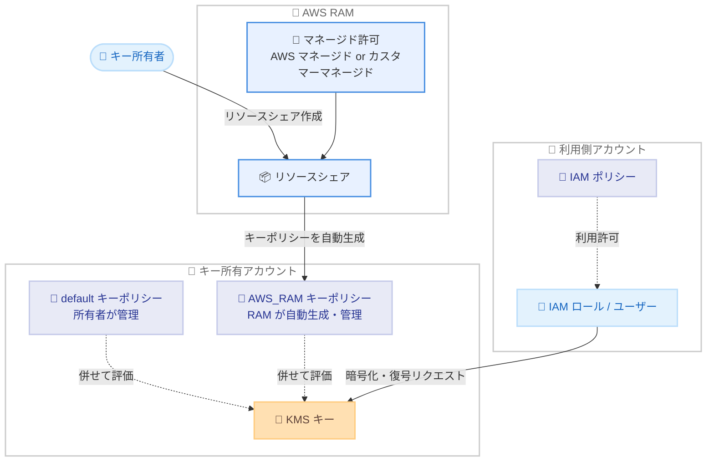

# AWS KMS - AWS Resource Access Manager によるキー共有サポート

**リリース日**: 2026 年 11 月 16 日
**サービス**: AWS Key Management Service (AWS KMS)、AWS Resource Access Manager (AWS RAM)
**機能**: AWS RAM を使用した KMS キーのクロスアカウント共有

📊 [このアップデートのインフォグラフィックを見る](https://takech9203.github.io/aws-news-summary/20261116-kms-key-sharing-resource-access-manager.html)

## 概要

AWS Key Management Service (AWS KMS) が AWS Resource Access Manager (AWS RAM) との統合をサポートしました。これにより、KMS キーを複数の AWS アカウント間、AWS Organizations の組織内、および特定の IAM ロールやユーザーと共有できるようになります。キー所有者は共有したい KMS キーとマネージド許可 (managed permission) を選択してリソースシェアを作成するだけで、クロスアカウントのキー共有を設定できます。

従来、クロスアカウントで KMS キーを利用させるには、キーポリシーに外部アカウント用のステートメントを手動で追加する必要がありました。今回のアップデートにより、RAM がマネージド許可から `AWS_RAM` という名前の 2 つ目のキーポリシーを自動生成するため、既存の `default` キーポリシーを変更せずに共有を実現できます。マルチアカウント環境を運用する組織、中央セキュリティチーム、SaaS プロバイダーと連携する企業にとって、キー共有の設定と保守が大幅に簡素化されます。

また、今回の RAM 側の機能強化 (複数ステートメントのサポート、追加の IAM 条件演算子、パラメーター化されたマネージド許可、カスタマーマネージド許可のクロスアカウント共有) は、RAM がサポートするすべてのリソースタイプに適用されます。

**アップデート前の課題**

- 以前はクロスアカウントで KMS キーを利用させるために、キーポリシー (`default`) に外部アカウント用のステートメントを手動で追加・編集する必要があった
- 多数のアカウントや組織単位 (OU) に一貫した権限でキーを共有する場合、複数のキーポリシーステートメントを個別に記述・管理する必要があった
- 中央セキュリティチームや SaaS プロバイダーが推奨するアクセスポリシーを適用するには、各アカウントがポリシーを手動でコピーして維持する必要があった

**アップデート後の改善**

- リソースシェアを作成するだけで、アカウント、組織、OU、特定の IAM ロール / ユーザーへのキー共有が可能になった
- `default` キーポリシーは変更されず、RAM が `AWS_RAM` キーポリシーを自動生成・管理するため、既存のポリシー管理への影響なしに共有できるようになった
- カスタマーマネージド許可 (CMP) を信頼できる第三者が一度発行すれば、利用者は値を埋めてアタッチするだけで適用でき、CMP の更新バージョンも任意のタイミングで適用できるようになった
- KMS コンソールの「Keys shared with me」ページや `ListKeys` API の `ResourceOwners` パラメーターで、共有されたキーを簡単に発見できるようになった

## アーキテクチャ図



キー所有者がリソースシェアを作成すると、AWS RAM がマネージド許可から `AWS_RAM` キーポリシーを自動生成します。KMS は `default` キーポリシーと `AWS_RAM` キーポリシーを併せて評価し、利用側アカウントの IAM ロール / ユーザーは自身の IAM ポリシーと組み合わせて共有キーを使用します。

## サービスアップデートの詳細

### 主要機能

1. **リソースシェアによる KMS キーの共有**
   - 共有したい KMS キー、マネージド許可、共有先プリンシパル (AWS アカウント、組織、OU、IAM ロール / ユーザー) を指定してリソースシェアを作成する
   - KMS キーは所有アカウントに留まり、所有者が引き続きキーと `default` キーポリシーを管理する
   - RAM がマネージド許可から `AWS_RAM` キーポリシーを生成し、KMS は 2 つのキーポリシーを併せて評価する
   - 組織外のアカウントと共有する場合は、相手アカウントが招待を承諾する必要がある

2. **AWS マネージド許可**
   - `AWSRAMPermissionKMSKeySymmetricEncryption` (デフォルト): `kms:Encrypt`、`kms:Decrypt`、`kms:ReEncrypt*`、`kms:GenerateDataKey*`、`kms:DescribeKey`、`kms:ListGrants` を許可。`kms:CreateGrant` は `kms:GrantIsForAWSResource` が `true` の場合のみ許可されるため、KMS と統合された AWS サービスが利用者の代理でグラントを作成できる
   - `AWSRAMPermissionKMSKeyLockoutResistant`: キー所有アカウントのルートユーザーに限定して `kms:DescribeKey`、`kms:GetKeyPolicy`、`kms:List*`、`kms:PutKeyPolicy` を許可し、キーポリシーのロックアウトを防止する

3. **カスタマーマネージド許可 (CMP) の強化**
   - 署名キーや HMAC キーなど、デフォルト以外の操作を許可する CMP を独自に作成できる
   - CMP が複数のポリシーステートメントと追加の IAM 条件演算子 (`StringNotEquals`、`BoolIfExists`、`ArnLike`、`ForAnyValue` / `ForAllValues` プレフィックスなど) をサポートし、最小権限アクセスを実現できる
   - パラメーター化されたマネージド許可により、プレースホルダー値を共有オーナーがカスタマイズでき、1 つの CMP を多数のアカウントで再利用できる
   - CMP をクロスアカウントで発行・共有でき、作成者がバージョンを集中管理し利用状況を追跡できる。利用者はコピーを維持する必要がない

4. **共有キーの発見と識別**
   - 利用側は KMS コンソールの「Keys shared with me」ページ、または `ListKeys` API の `ResourceOwners` パラメーター (`OTHER_ACCOUNTS_VIA_RAM`) で共有されたキーを一覧できる
   - 所有者は KMS コンソールの「Resource shares」タブ、または `ListKeyPolicies` API で共有状態を確認できる

## 技術仕様

### 共有可能な KMS キーと前提条件

| 項目 | 詳細 |
|------|------|
| 共有可能なキー | カスタマーマネージドキーのみ (AWS マネージドキーは不可) |
| サポートされるキータイプ | 対称暗号化キー、非対称キー、HMAC キー、マルチリージョンキー (プライマリ / レプリカ)、インポートされたキーマテリアル、カスタムキーストアのキー |
| 共有の条件 | 自アカウントで所有するキーのみ共有可能 (共有されたキーの再共有は不可) |
| 必要な権限 | `ram:CreateResourceShare` または `ram:AssociateResourceShare`、および対象キーへの `kms:PutKeyPolicy` |
| リージョン制約 | KMS キーとリソースシェアは同一リージョンに存在する必要がある |
| キーの指定方法 | キー ARN のみ (エイリアス ARN は不可) |
| `AWS_RAM` ポリシーサイズ | 最大 32,768 文字 (`default` キーポリシーのサイズクォータには影響しない) |
| CMP ポリシーテンプレート | 最大 20,480 バイト |

### 権限評価の仕組み

| 評価ルール | 動作 |
|------------|------|
| 2 つのキーポリシー | `default` と `AWS_RAM` を併せて評価し、いずれかの許可でアクセス可能 |
| 明示的な拒否 | `default` キーポリシーの `Deny` は `AWS_RAM` の `Allow` より優先される |
| マネージド許可の制約 | `Allow` ステートメントのみサポート (`Deny` は不可) |
| IAM ポリシー | 利用側アカウントでは、キーポリシーの許可に加えて IAM ポリシーでの許可も必要 |
| グラント | 共有や共有解除はグラントに影響しない |

### キー共有を特定ロールに限定するキーポリシー例

`kms:PolicyName` 条件キーを使用すると、`default` キーポリシーの変更を許可せずに、RAM 経由のキー共有のみを特定ロールに許可できます。

```json
{
  "Sid": "AllowSharingThroughRAM",
  "Effect": "Allow",
  "Principal": {
    "AWS": "arn:aws:iam::111122223333:role/kms-key-sharing-role"
  },
  "Action": "kms:PutKeyPolicy",
  "Resource": "*",
  "Condition": {
    "StringEquals": {
      "kms:PolicyName": "AWS_RAM"
    }
  }
}
```

## 設定方法

### 前提条件

1. 共有する KMS キー (カスタマーマネージドキー) を所有していること
2. `ram:CreateResourceShare` (または `ram:AssociateResourceShare`) と `kms:PutKeyPolicy` の権限を持っていること
3. 組織内共有を使用する場合は、AWS Organizations でリソース共有を有効化していること

### 手順

#### ステップ1: リソースシェアの作成

```bash
aws ram create-resource-share \
    --name my-key-share \
    --resource-arns arn:aws:kms:us-west-2:111122223333:key/1234abcd-12ab-34cd-56ef-1234567890ab \
    --principals 444455556666 \
    --permission-arns arn:aws:ram::aws:permission/AWSRAMPermissionKMSKeySymmetricEncryption
```

リソースシェアを作成し、KMS キーをキー ARN で指定してアカウント `444455556666` と共有します。`--permission-arns` でデフォルトの AWS マネージド許可 (対称暗号化用) を指定しています。この操作により、RAM がキーに `AWS_RAM` キーポリシーを自動生成します。KMS コンソールからも、対象キーの「Resource shares」タブの [Create resource share] から開始できます。

#### ステップ2: 共有状態の確認

```bash
aws kms list-key-policies \
    --key-id 1234abcd-12ab-34cd-56ef-1234567890ab
```

キーのポリシー名一覧を取得します。RAM 経由で共有されている場合、出力に `default` と `AWS_RAM` の両方が含まれます。`AWS_RAM` ポリシーの内容は `get-key-policy --policy-name AWS_RAM` で確認できます。

#### ステップ3: 利用側アカウントでの設定と確認

```bash
# 共有されたキーの一覧を表示
aws kms list-keys --resource-owners OTHER_ACCOUNTS_VIA_RAM
```

利用側アカウントで、他のアカウントから RAM 経由で共有された KMS キーを一覧表示します。組織外のアカウントの場合は、事前にリソースシェアの招待を承諾する必要があります。また、利用側のユーザーやロールがキーを使用するには、キー ARN を `Resource` に指定した IAM ポリシーで許可を付与する必要があります。

#### ステップ4: 共有の解除 (不要になった場合)

```bash
aws ram disassociate-resource-share \
    --resource-share-arn arn:aws:ram:us-west-2:111122223333:resource-share/EXAMPLE \
    --resource-arns arn:aws:kms:us-west-2:111122223333:key/1234abcd-12ab-34cd-56ef-1234567890ab
```

リソースシェアから KMS キーを削除します。キーが唯一のリソースシェアから削除されると、RAM は `AWS_RAM` キーポリシーを削除し、利用側はシェア経由の権限を失います。`default` キーポリシーやグラントによるアクセスは影響を受けません。

## メリット

### ビジネス面

- **マルチアカウント運用の効率化**: 1 つのマネージド許可で組織全体や多数のアカウントに一貫したキー共有を設定でき、ポリシー管理の工数を削減できる
- **ガバナンスの強化**: 中央セキュリティチームが CMP を集中管理し、バージョン管理と利用状況の追跡を行うことで、組織全体で統一されたキーアクセス標準を適用できる
- **SaaS 連携の簡素化**: SaaS プロバイダーなど信頼できる第三者が発行した CMP を利用者が値を埋めるだけで適用でき、手動でのキーポリシー編集が不要になる

### 技術面

- **既存キーポリシーへの非干渉**: `default` キーポリシーは変更されず、RAM が `AWS_RAM` キーポリシーを別途生成・管理するため、既存のポリシー運用と安全に共存できる
- **最小権限の実現**: CMP で複数ステートメントと豊富な IAM 条件演算子を使用でき、必要最小限のアクションのみを許可できる
- **幅広いキータイプに対応**: 対称キーだけでなく、非対称キー、HMAC キー、マルチリージョンキー、カスタムキーストアのキーも共有できる
- **関連リソースとの一括共有**: KMS キーを他の AWS リソースと同じリソースシェアにまとめて共有できる

## デメリット・制約事項

### 制限事項

- AWS マネージドキーは共有できない (カスタマーマネージドキーのみ)
- 共有されたキーを再共有することはできない
- マネージド許可は `Allow` ステートメントのみをサポートし、`Deny` ステートメントや一部の条件キーは使用できない
- CMP に含められない KMS アクションがある (例: `kms:PutKeyPolicy` は不可、`kms:CreateGrant` には条件が必須)
- KMS キーとリソースシェアは同一リージョンに存在する必要があり、エイリアス ARN では指定できない
- 中東 (UAE) リージョンと中東 (バーレーン) リージョンでは利用できない

### 考慮すべき点

- デフォルトのマネージド許可は対称暗号化キー向けのため、署名キーや HMAC キーを共有する場合は適切なアクションを許可する CMP を作成する必要がある
- `AWS_RAM` キーポリシーは最大 32,768 文字で、リソースシェアやプリンシパルを追加するとサイズが増加する。プリンシパルを複数のシェアに分割してもこの制限は回避できない
- 共有解除後も、共有中に AWS サービスが作成したグラントは廃止または取り消しされるまで有効なため、`ListGrants` で確認し必要に応じて `RevokeGrant` を実行する
- リソースシェアや `AWS_RAM` キーポリシーの変更は結果整合性であり、反映まで短時間かかる場合がある
- `ram:RequestedResourceType` 条件キー (`kms:Key`) を使用した SCP で、組織内でキー共有できるプリンシパルを制限することが推奨される
- CloudTrail で `CreateResourceShare`、`AssociateResourceShare`、および RAM による `PutKeyPolicy` イベントを監視し、意図しない共有を検知する仕組みを整えることが推奨される

## ユースケース

### ユースケース1: 組織全体への暗号化キーの一括共有

**シナリオ**: 多数のメンバーアカウントを持つ企業が、中央のセキュリティアカウントで管理する KMS キーを組織全体で利用し、S3 バケットや EBS ボリュームの暗号化を統一したい。

**実装例**:
```bash
aws ram create-resource-share \
    --name org-wide-encryption-key \
    --resource-arns arn:aws:kms:ap-northeast-1:111122223333:key/1234abcd-12ab-34cd-56ef-1234567890ab \
    --principals arn:aws:organizations::111122223333:organization/o-exampleorgid \
    --permission-arns arn:aws:ram::aws:permission/AWSRAMPermissionKMSKeySymmetricEncryption
```

**効果**: 組織 ARN を指定した 1 つのリソースシェアで全メンバーアカウントにキーを共有でき、アカウント追加時のキーポリシー編集が不要になる。`kms:GrantIsForAWSResource` 条件により、KMS 統合サービスが各アカウントで安全にグラントを作成できる。

### ユースケース2: 中央セキュリティチームによる CMP の標準化

**シナリオ**: セキュリティチームが署名用の非対称キーの共有ポリシーを標準化し、各事業部アカウントが独自にポリシーを記述することなく、承認済みの権限セットでキーを共有できるようにしたい。

**実装例**:
```
1. セキュリティチームが kms:Sign、kms:Verify、kms:DescribeKey のみを
   許可する CMP を作成し、条件演算子で利用元を制限
2. CMP を RAM 経由で各事業部アカウントに共有
3. 各事業部はキー共有時にこの CMP を選択し、
   パラメーター化されたプレースホルダーに自環境の値を設定
```

**効果**: セキュリティチームが CMP のバージョンを集中管理し、更新時は各利用者が任意のタイミングで新バージョンを適用できる。各事業部はポリシーのコピーを維持する必要がなく、最小権限が組織全体で担保される。

### ユースケース3: キー共有権限の分離とガードレールの設定

**シナリオ**: キー管理者以外の運用チームにキー共有の作業を委任したいが、`default` キーポリシーの変更は許可したくない。

**実装例**:
```json
{
  "Sid": "AllowSharingThroughRAM",
  "Effect": "Allow",
  "Principal": {
    "AWS": "arn:aws:iam::111122223333:role/kms-key-sharing-role"
  },
  "Action": "kms:PutKeyPolicy",
  "Resource": "*",
  "Condition": {
    "StringEquals": {
      "kms:PolicyName": "AWS_RAM"
    }
  }
}
```

**効果**: `kms:PolicyName` 条件により、運用チームは RAM 経由の共有 (`AWS_RAM` ポリシーの書き込み) のみ実行でき、`default` キーポリシーは変更できない。さらに `default` ポリシーの明示的な `Deny` や RCP をガードレールとして併用することで、共有キーに対する最大権限を制御できる。

## 料金

今回の発表に追加料金に関する記載はありません。KMS キーの保管および API リクエストには、通常の AWS KMS の料金が適用されます。詳細は [AWS KMS 料金ページ](https://aws.amazon.com/kms/pricing/) を参照してください。

## 利用可能リージョン

AWS KMS と AWS RAM の両方が利用可能なすべての AWS リージョンで利用できます。ただし、以下のリージョンを除きます。

- 中東 (UAE)
- 中東 (バーレーン)

## 関連サービス・機能

- **AWS Resource Access Manager (AWS RAM)**: リソースシェアとマネージド許可を管理するサービス。今回の KMS 統合に加え、CMP の複数ステートメント対応やパラメーター化などの強化はすべての RAM 対応リソースタイプに適用される
- **AWS Organizations**: 組織や OU 単位でのキー共有に使用。SCP と組み合わせてキー共有のガードレールを設定できる
- **AWS CloudTrail**: `CreateResourceShare` や RAM による `PutKeyPolicy` などの共有操作イベントを記録し、監査と異常検知に活用できる
- **AWS IAM**: 利用側アカウントでは、キーポリシーの許可に加えて IAM ポリシーによる許可が必要。リソースコントロールポリシー (RCP) でキーの最大権限も制御できる

## 参考リンク

- 📊 [インフォグラフィック](https://takech9203.github.io/aws-news-summary/20261116-kms-key-sharing-resource-access-manager.html)
- [公式発表 (What's New)](https://aws.amazon.com/about-aws/whats-new/2026/11/kms-key-sharing-resource-access-manager/)
- [ドキュメント: Sharing KMS keys with AWS RAM](https://docs.aws.amazon.com/kms/latest/developerguide/key-sharing-ram.html)
- [ドキュメント: Working with shared AWS resources](https://docs.aws.amazon.com/ram/latest/userguide/working-with.html)
- [料金ページ: AWS KMS Pricing](https://aws.amazon.com/kms/pricing/)

## まとめ

AWS KMS と AWS RAM の統合により、キーポリシーを手動編集することなく、マルチアカウント環境での KMS キー共有を安全かつ効率的に設定できるようになりました。マルチアカウント構成で暗号化キーを共有している組織は、既存のクロスアカウントキーポリシー運用を見直し、RAM のマネージド許可と CMP を活用した標準化への移行を検討することを推奨します。導入時は、SCP によるガードレールの設定と CloudTrail による共有操作の監視を併せて実施してください。
