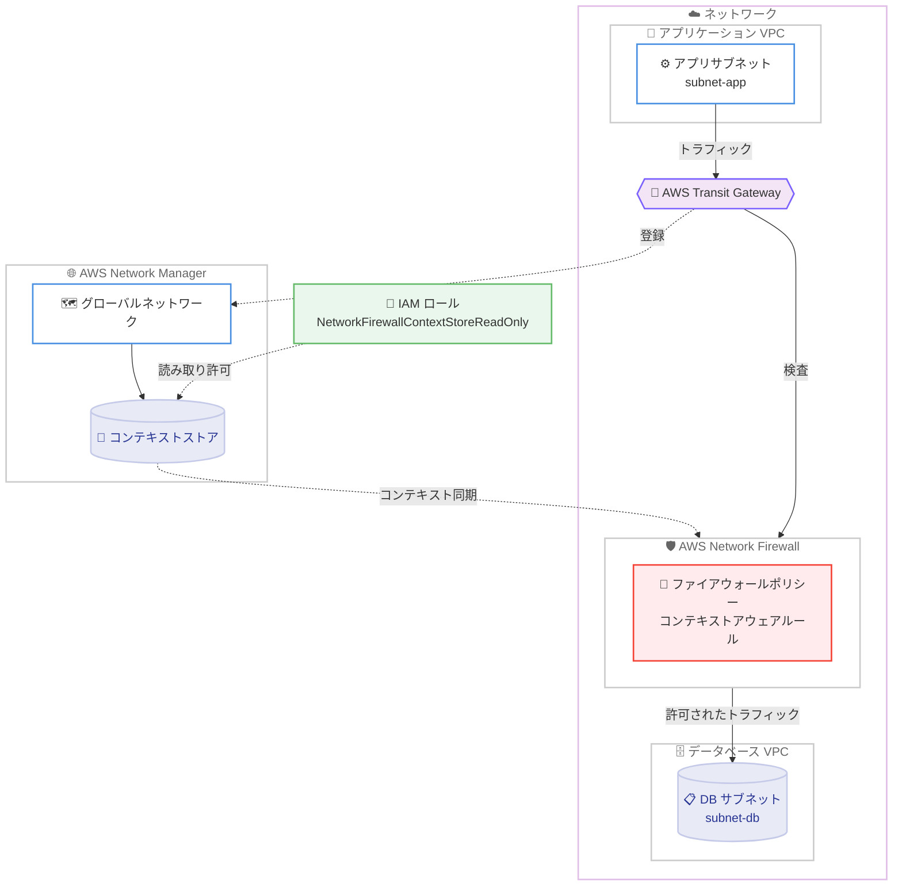

# AWS Network Firewall - Transit Gateway アタッチ型ファイアウォールでのコンテキストアウェアルール対応

**リリース日**: 2026 年 11 月 16 日
**サービス**: AWS Network Firewall, AWS Transit Gateway
**機能**: コンテキストアウェアルール (Context-aware rules)

📊 [このアップデートのインフォグラフィックを見る](https://takech9203.github.io/aws-news-summary/20261116-network-firewall-context-aware-rules.html)

## 概要

AWS Transit Gateway にアタッチされた AWS Network Firewall で、ファイアウォールポリシーにコンテキストアウェアルールを使用できるようになりました。Network Firewall は、VPC をまたぐトラフィックを検査・フィルタリングするマネージド型のファイアウォールおよび侵入防止 (IPS) サービスです。

コンテキストアウェアルールでは、IP アドレスの代わりに VPC リソースのコンテキストを参照してルールを記述します。具体的には、VPC、サブネット、セキュリティグループ、Transit Gateway アタッチメントの ID (総称してコンテキスト識別子) を使用してトラフィックをマッチングできます。ルールはリソースの識別子に基づいてマッチングされるため、参照した境界内のすべてのリソースに適用され、ルール作成後に追加された新しいワークロードも自動的にカバーされます。組織の成長に合わせて一貫したセキュリティ制御を適用しやすくなり、手動でのルール更新が不要になります。

コンテキスト識別子はルールの送信元として任意のプロトコルで参照でき、宛先としては HTTP、TLS、SSH などの TCP ベースのプロトコルで参照できます。また、フローログとアラートログにコンテキスト識別子が含まれるため、コンテキストに基づいたアクティビティ調査が可能です。

**アップデート前の課題**

- Network Firewall のステートフルルールは IP アドレスやポートに基づいて記述する必要があり、ワークロードの追加や IP アドレスの変更のたびにルール (IP セット) の更新が必要だった
- サブネットやセキュリティグループといった論理的な境界でトラフィックを制御するには、CIDR 範囲を手動で管理し、ルールへ反映し続ける運用負荷が発生していた
- 動的に変化する環境では、IP ベースのルールと実際のリソース構成の間に乖離が生じ、セキュリティ制御の抜け漏れのリスクがあった

**アップデート後の改善**

- VPC ID、サブネット ID、セキュリティグループ ID、Transit Gateway アタッチメント ID を直接ルールに参照でき、リソースの識別子に基づいたトラフィック制御が可能になった
- 既存のルールが新規ワークロードを自動的にカバーするため、組織の拡大に伴う手動でのルール更新が不要になった
- フローログとアラートログにコンテキスト識別子が記録され、IP アドレスではなくリソースの観点でトラフィックを調査できるようになった

## アーキテクチャ図



AWS Network Manager のコンテキストストアが Transit Gateway 配下のリソース情報を追跡し、Network Firewall がこれを自動的に同期します。ファイアウォールポリシー内のコンテキストアウェアルールは、同期されたコンテキスト識別子 (VPC、サブネット、セキュリティグループ、TGW アタッチメントの ID) に基づいてトラフィックをマッチングします。

## サービスアップデートの詳細

### 主要機能

1. **コンテキスト識別子によるトラフィックマッチング**
   - VPC (`vpc-`)、サブネット (`subnet-`)、セキュリティグループ (`sg-`)、Transit Gateway アタッチメント (`tgw-attach-`) の ID をルールで参照可能
   - IP アドレスやポートの指定に加えて、または代わりに、コンテキストを使用できる
   - リソースの識別子に基づくマッチングのため、ルール作成後に追加されたリソースにもルールが自動適用される

2. **送信元・宛先の両方で使用可能**
   - 送信元のコンテキスト識別子は、すべてのプロトコルのすべてのフローの全パケットで利用可能
   - 宛先のコンテキスト識別子は、ファイアウォールが戻りトラフィックから受信側リソースを学習する仕組みのため、HTTP、TLS、SSH などの TCP ベースのプロトコルで利用可能

3. **コンテキストセット (ContextSets) によるルール記述**
   - ルールグループの `RuleVariables` に `ContextSets` を定義し、`$APP_SUBNETS` のような変数名でルールから参照する
   - 1 つのコンテキストセットに VPC、セキュリティグループなど異なる種類の ID を混在させることが可能
   - 既存の `IPSets` や `PortSets` と同一ルール内で組み合わせて使用できる

4. **ログへのコンテキスト記録**
   - フローログとアラートログに各フローのコンテキスト識別子が記録される
   - ルールにマッチしないフローについてもコンテキストが記録されるため、リソース観点でのトラフィック調査が可能

5. **複数のポリシー形式に対応**
   - Next Generation Firewall ポリシーのファイアウォールルールグループおよび IPS ルールグループで使用可能
   - Classic Network Firewall ポリシーのステートフルルールグループ (Suricata 互換ルール文字列 `RulesString` および構造化ルール `StatefulRules`) でも使用可能

## 技術仕様

### コンテキスト識別子の種類

| コンテキスト識別子 | ID 形式 | 送信元 | 宛先 |
|------|------|------|------|
| VPC | `vpc-` | 任意のプロトコル | TCP ベースのプロトコルのみ |
| サブネット | `subnet-` | 任意のプロトコル | TCP ベースのプロトコルのみ |
| セキュリティグループ | `sg-` | 任意のプロトコル | TCP ベースのプロトコルのみ |
| Transit Gateway アタッチメント | `tgw-attach-` | 任意のプロトコル | TCP ベースのプロトコルのみ |

### 前提となる構成要素

| 項目 | 詳細 |
|------|------|
| ファイアウォール形態 | Transit Gateway アタッチ型の Network Firewall のみ対応 |
| コンテキストストア | AWS Network Manager のグローバルネットワークごとに 1 つ作成し、Transit Gateway と関連付け |
| IAM ロール | ストア所有アカウントに `NetworkFirewallContextStoreReadOnly` という固定名のロールが必要 |
| コンテキストセット名 | 先頭は英字、英数字とアンダースコアのみ、最大 32 文字。`ContextSets`、`IPSets`、`PortSets` 間で一意 |
| ID の解決タイミング | ポリシーが各ファイアウォールにデプロイされる際に解決 (ルールグループ作成時ではない) |

### API 変更履歴

| 日付 | サービス | 変更内容 |
|------|----------|----------|
| 2026/11/16 | [AWS Network Firewall](https://awsapichanges.com/archive/changes/f1785c-network-firewall.html) | 2 new 9 updated api methods - コンテキストアウェアなステートフルルールグループのサポートを追加。`ListContextStores`、`ListResourcesInContextStore` の 2 つの API が新規追加され、`CreateRuleGroup`、`UpdateRuleGroup`、`DescribeFirewall`、`CreateFirewallPolicyV2`、`UpdateFirewallPolicyV2` などが `ContextSets` やコンテキストストア情報に対応 |

### ルール記述例

コンテキストセットを定義し、アプリケーションサブネットからデータベースサブネットへの HTTPS のみを許可するファイアウォールルールグループの例です。

```json
{
    "RuleVariables": {
        "ContextSets": {
            "APP_SUBNETS": {
                "Definition": [
                    "subnet-1234567890abcdef0",
                    "subnet-021345abcdef6789a"
                ]
            },
            "DB_SUBNETS": {
                "Definition": [
                    "subnet-0abc123def4567890"
                ]
            }
        }
    },
    "RulesSource": {
        "RulesString": "accept:flow tcp:all $APP_SUBNETS any -> $DB_SUBNETS 443 (sid:1001;)"
    }
}
```

## 設定方法

### 前提条件

1. AWS Transit Gateway にアタッチされた Network Firewall が構成済みであること
2. AWS Network Manager でグローバルネットワークを作成し、対象の Transit Gateway を登録済みであること
3. コンテキストストアの所有アカウントで、Network Firewall にストアへの読み取りアクセスを許可する IAM ロールを作成できること

### 手順

#### ステップ 1: コンテキストストアの作成と Transit Gateway の関連付け

AWS Network Manager コンソールで以下を実施します。

1. グローバルネットワークを選択 (または新規作成) する
2. ファイアウォールがアタッチされている Transit Gateway をグローバルネットワークに登録し、ステータスが Available になるまで待つ
3. ナビゲーションペインで [コンテキストストア] を選択し、[コンテキストストアの作成] で登録済みの Transit Gateway を関連付ける

関連付けは通常数分で Associated になります。グローバルネットワークごとに作成できるコンテキストストアは 1 つで、Transit Gateway ごとに 1 回の設定で完了します。

#### ステップ 2: IAM ロールの作成

コンテキストストアの所有アカウントで、`NetworkFirewallContextStoreReadOnly` という名前の IAM ロールを作成します。信頼ポリシーで `network-firewall.amazonaws.com` の AssumeRole を許可し、以下の許可ポリシーをアタッチします。

```json
{
    "Version": "2012-10-17",
    "Statement": [
        {
            "Effect": "Allow",
            "Action": [
                "networkmanager:GetContextStoreAssociation",
                "networkmanager:GetContextVersion",
                "networkmanager:ListContexts",
                "networkmanager:ListContextChanges"
            ],
            "Resource": "*"
        }
    ]
}
```

このロールがないと、ファイアウォールはコンテキストストアと同期できず、コンテキストアウェアルールはどのトラフィックにもマッチしません。ロールはストア所有アカウントごとに 1 回作成すればよく、アカウント内のすべてのコンテキストストアをカバーします。

#### ステップ 3: ファイアウォールの同期状態の確認

Network Firewall 側の設定は不要です。ファイアウォールは Transit Gateway に関連付けられたコンテキストストアを自動的に検出します (通常は関連付けから数分以内)。

```bash
aws network-firewall describe-firewall --firewall-name example-firewall
```

このコマンドはファイアウォールの詳細を取得します。レスポンスの `Firewall` オブジェクトで `ContextStoreId` と `ContextStoreOwnerAccountId` が設定されていれば、コンテキストストアの検出が完了しています。コンソールではファイアウォール詳細ページの [Context store sync state] セクションで確認できます。

#### ステップ 4: コンテキストストア内のリソースの確認

```bash
aws network-firewall list-resources-in-context-store \
    --context-store-id <context-store-id> \
    --filters Region=ap-northeast-1,ResourceType=Subnet
```

このコマンドは、コンテキストストアが追跡しているリソースの一覧を取得します。ルールで参照するコンテキスト ID は、この API が返す ID である必要があります。

#### ステップ 5: コンテキストアウェアルールの作成

```bash
aws network-firewall create-rule-group \
    --type FIREWALL --capacity 100 \
    --rule-group-name example-context-firewall-rule-group \
    --firewall-rule-group file://firewall-rules.json \
    --region ap-northeast-1
```

このコマンドは、`ContextSets` を含むルールグループ定義ファイル (前述のルール記述例を参照) からファイアウォールルールグループを作成します。作成したルールグループをファイアウォールポリシーに追加すると、コンテキストアウェアルールが有効になります。

## メリット

### ビジネス面

- **運用負荷の削減**: 既存のルールが新規ワークロードを自動的にカバーするため、組織の成長に伴うルールの手動更新作業が不要になる
- **一貫したセキュリティガバナンス**: IP アドレスの変化に影響されず、VPC やサブネットといった論理的な境界に基づいた一貫したセキュリティ制御を維持できる
- **追加コストなし**: コンテキストアウェアルールは追加料金なしで利用可能

### 技術面

- **意図が明確なルール記述**: 「アプリ層から DB 層への HTTPS のみ許可」のように、アーキテクチャの意図をそのままルールとして表現でき、CIDR の読み解きが不要になる
- **既存のルール変数との統合**: `ContextSets` は既存の `IPSets`、`PortSets` と同一ルール内で組み合わせ可能で、段階的な移行がしやすい
- **調査性の向上**: フローログとアラートログにコンテキスト識別子が記録されるため、どのリソースが関与したトラフィックかを直接特定できる
- **安全な削除の扱い**: ルールが参照するリソースを削除しても、ルールは残りの ID に対するマッチングを継続する。削除された ID は再利用されないため、ルールの即時更新は不要

## デメリット・制約事項

### 制限事項

- Transit Gateway アタッチ型の Network Firewall のみ対応 (VPC 内にエンドポイントを配置する従来の構成では利用不可)
- 宛先位置でのコンテキスト識別子の使用は TCP または TCP ベースのアプリケーションプロトコルに限定される (ファイアウォールが戻りトラフィックから受信側リソースを学習するため)
- コンテキストストアの事前設定 (AWS Network Manager のグローバルネットワーク作成、Transit Gateway の登録、ストアの関連付け) が必要
- グローバルネットワークごとに作成できるコンテキストストアは 1 つで、関連付けできるのは Transit Gateway のみ

### 考慮すべき点

- ストア所有アカウントに `NetworkFirewallContextStoreReadOnly` という固定名の IAM ロールが必須。ロールがない場合、ルールはどのトラフィックにもマッチしないため、設定漏れに注意が必要
- ルールグループ更新時は `RuleVariables` を含む完全なルールグループオブジェクトを指定する必要がある。変数を省略した更新を行うとコンテキストセットが削除される
- コンテキスト ID はポリシーのデプロイ時に解決されるため、ストアが認識しない ID を参照したルールは何にもマッチしない。`ListResourcesInContextStore` で ID を事前確認することが推奨される

## ユースケース

### ユースケース 1: アプリケーション層とデータベース層のセグメンテーション

**シナリオ**: マルチ VPC 環境で、アプリケーションサブネットからのみデータベースサブネットへのアクセスを許可し、その他のアクセスをすべてブロックしたい。

**実装例**:
```
accept:flow tcp:all $APP_SUBNETS any -> $DB_SUBNETS [3306,5432] (msg:"Allow application to database subnets"; sid:2004;)
drop:flow tcp:all any any -> $DB_SUBNETS [3306,5432] (msg:"Block all other access to database subnets"; sid:2005;)
```

**効果**: サブネット ID に基づくセグメンテーションにより、IP アドレスの管理なしでデータベース層を保護できる。新しいアプリケーションサブネットを `$APP_SUBNETS` に追加するだけで制御を拡張できる。

### ユースケース 2: 隔離済みセキュリティグループからのトラフィック監視

**シナリオ**: インシデント対応で隔離 (検疫) 用セキュリティグループに移したリソースからの全トラフィックを検知・ブロックしたい。

**実装例**:
```
drop:flow tcp:all $QUARANTINE_SG any -> $EXTERNAL_NET any (msg:"Block external access from quarantined resources"; sid:3001;)
```

**効果**: 隔離対象のリソースをセキュリティグループに追加するだけで、ファイアウォールレベルでの封じ込めが即座に適用される。アラートログにはセキュリティグループ ID が記録されるため、調査も容易になる。

### ユースケース 3: オンプレミス接続からのプロトコル制御

**シナリオ**: Direct Connect 経由のオンプレミス接続 (Transit Gateway アタッチメント) からの UDP トラフィックをブロックしたい。

**実装例**:
```
drop udp $ON_PREM any -> any any (msg:"Block UDP from on-premises attachments"; sid:2006;)
```

**効果**: Transit Gateway アタッチメント ID により、トラフィックがネットワークに入ってくる経路に基づいた制御が可能になる。オンプレミス側の IP アドレス体系を把握・管理する必要がない。

## 料金

コンテキストアウェアルールは追加料金なしで利用できます。AWS Network Firewall 自体の料金 (エンドポイント時間課金およびトラフィック処理量課金) と、AWS Transit Gateway の料金は通常どおり発生します。

詳細は [AWS Network Firewall の料金ページ](https://aws.amazon.com/network-firewall/pricing/) を参照してください。

## 利用可能リージョン

すべての商用リージョンおよび AWS GovCloud (US) リージョンで利用可能です。サポート対象リージョンの全リストは [AWS Capabilities by Region ページ](https://builder.aws.com/build/capabilities/explore) を参照してください。

## 関連サービス・機能

- **AWS Transit Gateway**: コンテキストアウェアルールの前提となるファイアウォールのアタッチ先。VPC やオンプレミス接続を集約するハブとして機能する
- **AWS Network Manager (Global Networks for Transit Gateways)**: コンテキストストアを管理するサービス。グローバルネットワークに Transit Gateway を登録し、コンテキスト共有を設定する
- **Amazon VPC セキュリティグループ**: コンテキスト識別子の 1 つとして利用可能。インスタンスレベルの制御とファイアウォールレベルの制御を同じグループ定義で連携できる
- **AWS Network Firewall ログ (フローログ・アラートログ)**: コンテキスト識別子が記録されるようになり、リソース観点でのトラフィック分析が可能

## 参考リンク

- 📊 [インフォグラフィック](https://takech9203.github.io/aws-news-summary/20261116-network-firewall-context-aware-rules.html)
- [公式発表 (What's New)](https://aws.amazon.com/about-aws/whats-new/2026/11/network-firewall-context-aware-rules/)
- [ドキュメント: Context-aware rules in AWS Network Firewall](https://docs.aws.amazon.com/network-firewall/latest/developerguide/context-aware-rules.html)
- [ドキュメント: Writing context-aware rules](https://docs.aws.amazon.com/network-firewall/latest/developerguide/context-aware-rules-writing.html)
- [ドキュメント: Onboarding your transit gateway to a context store](https://docs.aws.amazon.com/network-firewall/latest/developerguide/context-aware-rules-setup.html)
- [AWS Network Firewall 製品ページ](https://aws.amazon.com/network-firewall/)
- [料金ページ](https://aws.amazon.com/network-firewall/pricing/)

## まとめ

AWS Network Firewall のコンテキストアウェアルールにより、IP アドレスではなく VPC、サブネット、セキュリティグループ、Transit Gateway アタッチメントといったリソースの識別子に基づいたトラフィック制御が可能になりました。既存のルールが新規ワークロードを自動的にカバーするため、動的に成長する環境でのルール管理の負荷が大幅に軽減されます。Transit Gateway アタッチ型の Network Firewall を運用している場合は、AWS Network Manager でコンテキストストアを設定し、IP ベースのルールからの段階的な移行を検討することを推奨します。
