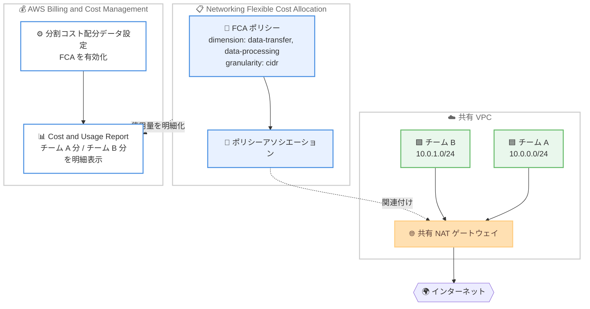

# Amazon VPC - Networking Flexible Cost Allocation

**リリース日**: 2026 年 11 月 16 日
**サービス**: Amazon Virtual Private Cloud (Amazon VPC)
**機能**: Networking Flexible Cost Allocation (FCA)

📊 [このアップデートのインフォグラフィックを見る](https://takech9203.github.io/aws-news-summary/20261116-networking-flexible-cost-allocation.html)

## 概要

Amazon VPC が Networking Flexible Cost Allocation (FCA) を発表しました。FCA は、NAT ゲートウェイなどの共有ネットワークリソースのデータ転送料金やデータ処理料金を、実際にその使用量を発生させたリソース、サブネット、VPC、アカウント、IP アドレス範囲に帰属させて AWS Cost and Usage Report (CUR) に明細表示できる機能です。

これまで、複数のチームが 1 つの NAT ゲートウェイを共有している場合、請求書にはリソース所有アカウントに対する 1 つの料金としてしか表示されず、どのチームがどれだけのコストを発生させたかを把握できませんでした。FCA を使用すると、コスト配分ポリシーを作成してリソースに関連付けるだけで、CUR 上で使用量が発生元ごとに明細化されます。なお、FCA が変更するのはレポート上の明細表示のみであり、請求総額、トラフィックのルーティング、メータリングには一切影響しません (ショーバック方式)。

複数チームでネットワークリソースを共有する大規模組織、マルチアカウント環境を運用する FinOps チーム、社内コスト配賦 (チャージバック / ショーバック) を実施したい管理者にとって有用なアップデートです。

**アップデート前の課題**

- 共有 NAT ゲートウェイや VPC ピアリングのコストは CUR 上で 1 つの明細としてのみ表示され、どのチームやアプリケーションが使用量を発生させたかを特定できなかった
- VPC Flow Logs をカスタムスクリプトで分析してコストを推計する必要があり、継続的なエンジニアリング負担が発生していた
- 固定比率でコストを按分する方法では、実際の使用量と乖離し、一部のチームに過大または過小な請求が発生していた

**アップデート後の改善**

- コスト配分ポリシーをリソースに関連付けるだけで、使用量発生元ごとの明細が CUR に自動的に表示されるようになった
- ENI、EC2 インスタンス、サブネット、VPC、アカウント、CIDR ラベルといった粒度を選択してレポートできるようになった
- カスタムスクリプトや手動の推計が不要になり、実使用量に基づいた正確なコスト配賦が可能になった

## アーキテクチャ図



複数チームが共有する NAT ゲートウェイに FCA ポリシーを関連付けることで、CUR 上で各チームのトラフィックに応じたコスト明細が表示される流れを示しています。

## サービスアップデートの詳細

### 主要機能

1. **コスト配分ポリシー (FCA ポリシー)**
   - 配分対象のコストディメンションとレポート粒度を定義するポリシーを作成し、リソースに関連付ける
   - 1 つのポリシーは 1 つのリソースタイプ (NAT ゲートウェイ、EC2 インスタンス、VPC ピアリング接続) に適用される
   - 特定のリソース単位のほか、アカウント、VPC、サブネットといったスコープ単位での関連付けも可能で、スコープ内に新規作成されたリソースにも自動適用される

2. **柔軟なレポート粒度**
   - `eni` (ネットワークインターフェイス)、`ec2` (EC2 インスタンス)、`subnet`、`vpc`、`account`、`cidr` (ユーザー定義の CIDR ラベル) の粒度から選択できる
   - VPC ピアリング接続では `peering-id` などの追加粒度もサポート
   - 指定した粒度でフローを解決できない場合は、解決可能な 1 段階粗い粒度で自動的に明細化される

3. **ショーバック (Showback) 制御**
   - ポリシー単位で配分のオン / オフを切り替えられる (デフォルトはオン)
   - ショーバックをオフにしても、ポリシーとアソシエーションは保持されるため、関連付けを削除せずに配分を一時停止できる
   - 請求の支払い主体は変わらず、共有リソースの所有アカウントが引き続き支払う (レポート上の可視化のみ)

4. **CUR / Data Exports との統合**
   - Amazon ECS や Amazon EKS の分割コスト配分データと同じ仕組み・同じカラムを使用
   - 従来の CUR と CUR 2.0 (AWS Data Exports) の両方に対応
   - ポリシー関連付け後、最大 24 時間以内に配分済み明細がレポートに表示される

## 技術仕様

### 対応リソースとディメンション

| リソースタイプ | 配分対象のコスト | 備考 |
|------|------|------|
| NAT ゲートウェイ (`natgw`) | データ転送 (`data-transfer`) + データ処理 (`data-processing`) | インターネット向けトラフィックを含む。プライベート NAT ゲートウェイは未対応 |
| EC2 インスタンス (`ec2`) | データ転送 (`data-transfer`) | 同一 VPC 内で直接接続されたピアとのリージョン内データ転送 |
| VPC ピアリング接続 (`pcx`) | データ転送 (`data-transfer`) | 同一リージョン内のピアリングのみ。クロスリージョンは未対応 |

### 主要な概念

| 概念 | 説明 |
|------|------|
| ポリシー | 配分対象のディメンションとレポート粒度を定義。最大 100 バージョンを保持 |
| アソシエーション | ポリシーをリソース、アカウント、VPC、サブネットに適用。リソース個別の関連付けがスコープより優先 |
| レポート粒度 | `eni` / `ec2` / `subnet` / `vpc` / `account` / `cidr` (リソースタイプにより追加粒度あり) |
| 有効化タイミング | アソシエーション作成時刻 + 60 分を次の正時に切り上げた時刻以降に有効化。過去の使用量への遡及適用はなし |

### API変更履歴

| 日付 | サービス | 変更内容 |
|------|----------|----------|
| 2026/11/13 | [Amazon Elastic Compute Cloud](https://awsapichanges.com/archive/changes/b4312b-ec2.html) | 8 new 8 updated api methods - Networking Flexible Cost Allocation API のサポートを追加。共有ネットワークコストをトラフィック発生元のリソース単位で分解可能に |

主な新規 API (AWS CLI コマンド名):

- `create-networking-flex-cost-allocation-policy` - ポリシーの作成
- `associate-networking-flex-cost-allocation-policy` / `disassociate-networking-flex-cost-allocation-policy` - リソースへの関連付け / 解除
- `describe-networking-flex-cost-allocation-policies` / `describe-networking-flex-cost-allocation-policy-associations` - ポリシーとアソシエーションの一覧表示
- `get-networking-flex-cost-allocation-policy-versions` - ポリシーバージョンの取得
- `modify-networking-flex-cost-allocation-policy` - ポリシーの更新
- `delete-networking-flex-cost-allocation-policies` - ポリシーの削除 (最大 50 件を一括指定可能)

### ポリシードキュメントの例

NAT ゲートウェイの両ディメンションを配分し、送信元 CIDR 範囲のラベルで明細化する例です。

```json
{
  "ReportingGranularity": ["cidr"],
  "Dimensions": ["data-transfer", "data-processing"],
  "CidrRangeSpecifications": {
    "PrefixesType": "source-prefixes",
    "Prefixes": [
      { "CidrRange": "10.0.0.0/24", "CidrLabel": "team-a" },
      { "CidrRange": "10.0.1.0/24", "CidrLabel": "team-b" }
    ]
  }
}
```

## 設定方法

### 前提条件

1. CUR (または CUR 2.0 / Data Exports) で分割コスト配分データ (split cost allocation data) が有効化されていること
2. AWS Billing and Cost Management コンソールの Cost Management preferences で、管理アカウントまたはスタンドアロンアカウントが「Networking flexible cost allocation」を有効化していること
3. FCA ポリシーの作成・関連付け権限に加え、対象リソースの describe 権限 (例: `ec2:DescribeNatGateways`、`ec2:DescribeInstances`、`ec2:DescribeVpcPeeringConnections`) を持つ IAM ロール / ユーザーであること

### 手順

#### ステップ1: FCA ポリシーの作成

```bash
aws ec2 create-networking-flex-cost-allocation-policy \
    --network-resource-type natgw \
    --nat-fca-policy-document file://policy-document.json \
    --show-back-enabled \
    --description "Allocate shared NAT gateway costs by team"
```

NAT ゲートウェイ向けの FCA ポリシーを作成します。`--network-resource-type` にはリソースタイプ (`natgw`、`ec2`、`pcx`) を指定し、ポリシードキュメントで配分ディメンションとレポート粒度を定義します。出力には、ポリシー ID (`fcap-xxxx`) と有効化予定時刻 (`ExpectedEffectiveAt`) が含まれます。

#### ステップ2: ポリシーのリソースへの関連付け

```bash
# 特定の NAT ゲートウェイに関連付け
aws ec2 associate-networking-flex-cost-allocation-policy \
    --fca-policy-id fcap-0123456789abcdef0 \
    --network-resource-ids nat-0123456789abcdef0

# または VPC スコープで関連付け (VPC 内のすべての NAT ゲートウェイに適用)
aws ec2 associate-networking-flex-cost-allocation-policy \
    --fca-policy-id fcap-0123456789abcdef0 \
    --network-resource-scope 'ResourceType=vpc,ResourceIds=[vpc-1a2b3c4d5e6f7a8b9]'
```

作成したポリシーをリソースまたはスコープ (アカウント / VPC / サブネット) に関連付けます。1 リクエストで最大 20 件まで指定できます。関連付けは作成時刻 + 60 分を次の正時に切り上げた時刻以降に有効化されます。

#### ステップ3: CUR で分割コスト配分データを有効化

AWS Billing and Cost Management コンソールで以下を実施します。

1. ナビゲーションペインで [Cost Management preferences] を選択
2. [Split cost allocation data] セクションで [Networking flexible cost allocation] を選択
3. [Save preferences] を選択

この設定は管理アカウントまたはスタンドアロンアカウントのみが変更できます。有効化後、最大 24 時間以内に配分済み明細が CUR に表示されます。配分済み明細は、共有リソースを所有するアカウントのレポートと管理アカウントのレポートの両方に表示されます。

## メリット

### ビジネス面

- **正確なコスト配賦**: 固定比率の按分や推計ではなく、実際のトラフィック量に基づいてチームやアプリケーションごとのコストを可視化できる
- **FinOps の推進**: チーム単位のコスト責任を明確化でき、ショーバック / チャージバックの運用を標準機能で実現できる
- **追加コストなし**: FCA 自体は無料で利用でき、既存の NAT ゲートウェイやデータ転送の標準料金のみで利用できる

### 技術面

- **カスタム分析基盤が不要**: VPC Flow Logs のカスタムスクリプト分析や独自のコスト按分パイプラインを廃止でき、運用負担を削減できる
- **柔軟な粒度設定**: ENI 単位の詳細な分析から、アカウント単位や CIDR ラベル単位の集計まで、用途に応じた粒度を選択できる
- **IaC 対応**: AWS CLI に加えて AWS CloudFormation (`AWS::EC2::FcaPolicy`、`AWS::EC2::FcaPolicyAssociation`) でポリシーを管理でき、構成をコードとして統制できる

## デメリット・制約事項

### 制限事項

- 対応リソースは NAT ゲートウェイ、EC2 インスタンス、VPC ピアリング接続のみ (Transit Gateway などは未対応)
- 同一リージョン内のトラフィックのみが対象。クロスリージョン VPC ピアリングを含むリージョン間トラフィックは配分されない
- プライベート NAT ゲートウェイは未対応
- ポリシーは 1 リージョン・1 アカウントあたり最大 100 個。1 ポリシーに関連付けられるリソース / アカウント / VPC / サブネットは合計 100 件まで。1 リソースに関連付けられるポリシーは 1 つのみ
- CIDR 範囲は 1 ポリシーあたり最大 100 件で、送信元または送信先のいずれか一方のみ指定可能
- 自アカウントが所有するリソースのみ関連付け可能。他アカウントから共有された VPC やサブネットは関連付けられない
- 「Networking flexible cost allocation」の設定は管理アカウントまたはスタンドアロンアカウントのみが有効化できる
- 中東 (バーレーン) と中東 (UAE) リージョン、および AWS GovCloud (US) リージョンでは利用不可

### 考慮すべき点

- 配分は遡及適用されない。アソシエーションの有効化予定時刻 (作成 + 60 分を正時に切り上げ) 以降にメータリングされたトラフィックのみが対象となる
- AWS Network Firewall エンドポイントや Gateway Load Balancer エンドポイントが送信元と NAT ゲートウェイの間に存在する場合、そのトラフィックの NAT ゲートウェイ使用量は発生元に明細化されず、通常どおり所有アカウントに課金表示される
- NAT ゲートウェイのサブネットのネットワーク ACL が送信トラフィックを破棄した場合でも、そのトラフィックは配分対象・課金対象としてカウントされる。拒否したいトラフィックは送信元のセキュリティグループでブロックすることが推奨される
- アソシエーションは常にポリシーの最新バージョンを使用するため、短時間に連続してバージョンを作成すると中間バージョンが有効化されずにスキップされる場合がある
- 分割コスト配分データの設定はサービスごとの選択ができないため、有効化すると Amazon ECS / Amazon EKS など分割コスト配分データをサポートするすべてのサービスの行が CUR に含まれる

## ユースケース

### ユースケース1: 共有 NAT ゲートウェイのチーム別コスト配賦

**シナリオ**: 共通ネットワークアカウントの NAT ゲートウェイを複数チームのワークロードが共有しており、チームごとのサブネット CIDR に応じてコストを可視化したい。

**実装例**:
```json
{
  "ReportingGranularity": ["cidr"],
  "Dimensions": ["data-transfer", "data-processing"],
  "CidrRangeSpecifications": {
    "PrefixesType": "source-prefixes",
    "Prefixes": [
      { "CidrRange": "10.0.0.0/24", "CidrLabel": "team-a" },
      { "CidrRange": "10.0.1.0/24", "CidrLabel": "team-b" }
    ]
  }
}
```

**効果**: CUR に `team-a` / `team-b` のラベル付きで NAT ゲートウェイのデータ転送・データ処理コストが明細表示され、実トラフィックに基づく正確なチャージバックが可能になる。

### ユースケース2: マルチアカウント環境での VPC ピアリングコストの帰属

**シナリオ**: ハブアカウントが所有する VPC ピアリング接続を介して複数のスポークアカウントが通信しており、データ転送コストをアカウント単位で把握したい。

**実装例**:
```bash
aws ec2 create-networking-flex-cost-allocation-policy \
    --network-resource-type pcx \
    --pcx-fca-policy-document file://pcx-policy.json \
    --show-back-enabled \
    --description "Allocate peering data transfer by account"
```
(ポリシードキュメントで `"ReportingGranularity": ["account"]` を指定)

**効果**: ピアリング経由のデータ転送コストが通信相手のアカウント単位で明細化され、管理アカウントのレポートで組織全体のネットワークコスト構造を把握できる。

### ユースケース3: VPC スコープでの自動適用による運用省力化

**シナリオ**: 開発チームが NAT ゲートウェイを頻繁に作成・削除する環境で、新規リソースにも漏れなくコスト配分を適用したい。

**実装例**:
```bash
aws ec2 associate-networking-flex-cost-allocation-policy \
    --fca-policy-id fcap-0123456789abcdef0 \
    --network-resource-scope 'ResourceType=vpc,ResourceIds=[vpc-1a2b3c4d5e6f7a8b9]'
```

**効果**: VPC スコープで関連付けることで、アソシエーションが有効な間に新規作成された NAT ゲートウェイにもポリシーが自動適用され、個別の関連付け作業が不要になる。

## 料金

FCA は追加料金なしで利用できます。NAT ゲートウェイ、データ転送などの標準料金は従来どおり発生します。FCA はレポート上の明細表示を変更するのみで、請求総額は変わりません。

詳細は [Amazon VPC の料金ページ](https://aws.amazon.com/vpc/pricing/) を参照してください。

## 利用可能リージョン

- 中東 (バーレーン) と中東 (UAE) を除くすべての AWS 商用リージョン (東京・大阪リージョンを含む)
- 中国リージョンでも利用可能
- AWS GovCloud (US) リージョンでは利用不可

## 関連サービス・機能

- **AWS Cost and Usage Report (CUR) / AWS Data Exports**: FCA の配分済み明細の出力先。分割コスト配分データの有効化が必要
- **分割コスト配分データ (Split Cost Allocation Data)**: Amazon ECS / Amazon EKS で提供されてきたコスト分割の仕組み。FCA は同じカラムと設定を使用する
- **NAT ゲートウェイ / VPC ピアリング**: FCA の配分対象となる共有ネットワークリソース
- **VPC Flow Logs**: 従来のコスト推計に使われていた手段。FCA により配賦目的でのカスタム分析が不要になる

## 参考リンク

- 📊 [インフォグラフィック](https://takech9203.github.io/aws-news-summary/20261116-networking-flexible-cost-allocation.html)
- [公式発表 (What's New)](https://aws.amazon.com/about-aws/whats-new/2026/11/networking-flexible-cost-allocation/)
- [ドキュメント: Networking Flexible Cost Allocation](https://docs.aws.amazon.com/vpc/latest/userguide/networking-flexible-cost-allocation.html)
- [ドキュメント: 分割コスト配分データの有効化](https://docs.aws.amazon.com/cur/latest/userguide/enabling-split-cost-allocation-data.html)
- [料金ページ (Amazon VPC)](https://aws.amazon.com/vpc/pricing/)

## まとめ

Networking Flexible Cost Allocation は、共有ネットワークリソースのコスト可視化という長年の課題を、追加料金なしの標準機能として解決するアップデートです。NAT ゲートウェイや VPC ピアリングを複数チームで共有しているマルチアカウント環境では、まず管理アカウントで分割コスト配分データと FCA 設定を有効化し、コスト按分のカスタムスクリプトを FCA ポリシーへ置き換えることを推奨します。
