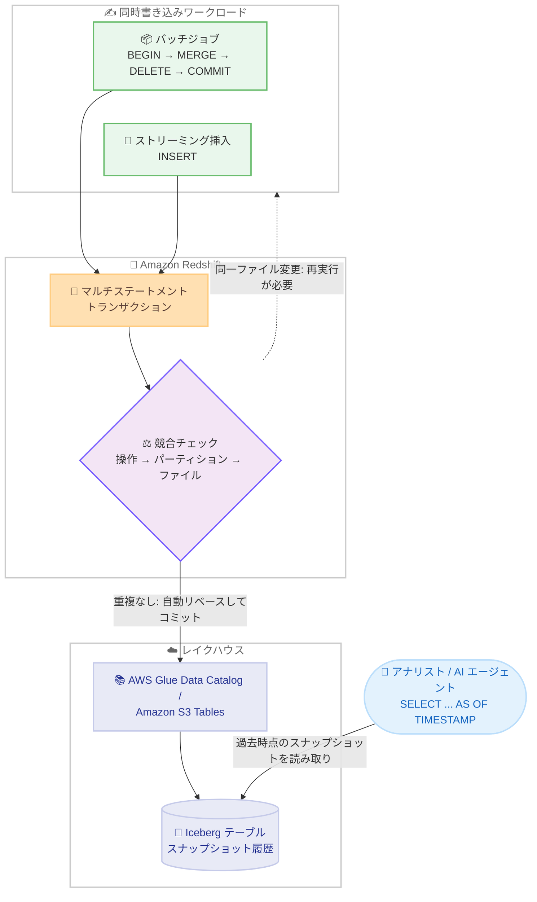

# Amazon Redshift - Apache Iceberg テーブル向けマルチステートメントトランザクション、競合解決、タイムトラベル

**リリース日**: 2026 年 11 月 16 日
**サービス**: Amazon Redshift
**機能**: Apache Iceberg テーブルに対するマルチステートメントトランザクション、自動競合解決、タイムトラベルクエリ

📊 [このアップデートのインフォグラフィックを見る](https://takech9203.github.io/aws-news-summary/20261116-redshift-time-travel-multi-statement.html)

## 概要

Amazon Redshift が Apache Iceberg テーブルに対する 3 つの新機能、マルチステートメントトランザクション、自動競合解決、タイムトラベルクエリをサポートしました。これにより、データウェアハウスと同等のトランザクションセマンティクスを備えた本番規模の書き込みワークロードを Iceberg テーブル上で実行できるようになります。

マルチステートメントトランザクションでは、複数の SQL ステートメントを `BEGIN ... COMMIT` ブロックにまとめ、単一のアトミックな Iceberg スナップショットとして公開できます。自動競合解決では、同じテーブルに対する複数の同時書き込みが、変更内容が重複しない限り自動的にコミットされます。タイムトラベルでは、`AS OF TIMESTAMP` 句を使用して過去の時点のテーブル状態をクエリできます。

バッチジョブの開発者、ストリーミングと定期ジョブを同一テーブルに書き込むデータエンジニア、過去のテーブル状態を参照したいアナリストや監査担当者、AI エージェントなど、Iceberg ベースのレイクハウスを運用する幅広いユーザーが対象です。

**アップデート前の課題**

- 複数の書き込みステートメントが個別にコミットされるため、処理の途中で失敗すると中途半端な状態がテーブルに残り、外部からも部分適用された状態が見えてしまった
- Apache Iceberg の楽観的同時実行制御 (OCC) はテーブルバージョン単位で競合を検出するため、異なるパーティションやファイルへの書き込みであっても後からコミットした側が失敗し、アプリケーション側でのリトライが必要だった (例: 1 時間かかる削除ジョブが、実行中にストリーミング挿入が 1 件コミットされただけで失敗する)
- 過去時点のテーブル状態を参照するには、テーブルのコピーを別途保持するなどの運用上の工夫が必要だった

**アップデート後の改善**

- `BEGIN ... COMMIT` で囲んだ複数ステートメント (MERGE の後に DELETE など) が単一の Iceberg スナップショットとしてアトミックに公開され、失敗時はクリーンにロールバックされる
- 同時書き込みがデータレベルで重複しない場合、Redshift が自動的にリベースしてコミットするため、再実行やアプリケーション側のリトライが不要になった
- `AS OF TIMESTAMP` 句により、追加のコピーを保持することなく、レポートの再現、変更の監査、誤った書き込みからの復旧が可能になった

## アーキテクチャ図



複数の書き込みワークロードが同一の Iceberg テーブルに同時書き込みする際、Redshift が操作レベル → パーティションレベル → ファイルレベルの順で競合をチェックし、重複しない変更を自動的にコミットします。読み取り側は `AS OF TIMESTAMP` で過去のスナップショットを参照できます。

## サービスアップデートの詳細

### 主要機能

1. **マルチステートメントトランザクション**
   - 複数の DML ステートメントを `BEGIN ... COMMIT` ブロックにまとめ、単一のアトミックな Iceberg スナップショットとして公開 (新しい構文は不要)
   - 各ステートメントは直前のステートメントの未コミットメタデータの上に構築され、1 つの保留中スナップショットとして蓄積される
   - 外部の読み取りからは「バッチ適用前」か「バッチ適用後」のどちらかのみが見え、中間状態は決して見えない
   - 失敗または `ROLLBACK` 時は何も公開されず、テーブルは変更されない
   - トランザクション内では自身の未コミットの書き込みを読み取り可能 (write-audit-publish パターンに対応)
   - 書き込み対象は 1 トランザクションにつき 1 つの Iceberg テーブル。Iceberg、RMS、外部テーブルの読み取りはデータベースをまたいで可能

2. **自動競合解決**
   - コミットの競合発生時に、競合した書き込み同士が実際にデータレベルで重複しているかを Redshift がチェックし、独立していると証明できた場合は最新テーブルバージョンに書き込みをリベースしてコミット (git rebase に類似)
   - 再スキャン、再実行、アプリケーション側のリトライが不要。設定やクラスタリングキー、再パーティショニングも不要で、対象の書き込みに自動適用される
   - チェックは軽量な順に 3 段階で実施: 操作レベル (片方が追加のみなら解決) → パーティションレベル (削除同士でもパーティションが重複しなければ解決) → ファイルレベル (同一パーティションでも異なるファイルなら解決)
   - 独立性を証明できない場合は安全側に倒し、競合として書き込みをリトライさせる設計 (正しさを同時実行性より優先)
   - Iceberg のテーブルプロパティ `write.*.isolation-level` に準拠したスナップショット分離で動作し、Spark、Amazon EMR、Amazon Athena と整合。serializable 設定のテーブルでは従来どおりすべての競合が表面化する

3. **タイムトラベルクエリ**
   - `FROM`、`JOIN`、`USING` 句のテーブル名の後に `AS OF TIMESTAMP` 句を追加し、過去時点のテーブルスナップショットを読み取り
   - タイムスタンプはリテラル (`'2026-11-01 09:00:00 UTC'` など) または式 (`(CURRENT_TIMESTAMP - INTERVAL '1 day')` など) で指定
   - 読み取り専用であり、テーブルや履歴は変更されない。クエリ可能な期間はテーブルのスナップショット保持設定に依存
   - レポートの再現、変更の監査、誤った書き込みからの復旧 (過去スナップショットから `INSERT` / `UPDATE` / `DELETE` で復元) などに活用可能

## 技術仕様

### 機能別の対応カタログと要件

| 項目 | 詳細 |
|------|------|
| マルチステートメントトランザクション対応カタログ | AWS Glue Data Catalog、Amazon S3 Tables (外部スキーマまたは自動マウントされた `awsdatacatalog` 経由) |
| タイムトラベル対応カタログ | AWS Glue Data Catalog の Iceberg テーブル (Iceberg マテリアライズドビューを含む) |
| 必要パッチ (マルチステートメントトランザクション) | Redshift Patch 206 以降 |
| トランザクション内で許可される書き込み | 単一 Iceberg テーブルへの `INSERT`、`UPDATE`、`DELETE`、`MERGE`、単一 Iceberg マテリアライズドビューの `REFRESH` |
| トランザクション内で拒否される操作 | 2 つ目の Iceberg テーブルへの書き込み、RMS / 一時テーブルへの DML、`COPY`、`UNLOAD`、`GRANT`、`REVOKE`、`ANALYZE`、Iceberg DDL、ストアドプロシージャ内の Iceberg 書き込み |
| 競合解決の分離レベル | スナップショット分離 (Iceberg の `write.*.isolation-level` テーブルプロパティに準拠) |
| タイムトラベルの指定方法 | タイムスタンプのみ (スナップショット ID による `AS OF VERSION` は非対応) |

### 競合解決の結果マトリクス

| 自分の書き込み | INSERT と競合 | DELETE / UPDATE / MERGE と競合 | コンパクションと競合 | ALTER と競合 |
|------|------|------|------|------|
| INSERT | 自動解決 | 自動解決 | 自動解決 | 再実行 |
| DELETE / UPDATE / MERGE | 自動解決 | 同一ファイル変更以外は自動解決 | 同一ファイル変更以外は自動解決 | 再実行 |
| ALTER | 再実行 | 再実行 | 再実行 | 再実行 |

### タイムトラベルの構文

```sql
SELECT ...
FROM iceberg_table
     AS OF TIMESTAMP { 'timestamp_literal' | ( timestamp_expression ) }
     [ [ AS ] alias ]
```

`AS OF TIMESTAMP` 句は直後のテーブル参照にのみ適用され、クエリ内の他のテーブルは現在の状態で読み取られます。時点はクエリ実行前に一度だけ決定されます。

## 設定方法

### 前提条件

1. Amazon Redshift プロビジョンドクラスター (RA3) または Redshift Serverless を使用していること (マルチステートメントトランザクションは Patch 206 以降)
2. AWS Glue Data Catalog または Amazon S3 Tables に Apache Iceberg テーブルが登録され、外部スキーマまたは `awsdatacatalog` 経由で参照できること
3. マルチステートメントトランザクション利用前に、孤立ファイルクリーンアップを有効化しておくことを推奨 (中断されたトランザクションが未参照ファイルを残すため。S3 Tables はデフォルトで有効、Glue Data Catalog テーブルは孤立ファイル削除オプティマイザーの有効化が必要)

### 手順

#### ステップ 1: マルチステートメントトランザクションで複数の書き込みをまとめる

```sql
BEGIN;

-- POS 売上データをマージ
MERGE INTO iceberg_schema.sales USING iceberg_schema.pos_sales p ON ...;

-- 取り消しされた売上を削除
DELETE FROM iceberg_schema.sales
  WHERE sale_id IN (SELECT sale_id FROM iceberg_schema.pos_voids);

-- 監査チェック: 未コミットの変更をトランザクション内で確認
SELECT sum(amount), sum(CASE WHEN amount < 0 THEN 1 ELSE 0 END)
FROM iceberg_schema.sales WHERE sale_date = '2026-10-06';

COMMIT; -- チェックに問題があれば ROLLBACK
```

`BEGIN` から `COMMIT` までの MERGE と DELETE が単一の Iceberg スナップショットとして公開されます。コミット前の SELECT は自身の未コミット変更を読み取れるため、検証してから公開する write-audit-publish パターンを実装できます。問題があれば `ROLLBACK` で何も公開せずに取り消せます。

#### ステップ 2: タイムトラベルクエリで過去の状態を参照する

```sql
-- 1 日前と現在の行数を比較
SELECT 'current' AS period, COUNT(*) AS order_count
FROM iceberg_schema.orders
UNION ALL
SELECT '1 day ago', COUNT(*)
FROM iceberg_schema.orders AS OF TIMESTAMP (CURRENT_TIMESTAMP - INTERVAL '1 day');
```

`AS OF TIMESTAMP` 句を付けたテーブル参照のみが過去時点のスナップショットを読み取り、他のテーブル参照は現在の状態を読み取ります。

#### ステップ 3: 誤った書き込みから復旧する

```sql
BEGIN;

DELETE FROM iceberg_schema.orders WHERE customer_id = 42;

INSERT INTO iceberg_schema.orders
SELECT * FROM iceberg_schema.orders
     AS OF TIMESTAMP (CURRENT_TIMESTAMP - INTERVAL '1 hour')
WHERE customer_id = 42;

COMMIT;
```

顧客 42 の行を一度削除し、1 時間前のスナップショットから再挿入することで、その時点の状態に正確に復元します。マルチステートメントトランザクションにより、どちらかのステートメントが失敗した場合は何もコミットされません。

## メリット

### ビジネス面

- **パイプラインの信頼性向上**: バッチ処理が all-or-nothing でコミットされるため、途中失敗による不整合データが下流のレポートや分析に影響することがなくなる
- **運用コストの削減**: 競合時のリトライロジックの実装・運用や、監査用のテーブルコピー保持が不要になり、開発・運用の負担が軽減される
- **監査・コンプライアンス対応**: タイムトラベルにより過去時点の状態を正確に再現でき、監査対応やレポートの再現性が向上する

### 技術面

- **スループットの向上**: AWS のベンチマークでは、従来の OCC で 16 並列書き込み時に約 94% が失敗していたワークロードが、競合解決により拒否ゼロとなり、完了コミット数が 12 倍に向上
- **コミットオーバーヘッドの削減**: 小さなステートメントをトランザクションにまとめることで実行時間を短縮 (25 ステートメントのバッチで INSERT 約 14.77%、DELETE 約 11.29% の短縮)。32 並列書き込み時の正規化スループットは、自動コミットの約 2.89 倍に対し 4 ステートメントのトランザクションで約 10.37 倍に向上
- **エコシステムとの整合性**: スナップショット分離の動作が Spark、Amazon EMR、Amazon Athena と整合しており、複数エンジンから同一テーブルを扱うレイクハウス構成でも一貫した動作となる

## デメリット・制約事項

### 制限事項

- マルチステートメントトランザクションで書き込めるのは 1 トランザクションにつき 1 つの Iceberg テーブルのみ。2 つ目のテーブルへの書き込みはトランザクションを中断させる
- トランザクション内で Iceberg DDL (`CREATE` / `ALTER` / `DROP TABLE` など) は拒否される。これは動作変更であり、以前はトランザクション内の単一 DDL が成功していた
- ストアドプロシージャ内からの Iceberg 書き込みはトランザクションで利用できない
- 競合解決では、同一ファイルを変更する書き込み同士、および `ALTER` が絡む競合は自動解決されず再実行が必要
- タイムトラベルは AWS Glue Data Catalog の Iceberg テーブルのみ対応。AWS Lake Formation で管理されたテーブル (Amazon S3 Tables カタログ `s3tablescatalog` を含む) やデータ共有経由のテーブルでは利用できない
- タイムトラベルは、参照するスナップショットのスキーマに `struct`、`array`、`map` などの複合データ型の列が含まれる場合は利用できない
- タイムトラベルはスナップショット ID 指定 (`AS OF VERSION`) に非対応で、タイムスタンプ指定のみ

### 考慮すべき点

- 中断されたトランザクションは未参照ファイルを残すため、孤立ファイルクリーンアップの有効化が推奨される (Glue Data Catalog のオプティマイザーは有効化後に作成されたファイルのみクリーンアップする点に注意)
- トランザクション内のテーブルバージョンは `BEGIN` 時点ではなく各テーブルの初回読み取り時点で固定されるため、後から初めて読むテーブルには他セッションのコミットが反映される可能性がある
- タイムトラベルで遡れる期間はスナップショット保持設定に依存する。スナップショットを保持しすぎるとクエリプランニングやストレージに影響するため、必要な期間のみ保持し、長期履歴はテーブル自体にタイムスタンプ列などで保持することが推奨される
- 個々のステートメントがすでにデータ量の多い処理である場合、コミットオーバーヘッドの割合が小さいため、トランザクション化による性能向上は限定的

## ユースケース

### ユースケース 1: 日次バッチの write-audit-publish パターン

**シナリオ**: 小売業で POS データを夜間バッチで売上テーブルにマージし、取り消しデータを削除した上で、整合性チェックに合格した場合のみ公開したい。

**実装例**:
```sql
BEGIN;
MERGE INTO iceberg_schema.sales USING iceberg_schema.pos_sales p ON ...;
DELETE FROM iceberg_schema.sales
  WHERE sale_id IN (SELECT sale_id FROM iceberg_schema.pos_voids);
SELECT sum(amount) FROM iceberg_schema.sales WHERE sale_date = '2026-10-06';
-- チェック結果に応じて COMMIT または ROLLBACK
COMMIT;
```

**効果**: 下流の利用者には検証済みの完全な状態のみが見え、途中失敗時もテーブルは変更前のままクリーンに保たれる。

### ユースケース 2: ストリーミング挿入とコンプライアンス削除の同時実行

**シナリオ**: IoT データをストリーミング挿入し続けるテーブルに対し、GDPR などに基づく長時間の削除ジョブを定期実行したい。従来は削除ジョブ実行中に挿入が 1 件コミットされるだけで削除ジョブ全体が失敗していた。

**実装例**:
```sql
-- セッション A: ストリーミング挿入 (継続実行)
INSERT INTO iceberg_schema.events SELECT * FROM staging_events;

-- セッション B: 定期削除ジョブ (同時実行)
DELETE FROM iceberg_schema.events WHERE user_id IN (SELECT user_id FROM deletion_requests);
```

**効果**: 挿入は追加のみの操作であるため常に自動解決され、削除ジョブも変更が重複しない限り失敗しない。リトライロジックの実装が不要になり、ジョブの完了時間が予測可能になる。

### ユースケース 3: 誤削除からの復旧とレポートの再現

**シナリオ**: 誤った DELETE で注文データの一部が消えてしまった。また、月末締めのレポートを後日同じ結果で再実行したい。

**実装例**:
```sql
-- 誤削除からの復旧: 1 時間前のスナップショットから復元
INSERT INTO iceberg_schema.orders
SELECT * FROM iceberg_schema.orders
     AS OF TIMESTAMP (CURRENT_TIMESTAMP - INTERVAL '1 hour')
WHERE status = 'pending';

-- 月末締め時点のレポート再現
SELECT order_date, SUM(amount) AS revenue
FROM iceberg_schema.orders AS OF TIMESTAMP '2026-11-01 02:00:00 UTC'
WHERE order_date = '2026-10-31'
GROUP BY order_date;
```

**効果**: テーブルのコピーやバックアップからのリストアなしに、SQL だけで誤操作からの復旧と締め時点のレポート再現が可能になる。

## 料金

これらの機能に追加料金はありません。Iceberg テーブルへの書き込み・クエリに使用する Amazon Redshift プロビジョンドクラスターまたは Redshift Serverless の通常の料金が適用されます。なお、タイムトラベル用にスナップショットを保持すると、そのスナップショットのみが参照するデータファイルが Amazon S3 に残るため、ストレージコストに影響する点に留意してください。

## 利用可能リージョン

Iceberg テーブルへの書き込みまたはクエリをサポートする Amazon Redshift プロビジョンドクラスター (RA3) および Redshift Serverless が利用できる、すべての AWS 商用リージョンで利用可能です。

## 関連サービス・機能

- **AWS Glue Data Catalog**: Iceberg テーブルのカタログとして使用。スナップショット保持オプティマイザー、コンパクションオプティマイザー、孤立ファイル削除オプティマイザーによるテーブルメンテナンスを提供
- **Amazon S3 Tables**: Iceberg 専用の組み込みマネージドテーブルストレージ。マルチステートメントトランザクションの書き込み先として利用可能で、未参照ファイル削除がデフォルトで有効
- **Amazon Athena / Amazon EMR (Spark)**: 同一の Iceberg テーブルを共有する他の分析エンジン。競合解決のスナップショット分離の動作がこれらのエンジンと整合する
- **Amazon Redshift マテリアライズドビュー**: Iceberg マテリアライズドビューはトランザクション内での `REFRESH` やタイムトラベルクエリの対象となる

## 参考リンク

- 📊 [インフォグラフィック](https://takech9203.github.io/aws-news-summary/20261116-redshift-time-travel-multi-statement.html)
- [公式発表 (What's New)](https://aws.amazon.com/about-aws/whats-new/2026/11/redshift-time-travel-multi-statement)
- [AWS Blog: Multi-statement transactions for Apache Iceberg tables in Amazon Redshift](https://aws.amazon.com/blogs/big-data/multi-statement-transactions-for-apache-iceberg-tables-in-amazon-redshift/)
- [AWS Blog: Resolving concurrent write conflicts for Apache Iceberg tables in Amazon Redshift](https://aws.amazon.com/blogs/big-data/resolving-concurrent-write-conflicts-for-apache-iceberg-tables-in-amazon-redshift/)
- [ドキュメント: Time travel queries on Iceberg tables in Amazon Redshift](https://docs.aws.amazon.com/redshift/latest/dg/iceberg-time-travel.html)
- [料金ページ: Amazon Redshift の料金](https://aws.amazon.com/redshift/pricing/)

## まとめ

今回のアップデートにより、Amazon Redshift は Apache Iceberg テーブルに対してデータウェアハウス同等のトランザクションセマンティクスを提供し、レイクハウスでの本番書き込みワークロードの運用を大幅に簡素化します。Iceberg テーブルへの書き込みで競合リトライや部分失敗に悩まされていた場合は、Patch 206 以降への更新と孤立ファイルクリーンアップの有効化を確認した上で、マルチステートメントトランザクションの導入を検討することを推奨します。
