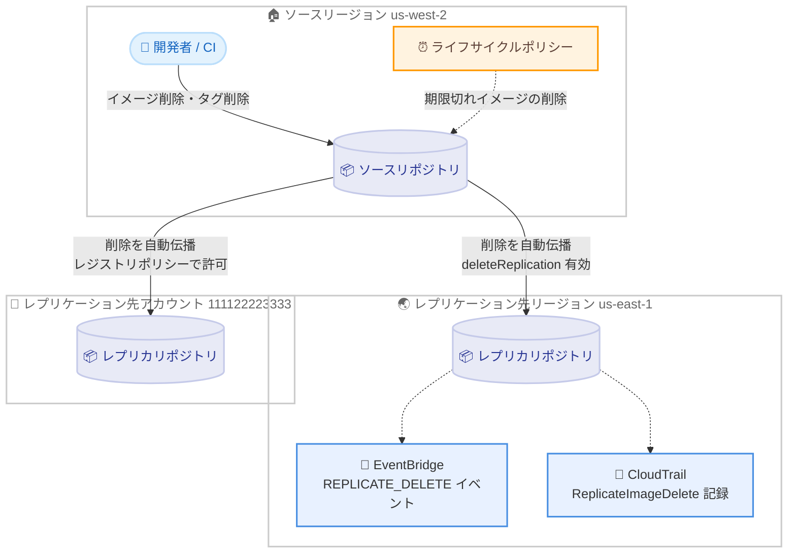

# Amazon ECR - イメージ削除のクロスリージョン / クロスアカウントレプリケーション

**リリース日**: 2026 年 11 月 16 日
**サービス**: Amazon Elastic Container Registry (Amazon ECR)
**機能**: レプリケーションルールによるイメージ削除・タグ削除の伝播 (Replication of deletes)

📊 [このアップデートのインフォグラフィックを見る](https://takech9203.github.io/aws-news-summary/20261116-replication-deletes-amazon-ecr.html)

## 概要

Amazon ECR のレプリケーション機能が、イメージの削除とイメージタグの削除をレプリケーション先に伝播できるようになりました。レプリケーションルールで削除レプリケーション (`deleteReplication`) を有効にすると、ソースレジストリで実行されたイメージ削除やタグ削除が、クロスリージョンおよびクロスアカウントのレプリケーション先リポジトリへ自動的に反映されます。手動削除だけでなく、ライフサイクルポリシーによるイメージの期限切れ削除も伝播の対象です。

これまで ECR レプリケーションはイメージのプッシュのみを複製し、削除は複製されませんでした。そのため、マルチリージョンやマルチアカウント構成を運用するチームは、各レプリケーション先で個別に削除処理を行う必要があり、スクリプトの保守や削除漏れによる不整合・不要なストレージコストが課題でした。今回のアップデートにより、レプリケーション先のリポジトリがソースと自動的に一貫性を保つようになります。

レプリケーションされた削除は Amazon EventBridge イベントとして発行され、AWS CloudTrail にも記録されるため、プッシュと同等の可観測性で削除操作を監視できます。

**アップデート前の課題**

- 以前は ECR レプリケーションがイメージのコピーのみを行い、ソースでの削除はレプリケーション先に反映されなかった
- レプリケーション先のリージョンやアカウントごとに、削除用のスクリプトや手動運用で整合性を維持する必要があった
- ライフサイクルポリシーをソースと各レプリケーション先で重複して管理する必要があり、設定差異による不整合や不要なストレージコストが発生していた

**アップデート後の改善**

- レプリケーションルールで削除レプリケーションを有効にするだけで、イメージ削除・タグ削除がすべてのレプリケーション先に自動伝播されるようになった
- ライフサイクルポリシーによる期限切れ削除も伝播されるため、ソース側のポリシー管理だけでレプリケーション先のクリーンアップが完結するようになった
- EventBridge イベントと CloudTrail 記録により、レプリケーションされた削除を監視・監査できるようになった

## アーキテクチャ図



ソースレジストリでのイメージ削除・タグ削除 (手動またはライフサイクルポリシー) が、レプリケーションルールに定義されたクロスリージョン / クロスアカウントのレプリケーション先へ自動的に伝播され、レプリケーション先では EventBridge イベントと CloudTrail 記録で削除を監視できます。

## サービスアップデートの詳細

### 主要機能

1. **イメージ削除・タグ削除の自動伝播**
   - ソースレジストリでイメージをダイジェスト指定で削除すると、各レプリケーション先でも該当イメージとすべてのタグが削除される
   - 複数タグを持つイメージから 1 つのタグを削除すると、各レプリケーション先でも同じタグが削除される
   - 最後のタグを削除した場合は、タグなしになったイメージ自体 (ダイジェストと関連タグ) が各レプリケーション先で削除される

2. **ライフサイクルポリシーによる削除の伝播**
   - ソースレジストリのライフサイクルポリシーがイメージを期限切れにした場合も、その削除が各レプリケーション先に伝播される
   - レプリケーション先ごとにライフサイクルポリシーを重複管理する必要がなくなる

3. **レプリケーションルール単位のオプトイン設定**
   - 削除レプリケーションはデフォルトで無効であり、レプリケーションルールごとに `deleteReplication` パラメータで有効化する
   - 有効化後に発生した削除のみが伝播され、有効化以前の削除は遡及して伝播されない
   - ECR コンソールまたは AWS CLI でレプリケーション設定を更新して有効化する

4. **EventBridge / CloudTrail による可観測性**
   - レプリケーションされた削除が完了すると、レプリケーション先リージョンで詳細タイプ `ECR Replication Action`、`action-type` が `REPLICATE_DELETE` の EventBridge イベントが発行される
   - レプリケーション先アカウントの CloudTrail に `ReplicateImageDelete` イベントとして記録される

## 技術仕様

### 削除レプリケーションの動作

| 項目 | 詳細 |
|------|------|
| 設定単位 | レプリケーションルールごと (`deleteReplication.enabled`) |
| デフォルト | 無効 (オプトイン) |
| 伝播対象 | イメージ削除 (ダイジェスト指定)、タグ削除、ライフサイクルポリシーによる期限切れ削除 |
| 伝播対象外 | リポジトリ自体の削除、有効化以前に発生した削除 |
| 一貫性 | 非同期・結果整合性。レプリケーション先の内容がソースのアクションと一致する場合のみ削除を適用 |
| 連鎖伝播 | なし。削除の伝播は 1 ホップのみ (A→B→C の構成でも A の削除は B までしか伝播しない) |
| サービスロール | `AWSServiceRoleForECRReplication` (サービスリンクロール) を使用 |
| クロスアカウント権限 | レプリケーション先レジストリのレジストリ権限ポリシーで、ソースアカウントに `ecr:ReplicateImageDelete` を許可 (従来の `ecr:ReplicateImage`、`ecr:CreateRepository` に追加) |
| 監視 | EventBridge (`REPLICATE_DELETE`)、CloudTrail (`ReplicateImageDelete`) |

### レプリケーション設定の例

```json
{
    "rules": [
        {
            "destinations": [
                {
                    "region": "us-west-2",
                    "registryId": "111122223333"
                }
            ],
            "deleteReplication": {
                "enabled": true
            }
        }
    ]
}
```

## 設定方法

### 前提条件

1. Amazon ECR プライベートレジストリでレプリケーションルールを設定済みであること (または新規に設定すること)
2. クロスアカウントレプリケーションの場合、レプリケーション先レジストリの権限ポリシーでソースアカウントに `ecr:ReplicateImageDelete` 権限を付与すること
3. AWS CLI を使用する場合は、レジストリ設定を更新できる IAM 権限があること

### 手順

#### ステップ 1: レプリケーション設定で削除レプリケーションを有効化

```bash
aws ecr put-replication-configuration \
  --replication-configuration '{
    "rules": [
      {
        "destinations": [
          {"region": "us-west-2", "registryId": "111122223333"}
        ],
        "deleteReplication": {"enabled": true}
      }
    ]
  }'
```

レジストリのレプリケーション設定を更新し、対象ルールに `deleteReplication` を設定して削除の伝播を有効化します。ECR コンソールのレプリケーション設定画面からも同様に有効化できます。

#### ステップ 2: クロスアカウントの場合はレプリケーション先の権限を更新

```bash
aws ecr put-registry-policy \
  --policy-text '{
    "Version": "2012-10-17",
    "Statement": [
      {
        "Sid": "AllowReplicationFromSource",
        "Effect": "Allow",
        "Principal": {"AWS": "arn:aws:iam::<ソースアカウントID>:root"},
        "Action": [
          "ecr:ReplicateImage",
          "ecr:CreateRepository",
          "ecr:ReplicateImageDelete"
        ],
        "Resource": "arn:aws:ecr:<リージョン>:<レプリケーション先アカウントID>:repository/*"
      }
    ]
  }'
```

レプリケーション先アカウントのレジストリ権限ポリシーを更新し、ソースアカウントに削除レプリケーションに必要な `ecr:ReplicateImageDelete` 権限を付与します。

#### ステップ 3: 動作確認と監視設定

```bash
# ソースでタグを削除して伝播を確認
aws ecr batch-delete-image \
  --repository-name my-app \
  --image-ids imageTag=v1.0.0

# レプリケーション先リージョンでイメージ一覧を確認
aws ecr list-images \
  --repository-name my-app \
  --region us-west-2
```

ソースレジストリでイメージまたはタグを削除し、レプリケーション先リポジトリから同じイメージが削除されることを確認します。レプリケーションは非同期のため、反映まで時間差が生じる場合があります。必要に応じて、レプリケーション先リージョンで `REPLICATE_DELETE` イベントを受け取る EventBridge ルールを作成し、通知や自動処理を構成します。

## メリット

### ビジネス面

- **運用コストの削減**: レプリケーション先ごとの削除スクリプトや手動クリーンアップが不要になり、マルチリージョン / マルチアカウント運用の負荷が軽減される
- **ストレージコストの最適化**: ソースで不要になったイメージがレプリケーション先にも残り続けることがなくなり、無駄なストレージ料金を抑制できる
- **追加コストなし**: 削除レプリケーション自体に追加料金は発生しない

### 技術面

- **一貫性の自動維持**: ソースとレプリケーション先のリポジトリ内容が自動的に同期され、環境間の差異による障害リスクが低減される
- **ライフサイクルポリシーの一元管理**: ソース側のライフサイクルポリシーだけで全レプリケーション先のクリーンアップを制御できる
- **可観測性の確保**: EventBridge イベントと CloudTrail 記録により、削除の伝播を監視・監査でき、ガバナンス要件にも対応しやすい

## デメリット・制約事項

### 制限事項

- リポジトリ自体の削除は伝播されない (イメージレベルの削除のみが対象)
- 有効化以前に発生した削除は遡及して伝播されない
- 削除の伝播は 1 ホップのみで、多段レプリケーション構成では下流まで連鎖しない

### 考慮すべき点

- レプリケーションは非同期・結果整合性であり、プッシュと削除がソースと異なる順序でレプリケーション先に到達する可能性がある (ECR はレプリケーション先の内容がソースのアクションと一致する場合のみ削除を適用)
- レプリケーション先をバックアップやアーカイブ用途で利用している場合、削除レプリケーションを有効にするとソースでの削除 (ライフサイクルポリシーによる自動削除を含む) がレプリケーション先にも及ぶため、有効化前に用途を確認する必要がある
- クロスアカウント構成では、レプリケーション先レジストリの権限ポリシーに `ecr:ReplicateImageDelete` の追加が必要

## ユースケース

### ユースケース 1: マルチリージョン展開でのイメージライフサイクル一元管理

**シナリオ**: グローバルにサービスを展開する企業が、東京リージョンをソースとして複数リージョンにコンテナイメージをレプリケーションしている。古いイメージの削除をリージョンごとに管理しており、設定差異で不整合が発生していた。

**実装例**:
```json
{
    "rules": [
        {
            "destinations": [
                {"region": "us-east-1", "registryId": "123456789012"},
                {"region": "eu-west-1", "registryId": "123456789012"}
            ],
            "deleteReplication": {"enabled": true}
        }
    ]
}
```

**効果**: 東京リージョンのライフサイクルポリシーだけで全リージョンのイメージ保持を制御でき、リージョン間の不整合と管理工数が解消される。

### ユースケース 2: 脆弱なイメージの全環境からの迅速な排除

**シナリオ**: セキュリティスキャンで重大な脆弱性が検出されたイメージを、本番アカウントを含むすべてのレプリケーション先から確実に排除したい。

**実装例**:
```bash
# ソースレジストリで脆弱なイメージをダイジェスト指定で削除
aws ecr batch-delete-image \
  --repository-name my-app \
  --image-ids imageDigest=sha256:1234abcd...
```

**効果**: ソースでの 1 回の削除操作が全レプリケーション先に伝播され、脆弱なイメージが環境全体から排除される。CloudTrail の `ReplicateImageDelete` 記録で削除の完了を監査できる。

### ユースケース 3: 削除伝播の監視と通知の自動化

**シナリオ**: 本番アカウントのリポジトリでイメージが削除された際に、運用チームへ通知し削除記録を残したい。

**実装例**:
```json
{
    "source": ["aws.ecr"],
    "detail-type": ["ECR Replication Action"],
    "detail": {
        "action-type": ["REPLICATE_DELETE"]
    }
}
```

**効果**: レプリケーション先リージョンで上記の EventBridge ルールを設定することで、削除の伝播完了を Amazon SNS 通知や AWS Lambda による後続処理に連携でき、削除操作の可視性が向上する。

## 料金

削除レプリケーション機能は追加料金なしで利用できます。Amazon ECR の通常の料金 (ストレージおよびデータ転送) が適用されます。レプリケーション先の不要イメージが自動削除されることで、ストレージ料金の削減につながる場合があります。

## 利用可能リージョン

Amazon ECR が利用可能なすべての AWS リージョンで利用できます。

## 関連サービス・機能

- **Amazon ECR ライフサイクルポリシー**: ソースレジストリでの期限切れ削除が削除レプリケーションの伝播対象となり、ポリシーの一元管理が可能になる
- **Amazon EventBridge**: `REPLICATE_DELETE` イベントを受け取り、通知や後続処理の自動化に利用できる
- **AWS CloudTrail**: レプリケーション先アカウントで `ReplicateImageDelete` イベントを記録し、削除操作の監査に利用できる
- **Amazon ECS / Amazon EKS**: マルチリージョン構成のコンテナワークロードで、各リージョンのイメージリポジトリの一貫性維持に貢献する

## 参考リンク

- 📊 [インフォグラフィック](https://takech9203.github.io/aws-news-summary/20261116-replication-deletes-amazon-ecr.html)
- [公式発表 (What's New)](https://aws.amazon.com/about-aws/whats-new/2026/11/replication-deletes-amazon-ecr)
- [ドキュメント: Replicating image deletions in Amazon ECR](https://docs.aws.amazon.com/AmazonECR/latest/userguide/replication-delete.html)
- [ドキュメント: Private image replication in Amazon ECR](https://docs.aws.amazon.com/AmazonECR/latest/userguide/replication.html)
- [料金ページ](https://aws.amazon.com/ecr/pricing/)

## まとめ

Amazon ECR の削除レプリケーションにより、マルチリージョン / マルチアカウント構成におけるコンテナイメージの整合性維持が自動化され、削除スクリプトの保守やライフサイクルポリシーの重複管理が不要になります。レプリケーションを利用中のチームは、レプリケーション先の用途 (バックアップ目的でないこと) を確認したうえで、レプリケーションルールの `deleteReplication` を有効化し、EventBridge と CloudTrail による削除監視を併せて構成することを推奨します。
