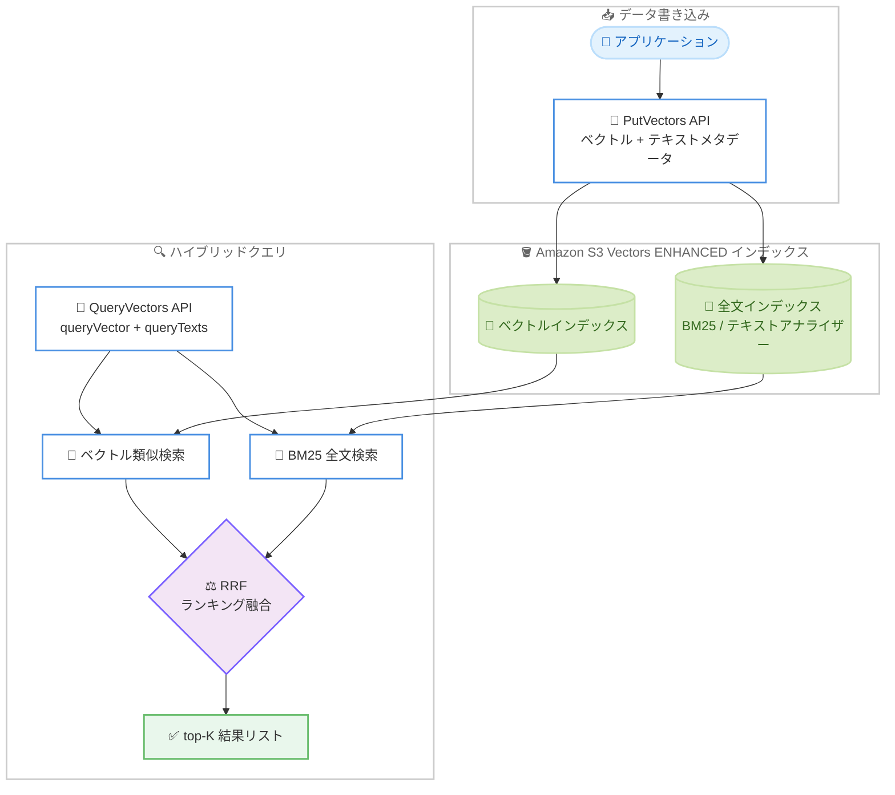

# Amazon S3 Vectors - ベクトル検索と全文検索を組み合わせたハイブリッド検索のサポート

**リリース日**: 2026 年 11 月 16 日
**サービス**: Amazon S3 (S3 Vectors)
**機能**: ハイブリッド検索 (ベクトル検索 + 全文検索)

📊 [このアップデートのインフォグラフィックを見る](https://takech9203.github.io/aws-news-summary/20261116-s3-vectors-hybrid-search.html)

## 概要

Amazon S3 Vectors が、ベクトル類似検索と全文検索を単一のクエリで組み合わせるハイブリッド検索をサポートしました。S3 Vectors は両方の検索を実行し、Reciprocal Rank Fusion (RRF) で 2 つのランキングを融合して、1 つのランク付けされた結果リストを返します。これにより、クエリの「意味」と「正確な用語」の両方を捉えた、より関連性の高い検索結果を得ることができます。

ベクトル検索は意味を捉えるのに優れていますが、製品コード、SKU、エラーコード、略語、法的引用、薬品名、ファイル名、固有名詞など、特定の用語に依存するクエリでは関連性の低い結果を返すことがありました。全文検索は BM25 (Best Matching 25) スコアリングを使用して用語の一致度で結果をランク付けするため、特定の用語を探すクエリにはより正確です。ハイブリッド検索は両者を組み合わせることで、RAG (検索拡張生成)、エージェントメモリ、検索アプリケーションなどにおける検索の関連性を向上させます。

S3 Vectors は、低頻度クエリでサブセカンドのレイテンシー、高頻度クエリで 100 ミリ秒以下程度のレイテンシーを維持しながら、既存の S3 Vectors API を通じてハイブリッド検索を利用できます。代替のベクトルソリューションと比較して、ベクトルの保存とクエリのコストを最大 90% 削減できるという S3 Vectors の経済性はそのまま活かされます。

**アップデート前の課題**

- S3 Vectors ではベクトル類似検索しか実行できず、エラーコードや製品 ID などの正確な用語一致を必要とするクエリで関連性の低い結果が返ることがあった
- キーワード一致による検索が必要な場合、Amazon OpenSearch Service などの別の検索エンジンを併用し、2 つのシステム間でデータを同期する必要があった
- ベクトル検索と全文検索の結果を組み合わせるには、アプリケーション側で独自のスコア正規化や融合ロジックを実装する必要があった

**アップデート後の改善**

- 単一の `QueryVectors` API 呼び出しで、クエリテキストとクエリベクトルを同時に送信し、RRF で融合された単一の top-K ランキングを取得できるようになった
- 検索対象のテキストをメタデータフィールドとして書き込むだけで、S3 Vectors が BM25 スコアリング用に自動的にインデックス化するようになった
- 既存のインデックスに格納済みのデータに対しても、その場で (in place) 全文検索を有効化できるようになった
- ベクトル検索のみ、全文検索のみ、ハイブリッドの 3 種類のクエリを同じインデックスに対して実行できるようになった

## アーキテクチャ図



`PutVectors` でベクトルと検索対象テキストを書き込むと、S3 Vectors が同一インデックス内に全文インデックスを自動構築します。`QueryVectors` にクエリベクトルとクエリテキストの両方を渡すと、ベクトル検索と BM25 全文検索が実行され、RRF で融合された単一のランキングが返されます。

## サービスアップデートの詳細

### 主要機能

1. **ハイブリッド検索 (RRF 融合)**
   - 単一の `QueryVectors` 呼び出しでクエリベクトルとクエリテキストの両方を指定可能
   - ベクトル検索と全文検索の結果を Reciprocal Rank Fusion (RRF) で融合し、単一の top-K ランキングを返却
   - `returnScores` を有効にすると、融合スコアと BM25 スコアの両方を取得可能

2. **BM25 スコアリングによる全文検索の自動インデックス化**
   - メタデータキーをインデックスの `textSearchConfigurations` に追加するだけで、S3 Vectors がそのフィールドを BM25 スコアリング用に自動インデックス化
   - 独自のトークナイゼーションや解析パイプラインの構築・運用は不要
   - クエリベクトルを省略すれば BM25 のみの全文検索も実行可能

3. **ビルトインのテキストアナライザー**
   - デフォルトは言語非依存の標準アナライザー。Unicode の単語境界でテキストを分割し、句読点の除去と小文字化を実施
   - オプションで言語指定のアナライザーを使用可能。ステミング (語幹処理) とストップワード除去により、その言語のコンテンツの検索関連性が向上
   - 英語、フランス語、スペイン語、ポルトガル語、イタリア語、ドイツ語、オランダ語、中国語、日本語、韓国語の 10 言語のアナライザーを提供

4. **既存データへの全文検索のインプレース有効化**
   - `UpdateMetadataConfiguration` API で既存インデックスのメタデータフィールドに全文検索を追加可能
   - バックグラウンドでバックフィル (既存データのインデックス構築) が実行され、`GetIndex` API でフィールドごとのステータス (`BUILDING` / `ACTIVE`) を追跡可能
   - バックフィル中も `PutVectors` によるデータ書き込みは継続可能

5. **複数テキストフィールドの同時検索**
   - 1 回のクエリリクエストで複数のクエリテキストとフィールドのペアを指定可能
   - フィールドごとに BM25 検索を実行し、フィールド別スコアを合算した全文スコアをベクトルランキングと RRF で融合
   - 独自の再ランキングを行いたい場合は、全文のみとベクトルのみのクエリを別々に実行してアプリケーション側で融合することも可能

## 技術仕様

### クエリタイプ

| クエリタイプ | 指定するパラメータ | ランキング方法 |
|------|------|------|
| ベクトルのみ | `queryVector` のみ | ベクトル距離 |
| 全文のみ | `queryTexts` のみ | BM25 スコア |
| ハイブリッド | `queryVector` + `queryTexts` | RRF による融合ランキング |

### 主要な仕様

| 項目 | 詳細 |
|------|------|
| 対応インデックスモード | `ENHANCED` インデックスのみ (`CLASSIC` は `UpdateIndexMode` で変換が必要) |
| スコアリング | BM25 (全文)、RRF (融合) |
| テキストアナライザー | 標準 (言語非依存、デフォルト) + 10 言語の言語別アナライザー |
| 検索対象データ型 | 文字列および文字列のリスト (非文字列値は保存されるが検索対象外) |
| レイテンシー | コールドクエリ: サブセカンド、ウォームクエリ: 100 ミリ秒以下程度 |
| バックフィル | 数分から数時間 (データ量に依存)。同時に実行できる `UpdateMetadataConfiguration` は 1 つ |
| 大きな検索専用フィールド | `nonFilterableMetadataKeys` に指定することでフィルター可能フィールドより大きなサイズ制限を適用可能 |

### 設定例: 全文検索フィールド付きインデックスの作成

```json
{
    "nonFilterableMetadataKeys": ["passage_body"],
    "textSearchConfigurations": [
        { "metadataKey": "title" },
        { "metadataKey": "passage_body", "language": "en" }
    ]
}
```

## 設定方法

### 前提条件

1. S3 Vectors のベクトルバケットが作成済みであること
2. 対象のベクトルインデックスが `ENHANCED` モードであること (`CLASSIC` の場合は `UpdateIndexMode` で変換)
3. AWS CLI または AWS SDK が最新バージョンであること

### 手順

#### ステップ 1: 全文検索フィールドを設定したインデックスを作成する

```bash
aws s3vectors create-index \
    --vector-bucket-name "amzn-s3-demo-vector-bucket" \
    --index-name "documents" \
    --data-type "float32" \
    --dimension 1024 \
    --distance-metric "cosine" \
    --metadata-configuration '{
        "nonFilterableMetadataKeys": ["passage_body"],
        "textSearchConfigurations": [
            { "metadataKey": "title" },
            { "metadataKey": "passage_body", "language": "en" }
        ]
    }'
```

`documents` という名前のベクトルインデックスを作成し、`title` フィールドに標準アナライザー、`passage_body` フィールドに英語アナライザーを指定して全文検索を有効化しています。大きなテキストを格納する `passage_body` は `nonFilterableMetadataKeys` に指定し、検索専用フィールドとしています。

#### ステップ 2: 既存インデックスに全文検索を有効化する (既存データがある場合)

```bash
aws s3vectors update-metadata-configuration \
    --vector-bucket-name "amzn-s3-demo-vector-bucket" \
    --index-name "documents" \
    --add '{
        "textSearchConfigurations": [
            { "metadataKey": "passage_body", "language": "en" }
        ]
    }'
```

既存のメタデータフィールドに対して全文検索を有効化しています。バックグラウンドでバックフィルが実行され、既存データが BM25 スコアリング用にインデックス化されます。ステータスは `aws s3vectors get-index` で確認でき、`ACTIVE` になると検索可能になります。

#### ステップ 3: ハイブリッドクエリを実行する

```python
import boto3

client = boto3.client("s3vectors")

response = client.query_vectors(
    vectorBucketName="amzn-s3-demo-vector-bucket",
    indexName="documents",
    topK=10,
    queryVector={"float32": query_embedding},
    queryTexts=[
        {"text": "controller error code E1234", "metadataKey": "passage_body"},
    ],
    returnMetadata=True,
    returnDistance=True,
    returnScores=True,
)
```

クエリベクトルとクエリテキストの両方を指定してハイブリッド検索を実行しています。S3 Vectors がベクトル検索と `passage_body` フィールドへの BM25 全文検索を実行し、RRF で融合した上位 10 件を、メタデータ、ベクトル距離、スコアとともに返します。

## メリット

### ビジネス面

- **検索品質の向上**: 意味的な一致と正確な用語一致の両方を捉えることで、RAG や検索アプリケーションの回答・検索品質が向上する
- **コスト削減**: 全文検索のために別の検索エンジンを運用する必要がなく、代替のベクトルソリューションと比較して保存とクエリのコストを最大 90% 削減できる S3 Vectors の経済性をそのまま活用できる
- **運用負荷の軽減**: マネージドなテキストアナライザーと自動インデックス化により、独自の解析パイプラインの構築・運用が不要になる

### 技術面

- **単一インデックス・単一 API**: 検索対象テキストがベクトルと同じインデックスに存在するため、すべてのクエリが単一のインデックスと既存の `QueryVectors` API で完結する
- **既存データへの適用が容易**: `UpdateMetadataConfiguration` によるインプレースの有効化とバックグラウンドバックフィルにより、データの再取り込みなしで全文検索を追加できる
- **柔軟なクエリ構成**: ベクトルのみ、全文のみ、ハイブリッドを使い分けられるほか、スコアを取得して独自の融合ロジックを実装することも可能

## デメリット・制約事項

### 制限事項

- 全文検索およびハイブリッド検索は `ENHANCED` インデックスのみ対応 (`CLASSIC` インデックスは事前の変換が必要)
- 一度設定した全文検索設定 (アナライザーなど) は変更不可。フィールドの追加・削除のみ可能
- `nonFilterableMetadataKeys` リストはインデックス作成後に変更不可
- バックフィル中 (`BUILDING` 状態) のフィールドを対象とする全文・ハイブリッドクエリは拒否される
- バックフィルの途中キャンセルは不可。実行中は他の `UpdateMetadataConfiguration` リクエストが `ConflictException` で拒否される
- 非文字列値は全文検索の対象外 (保存と取得は可能)

### 考慮すべき点

- 言語別アナライザーは 10 言語に限定される。言語が混在するデータには標準アナライザーの使用を検討する
- バックフィルはデータ量により数分から数時間かかるため、複数フィールドを有効化する場合は 1 回の `UpdateMetadataConfiguration` リクエストにまとめることが推奨される
- クエリテキストのサイズや 1 リクエストで検索可能なフィールド数には上限があるため、公式の制限事項ドキュメントを確認する
- 実際の検索性能 (リコール) はデータセットとクエリに依存するため、代表的なデータでの事前検証が推奨される

## ユースケース

### ユースケース 1: RAG における技術ドキュメント検索

**シナリオ**: 製品マニュアルやナレッジベースに対する RAG で、「コントローラーのエラーコード E1234 の対処方法」のように、意味的な文脈と正確なエラーコードの両方を含む質問に回答したい。

**実装例**:
```python
response = client.query_vectors(
    vectorBucketName="kb-vector-bucket",
    indexName="manuals",
    topK=10,
    queryVector={"float32": question_embedding},
    queryTexts=[{"text": "エラーコード E1234 対処", "metadataKey": "passage_body"}],
    returnMetadata=True,
)
```

**効果**: ベクトル検索だけでは埋もれがちなエラーコードの完全一致を BM25 が捕捉し、RAG の回答精度が向上する。

### ユースケース 2: AI エージェントのメモリ検索

**シナリオ**: AI エージェントが過去の対話履歴を、会話の意味的な内容とチケット番号や注文 ID などの正確な識別子の両方で想起する必要がある。

**実装例**:
```python
response = client.query_vectors(
    vectorBucketName="agent-memory-bucket",
    indexName="conversations",
    topK=5,
    queryVector={"float32": context_embedding},
    queryTexts=[{"text": "order ORD-98765", "metadataKey": "conversation_text"}],
    returnScores=True,
)
```

**効果**: 意味と識別子の両方のシグナルで過去の対話を検索でき、エージェントの文脈想起の精度が向上する。

### ユースケース 3: 商品カタログ・コンテンツ検索

**シナリオ**: EC サイトの商品カタログやメディアライブラリで、タイトル、説明、トランスクリプトなど複数のテキストフィールドを横断して、SKU などの正確な ID とコンセプトの両方で検索したい。

**実装例**:
```python
response = client.query_vectors(
    vectorBucketName="catalog-bucket",
    indexName="products",
    topK=20,
    queryVector={"float32": query_embedding},
    queryTexts=[
        {"text": "SKU-12345 waterproof jacket", "metadataKey": "description"},
        {"text": "outdoor jacket", "metadataKey": "title"},
    ],
    returnMetadata=True,
)
```

**効果**: 複数フィールドの BM25 スコアを合算してベクトルランキングと融合することで、ID 指定検索と探索的な検索の両方に単一のクエリで対応できる。

## 料金

S3 Vectors は保存容量とリクエストに基づく従量課金制です。代替のベクトルソリューションと比較して、ベクトルの保存とクエリのコストを最大 90% 削減できるように設計されています。全文検索・ハイブリッド検索の詳細な料金は、Amazon S3 の料金ページを参照してください。

## 利用可能リージョン

S3 Vectors が利用可能なすべての AWS 商用リージョン、および AWS 中国リージョンで利用可能です。

## 関連サービス・機能

- **Amazon Bedrock Knowledge Bases**: S3 Vectors をベクトルストアとして利用した RAG 構築。ハイブリッド検索による検索品質向上が期待できる
- **Amazon OpenSearch Service**: 高度な全文検索・分析機能を持つ検索サービス。高頻度・低レイテンシーが求められるワークロードでは引き続き有力な選択肢
- **Amazon S3 メタデータフィルタリング**: ハイブリッド検索とメタデータフィルターを組み合わせて検索対象を絞り込み可能

## 参考リンク

- 📊 [インフォグラフィック](https://takech9203.github.io/aws-news-summary/20261116-s3-vectors-hybrid-search.html)
- [公式発表 (What's New)](https://aws.amazon.com/about-aws/whats-new/2026/11/s3-vectors-hybrid-search/)
- [ドキュメント: Hybrid search with Amazon S3 Vectors](https://docs.aws.amazon.com/AmazonS3/latest/userguide/s3-vectors-hybrid-search.html)
- [ドキュメント: Configuring full-text search](https://docs.aws.amazon.com/AmazonS3/latest/userguide/s3-vectors-configuring-full-text-search.html)
- [ドキュメント: Querying with full-text and vector search](https://docs.aws.amazon.com/AmazonS3/latest/userguide/s3-vectors-querying-full-text-and-vector-search.html)
- [料金ページ](https://aws.amazon.com/s3/pricing/)

## まとめ

S3 Vectors のハイブリッド検索により、ベクトル検索の意味理解と BM25 全文検索の正確な用語一致を単一のクエリで両立できるようになりました。別の検索エンジンを併用することなく、RAG、エージェントメモリ、検索アプリケーションの検索関連性を低コストで向上できます。S3 Vectors を利用中、または RAG の検索品質に課題を感じている場合は、`ENHANCED` インデックスでの全文検索の有効化と、代表的なクエリセットでのハイブリッド検索の評価を推奨します。
