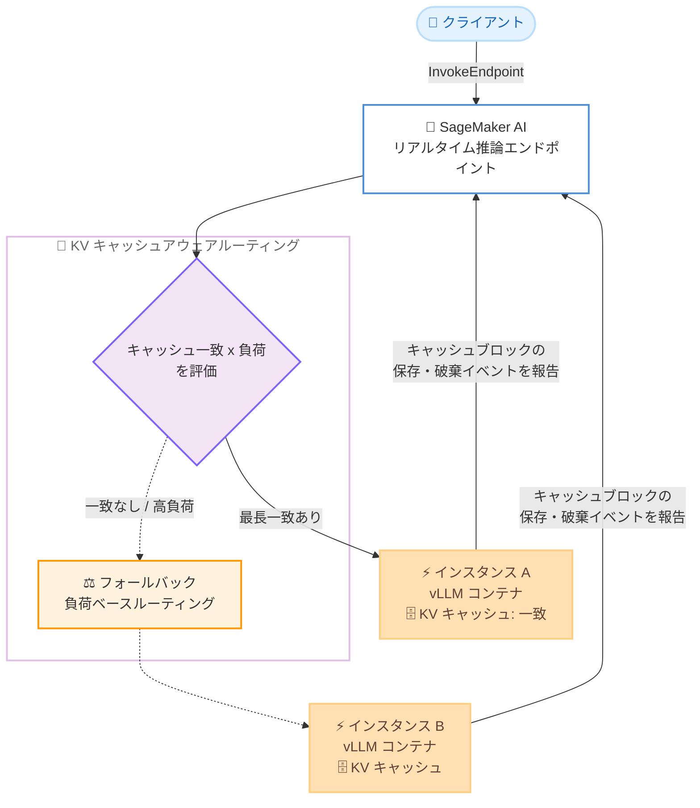

# Amazon SageMaker AI - リアルタイム推論エンドポイントの KV キャッシュアウェアルーティング

**リリース日**: 2026 年 11 月 16 日
**サービス**: Amazon SageMaker AI
**機能**: KV cache-aware routing for real-time inference endpoints

📊 [このアップデートのインフォグラフィックを見る](https://takech9203.github.io/aws-news-summary/20261116-sagemaker-kv-cache-routing.html)

## 概要

Amazon SageMaker AI のリアルタイム推論エンドポイントが、KV (Key-Value) キャッシュの状態に基づくリクエストルーティング (KV キャッシュアウェアルーティング) をサポートしました。各リクエストを、プロンプトの先頭部分と最も長く一致する KV キャッシュを保持しているインスタンスへルーティングすることで、長いプロンプトや繰り返しの多いプロンプトを扱う LLM ワークロードの TTFT (Time to First Token) を短縮できます。

vLLM などのサービングエンジンは、システムプロンプト、ドキュメント、チャット履歴といった繰り返し出現するプロンプトプレフィックスについて、計算済みの KV キャッシュを保存し、冗長な計算を回避します。本機能では、vLLM コンテナがどのキャッシュブロックを保存・破棄したかを SageMaker AI に報告し、SageMaker AI はそのライブビューをルーティング判断に利用します。キャッシュの照合に時間がかかる場合や一致が見つからない場合は、負荷ベースのルーティングに自動的にフォールバックするため、リクエストが滞留することはありません。

LLM をセルフホストしてチャットボット、RAG、エージェントなどのワークロードを運用するユーザーにとって、追加料金なしで推論レイテンシーと GPU メモリ効率を改善できるアップデートです。

**アップデート前の課題**

このアップデート以前は、以下の課題がありました。

- リクエストが該当する KV キャッシュを持たないインスタンスに到達すると、プロンプトプレフィックスの KV キャッシュを再計算する必要があり、TTFT が増大していた
- 負荷の高いインスタンスでは GPU メモリを確保するためにキャッシュブロックが破棄 (eviction) され、キャッシュヒット率が低下していた
- 既存のプレフィックスアウェアルーティングはプロンプトのハッシュに基づくスティッキーな割り当てであり、各インスタンスの実際のキャッシュ保持状況や負荷を考慮できなかった

**アップデート後の改善**

今回のアップデートにより、以下が可能になりました。

- 各リクエストを、プロンプトの先頭部分と最も長く一致するキャッシュを保持するインスタンスへルーティングし、プレフィックス再計算を回避できる
- キャッシュ一致の長さとインスタンスの負荷を加味した動的なルーティングにより、高負荷時や GPU メモリが限られる環境でも効率的に処理できる
- `RoutingStrategy` を `KV_AWARE` に設定し、環境変数を 1 つ追加するだけで有効化でき、呼び出し側は既存の API と OpenAI 互換ペイロードをそのまま利用できる

## アーキテクチャ図



vLLM コンテナが KV キャッシュブロックの保存・破棄イベントをエンドポイントに報告し、エンドポイントはプロンプト先頭部分の最長一致と各インスタンスの負荷を加味してルーティング先を決定します。一致が見つからない場合は負荷ベースのルーティングにフォールバックします。

## サービスアップデートの詳細

### 主要機能

1. **KV キャッシュ状態に基づく動的ルーティング**
   - 各リクエストを、プロンプトの先頭部分と最も長く一致する KV キャッシュを保持するインスタンスへルーティング
   - キャッシュ一致の長さと各インスタンスのビジー状態を重み付けして判断
   - 推論コンポーネントを使用するエンドポイントでは、呼び出された推論コンポーネントのコピー間で同様に選択

2. **キャッシュ状態のライブビュー**
   - vLLM コンテナが保存・破棄したキャッシュブロックを SageMaker AI に報告
   - エンドポイントはキャッシュの実態をリアルタイムに把握してルーティングに反映
   - オブザーバビリティメトリクスとして KV キャッシュヒット率を提供

3. **負荷ベースルーティングへの自動フォールバック**
   - キャッシュ照合が遅い場合や一致が見つからない場合は、`LEAST_OUTSTANDING_REQUESTS` と同様の負荷ベースルーティングで処理を継続
   - リクエストが確実に処理されることを保証

4. **シンプルな有効化と互換性**
   - プロダクションバリアントの `RoutingStrategy` を `KV_AWARE` に設定し、コンテナがキャッシュイベントを報告するための環境変数を 1 つ追加するだけで有効化
   - 呼び出しは既存の API と OpenAI 互換ペイロードをそのまま使用可能
   - LoRA アダプターを含む、単一モデルエンドポイントと推論コンポーネントの両方をサポート

## 技術仕様

### ルーティング戦略の比較

| ルーティング戦略 | 動作 | 適したケース |
|------|------|------|
| `LEAST_OUTSTANDING_REQUESTS` | 処理余力の大きいインスタンスにルーティング | 一般的なワークロード |
| `RANDOM` | ランダムに選択したインスタンスにルーティング | 均一な負荷分散 |
| `PREFIX_AWARE` | 同じプロンプトプレフィックスを共有するリクエストを同じインスタンス / コピーにルーティング | 安定した共有プロンプト、短いプロンプト、中程度の負荷 |
| `KV_AWARE` (新規) | プロンプト先頭部分の KV キャッシュ最長一致と負荷を加味してルーティング | 長いプロンプト、高負荷、限られた GPU メモリ |

### 利用要件

| 項目 | 詳細 |
|------|------|
| 対応エンドポイント | 単一モデルエンドポイントおよび推論コンポーネント (LoRA アダプター含む) |
| 対応インスタンス | GPU インスタンス |
| 必須コンテナ | AWS vLLM Deep Learning Container バージョン 0.33.0 以降 |
| 最小構成 | 2 つ以上のインスタンス、または 2 つ以上の推論コンポーネントコピー |
| メトリクス | KV キャッシュヒット率などのオブザーバビリティメトリクス |
| 呼び出し | 既存の InvokeEndpoint API、OpenAI 互換ペイロードに対応 |

### 設定例

```json
{
  "ProductionVariants": [
    {
      "VariantName": "AllTraffic",
      "ModelName": "my-llm-model",
      "InstanceType": "ml.g6.12xlarge",
      "InitialInstanceCount": 2,
      "RoutingConfig": {
        "RoutingStrategy": "KV_AWARE"
      }
    }
  ]
}
```

## 設定方法

### 前提条件

1. AWS vLLM Deep Learning Container バージョン 0.33.0 以降を使用したモデルであること
2. GPU インスタンスを使用し、2 つ以上のインスタンスまたは推論コンポーネントコピーを構成すること
3. 最新の AWS SDK または AWS CLI にアップデートしておくこと

### 手順

#### ステップ1: モデルの作成

```bash
aws sagemaker create-model \
  --model-name my-llm-model \
  --primary-container '{
    "Image": "<vLLM DLC 0.33.0 以降のイメージ URI>",
    "ModelDataUrl": "s3://my-bucket/model/",
    "Environment": {
      "<キャッシュイベント報告用の環境変数>": "<値>"
    }
  }' \
  --execution-role-arn arn:aws:iam::123456789012:role/SageMakerRole
```

vLLM DLC を使用するモデルを作成します。コンテナがキャッシュブロックの保存・破棄イベントを SageMaker AI に報告するための環境変数を 1 つ追加します (具体的な環境変数名は公式ドキュメントを参照してください)。

#### ステップ2: エンドポイント設定の作成

```bash
aws sagemaker create-endpoint-config \
  --endpoint-config-name my-llm-endpoint-config \
  --production-variants '[
    {
      "VariantName": "AllTraffic",
      "ModelName": "my-llm-model",
      "InstanceType": "ml.g6.12xlarge",
      "InitialInstanceCount": 2,
      "RoutingConfig": {
        "RoutingStrategy": "KV_AWARE"
      }
    }
  ]'
```

プロダクションバリアントの `RoutingConfig.RoutingStrategy` に `KV_AWARE` を指定してエンドポイント設定を作成します。KV キャッシュアウェアルーティングを機能させるため、インスタンス数は 2 以上を指定します。

#### ステップ3: エンドポイントの作成と呼び出し

```bash
aws sagemaker create-endpoint \
  --endpoint-name my-llm-endpoint \
  --endpoint-config-name my-llm-endpoint-config

aws sagemaker-runtime invoke-endpoint \
  --endpoint-name my-llm-endpoint \
  --content-type application/json \
  --body '{"messages": [{"role": "user", "content": "こんにちは"}]}' \
  output.json
```

エンドポイントを作成し、従来と同じ API で呼び出します。OpenAI 互換ペイロードもそのまま利用でき、呼び出し側のコード変更は不要です。

## メリット

### ビジネス面

- **応答性の向上によるユーザー体験改善**: TTFT の短縮により、チャットボットやエージェントアプリケーションの体感速度が向上する
- **追加コストなし**: 本機能の利用に追加料金は発生せず、既存のエンドポイント料金のまま性能を改善できる
- **インフラ効率の向上**: キャッシュの再計算を減らすことで、同じインスタンス数でより多くのリクエストを処理できる可能性がある

### 技術面

- **冗長なプレフィックス計算の削減**: 最長一致のキャッシュを持つインスタンスにルーティングすることで、プロンプトプレフィックスの再計算を回避できる
- **キャッシュ破棄の影響を考慮した動的判断**: コンテナからのキャッシュイベント報告に基づき、実際のキャッシュ保持状況を反映したルーティングが可能
- **フォールバックによる可用性確保**: 一致が見つからない場合も負荷ベースルーティングで処理が継続され、安全に導入できる
- **KV キャッシュヒット率の可視化**: メトリクスにより、ルーティング戦略の効果を定量的に評価できる

## デメリット・制約事項

### 制限事項

- AWS vLLM Deep Learning Container バージョン 0.33.0 以降が必要であり、他のサービングコンテナでは利用できない
- 2 つ以上のインスタンスまたは推論コンポーネントコピーが必要
- GPU インスタンスのみのサポート

### 考慮すべき点

- 安定した共有プロンプト、短いプロンプト、中程度の負荷のワークロードでは、既存のプレフィックスアウェアルーティング (`PREFIX_AWARE`) の方が適する場合がある
- KV キャッシュアウェアルーティングは、長いプロンプト、高負荷、限られた GPU メモリという条件で最も効果を発揮する
- 効果の検証には KV キャッシュヒット率などのメトリクスを確認し、ワークロードに応じて戦略を選択することが推奨される

## ユースケース

### ユースケース1: 長いシステムプロンプトを共有するチャットボット

**シナリオ**: 数千トークンのシステムプロンプトと会話履歴を含むマルチターンチャットを、セルフホストした LLM で提供している。ターンごとにプレフィックスが再計算され、応答開始が遅い。

**実装例**:
```json
{
  "RoutingConfig": { "RoutingStrategy": "KV_AWARE" }
}
```

**効果**: 同一会話の後続リクエストが、その会話のキャッシュを保持するインスタンスへルーティングされ、TTFT が短縮される。

### ユースケース2: RAG アプリケーションでの長文ドキュメント処理

**シナリオ**: 同じドキュメントセットをコンテキストとして複数の質問に回答する RAG アプリケーションで、ドキュメント部分のプレフィックス計算が繰り返し発生している。

**実装例**:
```json
{
  "VariantName": "AllTraffic",
  "InstanceType": "ml.g6.12xlarge",
  "InitialInstanceCount": 4,
  "RoutingConfig": { "RoutingStrategy": "KV_AWARE" }
}
```

**効果**: 同一ドキュメントを参照するリクエストがキャッシュ保持インスタンスに集約され、GPU の計算リソースを生成処理に集中できる。

### ユースケース3: LoRA アダプターを多数ホストする推論コンポーネント構成

**シナリオ**: 推論コンポーネントで複数の LoRA アダプターをホストし、高負荷かつ GPU メモリが逼迫した状態で運用している。キャッシュ破棄が頻発し、ヒット率が安定しない。

**実装例**:
```
推論コンポーネントのコピーを 2 以上に設定し、
エンドポイント設定で RoutingStrategy を KV_AWARE に変更。
KV キャッシュヒット率メトリクスでヒット率を監視。
```

**効果**: キャッシュの保存・破棄状況と負荷をリアルタイムに考慮したルーティングにより、高負荷・限られた GPU メモリの条件下でもキャッシュヒット率を維持しやすくなる。

## 料金

KV キャッシュアウェアルーティングの利用に追加料金はかかりません。SageMaker AI リアルタイム推論エンドポイントの通常のインスタンス料金のみが発生します。

## 利用可能リージョン

Amazon SageMaker AI が提供されているすべての AWS リージョンで利用可能です。

## 関連サービス・機能

- **Amazon SageMaker AI リアルタイム推論**: 本機能が適用されるホスティング形態。プロダクションバリアントのルーティング設定として提供される
- **SageMaker AI 推論コンポーネント**: 推論コンポーネントのコピー間でも KV キャッシュアウェアルーティングが機能し、LoRA アダプターもサポートされる
- **AWS vLLM Deep Learning Container**: 本機能の前提となるサービングコンテナ。バージョン 0.33.0 以降でキャッシュイベントの報告に対応
- **プレフィックスアウェアルーティング (`PREFIX_AWARE`)**: 既存のルーティング戦略。安定した共有プロンプトや中程度の負荷に適しており、ワークロードに応じて使い分ける

## 参考リンク

- 📊 [インフォグラフィック](https://takech9203.github.io/aws-news-summary/20261116-sagemaker-kv-cache-routing.html)
- [公式発表 (What's New)](https://aws.amazon.com/about-aws/whats-new/2026/11/sagemaker-kv-cache-routing/)
- [API リファレンス: ProductionVariantRoutingConfig](https://docs.aws.amazon.com/sagemaker/latest/APIReference/API_ProductionVariantRoutingConfig.html)
- [Amazon SageMaker AI 推論 (デプロイ)](https://aws.amazon.com/sagemaker/ai/deploy/)
- [Amazon SageMaker AI 料金ページ](https://aws.amazon.com/sagemaker/pricing/)

## まとめ

KV キャッシュアウェアルーティングにより、SageMaker AI 上のセルフホスト LLM で、長いプロンプトや高負荷のワークロードにおける TTFT を追加料金なしで短縮できるようになりました。vLLM DLC 0.33.0 以降と 2 つ以上のインスタンスという要件を満たす環境であれば、`RoutingStrategy` を `KV_AWARE` に変更するだけで導入できるため、チャットボット、RAG、エージェントなどの LLM ワークロードを運用しているユーザーは、KV キャッシュヒット率メトリクスを確認しながら効果を検証することを推奨します。
