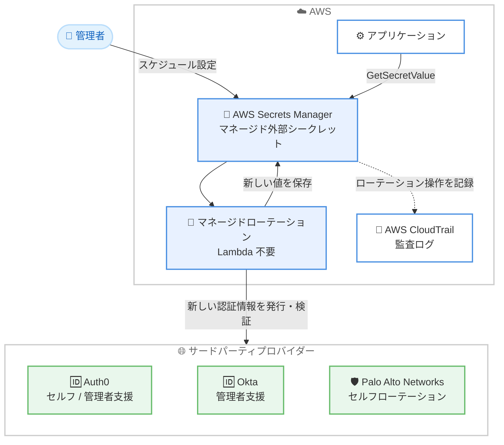

# AWS Secrets Manager - Auth0、Okta、Palo Alto Networks のマネージド外部シークレット対応

**リリース日**: 2026 年 11 月 16 日
**サービス**: AWS Secrets Manager
**機能**: Managed External Secrets (マネージド外部シークレット) の対応プロバイダー追加

📊 [このアップデートのインフォグラフィックを見る](https://takech9203.github.io/aws-news-summary/20261116-secrets-manager-managed-external-secrets-auth0-okta-palo-alto.html)

## 概要

AWS Secrets Manager のマネージド外部シークレット機能が、新たに Auth0、Okta、Palo Alto Networks の 3 つのサードパーティプロバイダーに対応しました。マネージド外部シークレットは、サードパーティの認証情報 (API キー、OAuth トークン、クレデンシャルペアなど) を Secrets Manager に保存し、カスタムのローテーション用 Lambda 関数を作成することなく自動ローテーションできる機能です。

AWS マネジメントコンソールまたは API からローテーションスケジュールを設定するだけで、Secrets Manager がローテーションと保存を代行します。Secrets Manager から認証情報を取得しているアプリケーションは、コード変更や再デプロイなしでローテーション後の値を自動的に受け取ることができます。長期間ローテーションされない認証情報は、漏えい時に不正アクセスのリスクを高めるため、ID 管理 (Auth0、Okta) やネットワークセキュリティ (Palo Alto Networks) といった重要な外部サービスの認証情報を扱う組織にとって価値のあるアップデートです。

今回の 3 プロバイダーは、既にサポートされている BigID、Cisco Security Platform、Confluent Cloud、Databricks、Datadog、GitLab、Jenkins、MongoDB Atlas、Netskope、Paddle、Salesforce、Snowflake、SonarQube、Twilio に追加される形となります。

**アップデート前の課題**

- Auth0、Okta、Palo Alto Networks の認証情報をローテーションするには、各サービスの API 仕様に合わせたカスタムのローテーション用 Lambda 関数を独自に開発・保守する必要があった
- ローテーション用 Lambda 関数はアプリケーションごとに固有であり、継続的なメンテナンスの負担が発生していた
- ローテーションが行われない長期間有効な認証情報は、漏えい時の不正アクセスリスクを増大させていた

**アップデート後の改善**

- Auth0、Okta、Palo Alto Networks の認証情報を、Lambda 関数なしで自動ローテーションできるようになった
- コンソールまたは API でローテーションスケジュールを設定するだけで、Secrets Manager がローテーション処理を代行するようになった
- Secrets Manager から認証情報を取得している既存アプリケーションは、コード変更や再デプロイなしでローテーション後の値を利用できる

## アーキテクチャ図



Secrets Manager がカスタム Lambda 関数なしで各プロバイダーの認証情報を自動ローテーションし、アプリケーションは従来どおり GetSecretValue で最新の値を取得する流れを示しています。

## サービスアップデートの詳細

### 主要機能

1. **Auth0 対応**
   - セルフローテーションと管理者支援ローテーションの両方をサポート
   - セルフローテーションでは、対象アプリケーション自身が自分のシークレットを置き換える
   - 管理者支援ローテーションでは、Management API 権限を持つ別の Auth0 アプリケーションが対象アプリケーションのシークレットを置き換える

2. **Okta 対応**
   - 別途用意した管理者用 JWT キーを使用する管理者支援ローテーションをサポート
   - 新しいシークレットを検証してから古いシークレットを無効化するため、ローテーション中のサービス断を防止できる

3. **Palo Alto Networks 対応**
   - 現在の API キーが自身の置き換えを承認するセルフローテーションをサポート
   - 追加の管理者クレデンシャルを用意する必要がない

4. **Lambda 不要のマネージドローテーション**
   - カスタムローテーション関数の作成・管理のオーバーヘッドを排除
   - マネージド外部シークレットの作成時に、コンソールではローテーションがデフォルトで有効化される
   - アカウント内に Lambda 関数はデプロイされない

5. **事前定義されたシークレット形式と完全な監査性**
   - 各パートナーが定義する形式でシークレットを保存し、ローテーションに必要なメタデータを含む
   - すべてのローテーション操作、シークレット値の更新、管理操作が AWS CloudTrail に記録される

## 技術仕様

### プロバイダーごとのローテーション方式

| プロバイダー | ローテーション方式 | 仕組み |
|------|------|------|
| Auth0 | セルフローテーション / 管理者支援 | 対象アプリケーション自身、または Management API 権限を持つ別の Auth0 アプリケーションがシークレットを置き換える |
| Okta | 管理者支援 | 別の管理者用 JWT キーでローテーションを実行し、新しいシークレットの検証後に古いシークレットを無効化する |
| Palo Alto Networks | セルフローテーション | 現在の API キーが新しいキーへの置き換えを承認する |

### マネージド外部シークレットの特徴

| 項目 | 詳細 |
|------|------|
| シークレットタイプ | マネージド外部シークレット (Managed External Secrets) |
| ローテーション実装 | Secrets Manager によるマネージドローテーション、Lambda 関数不要 |
| 設定方法 | AWS マネジメントコンソールまたは API でスケジュールを設定 |
| アプリケーション側の対応 | 不要。既存の GetSecretValue 呼び出しでローテーション後の値を取得 |
| 監査 | AWS CloudTrail によるローテーション・更新・管理操作の記録 |
| その他の機能 | きめ細かなアクセス許可管理、可観測性、ガバナンス、コンプライアンス、災害対策、モニタリング |

## 設定方法

### 前提条件

1. AWS アカウントと Secrets Manager へのアクセス権限
2. 対象プロバイダー (Auth0、Okta、Palo Alto Networks) のアカウントと認証情報
3. 管理者支援ローテーションを使用する場合は、ローテーション用の管理者権限を持つ認証情報 (Auth0 の Management API 権限付きアプリケーション、Okta の管理者用 JWT キーなど)

### 手順

#### ステップ 1: マネージド外部シークレットの作成

```bash
# コンソールの場合: Secrets Manager コンソールで「新しいシークレットを保存」を選択し、
# シークレットタイプとして対象プロバイダー (Auth0 / Okta / Palo Alto Networks) を選択する
# プロバイダーごとに事前定義された形式に沿って認証情報を入力する
```

Secrets Manager コンソールで新しいシークレットを作成し、プロバイダーが定義する形式で認証情報を保存します。コンソールで作成した場合、ローテーションはデフォルトで有効化されます。

#### ステップ 2: ローテーションスケジュールの設定

```bash
# ローテーションスケジュールを設定 (例: 30 日ごと)
aws secretsmanager rotate-secret \
  --secret-id MyAuth0Secret \
  --rotation-rules '{"ScheduleExpression": "rate(30 days)"}'
```

ローテーションスケジュールを設定します。Lambda 関数の ARN を指定する必要はなく、Secrets Manager がマネージドローテーションを実行します。設定の詳細は公式ドキュメントの手順を参照してください。

#### ステップ 3: アプリケーションからのシークレット取得

```bash
# アプリケーションからシークレットを取得
aws secretsmanager get-secret-value --secret-id MyAuth0Secret
```

アプリケーションは従来どおり GetSecretValue でシークレットを取得します。ローテーション後も同じ呼び出しで最新の値が返されるため、コード変更や再デプロイは不要です。

## メリット

### ビジネス面

- **セキュリティリスクの低減**: 長期間有効な認証情報を定期的に自動ローテーションすることで、漏えい時の不正アクセスリスクを低減できる
- **運用コストの削減**: カスタムローテーション関数の開発・保守が不要になり、運用負担とコストを削減できる
- **コンプライアンス対応の強化**: CloudTrail による完全な監査証跡と定期的なローテーションにより、認証情報管理に関するコンプライアンス要件に対応しやすくなる

### 技術面

- **Lambda 関数の管理が不要**: ローテーション用 Lambda 関数のコード、ランタイム更新、ネットワーク設定などの管理から解放される
- **アプリケーション変更が不要**: Secrets Manager から認証情報を取得している既存アプリケーションは、コード変更や再デプロイなしでローテーション後の値を受け取れる
- **安全なローテーションフロー**: Okta では新しいシークレットの検証後に古いシークレットを無効化するなど、プロバイダーごとに安全なローテーション方式が実装されている

## デメリット・制約事項

### 制限事項

- 対応プロバイダーは Secrets Manager にオンボードされたパートナーに限定される (今回の 3 社を含め、Salesforce、Datadog、GitLab など)
- シークレットは各パートナーが定義する事前定義形式で保存する必要がある
- プロバイダーごとにサポートされるローテーション方式が異なる (Okta は管理者支援のみ、Palo Alto Networks はセルフローテーションのみ)

### 考慮すべき点

- 管理者支援ローテーションを使用する場合、ローテーション用の管理者クレデンシャル (Auth0 の Management API 権限付きアプリケーション、Okta の管理者用 JWT キー) を別途用意し、安全に管理する必要がある
- 既にカスタム Lambda 関数でこれらのプロバイダーの認証情報をローテーションしている場合は、マネージド外部シークレットへの移行計画を検討する必要がある
- 利用可能リージョンはマネージド外部シークレットがサポートされているリージョンに限られるため、事前に対象リージョンでの提供状況を確認する必要がある

## ユースケース

### ユースケース 1: Auth0 を利用した顧客向けアプリケーションの認証情報管理

**シナリオ**: 顧客向け Web アプリケーションで Auth0 を ID プロバイダーとして利用しており、Auth0 アプリケーションのクライアントシークレットを定期的にローテーションしたい。

**実装例**:
```
1. Auth0 のクライアントシークレットをマネージド外部シークレットとして Secrets Manager に保存
2. セルフローテーションまたは Management API 権限を持つ別アプリケーションによる管理者支援ローテーションを選択
3. 30 日ごとのローテーションスケジュールを設定
```

**効果**: Lambda 関数を開発することなくクライアントシークレットが自動ローテーションされ、アプリケーションは再デプロイなしで新しい値を利用できる。

### ユースケース 2: Okta API トークンの安全なローテーション

**シナリオ**: 社内の自動化システムが Okta API を利用してユーザープロビジョニングを行っており、API 認証情報のローテーション時にサービス断を発生させたくない。

**実装例**:
```
1. Okta の認証情報をマネージド外部シークレットとして保存
2. 管理者用 JWT キーを使用した管理者支援ローテーションを構成
3. ローテーションスケジュールを設定
```

**効果**: 新しいシークレットが検証されてから古いシークレットが無効化されるため、ローテーション中もプロビジョニング処理が中断しない。

### ユースケース 3: Palo Alto Networks API キーの自動更新

**シナリオ**: セキュリティ運用チームが Palo Alto Networks の API を利用してファイアウォールポリシーを自動管理しており、API キーの手動更新に運用負担を感じている。

**実装例**:
```
1. Palo Alto Networks の API キーをマネージド外部シークレットとして保存
2. 現在の API キーが置き換えを承認するセルフローテーションを有効化
3. 自動化ツールは GetSecretValue で常に最新の API キーを取得
```

**効果**: API キーの手動更新作業が不要になり、キーの定期ローテーションによりセキュリティ体制が向上する。

## 料金

マネージド外部シークレットには Secrets Manager の標準料金が適用されます。シークレット 1 件あたりの月額料金と API コール数に応じた料金が発生します。ローテーションに Lambda 関数を使用しないため、ローテーション用 Lambda 関数の実行料金や保守コストは発生しません。

最新の料金は [AWS Secrets Manager 料金ページ](https://aws.amazon.com/secrets-manager/pricing/) を確認してください。

## 利用可能リージョン

Secrets Manager のマネージド外部シークレットがサポートされているすべての AWS リージョンで利用可能です。対象リージョンの詳細は公式ドキュメントを確認してください。

## 関連サービス・機能

- **AWS Lambda**: 従来のカスタムローテーションではローテーション用 Lambda 関数が必要だったが、マネージド外部シークレットでは不要になる
- **AWS CloudTrail**: すべてのローテーション操作、シークレット値の更新、管理操作が記録され、監査に利用できる
- **AWS IAM**: きめ細かなアクセス許可管理により、シークレットへのアクセスを制御できる

## 参考リンク

- 📊 [インフォグラフィック](https://takech9203.github.io/aws-news-summary/20261116-secrets-manager-managed-external-secrets-auth0-okta-palo-alto.html)
- [公式発表 (What's New)](https://aws.amazon.com/about-aws/whats-new/2026/11/secrets-manager-managed-external-secrets-auth0-okta-palo-alto/)
- [ドキュメント: Managed External Secrets](https://docs.aws.amazon.com/secretsmanager/latest/userguide/managed-external-secrets.html)
- [料金ページ](https://aws.amazon.com/secrets-manager/pricing/)

## まとめ

AWS Secrets Manager のマネージド外部シークレットが Auth0、Okta、Palo Alto Networks に対応し、ID 管理やネットワークセキュリティ製品の認証情報を Lambda 関数なしで自動ローテーションできるようになりました。これらのプロバイダーの認証情報をカスタム Lambda 関数でローテーションしている、または手動で管理している場合は、マネージド外部シークレットへの移行を検討することを推奨します。
